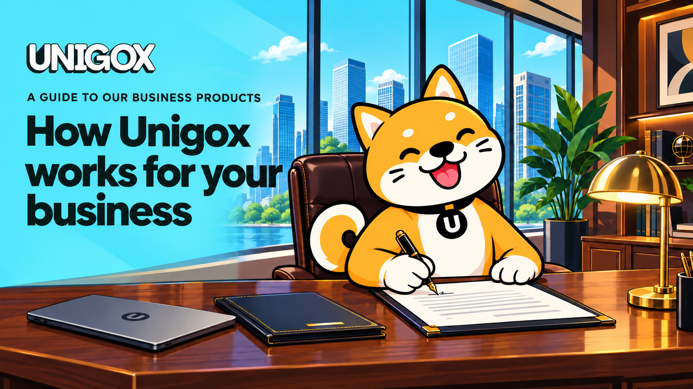

# How Unigox works for your business

Receive international payments, pay suppliers and move between local currencies and stablecoins. Build accounts, payments or trading into your own product. Earn from your website’s audience or the business clients you already know.

Unigox gives you several ways to serve your customers and grow your business. Choose the services that fit what you do today, and combine them as your needs grow.

<figure><figcaption></figcaption></figure>

## Receive payments through accounts in your company’s name

[Business accounts in Europe](https://www.unigox.com/european-business-accounts) give your company EUR, GBP and USD accounts in its own name. Receive payments from international customers, pay suppliers in EUR or GBP and manage your accounts through the Business Portal. Your finance team can download statements and keep track of the money coming in and going out. Companies registered outside Europe can apply too; eligibility depends on the country and business activity.

You can also make accounts part of your own service. Issue accounts in your business clients’ legal names or your individual customers’ names, so they can receive bank transfers through your product. Earn from those account services and automate the same operations available in the portal through the API. Account issuance is arranged separately, with verification for your business and each account holder.

## Convert larger amounts between fiat and stablecoins

If your revenue arrives in stablecoins but your expenses are in euros or pounds, the [OTC desk](https://www.unigox.com/otc-desk) handles the conversion for you. It works in both directions: sell stablecoins for EUR or GBP to cover business costs, or buy stablecoins to pay partners.

You agree the amount, exchange rate, fees and settlement details with our team before sending funds. We carry out the trade and send the proceeds to the agreed account or wallet. Confirmed deals appear in your Business Portal for your finance team to reference. OTC desks can also arrange settlement for their clients, with the paying business verified and the payment reviewed before funds are sent.

## Add local deposits and withdrawals to your app

[Payments API](https://www.unigox.com/payments-api) lets customers move money into and out of your product using bank transfers and mobile money. A customer pays in local currency to fund their balance; your business receives stablecoins. For a withdrawal, your business funds the payment in stablecoins and the customer receives local currency in their bank account or mobile wallet.

You control the customer experience and can add your own fee. Customers use familiar local payment methods to fund their balance or cash out, all through your app.

**Keep your existing non-custodial wallet infrastructure.** If you run a wallet, neobank or DeFi app, connect Payments API without migrating users’ wallets or replacing your wallet provider. Add fiat deposits and withdrawals to the product you already have.

## Accept crypto payments your way

[Crypto processing](https://www.unigox.com/crypto-processing) lets customers pay your business in stablecoins from their wallet or exchange. Integrate our API into your website or app, or use ready-made tools from Unigox to accept payments. Each payment is linked to the right invoice or customer, saving your team the work of matching transfers by hand.

Use it for customer purchases, invoices or balance top-ups. Keep the proceeds in stablecoins, send them to your wallet, or convert and withdraw to your bank account in a supported currency.

## Turn your website’s crypto audience into revenue

If your visitors already come to you to learn about crypto or find ways to buy and sell it, the [crypto widget](https://www.unigox.com/crypto-widget) lets them take that next step on your website. Embed ready-made buying and selling screens alongside your content, without building a trading interface or a customer verification flow.

You earn **20% of Unigox’s trading fee** on completed buys and sells through your widget. On sell trades, you can add your own markup and adjust it in your partner dashboard. The dashboard also shows orders, statuses, completed volume and markup earned, so you can see how the widget is performing.

Withdraw your earnings in crypto to your own wallet, or convert them to local currency using a payment method available in your country.

## Build trading into your product

[Trade API](https://www.unigox.com/trade-api) brings tokenized stocks, ETFs and meme coins into wallets, neobanks and trading apps. Users can buy assets on supported networks with the stablecoins they already hold, without separately bridging funds, buying a gas token or creating another wallet. Purchased assets arrive at their existing address.

Your team builds the trading experience; Unigox handles the blockchain execution. Asset discovery and trending data help you show customers what they can trade, while order updates let your app follow each transaction. You earn revenue from trades, and Unigox-funded trading competitions can help engage your users where local rules allow. Explore the product page to request access.

## Launch a money app under your own brand

[NeoBank-as-a-Service](https://www.unigox.com/neobank-as-a-service) is for teams that want a complete branded app. It combines local payments, a non-custodial crypto wallet and swaps with customer identity checks and transaction monitoring. Unigox builds the mobile app, supports the App Store submission and provides the payment infrastructure and operational support.

You bring your brand, audience and business model. We agree the markets, services and launch scope with you. This reduces the work of assembling a wallet, payment connections and verification systems from separate providers. If your business already has its own regulatory licence and compliance team, a technology licence is also available.

## Pay suppliers in China

For importers and businesses buying from China, [Pay suppliers in China](https://www.unigox.com/pay-china) helps you find a payment route for your supplier’s invoice. Choose your country, enter the amount the supplier should receive in CNY and see the available methods and estimated cost. Funding options depend on your country and account, and can include local payments or stablecoins.

If your supplier invoices in USD, choose the destination shown in their bank details, whether that is mainland China, Hong Kong or Singapore. You can check the relevant route before arranging payment.

## Turn your business network into recurring revenue

Your existing contacts could be your next source of income. With [Business referrals](https://www.unigox.com/sourcers), offer companies you know accounts, local payments, crypto processing or OTC conversions. A broad product range gives you more ways to help each client. Earn **up to 20% of the revenue Unigox earns** from those clients, for as long as they use the services covered by your partnership.

Bringing a client is straightforward: share your personal application link, then follow their verification, services and activity in your Business Portal. We handle the business review and service setup. Your revenue share and payment terms are agreed before you start.

## Start with what your business needs to do

You can combine products around the way your business works. A wallet can accept stablecoin top-ups through crypto processing and add local withdrawals through Payments API. An international company can receive customer payments into named accounts and use the OTC desk for larger conversions. A fintech can offer accounts to customers alongside local payment services.

[**Book a call**](https://calendly.com/hazem-unigox/30min) to discuss your customers, markets and payment needs. We’ll help you choose the right products, confirm availability and agree pricing and setup.
