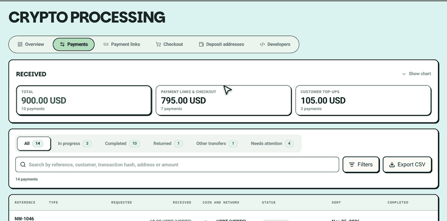

# Crypto processing: confirm payments on your server

> **Not available yet.** This page describes crypto processing ahead of its release. Until this notice is gone, `https://www.unigox.com/checkout.js`, the help pages and the link check it names can answer 404. Once released, crypto processing is in early access, turned on per business.

> **Crypto processing guide:** [Get started](https://developers.unigox.com/tutorials/crypto-checkout) · [Website checkout](https://developers.unigox.com/tutorials/crypto-checkout-embed) · **Confirm payments** · [Links from your server](https://developers.unigox.com/tutorials/crypto-checkout-links) · [Test and go live](https://developers.unigox.com/tutorials/crypto-checkout-testing) · [Reference](https://developers.unigox.com/tutorials/crypto-checkout-reference)

Fulfil an order only after your server has checked with Unigox that the payment reached your wallet. A message from the checkout, the customer's return to your site and a screenshot from the customer are not proof: each can be faked.

This page says "reference" for the text that names your order, "address ID" for the number of the payment address reserved for it, and "fingerprint" for the hash of the reference. In the API and in the code they are `memo`, `memoLockId` (or `lockId`) and `memoHash` ([Words this guide uses](https://developers.unigox.com/tutorials/crypto-checkout-reference#words-this-guide-uses)).

## Choose how to check

| Way | You need | It finds |
| --- | --- | --- |
| [Check the transfers your page reports](#check-the-transfers-your-page-reports) | Three values kept with the order: its reference, its address IDs and your wallet address. Nothing secret. | The transfers the checkout told your page about |
| [Read your payment history](#read-your-payment-history) | Your wallet's private key | Every payment to the order's addresses, also the ones made while no page was open |
| Look in the portal | Nothing | Every payment, in **Payments**: for checking by hand |

Unigox does not send payment notifications (webhooks) to your server yet. Run your check in two places: when the customer returns to your site, and in a job that goes over every open order every few minutes.

## Check the transfers your page reports

Anyone can read the status of a transfer with `GET /transaction/{chainId}/{txHash}`: it needs no key and no signature. The status says which payment address the transfer went to (the address ID), which reference it was recorded under (the fingerprint), and whether it was credited to your wallet. Your server reads the status of each transfer your page reports, and counts a transfer only when all three match the order.

1. **Keep three values with the order:** its reference, its address IDs and your wallet address. A link your server made has them already. For a link made in the portal, open **Checkout**, pick a way, and paste the link under **2. Choose an order**: **Payment link details** shows all three.
2. **Post the transfers from your page.** Send `payload.payments` from `onStatusChange` and `onComplete` (or from your own frame's messages) to your server. Each entry has `chainId`, `txHash`, `logIndex` and `quoteId`.
3. **Check them on your server** with `verifyTransfers()` below. It reads each reported transfer from Unigox and keeps only the transfers that were credited to your wallet under this order's reference and addresses.
4. **Mark the order paid once.** In one database transaction: record each transfer's `quoteId` so that it counts once, add its amount to the order, and mark the order paid when `isPaid()` returns true.

The status of one transfer looks like this (shortened). `verifyTransfers()` reads these fields:

- `memoLockId`: the address ID;
- `memoHash`: the fingerprint;
- `recipientAddress`: your wallet;
- `toChain`: `660279` marks a credit to a Unigox wallet;
- `status`, `subStatus` and `refund`: whether the transfer was credited;
- `actualToAmount`: the amount credited, in the coin's smallest units.

```json
{
  "status": "found",
  "code": 200,
  "data": {
    "quoteId": "<transfer ID>",
    "fromChain": "42161",
    "fromTx": "0x5f2c…9a41",
    "fromToken": "0xaf88d065e77c8cc2239327c5edb3a432268e5831",
    "fromAmount": "250000000",
    "toChain": "660279",
    "toToken": "<the coin's address on UNIGOX_BALANCE_CHAIN_ID, from GET /config>",
    "toAmount": "250000000",
    "actualToAmount": "250000000",
    "recipientAddress": "<your wallet address>",
    "toTx": "0x81d0…c3e7",
    "status": "DONE",
    "subStatus": "COMPLETED",
    "refund": null,
    "memo": null,
    "memoLockId": "27",
    "memoHash": "<keccak256 of the link's reference text>",
    "depositAddress": "<the link's payment address>"
  }
}
```

```js
// Node 18+ with viem (for keccak256). No key and no signature: every read is the public GET /transaction.
import { keccak256, toBytes } from "viem";

const UNIGOX_PAYMENTS_API = process.env.UNIGOX_PAYMENTS_API; // the API address on the Developers page
const UNIGOX_BALANCE_CHAIN_ID = 660279;                    // fixed: marks a payment credited to your Unigox wallet; copy as is

// One read of the Unigox payments API, at most 10 seconds: its JSON when the answer is ok and its status is `want`, else an error.
async function unigoxGet(path, want) {
  const response = await fetch(`${UNIGOX_PAYMENTS_API}${path}`, { cache: "no-store", signal: AbortSignal.timeout(10_000) });
  const body = await response.json().catch(() => null);
  if (!response.ok || body?.status !== want) throw new Error(`Unigox ${path}: HTTP ${response.status}, ${body?.status ?? "no JSON"}`);
  return body;
}

// Credited, the way the checkout reads it: DONE and completed, nothing refunded.
const settled = (tx) => tx.status === "DONE" && (tx.subStatus === "COMPLETED" || (!tx.subStatus && tx.toTx)) && !tx.refund;

// order: your own record of the link, e.g. { wallet: "0x…", memo: "NW-20418 · 250.00 USD · v2", lockIds: ["27", "28"],
//   amount: "250.00", tolerance: "default" }. reported: the `payments` your page received; never trusted, each one is
//   read again here. Returns [{ id, micros, fromTxMinedAt }]; the timestamp comes from Unigox, never the browser.
export async function verifyTransfers(order, reported) {
  // One transaction can hold several transfers. quoteId or logIndex names one of them exactly. A hash alone reads the
  // first transfer of that transaction: it is counted only when it is this link's credit, and can miss the others.
  const hints = (Array.isArray(reported) ? reported : []).slice(0, 200);
  const memoHash = keccak256(toBytes(order.memo));
  const config = await unigoxGet("/config", "fetched");
  const settlement = config.data.find((c) => Number(c.chainId) === UNIGOX_BALANCE_CHAIN_ID)?.tokens.filter((t) => !t.native && /^USD/.test(t.symbol)) ?? [];
  const credits = new Map();
  for (const p of hints) {
    if (!Number.isSafeInteger(p?.chainId) || typeof p.txHash !== "string" || !/^[\w-]{8,128}$/.test(p.txHash)) continue;
    const pick = typeof p.quoteId === "string" && p.quoteId.length > 0 ? `?quoteId=${encodeURIComponent(p.quoteId)}`
      : /^\d+$/.test(typeof p.logIndex === "number" ? String(p.logIndex) : typeof p.logIndex === "string" ? p.logIndex : "") ? `?logIndex=${p.logIndex}` : "";
    let tx;
    try {
      tx = (await unigoxGet(`/transaction/${p.chainId}/${encodeURIComponent(p.txHash)}${pick}`, "found")).data;
    } catch {
      continue;                                            // not indexed yet, or Unigox cannot be read: ask again later
    }
    if (!order.lockIds.includes(String(tx.memoLockId))) continue;                    // one of this link's address IDs
    if (tx.memoHash?.toLowerCase() !== memoHash) continue;                            // under this link's memo
    if (tx.recipientAddress?.toLowerCase() !== order.wallet.toLowerCase()) continue;  // credited to your wallet
    if (Number(tx.toChain) !== UNIGOX_BALANCE_CHAIN_ID || !settled(tx)) continue;
    const token = settlement.find((t) => t.address.toLowerCase() === tx.toToken?.toLowerCase());
    if (!token) continue;
    // Amounts are integer strings in base units: to micro-USD with the token's decimals, in BigInt.
    const units = BigInt(tx.actualToAmount ?? tx.toAmount);
    const decimals = Number(token.decimals);
    const micros = decimals >= 6 ? units / 10n ** BigInt(decimals - 6) : units * 10n ** BigInt(6 - decimals);
    credits.set(tx.quoteId, { id: tx.quoteId, micros, fromTxMinedAt: tx.fromTxMinedAt ?? null });  // the same transfer reported twice counts once
  }
  return [...credits.values()];
}

// Paid as the checkout grades it: short by at most 0.5 % of the amount and never more than 1.00 USD, or nothing short
// for an invoice or a link made with tol: "none" (tolerance "none").
export function isPaid(order, creditedMicros) {
  if (typeof order.amount !== "string" || !/^\d{1,12}(\.\d{1,2})?$/.test(order.amount) || !/[1-9]/.test(order.amount)) throw new Error("amount: a positive decimal string, at most two decimals");
  const [whole, fraction = ""] = order.amount.split(".");
  const due = BigInt(whole + fraction.padEnd(6, "0"));
  const allowed = order.tolerance === "none" ? 0n : due / 200n < 1_000_000n ? due / 200n : 1_000_000n;
  return creditedMicros >= due - allowed;
}
```

**Send `quoteId` or `logIndex` with each hash.** Either one picks a single transfer. With the hash alone, Unigox returns only the first transfer of the transaction, so your server can miss the others: an exchange often pays many withdrawals in one transaction. The hash alone cannot make your server count a transfer twice or for the wrong order.

**A transfer that is not credited yet is not counted.** `verifyTransfers()` skips a transfer that is `PENDING`, `PROCESSING` or on hold. Check it again at the next event from the page, and in your job.

**What this way misses:** a payment your page was never told about. That is a payment made from another device, after the customer closed the page, or through a link you sent by email. Find such a payment in **Payments**, or ask the customer for the transaction hash and pass `{ chainId, txHash }` to `verifyTransfers()`, or read your payment history (below).

### Several transfers in one Solana transaction

A Solana transaction can hold several transfers to one address, and `GET /transaction` returns one of them. To list them all, send this request with the address ID, the transaction signature, your wallet and the fingerprint:

`GET {link check address}/crypto-checkout/memo-locks/{addressId}/solana-transfers/{signature}?wallet={wallet}&memoHash={memoHash}`

**Developers → Environment → Technical details → Link check** shows an address that ends in `/crypto-checkout/memo-locks/{addressId}`. The link check address is the part before that ending. The answer lists up to 200 transfers, each with `logIndex`, `token` and `amount`, and has `limited: true` when there are more. The list is not proof of payment: read each transfer with `GET /transaction/{chainId}/{signature}?logIndex=…` and check it before you count it.

## Read your payment history

`POST /transactions/history`, signed with your wallet's key, lists every payment to your wallet. Filter it by an order's address ID (`memoLockId`) to see everything that order received. Run it in a job: it finds the payments that no page reported, and the payments that arrive after an order is already paid.

`fulfilInvoice()` reads the history of one order's address IDs and marks the order paid once the credited payments cover the amount:

```js
// Node 20+. Your server holds your wallet's key: signHistory() returns { chainId, authorization, signature }, the History
// type signed with your wallet and reused until it expires. The API reference has the signing code; its domain name is a
// fixed signature label ("Unigox Bridge History"): type it exactly.
// UNIGOX_PAYMENTS_API: the API address on the Developers page, as in verifyTransfers() above.
const ENVIRONMENT = "production";                         // one ledger per environment
const WALLET = "0x…";                                      // your wallet

// One read of the Unigox payments API, at most 10 seconds: its JSON when the answer is ok and its status is `want`, else an error.
export async function unigoxCall(path, want, init = {}) {
  const response = await fetch(`${UNIGOX_PAYMENTS_API}${path}`, { cache: "no-store", ...init, signal: AbortSignal.timeout(10_000) });
  const body = await response.json().catch(() => null);
  if (!response.ok || body?.status !== want) throw new Error(`Unigox ${path}: HTTP ${response.status}, ${body?.status ?? "no JSON"}`);
  return body;
}

async function readHistory(query) {
  const { data } = await unigoxCall("/transactions/history", "history_retrieved", {
    method: "POST", headers: { "Content-Type": "application/json" }, body: JSON.stringify({ ...(await signHistory()), query }),
  });
  if (!Array.isArray(data?.transactions)) throw new Error("Unigox /transactions/history: no transactions");
  return data;
}

const UNIGOX_BALANCE_CHAIN_ID = 660279;                    // fixed: marks a payment credited to your Unigox wallet; copy as is

// Credited, the way the checkout reads it: DONE and completed, nothing refunded.
const settled = (tx) => tx.status === "DONE" && (tx.subStatus === "COMPLETED" || (!tx.subStatus && tx.toTx)) && !tx.refund;

export async function fulfilInvoice(memoLockId) {
  const order = await db.orderByLockId(memoLockId);        // your own record: amount, tolerance, addresses, address IDs, status
  if (!order) return;
  const config = await unigoxCall("/config", "fetched");   // throws when Unigox cannot be read: the next pass retries
  if (!Array.isArray(config.data)) throw new Error("Unigox /config: no chains");
  const settlement = config.data.find((c) => Number(c.chainId) === UNIGOX_BALANCE_CHAIN_ID)?.tokens.filter((t) => !t.native && /^USD/.test(t.symbol)) ?? [];

  // An order paid on several networks has one address ID per address type: read each.
  const payments = [];
  for (const lockId of order.lockIds) {
    let before;
    do {
      const { transactions, nextBefore } = await readHistory({ memoLockId: lockId, limit: 100, ...(before ? { before } : {}) });
      for (const tx of transactions) {
        const token = settlement.find((t) => t.address.toLowerCase() === tx.toToken?.toLowerCase());
        if (!settled(tx) || !token || Number(tx.toChain) !== UNIGOX_BALANCE_CHAIN_ID) continue;
        if (tx.recipientAddress?.toLowerCase() !== WALLET.toLowerCase()) continue;
        // One of this order's payment addresses (EVM in any letter case, the others exactly).
        if (!order.addresses.some((a) => a === tx.depositAddress || (a.startsWith("0x") && a.toLowerCase() === tx.depositAddress?.toLowerCase()))) continue;
        // Amounts are integer strings in base units: keep them in BigInt.
        const units = BigInt(tx.actualToAmount ?? tx.toAmount);
        const micros = token.decimals >= 6 ? units / 10n ** BigInt(token.decimals - 6) : units * 10n ** BigInt(6 - token.decimals);
        payments.push({ intentId: tx.intentId, micros });
      }
      before = nextBefore;
    } while (before);
  }

  // One database transaction: each (environment, intentId) counts once, and the order changes with it.
  await db.transaction(async (q) => {
    const current = await q.orderForUpdate(order.id); // SELECT ... FOR UPDATE; cancellation uses the same row lock
    if (!current) return;
    for (const p of payments) if (await q.claimIntentOnce(ENVIRONMENT, p.intentId, order.id)) await q.addCredited(order.id, p.micros);
    // Keep money received for cancelled, expired or already paid orders in the ledger, without shipping again.
    if (current.status !== "open") return; // "open" is your order state that still allows fulfilment
    // The checkout's tolerance: short by at most 0.5 % of the amount, never more than 1.00 USD (1_000_000 micro-USD),
    // or nothing short for an invoice or a link made with tol: "none" (tolerance "none", kept in your order record).
    const due = BigInt(order.amountMicroUsd);
    if (due <= 0n) throw new Error("Order amount must be positive");
    const allowed = order.tolerance === "none" ? 0n : (due / 200n < 1_000_000n ? due / 200n : 1_000_000n);
    // markPaid is one conditional update, UPDATE orders SET status = 'paid' WHERE id = $1 AND status = 'open', and
    // returns whether it changed the row: of passes running at the same moment, only one queues the shipment.
    if (BigInt(await q.creditedTotal(order.id)) >= due - allowed && await q.markPaid(order.id)) await q.queueShipment(order.id);
  });
}
```

- **Count each payment once.** One transaction can hold several payments, each with its own `intentId`. Record each `(environment, intentId)` once, in the same database transaction that updates the order. If you also use `verifyTransfers()`, record the payments of both ways by `quoteId` (a history record has it too), so that the two ways never count one payment twice.
- **Mark the order paid with one conditional update**, and ship only when that update changed the row. Otherwise two runs that start at the same moment both see the order as open, and both ship it.
- **Keep reading orders that are paid or closed.** A second transfer can arrive after you fulfilled the order: record it, and do not ship again.
- **Compare the total with the amount in your own order record**, not with the amount in the link or anything the browser sent.

## When is a payment paid

| Unigox status | Meaning |
| --- | --- |
| `DONE` with `subStatus` `COMPLETED`, no `refund` | Credited to your wallet. Only this counts. |
| `PENDING`, `PROCESSING`, `DEFERRED`, `COMPLIANCE_HOLD`, `COMPLIANCE_FROZEN` | Not credited yet; can still become a credit |
| `DONE` with `PARTIAL` or `REFUNDED`, or `FAILED` | Not a credit |

An older record can be `DONE` with no `subStatus`. It is a credit when it has a `toTx`: the examples read it that way.

An order is paid when its credited payments add up to the amount, or fall short of it by at most 0.5 % and by no more than 1.00 USD. An invoice, and a link your server makes with `tol: "none"`, must be paid in full. Keep the link's allowance with your order: `isPaid()` reads it.

**Late payments.** The pay-by date only tells the payer when to pay: Unigox credits a later payment like any other. Whether you still fulfil the order is your decision. Compare the transfer's `fromTxMinedAt` (the time of the transfer on its network) with your own deadline, then fulfil, cancel or refund.

**Too much or too little.** Extra money stays in your wallet. A payment that is short by more than the allowance leaves the order open: the customer can send the rest to the same address.

## Payments in the portal and exports

**Payments** lists every payment with its status, its transactions and the link or the customer it belongs to. **Needs attention** collects the payments to open links that came short of the amount or over it: you decide what to do with each. Open a payment to see its details, the payer's address and the receiving address, the transactions (to look up on the network), and a timeline of what happened.

<figure><figcaption><p>Checking payments in the portal (sample data).</p></figcaption></figure>

**Export CSV** writes the list for a period:

- Choose **Readable** for a file people read, or **For developers** for a file a program reads: its column names and codes do not change. The developer file of payments has `reference`, `status`, `amount_due_usd`, `received`, `coin`, `source_network`, `source_tx`, `credit_tx`, `seen_at`, `credited_at`, `address_id`, `payment_key`, `source` and more.
- **Payment links → Export CSV** writes one row per link, with its status, amounts and address IDs.
- **Deposit addresses → Export CSV** writes one row per customer and network, with every address ID the customer had.

Times are in UTC unless you choose your time zone; each file has a `timezone` column.
