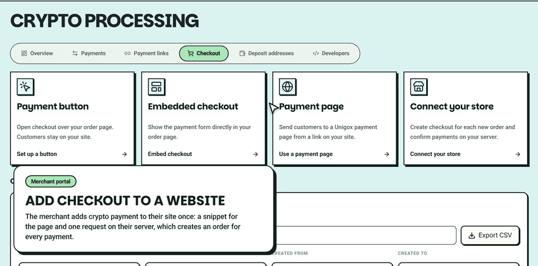
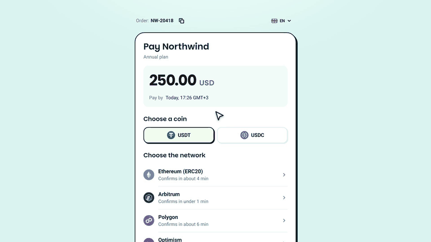

# Crypto processing: add checkout to your website

> **Not available yet.** This page describes crypto processing ahead of its release. Until this notice is gone, `https://www.unigox.com/checkout.js`, the help pages and the link check it names can answer 404. Once released, crypto processing is in early access, turned on per business.

> **Crypto processing guide:** [Get started](https://developers.unigox.com/tutorials/crypto-checkout) · **Website checkout** · [Confirm payments](https://developers.unigox.com/tutorials/crypto-checkout-confirm) · [Deposit pages and signed links](https://developers.unigox.com/tutorials/crypto-checkout-links) · [Test and go live](https://developers.unigox.com/tutorials/crypto-checkout-testing) · [Reference](https://developers.unigox.com/tutorials/crypto-checkout-reference)

Take payments on your website. You add the code once. For every payment, your server creates a new order with your API key, and the checkout shows that order: in a window over your page, inside your page, or on a Unigox payment page. The checkout shows the amount, lets the payer choose a coin and a network, shows the address and follows the transfer. It tells your page about each step through callbacks.

## Choose how customers pay

| Way | What the payer sees | What you add |
| --- | --- | --- |
| **Payment button** | The checkout opens in a window over your page | `checkout.js`, a button and one request on your server |
| **Embedded checkout** | The checkout inside your page | `checkout.js`, an empty element and one request on your server |
| **Payment page** | A Unigox page with the payment, in the same tab | A form that posts to your server, which sends the payer to the order's page |
| **Your own frame** | The checkout in an iframe you control | An iframe, a message listener and one request on your server |

Use the payment button or the embedded checkout if you can: `checkout.js` takes care of sizing, phones, loading problems and messages. Use the payment page on any page where you cannot add a script. Use your own frame only when your site cannot load a script from Unigox.

All four open an order. A payment link you make in the portal is for one payment you send to one customer, by email or in a chat ([Get started](https://developers.unigox.com/tutorials/crypto-checkout#your-first-payment-link)).

## 1. Create the order on your server

When the payer chooses to pay with crypto, your page asks your own server for an order. Your server creates it at Unigox with one request and answers the page with the order's `token` and `payUrl`.

**Before you start:**

- **Your partner API key.** In the portal, **Crypto processing → Checkout**, step **3. Create the order on your server**, has **Create API key**. Press it and confirm: the key appears there on the page and is shown once. Creating a key again replaces it and stops the old one at once, so give the new key to your server before you close the page. It is the one API key of your Unigox account: another integration of yours that calls the partner API needs the new key too. Keep the key on your server, never in a web page or a repository.
- **Addresses for your orders.** Each order takes one payment address of each address type from the addresses the portal keeps ready for orders. The portal adds them while you are signed in with **Crypto processing** open, as the account whose wallet receives the payments. Open it once before your first order, and open it again regularly: see [Limits](https://developers.unigox.com/tutorials/crypto-checkout-reference#limits).

The request, with your order number and total:

```bash
curl -X POST https://api.unigox.com/api/v1/partner/crypto/orders \
  -H "X-API-Key: $UNIGOX_API_KEY" \
  -H "Content-Type: application/json" \
  -d '{"merchantName": "Northwind", "reference": "A-1001", "amount": "25.00",
       "customer": {"id": "cus-77"}}'
```

The answer, `201` (shortened):

```json
{
  "status": "order_created",
  "code": 201,
  "data": {
    "id": "ord_4f9c2a7e1b3d5c8a0e6f2b4d",
    "token": "o_4f9c2a7e1b3d5c8a0e6f2b4d",
    "payUrl": "https://www.unigox.com/pay/o_4f9c2a7e1b3d5c8a0e6f2b4d",
    "reference": "A-1001",
    "amount": "25.00",
    "currency": "USD",
    "status": "open",
    "received": "0.00",
    "expiresAt": "2026-11-26T11:00:00.000000Z"
  }
}
```

The same request as the route your page calls, in Node.js:

```js
// Node 18+ with express (npm install express). UNIGOX_API_KEY stays on your server, never in the page.
import express from "express";

const app = express();
const UNIGOX_API = "https://api.unigox.com";

app.post("/your-server/crypto-order", async (req, res) => {
  const cart = await yourCart(req); // your own order, e.g. { id: "A-1001", total: "25.00", customerId: "cus-77" }
  const response = await fetch(`${UNIGOX_API}/api/v1/partner/crypto/orders`, {
    method: "POST",
    headers: { "Content-Type": "application/json", "X-API-Key": process.env.UNIGOX_API_KEY },
    body: JSON.stringify({
      merchantName: "Northwind",         // the name the payer sees
      // The same reference returns the same order. A new attempt needs a new one, such as "A-1001-2".
      reference: cart.id,                // your order number, at most 64 characters
      amount: cart.total,                // USD as a string, such as "25.00"
      ...(cart.customerId ? { customer: { id: cart.customerId } } : {}), // optional: leave it out for a guest
    }),
    signal: AbortSignal.timeout(10_000),
  });
  const body = await response.json().catch(() => null);
  if (!response.ok) {
    console.error("Unigox order not created:", response.status, body?.details, body?.field);
    return res.status(502).end(); // your page tells the payer the payment could not be started
  }
  await saveUnigoxOrderId(cart.id, body.data.id); // you read the order by this id to confirm the payment
  res.json({ token: body.data.token, payUrl: body.data.payUrl });
});

app.listen(3000);
```

`yourCart()` and `saveUnigoxOrderId()` stand for your own code. On a test account, `UNIGOX_API` is `https://api-staging.unigox.com`.

- **Create the order when the payer chooses to pay, not when the page loads.** An order holds one address of each type until it ends, and each address then rests 24 hours before another order can take it. Orders that nobody pays use up addresses.
- **Send the same `reference` for the same cart.** While that order is open or paid, and for 15 minutes after its `expiresAt`, a request with the same `reference` and `amount` returns the same order (`200`), so a double click or a retry never makes a second order. The repeat changes nothing in the order: its other fields are not applied. The same `reference` with another amount answers `409 order_reference_conflict`. For a new attempt, such as a changed total or a new try after the order's time ran out, use a new `reference`. An order that is not paid frees its `reference` 15 minutes after its `expiresAt`, or when you close it; the same `reference` then makes a new order.
- **Keep `data.id` with your order.** Your server reads the order with it to know when it is paid ([Confirm payments](https://developers.unigox.com/tutorials/crypto-checkout-confirm)). Never read an order by an id that the browser sends you.
- **Send `merchantName`.** It is the name the payer sees, and every answer about the order returns it. Without it the payer sees your partner account's name. The name under **Settings → Shown to the payer as** is kept in your browser and does not reach orders.
- **The order takes payments for 60 minutes.** Send `expiresInMinutes` for another time, from 5 to 10,080 (7 days).
- **When Unigox refuses the order**, the route answers `502` and the code in step 2 tells the payer that the payment could not be started; show them another way to pay. `409 no_free_addresses`: no address is free; open **Crypto processing** in the portal. `403 merchant_unverified_limit`: your business is not verified and has received 1,000 USD. Every field and error is in the [Reference](https://developers.unigox.com/tutorials/crypto-checkout-reference#orders-api).

## 2. Show the checkout

### Get the code from the portal

1. Open **Crypto processing → Checkout** and pick **Payment button**, **Embedded checkout** or **Payment page**. The fourth tile, **Connect your store**, opens the same setup in **Developers**.
2. Under **1. Choose how customers pay**, keep the way you picked or change it. **Your own frame** is in this list only. The preview beside the steps shows what your customer sees.
3. Under **2. Add checkout to your site**, press **Copy code** and paste the code into your page.
4. Under **3. Create the order on your server**, choose **cURL** or **Node.js** and add the request to your server. **Create API key**, under the code, makes the key your server sends.
5. Read **4. Check the payment**: ship once your server reads the order as `paid` ([Confirm payments](https://developers.unigox.com/tutorials/crypto-checkout-confirm)).

<figure><figcaption><p>Setting up the payment button in the portal (sample data).</p></figcaption></figure>

The code you copy calls `/your-server/crypto-order` on your site: the route of step 1. Under the steps, **Add to your Content-Security-Policy** gives the one line a strict policy needs, and **Callbacks** and **Error codes** list what your page can react to.

### Payment button

Load `checkout.js` once on the page, from `https://www.unigox.com`, and open the checkout from your button:

```html
<script src="https://www.unigox.com/checkout.js"></script>
<button type="button" id="pay-with-crypto">Pay with crypto</button>
<p id="pay-error" role="alert" hidden>The payment could not be started. Please try again.</p>
<script>
  // Your server's route: it creates the order and answers { token, payUrl }.
  const newOrder = () => fetch("/your-server/crypto-order", { method: "POST" })
    .then((r) => (r.ok ? r.json() : Promise.reject(new Error(`HTTP ${r.status}`))))
    .then((o) => (o && o.token && o.payUrl ? o : Promise.reject(new Error("no order"))));
  const button = document.getElementById("pay-with-crypto");
  const error = document.getElementById("pay-error");
  // No order: the button comes back, and the payer reads why nothing opened.
  const failed = () => { button.disabled = false; error.hidden = false; };
  let checkout;
  button.addEventListener("click", () => {
    error.hidden = true;
    // checkout.js did not load (an ad blocker, the network, your CSP): the order's payment page takes the payment.
    if (!window.UnigoxCheckout) {
      button.disabled = true; // one order per press
      return newOrder().then((o) => location.assign(o.payUrl), failed);
    }
    checkout ??= UnigoxCheckout.create({
      token: () => newOrder().then((o) => o.token), // called on the first open: your server creates the order
      mode: "modal",
      onError: ({ code }) => { if (code === "TOKEN_MISSING" || code === "TOKEN_TIMEOUT") failed(); },
      onComplete(payload) { /* update your page; only your server confirms the payment */ },
    });
    checkout.open();
  });
</script>
```

`checkout.js` calls the `token` function once, on the first `open()`. A failed request reaches `onError` as `TOKEN_MISSING`, the window closes, the page says that the payment could not be started, and the next `open()` calls the function again. Once it has a token, every `open()` shows the same order. Closing the window does not cancel the payment. If the payer comes back after the order's time ran out, the checkout shows the order as ended: call `checkout.destroy()` and create a new checkout, which creates a new order. An order that has already ended when the checkout loads sends your page no status: only a paid or overpaid one calls `onComplete`, as a paid order does. Your server's read of the order tells you which it is.

On a phone the window fills the screen. The window closes when the browser goes Back or leaves the page. In a single-page app, call `checkout.close()` when your route changes.

### Embedded checkout

```html
<script src="https://www.unigox.com/checkout.js"></script>
<button type="button" id="pay-with-crypto">Pay with crypto</button>
<p id="pay-error" role="alert" hidden>The payment could not be started. Please try again.</p>
<div id="checkout"></div>
<script>
  // Your server's route: it creates the order and answers { token, payUrl }.
  const newOrder = () => fetch("/your-server/crypto-order", { method: "POST" })
    .then((r) => (r.ok ? r.json() : Promise.reject(new Error(`HTTP ${r.status}`))))
    .then((o) => (o && o.token && o.payUrl ? o : Promise.reject(new Error("no order"))));
  const button = document.getElementById("pay-with-crypto");
  const error = document.getElementById("pay-error");
  // No order: the button comes back, and the payer reads why nothing opened.
  const failed = () => { button.hidden = false; error.hidden = false; };
  let checkout;
  // The order is created when the payer chooses crypto: the press mounts the checkout, which asks for the token.
  button.addEventListener("click", () => {
    error.hidden = true;
    button.hidden = true; // one order per press: the checkout takes the button's place
    // checkout.js did not load (an ad blocker, the network, your CSP): the order's payment page takes the payment.
    if (!window.UnigoxCheckout) return newOrder().then((o) => location.assign(o.payUrl), failed);
    checkout ??= UnigoxCheckout.create({
      token: () => newOrder().then((o) => o.token), // called on the first mount: your server creates the order
      mode: "inline",
      onError: ({ code }) => { if (code === "TOKEN_MISSING" || code === "TOKEN_TIMEOUT") failed(); },
    });
    checkout.mount("#checkout");
  });
</script>
```

The checkout takes the element's full width and the height it needs, so your page never shows a second scrollbar. Keep the element visible: a hidden or zero-height element hides the checkout.

### Payment page

Your button posts a form to your server. Your server creates the order and sends the payer to the order's payment page:

```html
<form method="post" action="/your-server/crypto-order">
  <button type="submit">Pay with crypto</button>
</form>
```

The route of step 1 answers the form with the order's payment page, and a refusal with a plain sentence for the payer:

```js
// Node 18+ with express (npm install express). UNIGOX_API_KEY stays on your server, never in the page.
import express from "express";

const app = express();
const UNIGOX_API = "https://api.unigox.com";

app.post("/your-server/crypto-order", async (req, res) => {
  const cart = await yourCart(req); // your own order, e.g. { id: "A-1001", total: "25.00", customerId: "cus-77" }
  const response = await fetch(`${UNIGOX_API}/api/v1/partner/crypto/orders`, {
    method: "POST",
    headers: { "Content-Type": "application/json", "X-API-Key": process.env.UNIGOX_API_KEY },
    body: JSON.stringify({
      merchantName: "Northwind",         // the name the payer sees
      // The same reference returns the same order. A new attempt needs a new one, such as "A-1001-2".
      reference: cart.id,                // your order number, at most 64 characters
      amount: cart.total,                // USD as a string, such as "25.00"
      ...(cart.customerId ? { customer: { id: cart.customerId } } : {}), // optional: leave it out for a guest
    }),
    signal: AbortSignal.timeout(10_000),
  });
  const body = await response.json().catch(() => null);
  if (!response.ok) {
    console.error("Unigox order not created:", response.status, body?.details, body?.field);
    return res.status(502).type("text").send("The payment could not be started. Please go back and try again.");
  }
  await saveUnigoxOrderId(cart.id, body.data.id); // you read the order by this id to confirm the payment
  res.redirect(303, body.data.payUrl); // the form's answer: the order's payment page
});

app.listen(3000);
```

`payUrl` is `https://www.unigox.com/pay/o_…`. For a language, put `/es`, `/fr` or `/pt` before `/pay` (`https://www.unigox.com/es/pay/o_…`). Without one, the page follows the payer's browser.

You can also send `payUrl` by email or in a chat. It takes payments until the order's `expiresAt`.

### Links you already have

Mark links to a payment page with `data-unigox-checkout`, and the checkout opens in a window over your page instead of on a new page. A link can be an order's `payUrl` that your server put in the page, or a payment link from the portal. With `data-unigox-checkout="inline"` and `data-target`, it shows inside the element you name:

```html
<a data-unigox-checkout href="https://www.unigox.com/pay/{token}">Pay with crypto</a>
<a data-unigox-checkout="inline" data-target="#checkout" href="https://www.unigox.com/pay/{token}">Pay here</a>
<div id="checkout"></div>
<script>window.UnigoxCheckout && UnigoxCheckout.bind();</script>
```

`{token}` is the part of the link after `/pay/`. These links give your page no callbacks. Confirm an order's payment by reading the order on your server, and a payment link's in **Payments** or from your payment history. On a page where users can post links (reviews, comments), bind only the container that holds your own links: `UnigoxCheckout.bind(document.querySelector("#checkout-links"))`.

### Invoices

An invoice made in **Payment links → Create invoice** is a payment link with the invoice document after `#invoice=` in the link. Pass the full link as `url`, not just the token, so the payer can open the invoice:

```js
// invoicePaymentUrl is the complete link copied from the portal, including #invoice=…
let checkout;
document.querySelector("#pay").addEventListener("click", () => {
  if (!window.UnigoxCheckout) return window.location.assign(invoicePaymentUrl);
  checkout ??= UnigoxCheckout.create({ url: invoicePaymentUrl, mode: "modal" });
  checkout.open();
});
```

The invoice document is stored only in the link and in the browser that made it. Anyone who has the full link can read the invoice: keep the link out of analytics and logs.

### Your own frame

Use this only if you cannot load `checkout.js`. Serve your page over HTTPS (or `http://localhost` while you build), keep the referrer policy that the example sets, and give each frame its own 16-character hexadecimal `instance`:

```html
<button type="button" id="pay-with-crypto">Pay with crypto</button>
<p id="pay-error" role="alert" hidden>The payment could not be started. Please try again.</p>
<div id="checkout"></div>
<a id="checkout-fallback" target="_blank" rel="noopener noreferrer" hidden></a>
<script>
  // locale: "en", "es", "fr" or "pt". Leave it out to follow the payer's browser, as checkout.js does.
  function mountCheckoutFrame(container, token, fallback, locale) {
    const checkoutOrigin = "https://www.unigox.com";
    const languages = ["en", "es", "fr", "pt"];
    const lang = languages.includes(locale) ? locale
      : (navigator.languages || [navigator.language]).map((l) => String(l).slice(0, 2).toLowerCase()).find((l) => languages.includes(l)) || "en";
    // The frame's name and the fallback link's text, in the checkout's language.
    const words = {
      en: ["Pay with crypto", "Continue to secure checkout"],
      es: ["Pagar con cripto", "Continuar al checkout seguro"],
      fr: ["Payer en crypto", "Continuer vers le checkout sécurisé"],
      pt: ["Pagar com cripto", "Continuar para o checkout seguro"],
    }[lang];
    const hostedUrl = new URL((lang === "en" ? "" : "/" + lang) + "/pay/" + encodeURIComponent(token), checkoutOrigin);
    const instance = Array.from(crypto.getRandomValues(new Uint8Array(8)), b => b.toString(16).padStart(2, "0")).join("");
    const frameUrl = new URL(hostedUrl);
    frameUrl.search = new URLSearchParams({ embed: "1", mode: "inline", v: "1", instance, origin: location.origin });
    const frame = document.createElement("iframe");
    frame.title = words[0];
    frame.setAttribute("sandbox", "allow-scripts allow-same-origin allow-forms allow-popups allow-popups-to-escape-sandbox allow-top-navigation-to-custom-protocols");
    frame.allow = "clipboard-write";
    frame.referrerPolicy = "strict-origin-when-cross-origin";
    frame.style.cssText = "width:100%;max-width:480px;height:560px;border:0;color-scheme:normal";
    let visible = true;
    // The link to the hosted page shows only while the frame cannot: 10 seconds without READY, or a frame that fails.
    if (fallback) {
      fallback.href = hostedUrl.href;
      fallback.textContent = words[1];
    }
    const showFallback = (show) => { if (fallback) fallback.hidden = !show; };
    const fallbackTimer = setTimeout(() => showFallback(true), 10000);
    const send = (type, fields = {}) => frame.contentWindow?.postMessage({
      source: "unigox-checkout-host", v: 1, instance, type, ...fields,
    }, checkoutOrigin);
    function onMessage(event) {
      if (event.origin !== checkoutOrigin || event.source !== frame.contentWindow) return;
      const msg = event.data;
      if (!msg || msg.source !== "unigox-checkout" || msg.v !== 1 || msg.instance !== instance) return;
      if (msg.type === "UNIGOX_CHECKOUT_READY") {
        clearTimeout(fallbackTimer);
        showFallback(false);
        // Repeat after READY: a visibility message sent before load may have been missed.
        send("UNIGOX_CHECKOUT_VISIBILITY", { visible });
      } else if (msg.type === "UNIGOX_CHECKOUT_RESIZE") {
        const height = msg.payload?.height;
        // The heights checkout.js takes too: more than 0, at most 10000 px. A long checkout on a phone is taller than
        // 2000 px; a lower cap would give it a scrollbar inside the frame.
        if (typeof height === "number" && height > 0 && height <= 10000) {
          frame.style.height = Math.max(160, height) + "px";
        }
      }
      // Payment events may update your screen. Only your server can fulfil the order.
    }
    window.addEventListener("message", onMessage);
    frame.addEventListener("load", () => send("UNIGOX_CHECKOUT_PING"));
    frame.addEventListener("error", () => showFallback(true));
    frame.src = frameUrl.href;
    container.append(frame);
    return {
      hostedUrl: hostedUrl.href,
      setVisible(value) {
        visible = Boolean(value);
        frame.hidden = !visible;
        send("UNIGOX_CHECKOUT_VISIBILITY", { visible });
      },
      destroy() {
        clearTimeout(fallbackTimer);
        window.removeEventListener("message", onMessage);
        frame.remove();
      },
    };
  }
  // Your server's route: it creates the order and answers { token, payUrl }.
  const newOrder = () => fetch("/your-server/crypto-order", { method: "POST" })
    .then((r) => (r.ok ? r.json() : Promise.reject(new Error(`HTTP ${r.status}`))))
    .then((o) => (o && o.token && o.payUrl ? o : Promise.reject(new Error("no order"))));
  const button = document.getElementById("pay-with-crypto");
  const error = document.getElementById("pay-error");
  // No order: the button comes back, and the payer reads why nothing opened.
  const failed = () => { button.hidden = false; error.hidden = false; };
  let frameCheckout;
  // The order is created when the payer presses the button, never when the page loads; its token opens the frame.
  button.addEventListener("click", () => {
    error.hidden = true;
    button.hidden = true; // one order per press: the checkout takes the button's place
    newOrder().then((o) => {
      frameCheckout = mountCheckoutFrame(document.getElementById("checkout"), o.token, document.getElementById("checkout-fallback"));
    }, failed);
  });
  // In Spanish, for example: mountCheckoutFrame(container, token, fallback, "es").
  // Call frameCheckout.destroy() when this view unmounts.
</script>
```

The ordinary payment page cannot be shown in a frame. Only the URL with `embed=1` can.

### React, Next.js, Vue and PHP

Each example calls the route of step 1, `/your-server/crypto-order`, which answers `{ token, payUrl }`. As in the examples above, the order is made when the payer presses the button, and a refusal (an answer that is not ok, or one without `token` and `payUrl`, or `onError` with `TOKEN_MISSING` or `TOKEN_TIMEOUT`) brings the button back with one sentence for the payer.

React: the payment button, and the checkout inside the page.

```jsx
import { useEffect, useRef, useState } from "react";

// Your server's route: it creates the order and answers { token, payUrl }. Anything else is a refusal.
const newOrder = () => fetch("/your-server/crypto-order", { method: "POST" })
  .then((r) => (r.ok ? r.json() : Promise.reject(new Error(`HTTP ${r.status}`))))
  .then((o) => (o && o.token && o.payUrl ? o : Promise.reject(new Error("no order"))));
const noOrder = ({ code }) => code === "TOKEN_MISSING" || code === "TOKEN_TIMEOUT";
const Failed = () => <p role="alert">The payment could not be started. Please try again.</p>;

// The checkout over the page: the first press creates the order.
export function PayWithCrypto({ cartId }) {
  const checkout = useRef(null);
  const [busy, setBusy] = useState(false);
  const [failed, setFailed] = useState(false);
  useEffect(() => {
    setFailed(false);
    return () => { checkout.current?.destroy(); checkout.current = null; };
  }, [cartId]);
  const pay = () => {
    setFailed(false);
    // checkout.js did not load (an ad blocker, the network, your CSP): the order's payment page takes the payment.
    if (!window.UnigoxCheckout) {
      setBusy(true); // one order per press
      return newOrder().then((o) => window.location.assign(o.payUrl), () => { setBusy(false); setFailed(true); });
    }
    checkout.current ??= window.UnigoxCheckout.create({
      token: () => newOrder().then((o) => o.token), // called on the first open: your server creates the order
      onError: (e) => { if (noOrder(e)) setFailed(true); },
      onComplete: () => window.location.assign(`/orders/${cartId}`),
    });
    checkout.current.open();
  };
  return <><button type="button" onClick={pay} disabled={busy}>Pay with crypto</button>{failed && <Failed />}</>;
}

// The checkout inside the page: the press creates the order, and the checkout takes the button's place.
export function InlineCheckout({ cartId }) {
  const box = useRef(null);
  const checkout = useRef(null);
  const [shown, setShown] = useState(false);
  const [failed, setFailed] = useState(false);
  useEffect(() => {
    setShown(false);
    setFailed(false);
    return () => { checkout.current?.destroy(); checkout.current = null; };
  }, [cartId]);
  const back = () => { setShown(false); setFailed(true); };
  const pay = () => {
    setFailed(false);
    setShown(true); // one order per press
    if (!window.UnigoxCheckout) return newOrder().then((o) => window.location.assign(o.payUrl), back);
    checkout.current ??= window.UnigoxCheckout.create({
      token: () => newOrder().then((o) => o.token), // called on the first mount: your server creates the order
      mode: "inline",
      onError: (e) => { if (noOrder(e)) back(); },
    });
    checkout.current.mount(box.current);
  };
  return <>{!shown && <button type="button" onClick={pay}>Pay with crypto</button>}{failed && <Failed />}<div ref={box} /></>;
}
```

Next.js (App Router), the route and the button:

```js
// app/your-server/crypto-order/route.js: runs on your server, so UNIGOX_API_KEY never reaches the browser.
export async function POST(request) {
  const cart = await yourCart(request); // your own order, e.g. { id: "A-1001", total: "25.00" }
  const response = await fetch("https://api.unigox.com/api/v1/partner/crypto/orders", {
    method: "POST",
    headers: { "Content-Type": "application/json", "X-API-Key": process.env.UNIGOX_API_KEY },
    body: JSON.stringify({ merchantName: "Northwind", reference: cart.id, amount: cart.total }),
  });
  const body = await response.json().catch(() => null);
  if (!response.ok) return new Response(null, { status: 502 });
  await saveUnigoxOrderId(cart.id, body.data.id);
  return Response.json({ token: body.data.token, payUrl: body.data.payUrl });
}
```

```jsx
// app/checkout/pay-button.jsx
"use client";
import Script from "next/script";
import { useEffect, useRef, useState } from "react";

// Your route above. Anything but { token, payUrl } is a refusal.
const newOrder = () => fetch("/your-server/crypto-order", { method: "POST" })
  .then((r) => (r.ok ? r.json() : Promise.reject(new Error(`HTTP ${r.status}`))))
  .then((o) => (o && o.token && o.payUrl ? o : Promise.reject(new Error("no order"))));

export default function PayButton() {
  const [loaded, setLoaded] = useState(false);
  const [busy, setBusy] = useState(false);
  const [failed, setFailed] = useState(false);
  const checkout = useRef(null);
  useEffect(() => () => { checkout.current?.destroy(); checkout.current = null; }, []);
  const pay = () => {
    setFailed(false);
    // checkout.js not loaded (yet): the order's payment page takes the payment.
    if (!loaded || !window.UnigoxCheckout) {
      setBusy(true); // one order per press
      return newOrder().then((o) => window.location.assign(o.payUrl), () => { setBusy(false); setFailed(true); });
    }
    (checkout.current ??= window.UnigoxCheckout.create({
      token: () => newOrder().then((o) => o.token), // called on the first open: your server creates the order
      onError: ({ code }) => { if (code === "TOKEN_MISSING" || code === "TOKEN_TIMEOUT") setFailed(true); },
    })).open();
  };
  return (
    <>
      <Script src="https://www.unigox.com/checkout.js" strategy="afterInteractive" onReady={() => setLoaded(true)} onError={() => setLoaded(false)} />
      <button type="button" onClick={pay} disabled={busy}>Pay with crypto</button>
      {failed && <p role="alert">The payment could not be started. Please try again.</p>}
    </>
  );
}
```

Vue, the checkout inside the page: the press creates the order, and the checkout takes the button's place:

```vue
<template>
  <button v-if="!shown" type="button" @click="pay">Pay with crypto</button>
  <p v-if="failed" role="alert">The payment could not be started. Please try again.</p>
  <div ref="box" />
</template>
<script setup>
import { onBeforeUnmount, ref } from "vue";
// Your server's route: it creates the order and answers { token, payUrl }. Anything else is a refusal.
const newOrder = () => fetch("/your-server/crypto-order", { method: "POST" })
  .then((r) => (r.ok ? r.json() : Promise.reject(new Error(`HTTP ${r.status}`))))
  .then((o) => (o && o.token && o.payUrl ? o : Promise.reject(new Error("no order"))));
const box = ref(null);
const shown = ref(false);
const failed = ref(false);
let checkout;
function back() { shown.value = false; failed.value = true; }
function pay() {
  failed.value = false;
  shown.value = true; // one order per press
  // checkout.js did not load: the order's payment page takes the payment.
  if (!window.UnigoxCheckout) return newOrder().then((o) => window.location.assign(o.payUrl), back);
  checkout ??= window.UnigoxCheckout.create({
    token: () => newOrder().then((o) => o.token), // called on the first mount: your server creates the order
    mode: "inline",
    onError: ({ code }) => { if (code === "TOKEN_MISSING" || code === "TOKEN_TIMEOUT") back(); },
  });
  checkout.mount(box.value);
}
onBeforeUnmount(() => checkout?.destroy());
</script>
```

PHP, the payment page way (WordPress included). Point the `action` of the form in [Payment page](#payment-page) at this file.

```php
<?php
// your-server/crypto-order.php: creates the order and sends the payer to its payment page.
// UNIGOX_API_KEY comes from your server's environment, never from the page.
$cart = your_cart(); // your own order, e.g. ['id' => 'A-1001', 'total' => '25.00']
$ch = curl_init('https://api.unigox.com/api/v1/partner/crypto/orders');
curl_setopt_array($ch, [
  CURLOPT_POST => true,
  CURLOPT_RETURNTRANSFER => true,
  CURLOPT_TIMEOUT => 10,
  CURLOPT_HTTPHEADER => ['Content-Type: application/json', 'X-API-Key: ' . getenv('UNIGOX_API_KEY')],
  CURLOPT_POSTFIELDS => json_encode(['merchantName' => 'Northwind', 'reference' => $cart['id'], 'amount' => $cart['total']]),
]);
$body = json_decode((string) curl_exec($ch), true);
$status = curl_getinfo($ch, CURLINFO_RESPONSE_CODE);
// A refusal (409 no_free_addresses, any other error, no answer): a plain sentence, never the API's JSON.
if (($status !== 200 && $status !== 201) || empty($body['data']['id']) || empty($body['data']['payUrl'])) {
  error_log('Unigox order not created: ' . $status . ' ' . ($body['details'] ?? ''));
  http_response_code(502);
  header('Content-Type: text/plain; charset=utf-8');
  exit('The payment could not be started. Please go back and try again.');
}
save_unigox_order_id($cart['id'], $body['data']['id']); // you read the order by this id to confirm the payment
header('Location: ' . $body['data']['payUrl'], true, 303);
```

## 3. React to the checkout

### Options

| Option | Default | What it does |
| --- | --- | --- |
| `token` | none | The order's token, or a payment link's, or a function that returns it or a promise of it. The function is called on the first `open()` or `mount()`, and again after it failed or timed out. |
| `url` | none | A whole payment page address instead of `token`: an order's `payUrl` or a payment link. Keeps an invoice attached after `#invoice=`. |
| `mode` | `"modal"` | `"modal"`: a window over your page. `"inline"`: inside your page. `"hosted"`: `open()` sends the payer to the payment page, in the same tab. A browser without `<dialog>` gets `"hosted"`. |
| `container` | none | Embedded: the element or a selector, used when `mount()` gets none. |
| `theme` | light | `"light"` or `"dark"`. |
| `locale` | `"auto"` | `"en"`, `"es"`, `"fr"` or `"pt"`. `"auto"` follows the payer's browser. |
| `readyTimeoutMs` | `10000` | How long to wait for your token function and for the checkout to load, 3,000 to 120,000 ms. |
| `keepAlive` | `true` | Window: keep the checkout while it is closed. `false` removes it on close. |
| `zIndex` | `2147483000` | Stacking order of the window. |

### Methods

| Method | What it does |
| --- | --- |
| `UnigoxCheckout.create(options)` | Returns a checkout. Nothing is added to the page until you open or mount it. |
| `checkout.open()` | Shows the window, or mounts the embedded checkout. Returns a promise that settles when the checkout is ready, falls back or fails. |
| `checkout.close()` | Hides the window. The payment is kept and its checks pause until it opens again. |
| `checkout.mount(container)` | Embedded: shows the checkout in the element. |
| `checkout.unmount()` | Embedded: removes it. |
| `checkout.destroy()` | Removes everything for good. |
| `checkout.state` | `idle`, `loading`, `ready`, `open`, `closed`, `fallback` or `destroyed` |
| `checkout.status` | The last payment status, for example `awaiting_payment` or `paid` |
| `checkout.hostedUrl` | The payment page of this payment |
| `UnigoxCheckout.hostedUrl(token, { locale })` | The payment page of a token |
| `UnigoxCheckout.bind(root = document)` | Handles `data-unigox-checkout` links inside `root` |

The types are at `https://www.unigox.com/checkout.d.ts`.

### Callbacks

Use callbacks to update your page. A callback is not proof of payment, because anyone can call it in their own browser. Proof is your server's check ([Confirm payments](https://developers.unigox.com/tutorials/crypto-checkout-confirm)).

| Callback | When |
| --- | --- |
| `onReady(payload)` | The checkout has loaded. `payload` has `livemode`, `mode` and `environment`. |
| `onStatusChange(status, payload)` | At every status below |
| `onPaymentDetected(payload)` | A transfer was seen on its network |
| `onComplete(payload)` | Once, on `paid`, `overpaid` or `paid_late` |
| `onDeposit(payload)` | Deposit page: a deposit was credited. Sent again for each credited deposit every time the page opens: count each `quoteId` once. |
| `onReturn(payload)` | The payer pressed **Back to {merchant}**. If you pass no `onReturn`, the window closes. |
| `onClose({reason})` | The window closed: `button`, `escape`, `backdrop`, `api`, `return`, `replaced` or `navigation` |
| `onError({code})` | See below |
| `onResize({height})` | The checkout changed height (already applied) |

For an order, your server reads the order to confirm the payment; the callbacks only tell it when to read. For a payment link, post `payload.payments` from `onStatusChange` and `onComplete` to your server, which checks those transfers with Unigox.

| Error code | What it means and what to do |
| --- | --- |
| `TOKEN_MISSING` | No token: none given, or your token function failed. Call `open()` again once you have one. |
| `TOKEN_TIMEOUT` | Your token function took longer than `readyTimeoutMs`. Let the payer retry. Create the order with the same `reference`, so a retry returns the same order instead of a second one. |
| `TOKEN_INVALID` | The token is not one Unigox can open: a link cut off, edited or no longer reserved for this payment, or an order token that names no order. The payer is told not to pay. Create a new order, or copy the link again. |
| `CHECKOUT_UNAVAILABLE` | Unigox cannot be reached right now. Temporary, not a failed payment: do not close the order. |
| `FRAME_TIMEOUT` | The checkout did not load in time, or your Content Security Policy blocked it. The payer sees **Continue to secure checkout**. Temporary: if `onReady` follows, the checkout loaded late. |
| `FRAME_ERROR` | Anything else went wrong while setting up the checkout; the browser console says what after `[UnigoxCheckout]`. Try again, or send the payer to `checkout.hostedUrl`. |
| `CONTAINER_NOT_FOUND` | Embedded: no element was found to mount into. |
| `CONTAINER_OCCUPIED` | Embedded: another checkout already uses this element. |

None of these codes means that a payment failed or that the payer must pay again.

### Payment statuses

These are the checkout's statuses, which your page receives. They are not the order's statuses, which your server reads ([Order statuses](https://developers.unigox.com/tutorials/crypto-checkout-reference#order-statuses)): an order that is short reads `partly_paid` there and `underpaid` here, and an order that ended short reads `expired` or `closed` there and `underpaid_closed` here. Your server ships by the order's status only.

| Status | What it means | What your page does |
| --- | --- | --- |
| `choosing` | The payer is choosing a coin and network | Nothing |
| `awaiting_payment` | The address and amount are shown | Nothing |
| `detected`, `confirming` | A transfer is on its network, not credited yet | Show "payment received, confirming" |
| `paid` | Credited in full, or short by at most 0.5 % and never more than 1.00 USD | Ask your server to confirm |
| `overpaid` | Credited, more than the amount | Ask your server to confirm |
| `paid_late` | Credited, but a transfer after the pay-by date was needed | Ask your server; your policy decides |
| `underpaid` | Credited, short by more than the allowance; the rest can still come | Wait, or ask for the rest |
| `underpaid_closed` | Short, and the pay-by date passed or the link closed | Your server decides |
| `on_hold` | Received, being reviewed by Unigox; not in your wallet yet | Wait |
| `failed` | Not credited, or being sent back | Do not fulfil |
| `expired` | The pay-by date passed and nothing came | Create a new order (or link) if the sale stands |
| `closed` | The order or link was closed | Nothing; money sent later still reaches your wallet |
| `cancelled` | Kept for older integrations. The payment page offers the payer no cancel, so a real payment does not send it; a payer who leaves closes the window or the tab, and the order stays open until its time | Nothing |
| `unreferenced` | Money reached the address after the payment was closed, so it is not recorded under it | Find it in **Payments** and match it to the order yourself |
| `unavailable` | The checkout cannot reach Unigox right now | Nothing; it keeps trying |
| `credited` | Deposit page only: a deposit was credited | Ask your server to add it to the customer's balance |

### The payload

Each callback gets the same fields, each only when it applies. Money is a decimal string.

| Field | Value |
| --- | --- |
| `status` | One of the statuses above |
| `mode` | `modal`, `inline`, `topup` on a deposit page, or `null` |
| `livemode` | `true` for a real payment, `false` on a sample page |
| `environment` | `production` or `staging` |
| `reference` | Your order reference: an order's `reference`, as your server sent it |
| `invoiceId` | For an order, the order's `id` (`ord_…`). For a payment link, the full reference text, for example `NW-20418 · 250.00 USD` |
| `amountDue`, `currency` | The amount due, in `USD` |
| `coin`, `chainId` | The coin and network the payer chose |
| `address` | The address shown (`awaiting_payment` only) |
| `txHash`, `logIndex`, `quoteId` | The latest transfer: its transaction hash, which transfer of that transaction, and its Unigox ID |
| `token`, `tokenAddress` | The coin the payment came in, and its contract address. `null` while the coin is not known, or when the amount came in two coins. |
| `amount` | What was sent, credited or on its way |
| `amountReceived` | What is credited so far |
| `amountRemaining` | `underpaid` only: what is still due |
| `amountExtra` | `overpaid` only: what came on top |
| `payments` | Every transfer the checkout follows: `chainId`, `txHash`, `logIndex`, `quoteId`, `amount`, `coin`, `tokenAddress` and `stage` (`checking`, `seen`, `detected`, `confirming`, `on_hold`, `credited`, `failed` or `refunded`) |
| `incomplete` | `true` when the checkout could not follow every transfer (over 200): the amounts are then a minimum |

The same status can arrive more than once. A transfer that is still being checked can appear in `payments` with the amount 0.

### Messages to your own frame

Your own frame posts the same statuses as messages to your page. Each message is `{source: "unigox-checkout", v: 1, instance, type, payload}`, where `type` is one of:

`UNIGOX_CHECKOUT_READY`, `UNIGOX_CHECKOUT_RESIZE` (`payload.height`), `UNIGOX_CHECKOUT_CHOOSING`, `UNIGOX_CHECKOUT_AWAITING_PAYMENT`, `UNIGOX_CHECKOUT_PAYMENT_DETECTED`, `UNIGOX_CHECKOUT_ON_HOLD`, `UNIGOX_CHECKOUT_UNDERPAID`, `UNIGOX_CHECKOUT_PAID`, `UNIGOX_CHECKOUT_OVERPAID`, `UNIGOX_CHECKOUT_PAID_LATE`, `UNIGOX_CHECKOUT_EXPIRED`, `UNIGOX_CHECKOUT_CANCELLED`, `UNIGOX_CHECKOUT_FAILED`, `UNIGOX_CHECKOUT_RECEIVED_WITHOUT_REFERENCE`, `UNIGOX_CHECKOUT_DEPOSIT_CREDITED`, `UNIGOX_CHECKOUT_RETURN`, `UNIGOX_CHECKOUT_CLOSE_REQUESTED`, `UNIGOX_CHECKOUT_INVALID_LINK` and `UNIGOX_CHECKOUT_UNAVAILABLE`.

Accept a message only when `event.origin` is `https://www.unigox.com`, `event.source` is your frame, `source` is `"unigox-checkout"`, `v` is `1` and `instance` is your frame's. Your page can send two messages to the frame, with `source: "unigox-checkout-host"`, `v: 1` and the `instance`: `UNIGOX_CHECKOUT_PING` (send `READY` again) and `UNIGOX_CHECKOUT_VISIBILITY` with `visible: true` or `false` (pause checking while hidden). Nothing your page sends changes the payment.

### When the checkout cannot load

If the checkout does not load within `readyTimeoutMs`, or your Content Security Policy blocks it, the window or element shows **Continue to secure checkout**, and `checkout.state` is `fallback`. The button opens the payment page of the same payment in a new tab, with the transfers already seen, and `onError` gets `FRAME_TIMEOUT`. If the checkout loads late, it replaces the card and `onReady` follows.

If `checkout.js` itself does not load (an ad blocker, the network, your policy), `window.UnigoxCheckout` does not exist. Check for it and send the payer to the payment page, as the button example does. `data-unigox-checkout` links open the payment page by themselves.

### Content Security Policy

For a strict policy, add:

```
script-src https://www.unigox.com; frame-src https://www.unigox.com
```

`checkout.js` needs no `style-src` change. Your own frame needs only `frame-src https://www.unigox.com`.

The checkout only reads payment data: it cannot move money. It runs in a sandboxed frame that cannot navigate your page, and it posts payment details only to the page that framed it.

## 4. Return to your site

- **Payment button and embedded checkout:** `onReturn` is called; the checkout never navigates your page.
- **Payment page:** with `returnUrl` on the order, the page shows **Back to {merchant}**, with the name the payer sees. For a payment link, the page does this with **Return to your site** from **Settings**, or `u` in a token your server makes. It never redirects by itself.

On the page the payer returns to, have your server read the order and show its status. Do not treat the return itself as payment.

## What your customer sees

<figure><figcaption><p>The checkout as your customer sees it (sample page, no real payment).</p></figcaption></figure>

1. **Choose a coin**, then **Choose the network**. Coins and networks you did not accept are not offered. Each network shows how long a payment takes.
2. **Awaiting payment.** The exact amount and the address, each with a copy button, a QR code (on a phone, behind **Show QR**), and the time to pay by: every order has one, a link when you set one.
3. **Payment detected.** The transfer was seen and is confirming on its network. The payer does nothing more.
4. **Payment completed.** The payment is in your Unigox wallet. On the payment page the payer can **Print receipt**.

A payer who already sent the money opens **Help with this payment** on the payment page and enters the transaction hash there.
