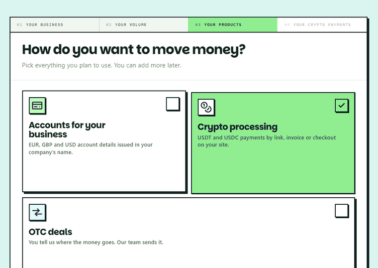
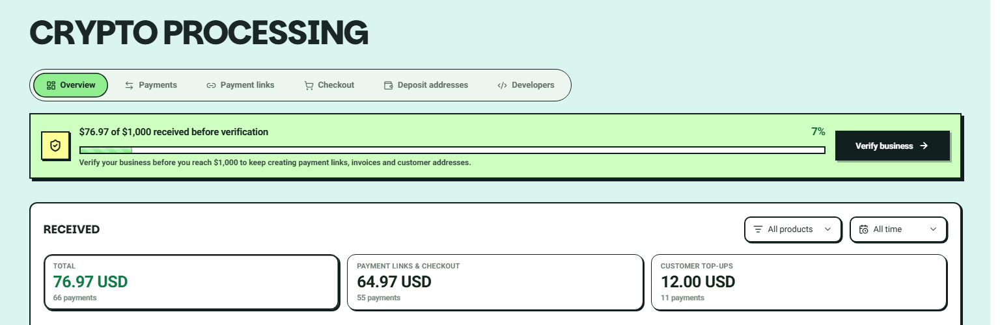
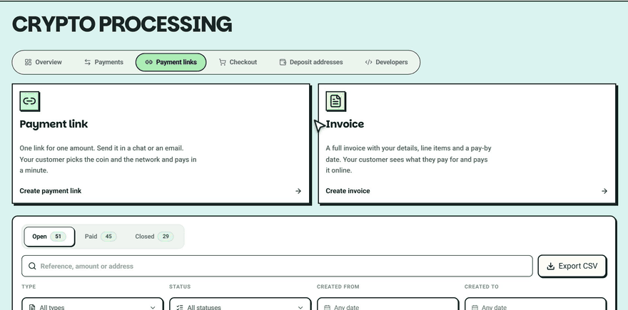
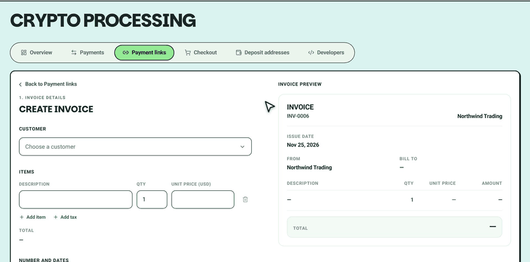
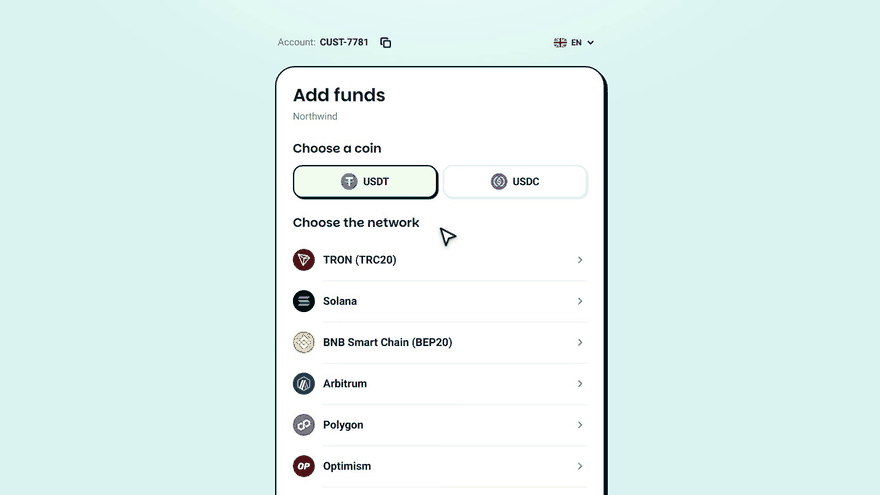
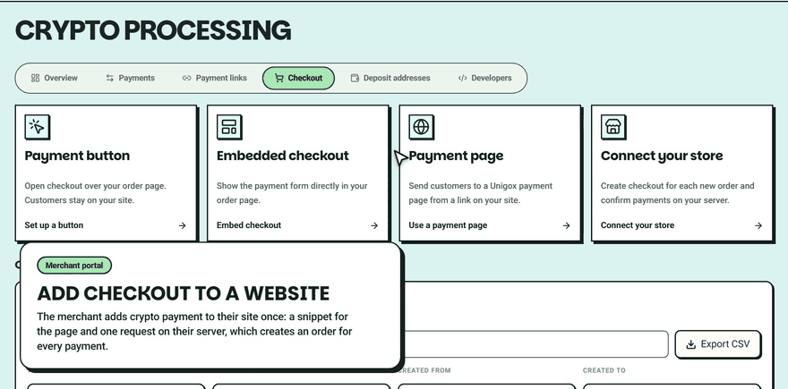
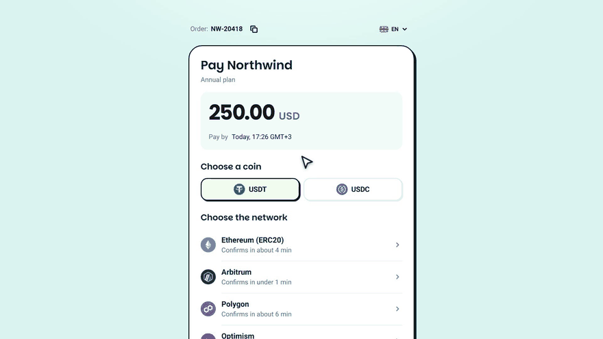
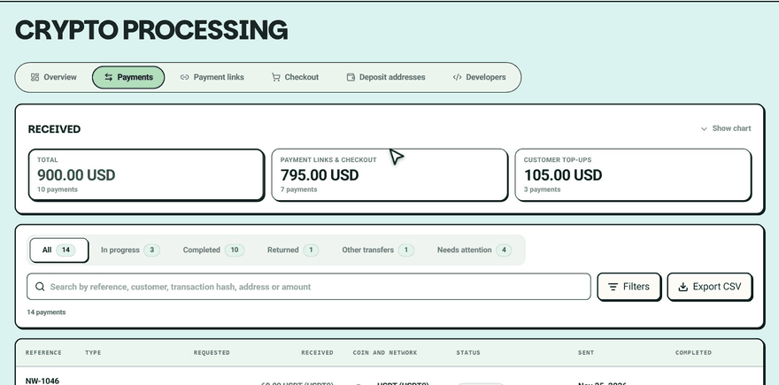
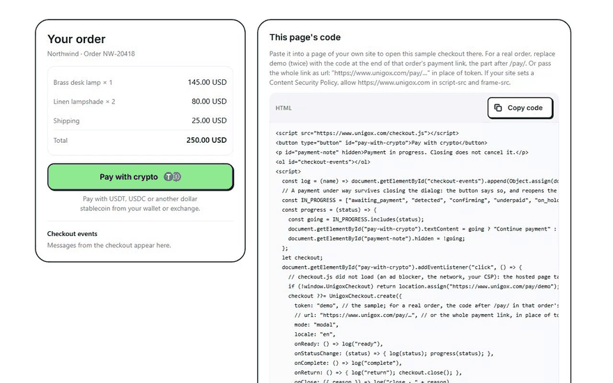

# Crypto processing: the whole guide

> **Not available yet.** This page describes crypto processing ahead of its release. Until this notice is gone, `https://www.unigox.com/checkout.js`, the help pages and the link check it names can answer 404. Once released, crypto processing is in early access, turned on per business.

Crypto processing lets your customers pay you in USDT, USDC, USDG and USDT0 on 13 networks. Each payment is added to your Unigox wallet. Unigox shows the payer the amount, the address and the progress of the transfer, so you do not build a payment page.

This guide is for the person who connects crypto processing to a website or a back office. Each page starts from a task and ends when the task works.

## Pick your task

| What you want to do | Code | Where |
| --- | --- | --- |
| Send a customer a link to pay an order | None | [Your first payment link](#your-first-payment-link) |
| Send an invoice with a PDF | None | Portal: **Payment links → Create invoice** |
| Give a customer permanent addresses to top up a balance | None | Portal: **Deposit addresses → Add a customer** |
| Add a **Pay with crypto** button to your website | A few lines of HTML | [Website checkout](https://developers.unigox.com/tutorials/crypto-checkout-embed) |
| Mark orders paid on your server | Server code, no key | [Confirm payments](https://developers.unigox.com/tutorials/crypto-checkout-confirm) |
| Create a link for every order automatically | Server code and your wallet's key | [Links from your server](https://developers.unigox.com/tutorials/crypto-checkout-links) |
| Build your own payment page | Server and page code, and your wallet's key | [Your own payment page](https://developers.unigox.com/tutorials/crypto-payments) |
| Check your integration before real customers pay | None | [Test and go live](https://developers.unigox.com/tutorials/crypto-checkout-testing) |

## How a payment works

1. You create a payment link: in the portal, or from your server. A link is `https://www.unigox.com/pay/{token}`. The token holds the amount, your order reference and the addresses that take the payment.
2. The customer opens the link, on its own page or in a checkout on your site, and picks a coin and a network.
3. The customer sends the amount from any wallet or exchange. No memo or tag is needed: each order has its own address.
4. Unigox credits the payment to your Unigox wallet, one for one in the coin that was sent. The portal's **Payments** shows it as **Completed**.
5. Your server checks the payment with Unigox and fulfils the order.

Creating a link and opening a checkout move no money. The checkout's messages to your page update your interface; they never prove a payment. Only a check from your server does.

## Open crypto processing

1. On `https://www.unigox.com/crypto-processing`, press **Start business onboarding**. Sign in or create an account if you have none.
2. Answer **Your business** and **Your volume**, and under **Your products** pick **Accept crypto payments**.
3. Answer **Before you start accepting crypto**: who you accept payments for (yourself, or a company and its name), your website and industry, how you plan to accept payments, whose goods or services customers pay for, where your customers are, the largest single payment you expect, and whether you can link payments to your customers. No documents are needed now.
4. Press **Finish and open my portal**. **Crypto processing** opens in your business portal.

<figure><figcaption><p>The crypto processing questions in business onboarding (sample answers).</p></figcaption></figure>

Until your business is verified you can receive up to 1,000 USD in all. The **Overview** shows how much of it you have received, with **Verify business**. At 1,000 USD, new payment links, invoices and deposit addresses wait until your business is verified; payments to the ones you already made still arrive.

## What you need

- **Crypto processing in your business portal** ([Open crypto processing](#open-crypto-processing)).
- **Your Unigox wallet address.** It receives every payment. **Developers → Environment** shows it as **Your Unigox wallet**.
- **The API address**, for server code. **Developers → Environment** shows it as **API address**. Keep it in your configuration, not in your code: it can change. The examples call it `UNIGOX_PAYMENTS_API`.
- **Your wallet's private key**, only to create links or read your payment history from your server. There is no separate API key: those requests are signed with the wallet's key. Unigox exports it on request (**Developers → Confirm payments on your server → Ask for the key**). The key can move your whole balance. Keep it in a secrets store on the server that signs, never in browser code or a repository, keep the wallet's balance low and move collected money out regularly.

Unigox does not send payment notifications to your server yet. Your server checks each payment's status itself, from your return page and from a periodic job.

## The portal

Everything for crypto processing is under **Crypto processing** in your business portal:

| Tab | What it is for |
| --- | --- |
| **Overview** | Money received, the limit before verification, recent payments and shortcuts |
| **Payments** | Every payment, its status and its transactions; **Export CSV** |
| **Payment links** | Create links and invoices, follow them, close them; **Export CSV** |
| **Checkout** | Set up the checkout on your website and copy its code |
| **Deposit addresses** | Customers with permanent addresses and deposit pages |
| **Developers** | Code for your website and server, test pages, the API address and your wallet |

<figure><figcaption><p>The Overview before your business is verified (test account).</p></figcaption></figure>

**Settings** holds what payers see. It has no tab: open `https://www.unigox.com/portal/crypto/settings`, or the **Settings** link that a link form shows when your business name is missing.

- **Shown to the payer as**: your business name on payment pages.
- **Return to your site (optional)**: an `https://` page the payer can go back to.
- **Support email for payers (optional)**: shown when a payer has to contact you.

They are saved in this browser only, and go into every link you copy from it afterwards. Links already sent keep what they carried.

## Your first payment link

1. Open **Crypto processing → Payment links**. On the **Payment link** tile, press **Create payment link**.
2. Enter **Amount (USD)**, at least 1.00. Add an **Order ID** to find the payment later, or leave it empty and the portal makes one.
3. Under **Accepted payments**, leave every coin and network ticked, or untick the ones you do not take.
4. Press **Create link**.
5. Press **Copy link** and send it to your customer, or **Open checkout** to see what they see.

<figure><figcaption><p>Creating a payment link (sample data).</p></figcaption></figure>

The link is ready when its networks are ready, usually within a minute. Until then **Copy link** waits and says which networks are still getting ready.

When the customer pays, the link shows **Payment detected**, then **Paid**, and the payment appears in **Payments**. A payment short by at most 0.5 % of the amount, and never more than 1.00 USD, counts as paid; an invoice takes the full amount only.

## Send an invoice

An invoice is a payment link with an invoice document: your customer gets the link and a PDF, and pays the total in full.

1. Open **Crypto processing → Payment links** and press **Create invoice**.
2. Under **Customer**, choose a customer or add one.
3. Under **Items**, enter what you charge for: **Description**, **Qty** and **Unit price (USD)**. **Add item** and **Add tax** add lines.
4. Check **Number and dates** and **Your business**, and add **Terms and notes** if you need them. **Invoice preview** shows the document as your customer gets it.
5. Press **Review invoice**, check the coins and networks under **Accepted payments**, then press **Create invoice & payment link**.
6. Under **Invoice created**, press **Copy link** to send the link, or **Download invoice PDF** to attach the invoice to an email.

<figure><figcaption><p>Creating an invoice (test account, nothing is created).</p></figcaption></figure>

## Give a customer deposit addresses

For customers who keep a balance with you: each gets permanent addresses of their own and can top up any amount, any time. Each deposit appears in **Payments** under that customer.

1. Open **Crypto processing → Deposit addresses** and press **Add a customer**.
2. Enter the **Customer or company name**: the customer sees it on their deposit page. **Tax ID**, **Email** and **Billing address** are optional.
3. Under **Networks**, keep every network or choose the ones you accept, then press **Create addresses**.
4. Under **Deposit addresses ready**, press **Copy link** and send the customer their deposit page, or show the addresses in your own product.

<figure><figcaption><p>Adding a customer with deposit addresses (test account, nothing is created).</p></figcaption></figure>

The customer opens the deposit page, picks a coin and a network and copies their address. Their deposits are listed on the same page.

<figure><figcaption><p>The deposit page as your customer sees it (sample page).</p></figcaption></figure>

Add each deposit to the customer's balance in your own system once: by hand from **Payments**, or from your server ([Links from your server](https://developers.unigox.com/tutorials/crypto-checkout-links#create-a-deposit-page-for-a-customer)).

Next: put the checkout on your website ([Website checkout](https://developers.unigox.com/tutorials/crypto-checkout-embed)), or mark orders paid on your server ([Confirm payments](https://developers.unigox.com/tutorials/crypto-checkout-confirm)).

<!-- checkout-embed.md -->

**Add checkout to your website**

Show the payment of an order on your website: in a window over your page, inside your page, or on a Unigox payment page. The checkout shows the amount, lets the payer choose a coin and a network, shows the address and follows the transfer. Your page gets a message at each step.

## Choose how customers pay

| Way | What the payer sees | What you add |
| --- | --- | --- |
| **Payment button** | The checkout opens in a window over your page | `checkout.js` and a button |
| **Embedded checkout** | The checkout inside your page | `checkout.js` and an empty element |
| **Payment page** | A Unigox page with the payment, in the same tab | A link |
| **Your own frame** | The checkout in an iframe you control | An iframe and a message listener |

Use the payment button or embedded checkout unless you have a reason not to: they handle sizing, phones, loading problems and messages for you. Use the payment page for email, chat and any page where you cannot add a script. Use your own frame only when you cannot load a script from Unigox.

## 1. Create the payment

Each checkout shows one payment link. Create it in the portal (**Payment links → Create payment link**) or on your server ([Links from your server](https://developers.unigox.com/tutorials/crypto-checkout-links)). One link is one order: for a cart whose total changes, or for many customers, your server creates a link for each order.

## 2. Show the checkout

### Get the code from the portal

1. Open **Crypto processing → Checkout** and pick **Payment button**, **Embedded checkout** or **Payment page**. The fourth tile, **Connect your store**, is for a shop whose server creates a link for each order: it opens **Developers** ([Links from your server](https://developers.unigox.com/tutorials/crypto-checkout-links)).
2. Under **1. Choose how customers pay**, check the way. **Your own frame** is here too.
3. Under **2. Choose an order**, choose a payment link, press **Create payment link**, or **Paste a payment link** you made elsewhere.
4. Under **3. Add checkout to your site**, check the preview of what your customer sees, then press **Copy code** and paste the code into your page.
5. **4. Check the payment** reminds you to confirm each payment before you fulfil the order.

<figure><figcaption><p>Setting up the payment button in the portal (sample data).</p></figcaption></figure>

The copied code has your order's link in it. Under the code, **Add to your Content-Security-Policy** gives the one line a strict policy needs, and **Callbacks** and **Error codes** list what your page can react to.

### Payment page

Link to the payment, redirect to it, or send it by email:

```html
<a href="https://www.unigox.com/pay/{token}">Pay with crypto</a>
```

For a language, put `/es`, `/fr` or `/pt` before `/pay` (`https://www.unigox.com/es/pay/{token}`). Without one, the page follows the payer's browser.

### Payment button

Load `checkout.js` once on the page, from `https://www.unigox.com`:

```html
<script src="https://www.unigox.com/checkout.js"></script>
```

Then open the checkout from your button:

```html
<button type="button" id="pay-with-crypto">Pay with crypto</button>
<script>
  let checkout;
  document.getElementById("pay-with-crypto").addEventListener("click", () => {
    // checkout.js did not load (an ad blocker, the network, your CSP): the hosted page takes the payment.
    if (!window.UnigoxCheckout) return location.assign("https://www.unigox.com/pay/{token}");
    checkout ??= UnigoxCheckout.create({
      token: "{token}", // or async () => token, called on the first open
      mode: "modal",
      onComplete(payload) { /* update your page; only your server confirms the payment */ },
    });
    checkout.open();
  });
</script>
```

When your server makes the link at the moment the payer clicks, pass a function that returns the token. Check the answer before you read it, so a failed request reaches `onError` as `TOKEN_MISSING`:

```js
token: () => fetch("/orders/1042/crypto-token", { method: "POST" })
  .then((r) => (r.ok ? r.json() : Promise.reject(new Error(`HTTP ${r.status}`))))
  .then((d) => d.token),                      // your route answers {"token": "…"}
```

Closing the window keeps the payment: `open()` again shows the same checkout. On a phone the window is a full-screen sheet. The window closes when the browser goes Back or leaves the page; in a single-page app, call `checkout.close()` when your route changes.

### Embedded checkout

```html
<div id="checkout"></div>
<script>
  if (window.UnigoxCheckout) UnigoxCheckout.create({ token: "{token}", mode: "inline" }).mount("#checkout");
  // checkout.js did not load (an ad blocker, the network, your CSP): a link to the hosted page instead.
  else document.getElementById("checkout").innerHTML = '<a href="https://www.unigox.com/pay/{token}">Pay with crypto</a>';
</script>
```

The checkout takes the element's full width and the height it needs, so your page never shows a second scrollbar. Keep the element visible: a hidden or zero-height element hides the checkout.

### Links you already have

Mark existing links with `data-unigox-checkout` and the checkout opens over your page instead of on a new one:

```html
<a data-unigox-checkout href="https://www.unigox.com/pay/{token}">Pay with crypto</a>
<a data-unigox-checkout="inline" data-target="#checkout" href="https://www.unigox.com/pay/{token}">Pay here</a>
<div id="checkout"></div>
<script>window.UnigoxCheckout && UnigoxCheckout.bind();</script>
```

These links give your page no callbacks. Confirm their payments in **Payments**, or from your server with your payment history. On a page where users can post links (reviews, comments), bind only the container that holds your own links: `UnigoxCheckout.bind(document.querySelector("#checkout-links"))`.

### Invoices

An invoice made in **Payment links → Create invoice** is a payment link with the invoice document after `#invoice=` in the link. Pass the full link as `url`, not just the token, so the payer can open the invoice:

```js
// invoicePaymentUrl is the complete link copied from the portal, including #invoice=…
let checkout;
document.querySelector("#pay").addEventListener("click", () => {
  if (!window.UnigoxCheckout) return window.location.assign(invoicePaymentUrl);
  checkout ??= UnigoxCheckout.create({ url: invoicePaymentUrl, mode: "modal" });
  checkout.open();
});
```

The document is stored only in the link and in the browser that made it. Anyone who has the full link can read it: keep it out of analytics and logs.

### Your own frame

Use this only if you cannot load `checkout.js`. Serve your page over HTTPS (or `http://localhost` while you build), keep the referrer policy shown, and give each frame its own 16-character hexadecimal `instance`:

```html
<div id="checkout"></div>
<a id="checkout-fallback" target="_blank" rel="noopener noreferrer" hidden></a>
<script>
  // locale: "en", "es", "fr" or "pt". Leave it out to follow the payer's browser, as checkout.js does.
  function mountCheckoutFrame(container, token, fallback, locale) {
    const checkoutOrigin = "https://www.unigox.com";
    const languages = ["en", "es", "fr", "pt"];
    const lang = languages.includes(locale) ? locale
      : (navigator.languages || [navigator.language]).map((l) => String(l).slice(0, 2).toLowerCase()).find((l) => languages.includes(l)) || "en";
    // The frame's name and the fallback link's text, in the checkout's language.
    const words = {
      en: ["Pay with crypto", "Continue to secure checkout"],
      es: ["Pagar con cripto", "Continuar al checkout seguro"],
      fr: ["Payer en crypto", "Continuer vers le checkout sécurisé"],
      pt: ["Pagar com cripto", "Continuar para o checkout seguro"],
    }[lang];
    const hostedUrl = new URL((lang === "en" ? "" : "/" + lang) + "/pay/" + encodeURIComponent(token), checkoutOrigin);
    const instance = Array.from(crypto.getRandomValues(new Uint8Array(8)), b => b.toString(16).padStart(2, "0")).join("");
    const frameUrl = new URL(hostedUrl);
    frameUrl.search = new URLSearchParams({ embed: "1", mode: "inline", v: "1", instance, origin: location.origin });
    const frame = document.createElement("iframe");
    frame.title = words[0];
    frame.setAttribute("sandbox", "allow-scripts allow-same-origin allow-forms allow-popups allow-popups-to-escape-sandbox allow-top-navigation-to-custom-protocols");
    frame.allow = "clipboard-write";
    frame.referrerPolicy = "strict-origin-when-cross-origin";
    frame.style.cssText = "width:100%;max-width:480px;height:560px;border:0;color-scheme:normal";
    let visible = true;
    // The link to the hosted page shows only while the frame cannot: 10 seconds without READY, or a frame that fails.
    if (fallback) {
      fallback.href = hostedUrl.href;
      fallback.textContent = words[1];
    }
    const showFallback = (show) => { if (fallback) fallback.hidden = !show; };
    const fallbackTimer = setTimeout(() => showFallback(true), 10000);
    const send = (type, fields = {}) => frame.contentWindow?.postMessage({
      source: "unigox-checkout-host", v: 1, instance, type, ...fields,
    }, checkoutOrigin);
    function onMessage(event) {
      if (event.origin !== checkoutOrigin || event.source !== frame.contentWindow) return;
      const msg = event.data;
      if (!msg || msg.source !== "unigox-checkout" || msg.v !== 1 || msg.instance !== instance) return;
      if (msg.type === "UNIGOX_CHECKOUT_READY") {
        clearTimeout(fallbackTimer);
        showFallback(false);
        // Repeat after READY: a visibility message sent before load may have been missed.
        send("UNIGOX_CHECKOUT_VISIBILITY", { visible });
      } else if (msg.type === "UNIGOX_CHECKOUT_RESIZE") {
        const height = msg.payload?.height;
        // The heights checkout.js takes too: more than 0, at most 10000 px. A long checkout on a phone is taller than
        // 2000 px; a lower cap would give it a scrollbar inside the frame.
        if (typeof height === "number" && height > 0 && height <= 10000) {
          frame.style.height = Math.max(160, height) + "px";
        }
      }
      // Payment events may update your screen. Only your server can fulfil the order.
    }
    window.addEventListener("message", onMessage);
    frame.addEventListener("load", () => send("UNIGOX_CHECKOUT_PING"));
    frame.addEventListener("error", () => showFallback(true));
    frame.src = frameUrl.href;
    container.append(frame);
    return {
      hostedUrl: hostedUrl.href,
      setVisible(value) {
        visible = Boolean(value);
        frame.hidden = !visible;
        send("UNIGOX_CHECKOUT_VISIBILITY", { visible });
      },
      destroy() {
        clearTimeout(fallbackTimer);
        window.removeEventListener("message", onMessage);
        frame.remove();
      },
    };
  }
  const frameCheckout = mountCheckoutFrame(document.getElementById("checkout"), "{token}", document.getElementById("checkout-fallback"));
  // In Spanish, for example: mountCheckoutFrame(container, token, fallback, "es").
  // Call frameCheckout.destroy() when this view unmounts; remount when its token changes.
</script>
```

The ordinary payment page refuses to be framed; only the URL with `embed=1` can be.

### React, Next.js, Vue and WordPress

React:

```jsx
import { useEffect, useRef, useState } from "react";

export function PayWithCrypto({ orderId, payUrl }) {
  const checkout = useRef(null);
  const [failed, setFailed] = useState(false);
  useEffect(() => {
    setFailed(false);
    return () => { checkout.current?.destroy(); checkout.current = null; };
  }, [orderId, payUrl]);
  const pay = (event) => {
    if (!window.UnigoxCheckout || failed) return; // follow the real href
    event.preventDefault();
    checkout.current ??= window.UnigoxCheckout.create({
      token: () => fetch(`/api/orders/${orderId}/crypto-token`, { method: "POST" })
        .then((r) => (r.ok ? r.json() : Promise.reject(new Error(`HTTP ${r.status}`))))
        .then((d) => d.token),
      onError: () => setFailed(true), // next click uses the hosted page, never a dead button
      onComplete: () => window.location.assign(`/orders/${orderId}`),
    });
    checkout.current.open();
  };
  return <a href={payUrl} onClick={pay}>Pay with crypto</a>;
}

export function InlineCheckout({ token }) {
  const box = useRef(null);
  const [ready, setReady] = useState(false);
  useEffect(() => {
    setReady(false);
    if (!window.UnigoxCheckout) return;
    const checkout = window.UnigoxCheckout.create({ token, mode: "inline", onReady: () => setReady(true), onError: () => setReady(false) });
    checkout.mount(box.current);
    return () => checkout.destroy();
  }, [token]);
  return <><div ref={box} />{!ready && <a href={`https://www.unigox.com/pay/${encodeURIComponent(token)}`}>Open checkout</a>}</>;
}
```

Next.js (App Router):

```jsx
// app/orders/[id]/pay-button.jsx
"use client";
import Script from "next/script";
import { useEffect, useRef, useState } from "react";

export default function PayButton({ token }) {
  const [loaded, setLoaded] = useState(false);
  const checkout = useRef(null);
  useEffect(() => () => {
    checkout.current?.destroy();
    checkout.current = null;
  }, [token]);
  return (
    <>
      <Script src="https://www.unigox.com/checkout.js" strategy="afterInteractive" onReady={() => setLoaded(true)} onError={() => setLoaded(false)} />
      <a href={`https://www.unigox.com/pay/${encodeURIComponent(token)}`} onClick={(event) => {
        if (!loaded || !window.UnigoxCheckout) return;
        event.preventDefault();
        (checkout.current ??= window.UnigoxCheckout.create({ token, onError: () => setLoaded(false) })).open();
      }}>Pay with crypto</a>
    </>
  );
}
```

Vue:

```vue
<template><div ref="box" /><a v-if="!ready" :href="`https://www.unigox.com/pay/${encodeURIComponent(props.token)}`">Open checkout</a></template>
<script setup>
import { onBeforeUnmount, onMounted, ref, watch } from "vue";
const props = defineProps({ token: String });
const box = ref(null);
const ready = ref(false);
let checkout;
function mountCheckout() {
  if (!box.value) return;
  checkout?.destroy();
  ready.value = false;
  if (!window.UnigoxCheckout) return;
  checkout = window.UnigoxCheckout.create({ token: props.token, mode: "inline", onReady: () => { ready.value = true; }, onError: () => { ready.value = false; } });
  checkout.mount(box.value);
}
onMounted(mountCheckout);
watch(() => props.token, mountCheckout, { flush: "post" });
onBeforeUnmount(() => checkout?.destroy());
</script>
```

WordPress (a shortcode in your theme's `functions.php`):

```php
// [unigox_checkout token="…"] prints a Pay with crypto link. A click shows the checkout inline, in the box above
// the link; without JavaScript, or before checkout.js has loaded, the link opens the hosted page.
add_shortcode('unigox_checkout', function ($atts) {
  $token = preg_replace('/[^A-Za-z0-9_-]/', '', $atts['token'] ?? '');
  wp_enqueue_script('unigox-checkout', 'https://www.unigox.com/checkout.js', [], null, true);
  wp_add_inline_script('unigox-checkout', 'window.UnigoxCheckout && UnigoxCheckout.bind();');
  return '<div id="unigox-checkout-' . esc_attr($token) . '"></div>'
    . '<a data-unigox-checkout="inline" data-target="#unigox-checkout-' . esc_attr($token) . '" href="https://www.unigox.com/pay/' . esc_attr($token) . '">Pay with crypto</a>';
});
```

## 3. React to the checkout

### Options

| Option | Default | What it does |
| --- | --- | --- |
| `token` | none | The payment token, or a function that returns it or a promise of it. Called on the first `open()` or `mount()`, and again after an error or a timeout. |
| `url` | none | The full link instead of `token`. Keeps an invoice attached after `#invoice=`. |
| `mode` | `"modal"` | `"modal"`, `"inline"` or `"hosted"`. A browser without `<dialog>` gets `"hosted"`. |
| `container` | none | Embedded: the element or a selector, used when `mount()` gets none. |
| `theme` | light | `"light"` or `"dark"`. |
| `locale` | `"auto"` | `"en"`, `"es"`, `"fr"` or `"pt"`. `"auto"` follows the payer's browser. |
| `readyTimeoutMs` | `10000` | How long to wait for your token function and for the checkout to load, 3,000 to 120,000 ms. |
| `keepAlive` | `true` | Window: keep the checkout while it is closed. `false` removes it on close. |
| `zIndex` | `2147483000` | Stacking order of the window. |

### Methods

| Method | What it does |
| --- | --- |
| `UnigoxCheckout.create(options)` | Returns a checkout. Nothing is added to the page until you open or mount it. |
| `checkout.open()` | Shows the window, or mounts the embedded checkout. Returns a promise that settles when the checkout is ready, falls back or fails. |
| `checkout.close()` | Hides the window. The payment is kept and its checks pause until it opens again. |
| `checkout.mount(container)` | Embedded: shows the checkout in the element. |
| `checkout.unmount()` | Embedded: removes it. |
| `checkout.destroy()` | Removes everything for good. |
| `checkout.state` | `idle`, `loading`, `ready`, `open`, `closed`, `fallback` or `destroyed` |
| `checkout.status` | The last payment status, for example `awaiting_payment` or `paid` |
| `checkout.hostedUrl` | The payment page of this payment |
| `UnigoxCheckout.hostedUrl(token, { locale })` | The payment page of a token |
| `UnigoxCheckout.bind(root = document)` | Handles `data-unigox-checkout` links inside `root` |

The types are at `https://www.unigox.com/checkout.d.ts`.

### Callbacks

Callbacks update your page. They are not proof of payment: only your server's check is ([Confirm payments](https://developers.unigox.com/tutorials/crypto-checkout-confirm)).

| Callback | When |
| --- | --- |
| `onReady(payload)` | The checkout has loaded. `payload` has `livemode`, `mode` and `environment`. |
| `onStatusChange(status, payload)` | At every status below |
| `onPaymentDetected(payload)` | A transfer is on its network |
| `onComplete(payload)` | Once, on `paid`, `overpaid` or `paid_late` |
| `onDeposit(payload)` | Deposit page: a deposit was credited. Sent again for each credited deposit every time the page opens: count each `quoteId` once. |
| `onReturn(payload)` | The payer pressed **Back to {merchant}**. Without it, the window closes. |
| `onClose({reason})` | The window closed: `button`, `escape`, `backdrop`, `api`, `return`, `replaced` or `navigation` |
| `onError({code})` | See below |
| `onResize({height})` | The checkout changed height (already applied) |

Post `payload.payments` to your server from `onStatusChange` and `onComplete`: your server checks those transfers with Unigox.

| Error code | What it means and what to do |
| --- | --- |
| `TOKEN_MISSING` | No token: none given, or your token function failed. Call `open()` again once you have one. |
| `TOKEN_TIMEOUT` | Your token function took longer than `readyTimeoutMs`. Let the payer retry; keep the same order on your server so a retry makes no second payment. |
| `TOKEN_INVALID` | The link is cut off, edited or no longer reserved for this payment. The payer is told not to pay. Copy the link again or make a new one. |
| `CHECKOUT_UNAVAILABLE` | Unigox cannot be reached right now. Temporary, not a failed payment: keep the order open. |
| `FRAME_TIMEOUT` | The checkout did not load in time, or your Content Security Policy blocked it. The payer sees **Continue to secure checkout**. Temporary: if `onReady` follows, the checkout loaded late. |
| `FRAME_ERROR` | Anything else went wrong while setting up the checkout; the browser console says what after `[UnigoxCheckout]`. Try again, or send the payer to `checkout.hostedUrl`. |
| `CONTAINER_NOT_FOUND` | Embedded: no element was found to mount into. |
| `CONTAINER_OCCUPIED` | Embedded: another checkout already uses this element. |

No error code means a payment failed or that the payer must pay again.

### Payment statuses

| Status | What it means | What your page does |
| --- | --- | --- |
| `choosing` | The payer is choosing a coin and network | Nothing |
| `awaiting_payment` | The address and amount are shown | Nothing |
| `detected`, `confirming` | A transfer is on its network, not credited yet | Show "payment received, confirming" |
| `paid` | Credited in full, or short by at most 0.5 % and never more than 1.00 USD | Ask your server to confirm |
| `overpaid` | Credited, more than the amount | Ask your server to confirm |
| `paid_late` | Credited, but a transfer after the pay-by date was needed | Ask your server; your policy decides |
| `underpaid` | Credited, short by more than the allowance; the rest can still come | Wait, or ask for the rest |
| `underpaid_closed` | Short, and the pay-by date passed or the link closed | Your server decides |
| `on_hold` | Received, being reviewed by Unigox; not in your wallet yet | Wait |
| `failed` | Not credited, or being sent back | Do not fulfil |
| `expired` | The pay-by date passed and nothing came | Make a new link if the order stands |
| `cancelled`, `closed` | The payer cancelled, or the link was closed | Nothing; money sent later still reaches your wallet |
| `unreferenced` | Money reached the address without this payment's reference | Check it in **Payments** |
| `unavailable` | The checkout cannot reach Unigox right now | Nothing; it keeps trying |

### The payload

Each callback gets the same fields, each only when it applies. Money is a decimal string.

| Field | Value |
| --- | --- |
| `status` | One of the statuses above |
| `mode` | `modal`, `inline`, `topup` on a deposit page, or `null` |
| `livemode` | `true` for a real payment, `false` on a sample page |
| `environment` | `production` or `staging` |
| `reference` | Your order reference |
| `invoiceId` | The full reference text, for example `NW-20418 · 250.00 USD` |
| `amountDue`, `currency` | The amount due, in `USD` |
| `coin`, `chainId` | The coin and network the payer chose |
| `address` | The address shown (`awaiting_payment` only) |
| `txHash`, `logIndex`, `quoteId` | The latest transfer: its transaction hash, which transfer of that transaction, and its Unigox ID |
| `token`, `tokenAddress` | The coin of the whole amount and its contract address |
| `amount` | What was sent, credited or on its way |
| `amountReceived` | What is credited so far |
| `amountRemaining` | `underpaid` only: what is still due |
| `amountExtra` | `overpaid` only: what came on top |
| `payments` | Every transfer the checkout follows: `chainId`, `txHash`, `logIndex`, `quoteId`, `amount`, `coin`, `tokenAddress` and `stage` (`checking`, `seen`, `detected`, `confirming`, `on_hold`, `credited`, `failed` or `refunded`) |
| `incomplete` | `true` when the checkout could not follow every transfer (over 200): amounts are a floor |

The same status can arrive more than once. A transfer still being checked can be in `payments` with amount 0.

### Messages to your own frame

Your own frame posts the same statuses as messages to your page. Each message is `{source: "unigox-checkout", v: 1, instance, type, payload}`, where `type` is one of:

`UNIGOX_CHECKOUT_READY`, `UNIGOX_CHECKOUT_RESIZE` (`payload.height`), `UNIGOX_CHECKOUT_CHOOSING`, `UNIGOX_CHECKOUT_AWAITING_PAYMENT`, `UNIGOX_CHECKOUT_PAYMENT_DETECTED`, `UNIGOX_CHECKOUT_ON_HOLD`, `UNIGOX_CHECKOUT_UNDERPAID`, `UNIGOX_CHECKOUT_PAID`, `UNIGOX_CHECKOUT_OVERPAID`, `UNIGOX_CHECKOUT_PAID_LATE`, `UNIGOX_CHECKOUT_EXPIRED`, `UNIGOX_CHECKOUT_CANCELLED`, `UNIGOX_CHECKOUT_FAILED`, `UNIGOX_CHECKOUT_RECEIVED_WITHOUT_REFERENCE`, `UNIGOX_CHECKOUT_DEPOSIT_CREDITED`, `UNIGOX_CHECKOUT_RETURN`, `UNIGOX_CHECKOUT_CLOSE_REQUESTED`, `UNIGOX_CHECKOUT_INVALID_LINK` and `UNIGOX_CHECKOUT_UNAVAILABLE`.

Accept a message only when `event.origin` is `https://www.unigox.com`, `event.source` is your frame, `source` is `"unigox-checkout"`, `v` is `1` and `instance` is your frame's. Your page can send two messages to the frame, with `source: "unigox-checkout-host"`, `v: 1` and the `instance`: `UNIGOX_CHECKOUT_PING` (send `READY` again) and `UNIGOX_CHECKOUT_VISIBILITY` with `visible: true` or `false` (pause checking while hidden). Nothing your page sends changes the payment.

### When the checkout cannot load

If the checkout does not load within `readyTimeoutMs`, or your Content Security Policy blocks it, the window or element shows **Continue to secure checkout**. It opens the payment page of the same payment in a new tab, with the transfers already seen, and `onError` gets `FRAME_TIMEOUT`. If the checkout loads late, it replaces the card and `onReady` follows.

If `checkout.js` itself does not load (an ad blocker, the network, your policy), `window.UnigoxCheckout` does not exist. Check for it and send the payer to the payment page, as the button example does. `data-unigox-checkout` links open the payment page by themselves.

### Content Security Policy

For a strict policy, add:

```
script-src https://www.unigox.com; frame-src https://www.unigox.com
```

`checkout.js` needs no `style-src` change. Your own frame needs only `frame-src https://www.unigox.com`.

The checkout only reads: it cannot move money. It runs in a sandboxed frame that cannot navigate your page, and it posts payment details only to the page that framed it.

## 4. Return to your site

- **Payment button and embedded checkout:** `onReturn` is called; the checkout never navigates your page.
- **Payment page:** with **Return to your site** set in **Settings** (or `returnUrl` in a token your server makes), the page shows **Back to {your site}**. It never redirects by itself.

The page you return to asks your server for the order's status.

## What your customer sees

<figure><figcaption><p>The checkout as your customer sees it (sample page, no real payment).</p></figcaption></figure>

1. **Choose a coin and network.** Coins and networks you did not accept are not offered.
2. **Pay.** The amount and the address with copy buttons, a QR code (on a phone, behind **Show QR**), and the pay-by date when the link has one.
3. **Confirming.** The transfer is seen and confirming on its network.
4. **Payment completed.** The payment is in your Unigox wallet. On the payment page the payer can **Print receipt**.

A payer who already sent the money can press **Already sent? Find my payment** and enter the transaction hash.

<!-- checkout-confirm.md -->

**Confirm payments on your server**

Fulfil an order only after your server has checked with Unigox that its payment reached your wallet. A message from the checkout, a return to your site or a screenshot from the customer is never proof.

## Choose how to check

| Way | You need | It finds |
| --- | --- | --- |
| [Check the transfers your page reports](#check-the-transfers-your-page-reports) | The link's reference, its address IDs and your wallet address. No key. | The transfers your page heard about from the checkout |
| [Read your payment history](#read-your-payment-history) | Your wallet's private key | Every payment to the order's addresses, including ones no page saw |
| The portal | Nothing | Every payment, in **Payments** |

Unigox does not send payment notifications to your server yet. Run your check from your return page and from a periodic job, every few minutes, for every open order.

## Check the transfers your page reports

Every transfer has a public status at `GET /transaction/{chainId}/{txHash}`. It says which reserved address the transfer paid (its address ID and the fingerprint of its reference) and whether it was credited to your wallet. So your server can check each transfer your page reports, without a key, and count only what it proved.

1. **Keep three things with the order:** the link's reference text, its address IDs and your wallet address. For a link made in the portal, open **Checkout**, pick a way, and paste the link under **2. Choose an order**: **Payment link details** shows all three.
2. **Post the transfers from your page.** Send `payload.payments` from `onStatusChange` and `onComplete` (or from your own frame's messages) to your server. Each has `chainId`, `txHash`, `logIndex` and `quoteId`.
3. **Check them on your server** with `verifyTransfers()` below. It reads each transfer from Unigox and keeps only the ones credited to your wallet under this link's reference and addresses.
4. **Mark the order paid once.** In one database transaction, count each transfer's `quoteId` once, add it to the order and mark the order paid when `isPaid()` holds.

The answer `verifyTransfers()` reads looks like this (shortened):

```json
{
  "status": "found",
  "code": 200,
  "data": {
    "quoteId": "<transfer ID>",
    "fromChain": "42161",
    "fromTx": "0x5f2c…9a41",
    "fromToken": "0xaf88d065e77c8cc2239327c5edb3a432268e5831",
    "fromAmount": "250000000",
    "toChain": "660279",
    "toToken": "<the coin's address on UNIGOX_BALANCE_CHAIN_ID, from GET /config>",
    "toAmount": "250000000",
    "actualToAmount": "250000000",
    "recipientAddress": "<your wallet address>",
    "toTx": "0x81d0…c3e7",
    "status": "DONE",
    "subStatus": "COMPLETED",
    "refund": null,
    "memo": null,
    "memoLockId": "27",
    "memoHash": "<keccak256 of the link's reference text>",
    "depositAddress": "<the link's payment address>"
  }
}
```

```js
// Node 18+ with viem (for keccak256). No key and no signature: every read is the public GET /transaction.
import { keccak256, toBytes } from "viem";

const UNIGOX_PAYMENTS_API = process.env.UNIGOX_PAYMENTS_API; // the API address on the Developers page
const UNIGOX_BALANCE_CHAIN_ID = 660279;                    // fixed: marks a payment credited to your Unigox wallet; copy as is

// One read of the Unigox payments API, at most 10 seconds: its JSON when the answer is ok and its status is `want`, else an error.
async function unigoxGet(path, want) {
  const response = await fetch(`${UNIGOX_PAYMENTS_API}${path}`, { cache: "no-store", signal: AbortSignal.timeout(10_000) });
  const body = await response.json().catch(() => null);
  if (!response.ok || body?.status !== want) throw new Error(`Unigox ${path}: HTTP ${response.status}, ${body?.status ?? "no JSON"}`);
  return body;
}

// Credited, the way the checkout reads it: DONE and completed, nothing refunded.
const settled = (tx) => tx.status === "DONE" && (tx.subStatus === "COMPLETED" || (!tx.subStatus && tx.toTx)) && !tx.refund;

// order: your own record of the link, e.g. { wallet: "0x…", memo: "NW-20418 · 250.00 USD · v2", lockIds: ["27", "28"],
//   amount: "250.00", tolerance: "default" }. reported: the `payments` your page received; never trusted, each one is
//   read again here. Returns [{ id, micros, fromTxMinedAt }]; the timestamp comes from Unigox, never the browser.
export async function verifyTransfers(order, reported) {
  // One transaction can hold several transfers. quoteId or logIndex names one of them exactly. A hash alone reads the
  // first transfer of that transaction: it is counted only when it is this link's credit, and can miss the others.
  const hints = (Array.isArray(reported) ? reported : []).slice(0, 200);
  const memoHash = keccak256(toBytes(order.memo));
  const config = await unigoxGet("/config", "fetched");
  const settlement = config.data.find((c) => Number(c.chainId) === UNIGOX_BALANCE_CHAIN_ID)?.tokens.filter((t) => !t.native && /^USD/.test(t.symbol)) ?? [];
  const credits = new Map();
  for (const p of hints) {
    if (!Number.isSafeInteger(p?.chainId) || typeof p.txHash !== "string" || !/^[\w-]{8,128}$/.test(p.txHash)) continue;
    const pick = typeof p.quoteId === "string" && p.quoteId.length > 0 ? `?quoteId=${encodeURIComponent(p.quoteId)}`
      : /^\d+$/.test(typeof p.logIndex === "number" ? String(p.logIndex) : typeof p.logIndex === "string" ? p.logIndex : "") ? `?logIndex=${p.logIndex}` : "";
    let tx;
    try {
      tx = (await unigoxGet(`/transaction/${p.chainId}/${encodeURIComponent(p.txHash)}${pick}`, "found")).data;
    } catch {
      continue;                                            // not indexed yet, or Unigox cannot be read: ask again later
    }
    if (!order.lockIds.includes(String(tx.memoLockId))) continue;                    // one of this link's address IDs
    if (tx.memoHash?.toLowerCase() !== memoHash) continue;                            // under this link's memo
    if (tx.recipientAddress?.toLowerCase() !== order.wallet.toLowerCase()) continue;  // credited to your wallet
    if (Number(tx.toChain) !== UNIGOX_BALANCE_CHAIN_ID || !settled(tx)) continue;
    const token = settlement.find((t) => t.address.toLowerCase() === tx.toToken?.toLowerCase());
    if (!token) continue;
    // Amounts are integer strings in base units: to micro-USD with the token's decimals, in BigInt.
    const units = BigInt(tx.actualToAmount ?? tx.toAmount);
    const decimals = Number(token.decimals);
    const micros = decimals >= 6 ? units / 10n ** BigInt(decimals - 6) : units * 10n ** BigInt(6 - decimals);
    credits.set(tx.quoteId, { id: tx.quoteId, micros, fromTxMinedAt: tx.fromTxMinedAt ?? null });  // the same transfer reported twice counts once
  }
  return [...credits.values()];
}

// Paid as the checkout grades it: short by at most 0.5 % of the amount and never more than 1.00 USD, or nothing short
// for an invoice or a link made with tol: "none" (tolerance "none").
export function isPaid(order, creditedMicros) {
  if (typeof order.amount !== "string" || !/^\d{1,12}(\.\d{1,2})?$/.test(order.amount) || !/[1-9]/.test(order.amount)) throw new Error("amount: a positive decimal string, at most two decimals");
  const [whole, fraction = ""] = order.amount.split(".");
  const due = BigInt(whole + fraction.padEnd(6, "0"));
  const allowed = order.tolerance === "none" ? 0n : due / 200n < 1_000_000n ? due / 200n : 1_000_000n;
  return creditedMicros >= due - allowed;
}
```

**Pass `quoteId` or `logIndex` with each hash.** They name one transfer exactly. A hash alone reads only the first transfer of its transaction: an exchange paying many withdrawals in one transaction, or a customer who sends two parts at once, can then be missed. A hash alone never counts a transfer twice or for the wrong order.

**A transfer that is not credited yet is not counted.** `PENDING`, `PROCESSING` and on hold are skipped: check again on the next event and from your periodic job.

**What this cannot see:** a payment your page never heard about, for example from another device, after the customer closed the page, or through a link you sent by email. Find it in **Payments**, ask the customer for the transaction hash and pass `{ chainId, txHash }`, or read your payment history (below).

### Several transfers in one Solana transaction

A Solana transaction can hold several deposits, and the status read above returns one. To list them, ask the link check service with the address ID, the transaction signature, your wallet and the reference fingerprint:

`GET {link check address}/crypto-checkout/memo-locks/{addressId}/solana-transfers/{signature}?wallet={wallet}&memoHash={memoHash}`

The link check address is **Developers → Environment → Technical details → Link check**, without the `/crypto-checkout/memo-locks/{addressId}` at its end. The answer lists up to 200 transfers, each with `logIndex`, `token` and `amount`, and `limited: true` when there are more. Check each with `GET /transaction/{chainId}/{signature}?logIndex=…` before you count it: the list alone proves nothing.

## Read your payment history

`POST /transactions/history`, signed with your wallet's key, lists every payment to your wallet. Filter by an order's address ID (`memoLockId`) to see everything that order received. Use it in a periodic job: it finds payments no page reported, and payments after an order was already paid.

`fulfilInvoice()` reads the history of one order's address IDs and marks the order paid once the payments cover the amount:

```js
// Node 20+. Your server holds your wallet's key: signHistory() returns { chainId, authorization, signature }, the History
// type signed with your wallet and reused until it expires. The API reference has the signing code; its domain name is a
// fixed signature label ("Unigox Bridge History"): type it exactly.
// UNIGOX_PAYMENTS_API: the API address on the Developers page, as in verifyTransfers() above.
const ENVIRONMENT = "production";                         // one ledger per environment
const WALLET = "0x…";                                      // your wallet

// One read of the Unigox payments API, at most 10 seconds: its JSON when the answer is ok and its status is `want`, else an error.
export async function unigoxCall(path, want, init = {}) {
  const response = await fetch(`${UNIGOX_PAYMENTS_API}${path}`, { cache: "no-store", ...init, signal: AbortSignal.timeout(10_000) });
  const body = await response.json().catch(() => null);
  if (!response.ok || body?.status !== want) throw new Error(`Unigox ${path}: HTTP ${response.status}, ${body?.status ?? "no JSON"}`);
  return body;
}

async function readHistory(query) {
  const { data } = await unigoxCall("/transactions/history", "history_retrieved", {
    method: "POST", headers: { "Content-Type": "application/json" }, body: JSON.stringify({ ...(await signHistory()), query }),
  });
  if (!Array.isArray(data?.transactions)) throw new Error("Unigox /transactions/history: no transactions");
  return data;
}

const UNIGOX_BALANCE_CHAIN_ID = 660279;                    // fixed: marks a payment credited to your Unigox wallet; copy as is

// Credited, the way the checkout reads it: DONE and completed, nothing refunded.
const settled = (tx) => tx.status === "DONE" && (tx.subStatus === "COMPLETED" || (!tx.subStatus && tx.toTx)) && !tx.refund;

export async function fulfilInvoice(memoLockId) {
  const order = await db.orderByLockId(memoLockId);        // your own record: amount, tolerance, addresses, address IDs, status
  if (!order) return;
  const config = await unigoxCall("/config", "fetched");   // throws when Unigox cannot be read: the next pass retries
  if (!Array.isArray(config.data)) throw new Error("Unigox /config: no chains");
  const settlement = config.data.find((c) => Number(c.chainId) === UNIGOX_BALANCE_CHAIN_ID)?.tokens.filter((t) => !t.native && /^USD/.test(t.symbol)) ?? [];

  // An order paid on several networks has one address ID per address type: read each.
  const payments = [];
  for (const lockId of order.lockIds) {
    let before;
    do {
      const { transactions, nextBefore } = await readHistory({ memoLockId: lockId, limit: 100, ...(before ? { before } : {}) });
      for (const tx of transactions) {
        const token = settlement.find((t) => t.address.toLowerCase() === tx.toToken?.toLowerCase());
        if (!settled(tx) || !token || Number(tx.toChain) !== UNIGOX_BALANCE_CHAIN_ID) continue;
        if (tx.recipientAddress?.toLowerCase() !== WALLET.toLowerCase()) continue;
        // One of this order's payment addresses (EVM in any letter case, the others exactly).
        if (!order.addresses.some((a) => a === tx.depositAddress || (a.startsWith("0x") && a.toLowerCase() === tx.depositAddress?.toLowerCase()))) continue;
        // Amounts are integer strings in base units: keep them in BigInt.
        const units = BigInt(tx.actualToAmount ?? tx.toAmount);
        const micros = token.decimals >= 6 ? units / 10n ** BigInt(token.decimals - 6) : units * 10n ** BigInt(6 - token.decimals);
        payments.push({ intentId: tx.intentId, micros });
      }
      before = nextBefore;
    } while (before);
  }

  // One database transaction: each (environment, intentId) counts once, and the order changes with it.
  await db.transaction(async (q) => {
    const current = await q.orderForUpdate(order.id); // SELECT ... FOR UPDATE; cancellation uses the same row lock
    if (!current) return;
    for (const p of payments) if (await q.claimIntentOnce(ENVIRONMENT, p.intentId, order.id)) await q.addCredited(order.id, p.micros);
    // Keep money received for cancelled, expired or already paid orders in the ledger, without shipping again.
    if (current.status !== "open") return; // "open" is your order state that still allows fulfilment
    // The checkout's tolerance: short by at most 0.5 % of the amount, never more than 1.00 USD (1_000_000 micro-USD),
    // or nothing short for an invoice or a link made with tol: "none" (tolerance "none", kept in your order record).
    const due = BigInt(order.amountMicroUsd);
    if (due <= 0n) throw new Error("Order amount must be positive");
    const allowed = order.tolerance === "none" ? 0n : (due / 200n < 1_000_000n ? due / 200n : 1_000_000n);
    // markPaid is one conditional update, UPDATE orders SET status = 'paid' WHERE id = $1 AND status = 'open', and
    // returns whether it changed the row: of passes running at the same moment, only one queues the shipment.
    if (BigInt(await q.creditedTotal(order.id)) >= due - allowed && await q.markPaid(order.id)) await q.queueShipment(order.id);
  });
}
```

- **Count each payment once.** One transaction can hold several payments, each with its own `intentId`. Count each `(environment, intentId)` once, in the same database transaction as the order update. If you also use `verifyTransfers()`, key both by `quoteId` so one payment is never counted twice.
- **Mark the order paid with one conditional update** and ship only when that update changed the row. Two passes that start together otherwise both see the order open.
- **Keep reading paid and closed orders too.** A second transfer can arrive after fulfilment: record it, never ship twice.
- **Compare with your own order's amount**, never with the link or anything the browser said.

## When is a payment paid

| Unigox status | Meaning |
| --- | --- |
| `DONE` with `subStatus` `COMPLETED`, no `refund` | Credited to your wallet. Only this counts. |
| `PENDING`, `PROCESSING`, `DEFERRED`, `COMPLIANCE_HOLD`, `COMPLIANCE_FROZEN` | Not credited yet; can still become a credit |
| `DONE` with `PARTIAL` or `REFUNDED`, or `FAILED` | Not a credit |

An older record can be `DONE` without a `subStatus`: it is a credit when it has a `toTx`, as the examples read it.

An order is paid when its credits reach the amount, or fall short by at most 0.5 % of the amount and never more than 1.00 USD. An invoice, and a link your server makes with `tol: "none"`, allow no shortfall. Keep the link's allowance with your order: `isPaid()` takes it.

**Late payments.** The link's pay-by date is shown to the payer; Unigox credits a payment after it like any other. Decide by your own order deadline, using the transfer's `fromTxMinedAt` (the time on its network), whether to fulfil, cancel or refund.

**More or less than the amount.** Extra money stays in your wallet as received. A larger shortfall leaves the order open: the customer can send the rest to the same address.

## Payments in the portal and exports

**Payments** lists every payment with its status, its transactions and the link or customer it belongs to. **Needs attention** gathers the ones that want a decision: short, late or held. Open a payment to see its details, the payer's and the receiving addresses, the transactions to check on chain, and a timeline of what happened.

<figure><figcaption><p>Checking payments in the portal (sample data).</p></figcaption></figure>

**Export CSV** writes the list for a period:

- **Readable** columns for people, or **For developers**, with stable column names and codes. The developer file of payments has `reference`, `status`, `amount_due_usd`, `received`, `coin`, `source_network`, `source_tx`, `credit_tx`, `seen_at`, `credited_at`, `address_id`, `payment_key`, `source` and more.
- **Payment links → Export CSV** writes one row per link, with its status, amounts and address IDs.
- **Deposit addresses → Export CSV** writes one row per customer and network, with every address ID the customer had.

Times are in UTC unless you choose your time zone; each file has a `timezone` column.

<!-- checkout-links.md -->

**Create payment links from your server**

Create a payment link for every order automatically, and a deposit page for every customer. Your server reserves a payment address for the order and builds the link; nothing is created by hand in the portal.

For a few orders a day you do not need this: create links in **Payment links** and use [Website checkout](https://developers.unigox.com/tutorials/crypto-checkout-embed).

## Before you start

- **Your wallet's private key.** Every request on this page is signed with the private key of your Unigox wallet; there is no other API key. Ask for it under **Developers → Confirm payments on your server → Ask for the key**. Once Unigox enables export, your account settings show **Export Private Key**. The key can move your whole balance: keep it in a secrets store on the server that signs, never in browser code or a repository, keep the wallet's balance low and move collected money out regularly.
- **The API address and the environment.** **Developers → Environment** shows the **API address** (`UNIGOX_PAYMENTS_API` below) and the environment: sign `"production"` against the production address and `"staging"` against a test account's.
- **Node.js 20 or later and [viem](https://viem.sh)**, for the examples. Any language that signs EIP-712 typed data works.

<figure><figcaption><p>Developers in the portal (sample data).</p></figcaption></figure>

How it fits together: a payment address is reserved for one order's reference text. Every transfer to that address is credited to your wallet under that reference, so you know which order it paid. You need one address for each address type you accept: `evm` (every Ethereum-style network), `tvm` (TRON), `ton` and `svm` (Solana).

## Create a link for an order

### 1. Reserve an address for the order

Write the order's reference text as `<your order reference> · <amount> USD`, for example `NW-20418-k3f9q2 · 250.00 USD`: a space, a middle dot (`·`, U+00B7) and a space between the parts, the amount with up to two decimals. At most 256 bytes. The checkout and the portal read the amount from it. Keep personal data out of the reference and add a random part: the reference's fingerprint is public.

`reserveAddress()` asks Unigox for a new address and reserves it for the reference, in one signed request (`POST /memo-locks/allocate`). Call it once for each address type you accept:

```js
// Node 20+ with viem: walletClient and account are your wallet's (viem's signTypedData). Your server holds the key.
const UNIGOX_PAYMENTS_API = process.env.UNIGOX_PAYMENTS_API; // the API address on the Developers page
const WALLET = "0x…";                                         // your Unigox wallet address
const ENVIRONMENT = "production";                             // or "staging", as the Developers page shows
// Fixed signature label: type this name exactly. It identifies the signing scheme; nothing else in your integration uses it.
const domain = { name: "Unigox Bridge Memo Locks", version: "1", chainId: 42161 };
const types = {
  AllocateAndLock: [
    { name: "action", type: "string" }, { name: "wallet", type: "address" },
    { name: "environment", type: "string" }, { name: "chainType", type: "string" },
    { name: "memo", type: "string" }, { name: "expiresAt", type: "uint64" },
    { name: "callbackUrl", type: "string" }, { name: "nonce", type: "bytes32" },
    { name: "deadline", type: "uint64" },
  ],
  Lock: [ // reserves a memo on an address you already have: the same fields, plus the address after chainType
    { name: "action", type: "string" }, { name: "wallet", type: "address" },
    { name: "environment", type: "string" }, { name: "chainType", type: "string" },
    { name: "depositAddress", type: "string" }, { name: "memo", type: "string" },
    { name: "expiresAt", type: "uint64" }, { name: "callbackUrl", type: "string" },
    { name: "nonce", type: "bytes32" }, { name: "deadline", type: "uint64" },
  ],
};
const nonce = () => "0x" + Array.from(crypto.getRandomValues(new Uint8Array(32)), (b) => b.toString(16).padStart(2, "0")).join("");

// The signed request for a new payment address of one address type ("evm", "tvm", "ton" or "svm"), reserved for this
// memo. Keep it with the order before reserveAddress() sends it: after a lost answer the same request is sent again,
// and no second request is ever signed for an order that may already have its address.
export async function allocationRequest(chainType, memo) {
  const { memoLimits } = await (await fetch(`${UNIGOX_PAYMENTS_API}/config`, { cache: "no-store", signal: AbortSignal.timeout(10_000) })).json();
  const message = {
    action: "allocate_and_lock", wallet: WALLET, environment: ENVIRONMENT, chainType, memo,
    expiresAt: "0",  // no end: the memo stays on the address until you end the reservation
    callbackUrl: "", // callbacks are off in production: confirm through step 6
    nonce: nonce(),  // fresh here and only here: the kept request carries it through every resend
    // 30 s inside the limit: a server whose clock runs a second ahead would refuse a deadline right at the edge.
    deadline: String(Number(memoLimits.serverTimeSeconds) + Number(memoLimits.maxWriteDeadlineSeconds) - 30),
  };
  const signature = await walletClient.signTypedData({ account, domain, types, primaryType: "AllocateAndLock", message });
  return { chainId: domain.chainId, message, signature };    // the request body, exactly as it is sent
}

// A new payment address, reserved for the memo. `signed` is the request you kept: sent again as it is, also after its
// deadline, Unigox answers with the address and reservation it made the first time. Without `signed` it signs a new
// request itself, so a lost answer cannot be sent again and a second call makes a second address: pass the request
// you kept whenever your server keeps the order's state (server.mjs below does).
export async function reserveAddress(chainType, memo, signed = null) {
  signed ??= await allocationRequest(chainType, memo);
  const response = await fetch(`${UNIGOX_PAYMENTS_API}/memo-locks/allocate`, {
    method: "POST", headers: { "Content-Type": "application/json" }, body: JSON.stringify(signed), signal: AbortSignal.timeout(10_000),
  });
  const result = await response.json();
  const made = result.data?.allocated?.[0];
  if (!response.ok || made?.lock?.status !== "ACTIVE") {
    // The error carries the answer: `code` is Unigox's reason, `allocated` the address the request made when the answer
    // names one. After 401 memo_lock_signature_expired the kept request is spent: with `allocated`, the deadline passed
    // before the memo was reserved, so reserve it with reserveMemo(); without, the request never took effect, so sign
    // a new one (its nonce was never used: no second address).
    const code = result.details ?? result.status ?? `HTTP ${response.status}`;
     // Only these refusals prove that this request performed no write. Unknown errors, 5xx and lost answers
     // retain the exact signed request: replacing its nonce could allocate a second address.
     const unusedRequest = !made && response.status < 500 && (String(code).startsWith("validation_") ||
       ["memo_lock_signature_invalid", "memo_lock_signature_expired", "memo_not_supported_for_chain", "deposit_addresses_cap_exceeded"].includes(code));
     throw Object.assign(new Error(code), { code, httpStatus: response.status, unusedRequest, allocated: made ? { address: made.address, monitoring: made.monitoring } : null });
  }
  // Keep these with the order: step 4 builds the link from them, step 6 confirms with them.
  return { address: made.address, addressId: made.lock.lockId, monitoring: made.monitoring };
}

// Reserves the memo on an address you already have (signed `Lock`, a fresh nonce each time): the address a 401
// memo_lock_signature_expired answer named, or one you reuse (see "If something goes wrong"). Returns what
// reserveAddress() returns. A lost answer here cannot be resent (409 memo_lock_nonce_used): read the address's newest
// reservation (newestReservation() in step 3) before you sign another; one that shows your memo went through.
export async function reserveMemo(chainType, address, memo) {
  const { memoLimits } = await (await fetch(`${UNIGOX_PAYMENTS_API}/config`, { cache: "no-store", signal: AbortSignal.timeout(10_000) })).json();
  const message = {
    action: "lock", wallet: WALLET, environment: ENVIRONMENT, chainType, depositAddress: address, memo,
    expiresAt: "0", callbackUrl: "", nonce: nonce(),
    deadline: String(Number(memoLimits.serverTimeSeconds) + Number(memoLimits.maxWriteDeadlineSeconds) - 30),
  };
  const signature = await walletClient.signTypedData({ account, domain, types, primaryType: "Lock", message });
  const response = await fetch(`${UNIGOX_PAYMENTS_API}/memo-locks/lock`, {
    method: "POST", headers: { "Content-Type": "application/json" }, body: JSON.stringify({ chainId: domain.chainId, message, signature }), signal: AbortSignal.timeout(10_000),
  });
  const result = await response.json();
  const lock = result.data?.lock;
  if (!response.ok || lock?.status !== "ACTIVE") throw new Error(result.details ?? result.status ?? `HTTP ${response.status}`);
  return { address, addressId: lock.lockId, monitoring: result.data.monitoring };
}

// A repeated Lock is not idempotent. Read first, and recover a lost answer by reading again.
// Never replace another payment's active reservation or unlock anything here.
export async function ensureMemo(chainType, address, memo) {
  const accept = (lock) => {
    if (lock?.status !== "ACTIVE") return null;
    if (lock.wallet?.toLowerCase() !== WALLET.toLowerCase() || lock.memo !== memo) throw new Error("address reserved for another payment");
    return { address, addressId: lock.lockId, monitoring: lock.monitoring };
  };
  const existing = accept(await newestReservation(chainType, address));
  if (existing) return existing;
  try { return await reserveMemo(chainType, address, memo); }
  catch (error) {
    const recovered = accept(await newestReservation(chainType, address));
    if (recovered) return recovered;
    throw error;
  }
}

const memo = `${order.reference} · ${order.amount} USD`; // e.g. "NW-20418 · 250.00 USD"
const signed = await allocationRequest("evm", memo);
await db.keepAllocationRequest(order.id, "evm", signed);  // before it is sent: a lost answer is resumed from here
const evm = await reserveAddress("evm", memo, signed);
```

**Keep the signed request with the order before you send it**, then the answer: the address, its address ID (`lockId`) and its network readiness (`monitoring`). A request is signed with a fresh 32-byte nonce and a deadline at most 10 minutes ahead, taken from `GET /config`.

**Sign `callbackUrl: ""`.** Payment notifications are not available yet; any other value is refused with 400 `validation_callback_url_invalid`.

**The signing chain id** only names the chain your signature is made for, not the networks your customers pay on. An ordinary wallet can sign with any chain id; the examples use 42161. A contract wallet must sign on a chain Unigox has enabled for contract wallets.

### 2. Wait until the address is ready

A new address takes payments only once its networks are watched, which can take a few minutes. The answer is then 202 `addresses_preparing` instead of 200 `memo_locked`. The link carries the readiness it was built with, so build it only when the address is ready, and build it when the order is placed, not when the payer presses Pay.

`waitUntilReady()` reads the address's reservation every 10 seconds (`POST /memo-locks/list`) until every network is ready, or until `maxMs`, and returns the readiness to put in the link:

```js
// A read signature (ListLocks, no nonce) is reused until it expires: one signature an hour, not one per read.
const readTypes = {
  ListLocks: [
    { name: "action", type: "string" }, { name: "wallet", type: "address" },
    { name: "environment", type: "string" }, { name: "issuedAt", type: "uint64" },
    { name: "expiresAt", type: "uint64" },
  ],
};
let readGrant = null;
async function readSignature() {
  const { memoLimits } = await (await fetch(`${UNIGOX_PAYMENTS_API}/config`, { cache: "no-store", signal: AbortSignal.timeout(10_000) })).json();
  const now = Number(memoLimits.serverTimeSeconds);
  if (readGrant && Number(readGrant.authorization.expiresAt) > now + 60) return readGrant;
  const authorization = { action: "list", wallet: WALLET, environment: ENVIRONMENT, issuedAt: String(now), expiresAt: String(now + 3600) };
  const signature = await walletClient.signTypedData({ account, domain, types: readTypes, primaryType: "ListLocks", message: authorization });
  return (readGrant = { authorization, signature });
}

// The address's newest reservation, from a signed POST /memo-locks/list: { lockId, wallet, memo, status, monitoring, … }
// as the API reference lists it, or null when the address never had one. It throws when Unigox cannot be read, so a
// caller never takes "no answer" for "no reservation". "If a request fails" and server.mjs read it after a
// Lock whose answer was lost: one that shows your wallet and memo, still ACTIVE, is the reservation that Lock made.
export async function newestReservation(chainType, address) {
  const { authorization, signature } = await readSignature();
  const response = await fetch(`${UNIGOX_PAYMENTS_API}/memo-locks/list`, {
    method: "POST", headers: { "Content-Type": "application/json" },
    body: JSON.stringify({ chainId: domain.chainId, authorization, signature, query: { chainType, address, limit: "1" } }), signal: AbortSignal.timeout(10_000),
  });
  const body = await response.json().catch(() => null);
  if (!response.ok || !Array.isArray(body?.data?.locks)) throw new Error(body?.details ?? body?.status ?? `HTTP ${response.status}`);
  return body.data.locks[0] ?? null;
}

// Polls for up to maxMs; each API request also has a 10-second timeout. With maxMs 0, reads once.
// Returns monitoring for paymentToken(): ready networks at the deadline, or null when none is ready.
export async function waitUntilReady(chainType, address, maxMs = 300_000) {
  if (!Number.isFinite(maxMs) || maxMs < 0) throw new Error("maxMs must be finite and nonnegative");
  const until = Date.now() + maxMs;
  for (;;) {
    const { authorization, signature } = await readSignature();
    const response = await fetch(`${UNIGOX_PAYMENTS_API}/memo-locks/list`, {
      method: "POST", headers: { "Content-Type": "application/json" },
      body: JSON.stringify({ chainId: domain.chainId, authorization, signature, query: { chainType, address, limit: "1" } }), signal: AbortSignal.timeout(10_000),
    });
    const body = await response.json();
    if (!response.ok || body?.status !== "memo_locks_retrieved" || !Array.isArray(body.data?.locks)) throw new Error(`Cannot read address readiness: HTTP ${response.status}`);
    const lock = body.data.locks[0];
    if (!lock || lock.status !== "ACTIVE") throw new Error("Address reservation is not active; restore it before creating a link");
    const monitoring = lock.monitoring;
    if (!monitoring || typeof monitoring.watched !== "boolean" || !Array.isArray(monitoring.chains)) throw new Error("Address readiness is missing; try again later");
    if (monitoring?.watched) return monitoring;                         // every network is ready
    if (Date.now() >= until) return monitoring.chains.some((c) => c.confirmed) ? monitoring : null;
    await new Promise((resolve) => setTimeout(resolve, 10_000));
  }
}
```

### 3. Build the link

`paymentToken()` turns the order and its addresses into the link's token. It sends nothing to Unigox, and it throws when the checkout would refuse the link, so a bad order fails on your server and not in front of the payer. Its source is under [The link format](#the-link-format).

```js
const token = paymentToken({
  merchant: "Northwind",                 // the name your customer sees
  memo,                                  // the exact reference text you reserved
  amount: "250.00",                      // amount due in USD
  wallet: WALLET,                        // your wallet, owner of the addresses
  expiresAt: null,                       // or your payment deadline as ISO time with its zone ("2026-11-02T12:00:00Z", "…+02:00") or a Date, before the reservation's own end
  openedAt: Date.now(),                  // milliseconds; transfers are watched from here
  description: "Order NW-20418",         // optional, one line
  returnUrl: "https://shop.example/orders/20418", // optional, https only
  supportEmail: "billing@shop.example", // optional, shown when the payer must contact you
  addresses: {
    evm: { address: evm.address, lockId: evm.addressId, monitoring: evm.monitoring },
    tvm: { address: tron.address, lockId: tron.addressId, monitoring: tron.monitoring },
  },
});
const payUrl = `https://www.unigox.com/pay/${token}`;
```

Before showing an address, the payment page checks with Unigox that each address in the token is still reserved by the token's wallet for the token's reference. A link whose reservation is gone does not open; one whose reservation has ended opens as closed. So keep the reservation open while the payment is due.

The check does not prove the wallet is yours: anyone who can edit a link can point it at another wallet. Give payers links only from your own site, emails and messages, never accept a token from a payer, and fulfil orders from your own order record.

### 4. Show the link and confirm the payment

Show the link with the [Website checkout](https://developers.unigox.com/tutorials/crypto-checkout-embed) code, or send it. Mark the order paid only from your server ([Confirm payments](https://developers.unigox.com/tutorials/crypto-checkout-confirm)).

### If a request fails

| What happened | What to do |
| --- | --- |
| No answer (timeout, dropped connection, 5xx) | Send the **same** signed request again, with the same nonce, even after its deadline. It answers with what the first one made. Never sign a new request for the same order before you know the first failed: that makes a second address. |
| 401 `memo_lock_signature_expired` with an address in `data.allocated` | The address was made but not reserved. Keep it with the order and reserve it with a new signed `Lock` (`reserveMemo()` above). |
| 401 `memo_lock_signature_expired` without an address | Nothing happened. Sign a new request. |
| 409 `memo_lock_nonce_used` on `Lock` or `Unlock` | The nonce was used: read the address's newest reservation (`newestReservation()` above). If it shows your reference (or is closed, for an unlock), the first request worked. Otherwise sign a new one. |
| 409 `deposit_address_already_locked` | The address is reserved already. Read it before you sign again. |
| 400 `validation_environment_mismatch` | Sign the environment the API address belongs to. |
| 429 `deposit_addresses_cap_exceeded` | You reached the address limit for this address type. Reuse addresses (below) or write to support@unigox.com. |

Every error code is in the [API reference](https://developers.unigox.com/api-reference/payment-addresses).

### Close a link

To stop a link taking payments, end its reservations: `POST /memo-locks/unlock`, signed `Unlock`, for each of its addresses. The link then opens as closed. Money sent to the address afterwards still reaches your wallet, but without the order's reference.

### Reuse an address

A new address is the safe choice. Reuse one only when its last payment was paid in full and credited, and its reservation ended at least 7 days ago; never reuse the address of an open, partly paid or unpaid order. To reuse it, end the old reservation (`POST /memo-locks/unlock`), then reserve the new reference on it (`POST /memo-locks/lock`, signed `Lock`, `expiresAt: "0"`). The address gets a new address ID; the old link now opens as closed. If reserving the address again after ending its reservation fails, the address has no reference until a reservation succeeds: a payment in between reaches your wallet without one. Retry the reservation, and match such a payment by its address in your history.

The portal works this way: it takes new addresses until an address type holds 80 % of its 1,000-address limit, then reuses the addresses of links paid in full and closed at least 7 days ago, longest idle first.

### The whole flow in one server

Two files: `unigox.mjs` holds the blocks above, `server.mjs` is a small shop that creates an order, builds its link once its addresses are ready, shows the checkout, checks reported transfers and marks the order paid once. It keeps orders in memory to stay short: use your own database.

**`unigox.mjs`**: paste the blocks of steps 1 to 3 (without the example calls), the builders of [The link format](#the-link-format) and the whole block of [Check the transfers your page reports](https://developers.unigox.com/tutorials/crypto-checkout-confirm#check-the-transfers-your-page-reports). Keep one `UNIGOX_PAYMENTS_API` line, move the `import` lines to the top and add:

```js
// At the top of unigox.mjs. npm install viem. The key comes from your secrets store, never from code.
import { createWalletClient, http } from "viem";
import { privateKeyToAccount } from "viem/accounts";
import { arbitrum } from "viem/chains";
const account = privateKeyToAccount(process.env.UNIGOX_WALLET_KEY);
const walletClient = createWalletClient({ account, chain: arbitrum, transport: http() });

// …the pasted blocks…

// At the end of unigox.mjs: the names server.mjs imports that the pasted blocks do not export themselves.
export { paymentToken, unigoxGet, WALLET };
```

**`server.mjs`**:

```js
// Node 20+. UNIGOX_PAYMENTS_API and UNIGOX_WALLET_KEY in the environment; run: node server.mjs
import { createServer } from "node:http";
import { Buffer } from "node:buffer";
import { allocationRequest, isPaid, newestReservation, paymentToken, reserveAddress, reserveMemo, unigoxGet, verifyTransfers, waitUntilReady, WALLET } from "./unigox.mjs";

const shop = new Map([["NW-20418", "250.00"]]); // your orders and their amounts in USD
const orders = new Map();                         // what this example keeps per order: in your shop, a database row
const counted = new Set();                        // transfer IDs (quoteId) already added, each once
const HINTS_MAX = 200;                            // reported transfers waiting to be proved, per order (verifyTransfers reads that many)

// 1. Order placed: reserve an address and build the link once it is ready, once per order. Started when the order is
//    placed, because a new address takes a few minutes to be ready; Pay with crypto then gets the finished link.
//    Each step is written to the order before the next one starts, so an attempt that fails is resumed, never redone:
//    the signed request is kept before it is sent and sent again as it is after a lost answer (same nonce, so Unigox
//    answers with the address it made the first time); once it is spent (401 memo_lock_signature_expired) the address
//    it made, if any, is kept and its memo reserved, else a new request is signed; and the address is kept before its
//    networks are awaited.
const making = new Map();                         // order ID -> the attempt under way
const linkFor = (id) => {
  if (!making.has(id)) making.set(id, makeLink(id).catch((error) => { making.delete(id); throw error; }));
  return making.get(id);
};
async function makeLink(id) {
  const amount = shop.get(id);
  if (amount === undefined) throw new Error(`no order ${id}`);
  // Reject an invalid shop amount/reference BEFORE reserving any address. isPaid validates the same amount contract.
  isPaid({ amount, tolerance: "none" }, 0n);
  if (typeof id !== "string" || !id.trim() || id !== id.trim() || Array.from(id).length > 64 || /[\p{Cc}\p{Cf}\p{Cs}\u2028\u2029]/u.test(id)) throw new Error("Invalid order reference");
  let order = orders.get(id);
  if (!order) {
    // A random part keeps the reference text from being guessed (see step 2).
    const memo = `${id}-${Math.random().toString(36).slice(2, 8)} · ${amount} USD`;
    if (Buffer.byteLength(memo, "utf8") > 256) throw new Error("Order reference is too long");
    order = { id, memo, amount, wallet: WALLET, tolerance: "default", request: null, address: null, lockSent: false, evm: null, token: null, lockIds: [], reported: [], micros: 0n, status: "open" };
    orders.set(id, order);
  }
  if (order.token) return order.token;
  if (!order.evm && !order.address) {
    order.request ??= await allocationRequest("evm", order.memo);    // signed and kept before it is sent
    try {
      // Can throw (a lost answer): the button reports TOKEN_MISSING, the payer tries again, and the same request is sent again.
      order.evm = await reserveAddress("evm", order.memo, order.request);
      order.request = null;                                           // spent: the order has its address
    } catch (error) {
      if (error.code !== "memo_lock_signature_expired") {
        if (error.unusedRequest) order.request = null; // correct configuration, then retry with a fresh signature
        throw error;
      }
      // The deadline passed before the memo was reserved: the kept request is spent either way. An answer that names the
      // address it made: keep it, its memo is reserved below. One that names none: the request never took effect, and
      // the next attempt signs a new one (its nonce was never used, so this makes no second address).
      order.request = null;
      order.address = error.allocated?.address ?? null;
      if (!order.address) throw error;
    }
  }
  if (!order.evm) {
    // An address without its memo: reserve it with a signed Lock, a fresh nonce each attempt (step 2). A Lock whose
    // answer was lost may have taken effect, and every later Lock on the address then answers 409
    // deposit_address_already_locked, so the order records that a Lock was sent before it goes out, and the attempt
    // after one first reads the address's newest reservation (step 2, "An answer is lost"). This order's own (your
    // wallet, this memo, still active) is the reservation that Lock made: its address ID is taken as it is. Another
    // active reservation on the address is another payment's: the order fails here for you to look at, and no further
    // Lock is signed. A closed one, or none, means the Lock never took effect: a new one is signed.
    const found = order.lockSent ? await newestReservation("evm", order.address) : null; // throws while Unigox cannot be read: the next attempt reads again
    if (found?.status === "ACTIVE") {
      if (found.wallet?.toLowerCase() !== WALLET.toLowerCase() || found.memo !== order.memo) throw new Error(`${id}: ${order.address} is reserved for another payment (address ID ${found.lockId})`);
      order.evm = { address: order.address, addressId: found.lockId, monitoring: found.monitoring };
    } else {
      order.lockSent = true;                                            // written before the Lock is sent
      order.evm = await reserveMemo("evm", order.address, order.memo);
    }
  }
  order.lockIds = [String(order.evm.addressId)];
  const monitoring = await waitUntilReady("evm", order.evm.address); // step 3: a link built earlier offers no network
  if (!monitoring) throw new Error(`${id}: the address is not ready yet`); // the address stays with the order: the next attempt waits again
  order.token = paymentToken({
    merchant: "Northwind", memo: order.memo, amount, wallet: WALLET, expiresAt: null, openedAt: Date.now(),
    addresses: { evm: { address: order.evm.address, lockId: order.evm.addressId, monitoring } },
  });
  console.log(`${id}: link https://www.unigox.com/pay/${order.token.slice(0, 12)}…`);
  return order.token;
}

// 2. A transfer was reported, or the job runs: ask Unigox, add each proven credit once, mark the order paid once.
async function check(order) {
  for (const credit of await verifyTransfers(order, order.reported)) {
    order.reported = order.reported.filter((r) => r.quoteId !== credit.id); // proven: out of the hint queue, into counted
    if (counted.has(credit.id)) continue;
    counted.add(credit.id);
    order.micros += credit.micros;
    console.log(`${order.id}: credited ${Number(credit.micros) / 1e6} USD`);
  }
  // A hint Unigox knows as a transfer of this order (pending, not credited yet) is kept until it is credited; the
  // others (not indexed yet, or made up) are the ones a full queue lets go, oldest first. A hint without a
  // quoteId (a logIndex, or only the transaction) is read again here, so it leaves the queue once its transfer was counted above.
  for (const r of order.reported) {
    if (r.known && r.quoteId) continue;           // leaves through the credits loop above once Unigox credits it
    const tx = await hintTransfer(order, r);
    r.known = tx !== null;
    r.proven = tx !== null && counted.has(tx.quoteId);
  }
  order.reported = order.reported.filter((r) => !r.proven);
  if (order.status === "open" && isPaid(order, order.micros)) {
    order.status = "paid";
    console.log(`${order.id}: paid`);           // ship the order here, once
  }
}
// One hint is one transfer: its quoteId once the page knows it, before that its place in the transaction (chainId,
// txHash, logIndex). A report that adds the quoteId is a new hint, not a repeat of the earlier one.
const sameHint = (a, b) => a.chainId === b.chainId && a.txHash === b.txHash && (a.quoteId || b.quoteId ? a.quoteId === b.quoteId : a.logIndex === b.logIndex);
// The transfer Unigox knows under the hint, when it is one to this order's address IDs; null for a transfer not indexed
// yet, a made-up one, another order's, or while Unigox cannot be read (asked again on the next check).
async function hintTransfer(order, hint) {
  const pick = hint.quoteId ? `?quoteId=${encodeURIComponent(hint.quoteId)}` : hint.logIndex != null ? `?logIndex=${encodeURIComponent(hint.logIndex)}` : "";
  try {
    const tx = (await unigoxGet(`/transaction/${hint.chainId}/${encodeURIComponent(hint.txHash)}${pick}`, "found")).data;
    return order.lockIds.includes(String(tx.memoLockId)) ? tx : null;
  } catch {
    return null;
  }
}

const json = (res, code, body) => res.writeHead(code, { "Content-Type": "application/json" }).end(JSON.stringify(body));

createServer(async (req, res) => {
  try {
    let body = "";
    for await (const chunk of req) if ((body += chunk).length > 65_536) return json(res, 413, { error: "too large" });
    const [, id, action] = /^\/orders\/([\w-]+)\/(crypto-token|payments|status)$/.exec(req.url) ?? [];
    if (action === "crypto-token" && req.method === "POST") return json(res, 200, { token: await linkFor(id) });
    const order = orders.get(id);
    if (!order) return json(res, 404, { error: "no such order" });
    if (action === "payments" && req.method === "POST") {
      // What the page reported is only a hint: check() reads every transfer again from Unigox, so a made-up hint credits
      // nothing. Hints wait in a queue of HINTS_MAX until a check proves them. When it is full, a check first marks the
      // hints Unigox knows as this order's transfers (kept until credited), then the oldest hint Unigox does not know
      // makes room: a flood of made-up hints never pushes out a transfer that is on its way, and a real transfer not
      // indexed yet comes back with the page's next report. A report of hundreds of hints costs that many reads, so
      // serve this route only to the session that owns the order, as your shop does for its other order routes.
      for (const p of JSON.parse(body || "{}").payments ?? []) {
        if (!Number.isSafeInteger(p?.chainId) || typeof p.txHash !== "string" || !/^[\w-]{8,128}$/.test(p.txHash)) continue;
        const hint = { chainId: p.chainId, txHash: p.txHash, logIndex: p.logIndex ?? null, quoteId: typeof p.quoteId === "string" ? p.quoteId : null, known: false };
        if ((hint.quoteId && counted.has(hint.quoteId)) || order.reported.some((r) => sameHint(r, hint))) continue;
        if (order.reported.length >= HINTS_MAX) {
          await check(order);                       // proves what it can, marks the hints Unigox knows
          const oldest = order.reported.findIndex((r) => !r.known);
          if (oldest < 0) continue;                 // every queued hint is a transfer of this order: none makes room
          order.reported.splice(oldest, 1);         // the oldest hint Unigox does not know goes
        }
        order.reported.push(hint);
      }
      await check(order);
    }
    return json(res, 200, { status: order.status });
  } catch (error) {
    console.error(error);                          // Unigox could not be read: the job tries again
    return json(res, 503, { error: "try again" });
  }
}).listen(3000, () => console.log("shop on http://localhost:3000"));

// Your shop places its orders: start making each order's link now, so it is ready when the payer presses Pay.
for (const id of shop.keys()) linkFor(id).catch(console.error);

// 3. The job: outstanding reported transfers on every order, every minute, even after payment or cancellation.
//    Keep recording money without fulfilling an order again or reopening a closed one. A transfer no
//    page reported needs your signed history (fulfilInvoice() in "Confirm") or the portal's Payments: it is not here.
setInterval(() => {
  for (const order of orders.values()) if (order.reported.length > 0) check(order).catch(console.error);
}, 60_000);
```

**`public/index.html`**:

```html
<script src="https://www.unigox.com/checkout.js"></script>
<button type="button" id="pay">Pay with crypto</button>
<a id="hosted-pay" hidden>Open payment page</a>
<p id="pay-error" role="alert"></p>
<script>
  const orderId = "NW-20418";
  const post = (path, body) => fetch(`/orders/${orderId}/${path}`, { method: "POST", headers: { "Content-Type": "application/json" }, body: JSON.stringify(body), signal: AbortSignal.timeout(10_000) });
  const report = (payload) => post("payments", { payments: payload.payments ?? [] }).catch(console.error);
  const button = document.getElementById("pay");
  const fallback = document.getElementById("hosted-pay");
  const message = document.getElementById("pay-error");
  let checkout;
  button.addEventListener("click", async () => {
    button.disabled = true;
    message.textContent = "";
    try {
      // The server reuses the same order reservation on every retry.
      const response = await post("crypto-token", {});
      if (!response.ok) throw new Error(`HTTP ${response.status}`);
      const { token } = await response.json();
      if (typeof token !== "string" || !/^[A-Za-z0-9_-]+$/.test(token)) throw new Error("Payment link is not ready");
      fallback.href = `https://www.unigox.com/pay/${token}`;
      fallback.hidden = false;
      if (!window.UnigoxCheckout) { window.location.assign(fallback.href); return; }
      checkout ??= UnigoxCheckout.create({
        token,
        onStatusChange: (status, payload) => report(payload),
        onComplete: (payload) => report(payload), // your server has the last word
        onError: () => { message.textContent = "Open the payment page to continue."; },
      });
      checkout.open();
    } catch {
      message.textContent = "Payment could not be opened. Try again.";
    } finally {
      button.disabled = false;
    }
  });
</script>
```

Run `UNIGOX_PAYMENTS_API=… UNIGOX_WALLET_KEY=… node server.mjs` and follow the log:

```text
shop on http://localhost:3000
NW-20418: link https://www.unigox.com/pay/eyJ2IjoxLCJt…   ← a few minutes after start: the address is ready
NW-20418: credited 250 USD                                 ← the transfer was credited to your Unigox wallet
NW-20418: paid                                             ← once, even if the page reports the payment again
```

## Create a deposit page for a customer

A deposit page gives a customer permanent addresses to top up their balance with you. It has no amount due: each deposit is credited to your wallet, and your server adds it to the customer's balance once.

In the portal: **Deposit addresses → Add a customer**, then **Copy link** of the customer's deposit page. From your server:

1. **Reserve one address for each address type** with the customer's reference, `Top-up · <customer reference> · <tag>`. The tag is 10 random characters of `a-z` and `2-7`, made once for the customer. Use your customer ID as the reference, never personal data: the customer sees it.
2. **Keep every address ID** with the customer, old and new.
3. **Build the page link** with `topUpToken()` ([The link format](#the-link-format)) and share `https://www.unigox.com/pay/{token}`, or show it on your site like any link. On your site, `onDeposit` reports each credited deposit.
4. **Credit each deposit** to the customer's balance once, as below.

`createDepositPage()` does steps 1 to 3 for one customer:

```js
// Node 20+. Your server holds your wallet's key (reserveAddress signs with it). db is your own database.
import { randomInt } from "node:crypto";

const TAG_LETTERS = "abcdefghijklmnopqrstuvwxyz234567";
const newTag = () => Array.from({ length: 10 }, () => TAG_LETTERS[randomInt(TAG_LETTERS.length)]).join("");

// withCustomerLock must serialize this customer across ALL your workers, including first creation.
// Every saveCustomer must commit before it resolves, even if a later API call fails. See the storage contract below.
export async function createDepositPage(customerId, types = ["evm", "tvm", "ton", "svm"]) {
  if (typeof customerId !== "string" || !customerId.trim() || customerId !== customerId.trim() || Array.from(customerId).length > 64 || /[\p{Cc}\p{Cf}\p{Cs}\u2028\u2029]/u.test(customerId)) throw new Error("customerId: 1 to 64 plain characters");
  if (!Array.isArray(types) || !types.length || types.some((f) => !["evm", "tvm", "ton", "svm"].includes(f))) throw new Error("Choose supported address types");
  return db.withCustomerLock(customerId, async (store) => {
    const saved = await store.customer(customerId);
    if (saved?.archived || saved?.status === "archived") throw new Error("Customer is archived; restore their reservations first");
    const memo = saved?.memo ?? `Top-up · ${customerId} · ${newTag()}`;
    if (Buffer.byteLength(memo, "utf8") > 256) throw new Error("customer reference is too long in UTF-8");
    const openedAt = saved?.openedAt ?? Date.now();
    const addresses = { ...saved?.addresses };
    const allocations = { ...saved?.allocations }; // kept signed request, or an allocated address still needing its memo
    const lockIds = new Set((saved?.lockIds ?? []).map(String));
    const save = () => {
      for (const a of Object.values(addresses)) lockIds.add(String(a.lockId));
      return store.saveCustomer({ ...saved, id: customerId, memo, openedAt, addresses, allocations, lockIds: [...lockIds] });
    };
    await save();
    const readyAddresses = {};
    const readyUntil = Date.now() + 300_000; // one five-minute budget for the whole page
    for (const type of new Set(types)) {
      if (!addresses[type]) {
        const attempt = allocations[type] ??= {};
        let made;
        if (!attempt.address) {
          if (!attempt.request) {
            attempt.request = await allocationRequest(type, memo);
            await save(); // durable BEFORE any write; a timeout reuses these exact signed bytes
          }
          try { made = await reserveAddress(type, memo, attempt.request); }
          catch (error) {
            if (error.code !== "memo_lock_signature_expired") {
              if (error.unusedRequest) { delete allocations[type]; await save(); }
              // An unavailable address type must not hide the other usable addresses. All other failures are retried.
              if (error.unusedRequest && ["memo_not_supported_for_chain", "deposit_addresses_cap_exceeded"].includes(error.code)) continue;
              throw error;
            }
            attempt.address = error.allocated?.address ?? null;
            attempt.request = null;
            await save(); // preserve an allocated address even if its memo was not reserved
            if (!attempt.address) throw error; // definitively unused request: next call may sign a new one
          }
        }
        if (!made) made = await ensureMemo(type, attempt.address, memo);
        addresses[type] = { address: made.address, lockId: made.addressId, monitoring: made.monitoring };
        delete allocations[type];
        await save(); // retain the address and its ID before any readiness read
      }
      // Existing addresses still need fresh readiness: never skip this on a retry or a regenerated link.
      const monitoring = await waitUntilReady(type, addresses[type].address, Math.max(0, readyUntil - Date.now()));
      if (monitoring) {
        addresses[type].monitoring = monitoring;
        readyAddresses[type] = addresses[type];
        await save();
      } // Keep saved addresses on timeout; never publish an address type that has no ready network.
    }
    if (!Object.keys(readyAddresses).length) throw new Error("No payment network is ready yet; retry with the same customer");
    const token = topUpToken({
      merchant: "Northwind",
      memo, wallet: WALLET, openedAt, addresses: readyAddresses,
      supportEmail: "billing@shop.example",
    });
    return `https://www.unigox.com/pay/${token}`;
  });
}
```

It runs one creation at a time per customer, with a lock in your database:

```js
export async function withCustomerLock(pool, customerId, storageFor, run) {
  const client = await pool.connect();
  const key = `unigox-topup:${customerId}`;
  let locked = false;
  let broken = false;
  const failed = () => { broken = true; };
  client.on("error", failed);
  try {
    try {
      await client.query("SELECT pg_advisory_lock(hashtextextended($1, 0))", [key]);
      locked = true;
    } catch (error) {
      broken = true; // the server may have acquired the lock before its answer was lost
      throw error;
    }
    const store = storageFor(client); // your existing customer reader/writer, each save committed
    const guard = (fn) => async (...args) => {
      if (broken) throw new Error("customer lock connection lost");
      const result = await fn(...args);
      if (broken) throw new Error("customer lock connection lost");
      return result;
    };
    return await run({ customer: guard(store.customer.bind(store)), saveCustomer: guard(store.saveCustomer.bind(store)) });
  } finally {
    if (locked && !broken) {
      try { await client.query("SELECT pg_advisory_unlock(hashtextextended($1, 0))", [key]); }
      catch { broken = true; }
    }
    client.removeListener("error", failed);
    client.release(broken); // discard a broken session, never leak its advisory lock into the pool
  }
}
// db.withCustomerLock = (id, run) => withCustomerLock(pool, id, storageFor, run);
```

Never use a customer's addresses for anything else, even after the customer leaves.

### Credit deposits

Count each credited transfer once, by its `quoteId`, so a repeated report adds nothing.

| Way | It finds | It misses |
| --- | --- | --- |
| Without the key | Deposits your page reports through `onDeposit`, and transaction hashes your customers give you | Deposits made while your page was not open: from the shared link, from another device |
| With the key | Every deposit, from your signed history, in a periodic job | Deposits not credited yet: read again later |

A deposit page is paid mostly while your page is closed, so for many customers you need the key, or someone who credits deposits from **Payments**.

**Without the key**, check each reported deposit with `verifyTransfers()` ([Confirm payments](https://developers.unigox.com/tutorials/crypto-checkout-confirm#check-the-transfers-your-page-reports)) against the customer's reference and every address ID they ever had:

```js
// Node 18+, with verifyTransfers() from "Confirm payments on your server" in the same file. No key and no signature.
const ENVIRONMENT = "production"; // one ledger per environment

// customer: your record, e.g. { id: "CUST-7", wallet: "0x…", memo: "Top-up · CUST-7 · abcdefghij", lockIds: ["31", "32", "57"] },
//   with every address ID the customer ever had (a restore adds new ones). reported: [{ chainId: payload.chainId,
//   txHash: payload.txHash, quoteId: payload.quoteId }] from an onDeposit payload (one deposit per payload, no payments
//   list), or [{ chainId, txHash }] for a hash a customer gave you (add quoteId or logIndex when you have it). Returns how many new credits it added.
export async function creditDeposits(customer, reported) {
  const credits = await verifyTransfers(customer, reported); // each one proven by Unigox, never taken from the browser
  let added = 0;
  // One database transaction: each (environment, transfer id) counts once.
  await db.transaction(async (q) => {
    for (const c of credits) {
      if (await q.claimTransferOnce(ENVIRONMENT, c.id, customer.id)) {
        await q.addToBalance(customer.id, c.micros); // micro-USD, as a BigInt
        added += 1;
      }
    }
  });
  return added;
}
```

**With the key**, read your signed history for each of the customer's addresses with `includeMemo: true`, keep the rows with the customer's reference and one of their address IDs, and pass them through the same ledger:

```js
// Server only. customer.lockIds includes the customer's current AND historical reservations.
// transactions is one page from your signed history with includeMemo: true.
export async function creditCustomerHistory(customer, transactions) {
  const hints = transactions.filter((tx) =>
    tx.memo === customer.memo && customer.lockIds.includes(String(tx.memoLockId)) &&
    tx.recipientAddress?.toLowerCase() === customer.wallet.toLowerCase() &&
    typeof tx.quoteId === "string" && tx.quoteId.length > 0
  ).map((tx) => ({ chainId: Number(tx.fromChain), txHash: tx.fromTx, quoteId: tx.quoteId }));
  let added = 0;
  // verifyTransfers rechecks each identified transfer, including settled status and settlement-token decimals.
  for (let i = 0; i < hints.length; i += 200) added += await creditDeposits(customer, hints.slice(i, i + 200));
  return added;
}
```

### Archive and restore a customer

- **Archive:** end the reservation of each of the customer's addresses (`POST /memo-locks/unlock`). Deposits still reach your wallet, without the customer's reference, and the deposit page opens as closed.
- **Restore:** reserve the same reference on the same addresses again (`POST /memo-locks/lock`, `expiresAt: "0"`), after checking with `POST /memo-locks/list` that no other reference is on them. The addresses get new address IDs, so build a new page link and send it to the customer.

## The link format

You need this only to read or check a link yourself; `paymentToken()` and `topUpToken()` write it.

The token is base64url JSON with these keys:

| Key | Field | Value |
| --- | --- | --- |
| `v` | version | `1` |
| `m` | merchant | The name the payer sees, up to 64 characters |
| `r` | reference text | Exactly as reserved on the addresses, up to 256 bytes |
| `a` | amount | Amount due in USD, up to 12 digits and two decimals. At least 1.00 is recommended. |
| `c` | currency | `USD`. USDT, USDC, USDG and USDT0 count one for one. |
| `w` | wallet | Your wallet, lowercase `0x` address |
| `x` | pay-by date | `null`, or ISO time with its zone. Only the page shows it; keep the reservation open past it. |
| `t` | opened at | Unix seconds; transfers are watched from then |
| `d` | description | Optional, one line, up to 140 characters |
| `u` | return page | Optional `https://` page of your site, up to 2,048 bytes. Shown as a link, never opened by itself. |
| `e` | support email | Optional, up to 254 characters |
| `l` | addresses | Per address type: `a` address, `k` address ID, `n` network ids ready (EVM, TRON), `s: 1` when watched (TON, Solana) |
| `tol` | allowance | Optional: `"none"` when the full amount is due. Without it, a shortfall of at most 0.5 % and never more than 1.00 USD counts as paid. |

A deposit page's token has `p: "topup"` and no `a`, `c`, `x` or `tol`.

Links made in the portal are shorter and write their terms into the reference text, so a link edited to other terms refuses to open:

```
<reference> · <amount> USD · v2 [· <tag>] [· by <UTC deadline>] [· no tolerance] [· coins <coins>] [· networks <network ids>] [· note <description>]
```

For example `NW-1042 · 250.00 USD · v2 · d6ppalq2 · by 2026-11-02T12:00Z · no tolerance · coins USDT,USDC · networks 42161,728126428`. The tag is 8 random characters of `a-z` and `2-7`. Your server can keep writing the short form `<reference> · <amount> USD`. To confirm a portal link's payment on your server, use its reference text exactly as the portal wrote it: **Payment link details** under the Website checkout code shows it.

### The builders

Node.js 20 or later, no dependencies. Both end with the same helpers: keep one copy if you use both.

`paymentToken()`:

```js
function paymentToken(link) {
  // Checked here so a bad order fails on your server, not on the payer's screen.
  const unsafe = /[\u0000-\u001F\u007F-\u009F\u061C\u200B-\u200F\u2028-\u202E\u2066-\u2069\uFEFF]/;
  if (typeof link.merchant !== "string" || !link.merchant || link.merchant.length > 64 || unsafe.test(link.merchant)) throw new Error("merchant: 1 to 64 characters, no control or text-direction characters");
  if (typeof link.memo !== "string" || !link.memo || Buffer.byteLength(link.memo, "utf8") > 256 || unsafe.test(link.memo) || /\p{Cs}/u.test(link.memo)) throw new Error("memo: the exact memo you reserved in step 2, up to 256 bytes");
  // Amount due in USD: a decimal string with at most two decimals ("250.00"); a number is taken when it has no more than cents.
  const cents = typeof link.amount === "number" && Number.isFinite(link.amount) && Math.abs(link.amount * 100 - Math.round(link.amount * 100)) < 1e-6;
  const amount = cents ? link.amount.toFixed(2) : String(link.amount ?? "");
  if (!/^\d{1,12}(\.\d{1,2})?$/.test(amount)) throw new Error("amount: a decimal string with at most two decimals, e.g. 250.00");
  if (!/[1-9]/.test(amount)) throw new Error("amount: more than 0");
  const description = oneLine(link.description, unsafe);
  const returnUrl = returnPage(link.returnUrl);
  const supportEmail = supportMailbox(link.supportEmail, unsafe);
  // "none" when the full amount is due (as on an invoice); anything else is the default tolerance.
  const tolerance = link.tolerance === "none" ? "none" : "default";
  // The payment deadline: a Date, or ISO time with its zone ("2026-11-02T12:00:00Z", "…+02:00"). Text without a zone
  // would be read in each payer's own time zone, so the link would end at a different hour on every device.
  const zoned = /^\d{4}-\d{2}-\d{2}T\d{2}:\d{2}(:\d{2}(\.\d{1,9})?)?([Zz]|[+-]\d{2}:?\d{2})$/;
  const deadline = link.expiresAt == null ? null : new Date(typeof link.expiresAt === "string" && !zoned.test(link.expiresAt) ? NaN : link.expiresAt);
  if (deadline !== null && (Number.isNaN(deadline.getTime()) || !/^\d{4}-/.test(deadline.toISOString()))) throw new Error("expiresAt: null, or ISO time with its zone, e.g. 2026-11-02T12:00:00Z");
  // A v2 memo ("<reference> · <amount> USD · v2 …", what the portal writes) states the link's terms itself: the link must
  // state exactly the same ones, or the checkout refuses it ("This payment link can't be used").
  const terms = linkTerms(link.memo);
  const centsOf = (s) => { const [whole, fraction = ""] = s.split("."); return BigInt(whole + fraction.padEnd(2, "0")); };
  const legacyAmount = / · (\d{1,12}(?:\.\d{1,2})?) USD$/.exec(link.memo)?.[1];
  if (!terms && legacyAmount && centsOf(legacyAmount) !== centsOf(amount)) throw new Error(`amount: the memo says ${legacyAmount} USD`);
  if (terms) {
    if (centsOf(terms.amount) !== centsOf(amount)) throw new Error(`amount: the memo says ${terms.amount} USD`);
    // Whole seconds, as the payment page compares them: a sub-second time (Go writes nine digits) is the same deadline.
    const by = terms.expiresAt === null ? null : Math.floor(Date.parse(terms.expiresAt) / 1000);
    const given = link.expiresAt == null ? null : Math.floor(Date.parse(link.expiresAt) / 1000);
    if (by !== given) throw new Error(`expiresAt: the memo says ${terms.expiresAt ?? "no deadline"}`);
    if ((terms.description ?? "") !== description) throw new Error(`description: the memo says "${terms.description ?? ""}"`);
    if (terms.tolerance !== tolerance) throw new Error(`tolerance: the memo says "${terms.tolerance}"`);
  }
  // One entry per address type: a = address, k = address ID, then readiness from the reservation's monitoring:
  // n = network ids it confirmed (EVM, Tron), s = 1 when the address is watched (TON, Solana).
  const addresses = {};
  for (const [type, entry] of walletAndAddresses(link)) {
    const m = entry.monitoring;
    const n = ((m && m.chains) || []).filter((c) => c.confirmed).map((c) => c.chainId);
    addresses[type] = { a: entry.address, k: String(entry.lockId), ...(n.length ? { n } : {}), ...(m && m.watched ? { s: 1 } : {}) };
  }
  const wire = {
    v: 1,                                        // token version
    m: link.merchant,                            // merchant name the payer sees
    r: link.memo,                                // the exact memo text on the reserved addresses
    a: amount,                                   // amount due, e.g. "250.00"
    c: "USD",
    w: link.wallet.toLowerCase(),                // your wallet, owner of the addresses
    x: terms ? terms.expiresAt : deadline === null ? null : deadline.toISOString(), // null, or the payment deadline the payer sees, before the reservation ends (ISO time, UTC); only the payer's page reads it
    t: Math.floor((link.openedAt ?? Date.now()) / 1000), // creation time: transfers are watched from here
    ...(description ? { d: description } : {}), // optional: what is being paid for
    ...(returnUrl ? { u: returnUrl } : {}),      // optional: the page of your site the payer may go back to
    ...(supportEmail ? { e: supportEmail } : {}), // optional: where the payer can write to you about this payment
    ...(tolerance === "none" ? { tol: "none" } : {}), // optional: the full amount is due
    l: addresses,
  };
  return Buffer.from(JSON.stringify(wire), "utf8").toString("base64url");
}

// The terms of a v2 memo: <reference> · <amount> USD · v2 [· <tag>] [· by <UTC>] [· no tolerance] [· coins …]
// [· networks …] [· note <description>]; null for any other memo. Coins and networks are the payer page's to read.
function linkTerms(memo) {
  const at = memo.indexOf(" USD · v2");
  if (at < 0) return null;
  const terms = { amount: memo.slice(0, at).split(" · ").pop(), expiresAt: null, description: null, tolerance: "default" };
  let rest = memo.slice(at + " USD · v2".length).replace(/^ · [a-z2-7]{8}(?= · |$)/, "");
  while (rest.startsWith(" · ")) {
    rest = rest.slice(3);
    if (rest.startsWith("note ")) { terms.description = rest.slice(5); rest = ""; break; }
    const end = rest.indexOf(" · ");
    const part = end < 0 ? rest : rest.slice(0, end);
    rest = end < 0 ? "" : rest.slice(end);
    const by = /^by (\d{4}-\d{2}-\d{2}T\d{2}:\d{2})(:\d{2})?Z$/.exec(part);
    if (by) terms.expiresAt = `${by[1]}${by[2] ?? ":00"}Z`;
    else if (part === "no tolerance") terms.tolerance = "none";
    else if (!/^(coins|networks) [\w,]+$/.test(part)) throw new Error(`memo: "${part}" is not a term of a v2 memo`);
  }
  if (rest) throw new Error("memo: not a v2 memo");
  return terms;
}

// One line of plain text: control and direction characters become spaces, a broken character becomes U+FFFD
// (the UTF-8 round trip replaces it), cut at 140 characters without splitting one.
function oneLine(text, unsafe) {
  const clean = String(text ?? "").replace(new RegExp(unsafe.source, "g"), " ").trim();
  return Array.from(Buffer.from(clean, "utf8").toString("utf8")).slice(0, 140).join("");
}

// Optional return page: https only, no user name or password, at most 2048 bytes.
function returnPage(value) {
  if (value == null || String(value).trim() === "") return null;
  let url = null;
  try { url = new URL(String(value).trim()); } catch {}
  if (!url || url.protocol !== "https:" || url.username || url.password || !url.hostname || Buffer.byteLength(url.href, "utf8") > 2048) throw new Error("returnUrl: an https address up to 2048 bytes, without a user name or password");
  return url.href;
}

// Your wallet (the owner of the addresses) and at least one address entry, each a payment address and its numeric address ID.
function walletAndAddresses(link) {
  if (typeof link.wallet !== "string" || !/^0x[0-9a-fA-F]{40}$/.test(link.wallet)) throw new Error("wallet: your wallet address, 0x and 40 hexadecimal characters");
  const entries = Object.entries(link.addresses || {}).filter(([type]) => ["evm", "tvm", "ton", "svm"].includes(type));
  if (!entries.length) throw new Error("addresses: at least one of evm, tvm, ton, svm, each a payment address you reserved");
  for (const [type, entry] of entries) {
    if (!entry || typeof entry.address !== "string" || !entry.address.trim()) throw new Error(`addresses.${type}.address: the payment address you reserved`);
    if (!/^\d+$/.test(String(entry.lockId))) throw new Error(`addresses.${type}.lockId: the address ID of the address you reserved, digits only`);
  }
  return entries;
}

// Optional support email: a plain mailbox, at most 254 characters.
function supportMailbox(value, unsafe) {
  if (value == null || String(value).trim() === "") return null;
  const email = String(value).trim();
  if (email.length > 254 || unsafe.test(email) || !/^[^\s@<>()",;:\\[\]]{1,64}@[A-Za-z0-9-]+(\.[A-Za-z0-9-]+)+$/.test(email)) throw new Error("supportEmail: a plain email address up to 254 characters");
  return email;
}
```

`topUpToken()`:

```js
function topUpToken(link) {
  // Checked here so a bad customer fails on your server, not on the payer's screen.
  const unsafe = /[\u0000-\u001F\u007F-\u009F\u061C\u200B-\u200F\u2028-\u202E\u2066-\u2069\uFEFF]/;
  if (typeof link.merchant !== "string" || !link.merchant || link.merchant.length > 64 || unsafe.test(link.merchant)) throw new Error("merchant: 1 to 64 characters, no control or text-direction characters");
  // The customer's memo: "Top-up · <customer reference> · <tag>", the tag 10 characters of a-z and 2-7 kept for the customer's lifetime.
  const shape = /^Top-up · (.+) · ([a-z2-7]{10})$/u;
  const m = typeof link.memo === "string" ? shape.exec(link.memo) : null;
  if (!m || m[1] !== m[1].trim() || Array.from(m[1]).length > 64 || Buffer.byteLength(link.memo, "utf8") > 256 || unsafe.test(link.memo) || /\p{Cs}/u.test(link.memo)) throw new Error("memo: Top-up · <customer reference> · <tag>, up to 256 bytes");
  if (!Number.isFinite(link.openedAt) || link.openedAt < 1000) throw new Error("openedAt: when the customer's first address was reserved, in milliseconds");
  const description = oneLine(link.description, unsafe);
  const returnUrl = returnPage(link.returnUrl);
  const supportEmail = supportMailbox(link.supportEmail, unsafe);
  const addresses = {};
  for (const [type, entry] of walletAndAddresses(link)) {
    const mon = entry.monitoring;
    const n = ((mon && mon.chains) || []).filter((c) => c.confirmed).map((c) => c.chainId);
    addresses[type] = { a: entry.address, k: String(entry.lockId), ...(n.length ? { n } : {}), ...(mon && mon.watched ? { s: 1 } : {}) };
  }
  const wire = {
    v: 1,
    p: "topup",                                  // a customer top-up page: no amount, currency or window
    m: link.merchant,
    r: link.memo,
    w: link.wallet.toLowerCase(),
    t: Math.floor(link.openedAt / 1000),         // transfers are watched from here
    ...(description ? { d: description } : {}),
    ...(returnUrl ? { u: returnUrl } : {}),
    ...(supportEmail ? { e: supportEmail } : {}),
    l: addresses,
  };
  return Buffer.from(JSON.stringify(wire), "utf8").toString("base64url");
}

// One line of plain text: control and direction characters become spaces, a broken character becomes U+FFFD
// (the UTF-8 round trip replaces it), cut at 140 characters without splitting one.
function oneLine(text, unsafe) {
  const clean = String(text ?? "").replace(new RegExp(unsafe.source, "g"), " ").trim();
  return Array.from(Buffer.from(clean, "utf8").toString("utf8")).slice(0, 140).join("");
}

// Optional return page: https only, no user name or password, at most 2048 bytes.
function returnPage(value) {
  if (value == null || String(value).trim() === "") return null;
  let url = null;
  try { url = new URL(String(value).trim()); } catch {}
  if (!url || url.protocol !== "https:" || url.username || url.password || !url.hostname || Buffer.byteLength(url.href, "utf8") > 2048) throw new Error("returnUrl: an https address up to 2048 bytes, without a user name or password");
  return url.href;
}

// Your wallet (the owner of the addresses) and at least one address entry, each a payment address and its numeric address ID.
function walletAndAddresses(link) {
  if (typeof link.wallet !== "string" || !/^0x[0-9a-fA-F]{40}$/.test(link.wallet)) throw new Error("wallet: your wallet address, 0x and 40 hexadecimal characters");
  const entries = Object.entries(link.addresses || {}).filter(([type]) => ["evm", "tvm", "ton", "svm"].includes(type));
  if (!entries.length) throw new Error("addresses: at least one of evm, tvm, ton, svm, each a payment address you reserved");
  for (const [type, entry] of entries) {
    if (!entry || typeof entry.address !== "string" || !entry.address.trim()) throw new Error(`addresses.${type}.address: the payment address you reserved`);
    if (!/^\d+$/.test(String(entry.lockId))) throw new Error(`addresses.${type}.lockId: the address ID of the address you reserved, digits only`);
  }
  return entries;
}

// Optional support email: a plain mailbox, at most 254 characters.
function supportMailbox(value, unsafe) {
  if (value == null || String(value).trim() === "") return null;
  const email = String(value).trim();
  if (email.length > 254 || unsafe.test(email) || !/^[^\s@<>()",;:\\[\]]{1,64}@[A-Za-z0-9-]+(\.[A-Za-z0-9-]+)+$/.test(email)) throw new Error("supportEmail: a plain email address up to 254 characters");
  return email;
}
```

<!-- checkout-testing.md -->

**Test and go live**

There is no test mode: a real link takes real money. Build your page against the samples, test your server on a test account, then make one small real payment.

## Test your page without money

The samples are real checkout pages of a made-up merchant, each in one state, with no address anyone can pay. Open `https://www.unigox.com/pay/<id>`, or pass the id as the token: `UnigoxCheckout.create({ token: "demo-awaiting" })`. Every event a sample sends has `livemode: false`. In production, ignore any event whose `livemode` is not `true`.

On the samples that wait for a payment, **Send the payment (sample)** plays the payment to the end; on the underpaid ones, **Send the rest (sample)** does. So you see every event of a paid checkout.

| Id | Shows | Events your page receives |
| --- | --- | --- |
| `demo` | Start: the payer picks a coin and a network | `READY`, `CHOOSING` |
| `demo-link` | A payment link: no order number | `READY`, `CHOOSING` |
| `demo-awaiting` | The address and the amount to send (a sample address that nobody can pay) | `READY`, `AWAITING_PAYMENT`; after **Send the payment (sample)**: `PAYMENT_DETECTED`, then `PAID` (`onComplete`) |
| `demo-detected` | A transfer seen on the network | `READY`, `PAYMENT_DETECTED` |
| `demo-paid` | Payment completed | `READY`, `PAID` (`onComplete`) |
| `demo-underpaid` | Less than the amount: what came and what remains | `READY`, `UNDERPAID`; after **Send the rest (sample)**: `PAYMENT_DETECTED`, then `PAID` (`onComplete`) |
| `demo-overpaid` | More than the amount | `READY`, `OVERPAID` (`onComplete`) |
| `demo-expired` | The pay-by time passed with nothing received | `READY`, `EXPIRED` |
| `demo-late` | Paid after the pay-by time | `READY`, `PAID_LATE` (`onComplete`) |
| `demo-hold` | Received, under review by Unigox | `READY`, `ON_HOLD` |
| `demo-confirming` | A transfer confirming on the network | `READY`, `PAYMENT_DETECTED` with `status: "confirming"` |
| `demo-tolerance` | Paid within the tolerance: 249.10 of 250.00 USD | `READY`, `PAID` (`onComplete`) |
| `demo-parts` | Paid in two transfers | `READY`, `PAID` (`onComplete`) |
| `demo-incomplete` | Less than the amount, and the pay-by time has passed | `READY`, `UNDERPAID` with `status: "underpaid_closed"` |
| `demo-failed` | A transfer that was not completed | `READY`, `FAILED` |
| `demo-too-small` | A transfer below the network's minimum: not credited | `READY`, `FAILED` |
| `demo-refunding` | A transfer that Unigox support is sending back | `READY`, `FAILED` |
| `demo-refunded` | A transfer that was sent back | `READY`, `FAILED` |
| `demo-frozen` | Received and on hold after a review: not in the balance | `READY`, `ON_HOLD` |
| `demo-unreferenced` | Money that reached the address after the link closed | `READY`, `RECEIVED_WITHOUT_REFERENCE` |
| `demo-closed` | A link that was closed: a newer payment uses the address | `READY`, `CANCELLED` with `status: "closed"` |
| `demo-cancelled` | The payer cancelled on the page | `READY`, `CANCELLED` with `status: "cancelled"` |
| `demo-unavailable` | The checkout cannot reach Unigox right now: the address stays, the status waits | `READY`, `AWAITING_PAYMENT`, `UNAVAILABLE` (`onError` `CHECKOUT_UNAVAILABLE`); after **Send the payment (sample)**: `PAYMENT_DETECTED`, then `PAID` (`onComplete`) |
| `demo-preset` | A link that offers one coin on one network: the address straight away | `READY`, `AWAITING_PAYMENT`; after **Send the payment (sample)**: `PAYMENT_DETECTED`, then `PAID` (`onComplete`) |
| `demo-preset-coin` | A link that offers one coin: the payer picks only the network | `READY`, `CHOOSING` |
| `demo-detected-expired` | A transfer seen before the pay-by time, which has passed since | `READY`, `PAYMENT_DETECTED` |
| `demo-underpaid-60` | 60.00 of a 100.00 USD payment received | `READY`, `UNDERPAID`; after **Send the rest (sample)**: `PAYMENT_DETECTED`, then `PAID` (`onComplete`) |
| `demo-repeat` | Paid, then sent again: both transfers and the extra | `READY`, `OVERPAID` (`onComplete`) |
| `demo-topup` | A customer's top-up page | `READY`, `CHOOSING`, both with `mode: "topup"`; once a network is chosen, after **Send a deposit (sample)**: `PAYMENT_DETECTED`, then `DEPOSIT_CREDITED` (`onDeposit`), with `mode: "topup"` and `livemode: false` |
| `embed-demo` | A shop's order page with a **Pay with crypto** button, its code and the events it receives | |
<!-- samples:end -->

Any other id is treated as a link that cannot be read (`INVALID_LINK`, `onError` `TOKEN_INVALID`).

### A complete test run on the sample shop

**Developers → Test before you go live → Open the sample host page** opens `https://www.unigox.com/pay/embed-demo`: a shop's order page with a **Pay with crypto** button, the code behind it and the events it receives. Use it to see the whole integration before you write any code:

1. Press **Pay with crypto**. The checkout opens over the page.
2. Choose a coin and a network. The address and the amount appear.
3. Press **Send the payment (sample)**. The page shows **Payment detected**, then **Payment completed**.
4. Close the window. Under **Checkout events** the shop lists what its code received, in order: `ready`, each status (`choosing`, `awaiting_payment`, `detected`, `paid`), `complete` and `close`. **This page's code** next to it is the code that produced them: copy it as a starting point.

<figure><figcaption><p>A test run on the sample shop: no real payment.</p></figcaption></figure>

Then do the same on your own page with a sample id as the token, and check that your page reacts to each callback.

## Test your server on a test account

**Developers → Test before you go live → Ask for a test account.** A test account has its own portal, API address and checkout site, which Unigox gives you with the account. Use that site in place of `https://www.unigox.com` in every example, sign `environment: "staging"`, and ask Unigox which networks and coins it accepts before you send anything.

Then pay small amounts and check each result on the page, in **Payments** and in your order records:

1. **Exactly the amount:** the page shows **Payment completed**; your check finds the payment and marks the order paid once.
2. **Less, then the rest from another network:** the page shows what came and what remains, then **Payment completed**.
3. **More than the amount:** **Payment completed**, with the extra shown.
4. **Two transfers** that together make the amount.
5. **After the pay-by date** (a link with a pay-by date): **Payment arrived after the deadline**.
6. **Close the window mid-payment**, pay, open it again: the same state.
7. **Close your page before the payment is credited**: your periodic job still finds the payment.
8. **Block the checkout** with `frame-src 'none'` in your policy: **Continue to secure checkout** opens the same payment.
9. **Unigox unreachable** (point `UNIGOX_PAYMENTS_API` at an address that fails): your job logs the error, keeps running, and pays the order once Unigox answers.
10. **The same order checked twice at once:** it is marked paid and shipped once.

With deposit pages:

11. Send two small deposits on two networks: **Payments** shows both, and your ledger adds two credits.
12. Open the deposit page again: `onDeposit` reports both again, and your ledger adds nothing.
13. Archive the customer, then deposit: the money reaches your wallet without the customer's reference and is not added to their balance.

## Go live

- **Developers → Environment** shows **Production**, and your server signs `environment: "production"` against the production API address, with `callbackUrl: ""`.
- Your business is verified, or you know how much is left of the 1,000 USD you can receive before verification (**Overview**).
- Every network you offer is ready for your addresses.
- Your periodic check covers open orders, and new credits on paid and closed orders. It passed tests 9 and 10.
- With deposit pages: your deposit job, or the person who credits deposits from **Payments**, runs as often as customers expect.
- If you hold your wallet's key, it is only in your secrets store.
- Your page ignores events whose `livemode` is not `true`.
- Your links carry your support email (**Settings → Support email for payers**, or `e` in a token your server makes).
- A production link opens on `https://www.unigox.com/pay/…` and shows its address, and your `checkout.js` and Content-Security-Policy name `https://www.unigox.com`.
- One small real payment passed tests 1 and 7.

<!-- checkout-reference.md -->

**Reference**

## Networks and coins

`GET /config` always has the current list; a network or coin Unigox turns off disappears from the checkout at once. "Credited in about" is an estimate from each network's confirmations, block time and Unigox's processing time.

<!-- networks:start -->
| Network | Chain id | Coins | Credited in about |
| --- | --- | --- | --- |
| Ethereum | `1` | USDT, USDC, USDG | 4 min |
| Base | `8453` | USDC | 1 min |
| Arbitrum | `42161` | USDT, USDC, USDG | 1 min |
| Polygon | `137` | USDT, USDC | 6 min |
| Optimism | `10` | USDT, USDC, USDT0 | 1 min |
| BNB Smart Chain | `56` | USDT, USDC | 1 min |
| Avalanche | `43114` | USDC | 1 min |
| Unichain | `130` | USDT, USDC | 1 min |
| HyperEVM | `999` | USDT, USDC | 1 min |
| Robinhood Chain | `4663` | USDG | 1 min |
| TRON | `728126428` | USDT | 1 min |
| TON | `69696969420` | USDT | 1 min |
| Solana | `1151111081099710` | USDT, USDC, USDG | 1 min |
<!-- networks:end -->

- **Each coin is credited one for one** to your Unigox wallet in the same coin: a USDG payment arrives as USDG.
- **Native coins** (ETH, TRX, TON, SOL and others) are not taken.
- **A coin or network the page does not offer** is not credited to the payment and not returned by itself. The payer contacts you, and you write to support@unigox.com with the network, the transaction hash, the coin, the amount and the receiving address. Recovery is not guaranteed.
- **Minimums.** A payment link asks for at least 1.00 USD. A transfer below the minimum of its coin and network, shown on the page, is neither credited nor returned.
- **Count a payment only once it is credited** (`DONE` and `COMPLETED`), never when the checkout shows it as seen or confirming.

## Limits

| What | Limit |
| --- | --- |
| Received before your business is verified | 1,000 USD in all. Then new links, invoices and deposit addresses wait for verification; payments to existing ones still arrive. |
| Payment link amount | At least 1.00 USD, up to two decimals |
| Allowed shortfall | 0.5 % of the amount, never more than 1.00 USD. Invoices, and links made with `tol: "none"`, allow none. |
| Addresses per address type | 1,000; write to support@unigox.com to raise it |
| Reference text | 256 bytes |
| Transfers followed per payment | 200 |
| Signed request deadline | 10 minutes ahead at most |

## Troubleshooting

| What you see | What to do |
| --- | --- |
| The payer sees "This payment link can't be used" (`TOKEN_INVALID`) | The link was edited, or its addresses are not reserved for it any more. Copy it again from **Payment links**, or build it again from your server's answers. |
| The payer sees "This payment link doesn't work" | The link was cut off. Send the whole link again. |
| The payer sees "We couldn't check this payment link" (`CHECKOUT_UNAVAILABLE`) | Unigox did not answer, or too many checks came from the payer's network. Nothing is wrong with the link: the payer presses **Try again**. |
| The payer sees "This payment request is closed" | The link was closed, or a newer payment uses its address. Create a new link. |
| The payer sent money but the checkout shows nothing | The checkout counts only the coins and networks it offered, sent to the address it showed. Look the payment up in **Payments**, or ask the payer for the transaction hash. |
| The payer sees "Payment arrived after this link was closed" | The transfer reached the address after the link was closed, so it carries no order reference. It is in your wallet: match it to the order yourself in **Payments**. |
| The window always shows **Continue to secure checkout** | Your Content Security Policy blocks the checkout. Add `https://www.unigox.com` to `frame-src`. |
| `UnigoxCheckout is not defined` | `checkout.js` did not load (an ad blocker, the network, your `script-src`). Send the payer to the payment page when `window.UnigoxCheckout` is missing. |
| A deposit is missing from the customer's page | The page lists deposits from the time the customer's first address was made, on the coins and networks it offers. The customer can find a deposit by its hash with **Deposit missing? Find it by its hash**. Otherwise look the address up in **Payments**. |
| A deposit was credited twice in your system | Count each deposit once by its `quoteId`, in the same database transaction that adds it to the balance, never by the transaction hash alone. |
| An API error | See the error table in the [API reference](https://developers.unigox.com/api-reference/payment-addresses#errors). |

## Questions

**Do I need a developer?** Not for payment links, invoices, deposit pages or a payment button for a link you made in the portal. You need one to create links for every order from your server, or to confirm payments on your server.

**Is there an API key?** No. The checkout and checking a payment need nothing secret. Creating links and reading your history are signed with your wallet's private key.

**Why does my server need my whole wallet's key?** A payment address is reserved by the wallet that owns it, and Unigox has no key that can only reserve addresses or only read payments yet. Keep the wallet's balance low and the key in a secrets store.

**Can my customer pay from an exchange?** Yes, when it can withdraw the chosen coin on the chosen network. The customer must cover the withdrawal fee; a small shortfall within the allowance still counts as paid.

**What if they pay too little, too much or late?** Too little shows as `underpaid`, and the customer can send the rest to the same address. More is credited as `overpaid`. A payment that needed a transfer after the pay-by date is `paid_late`. In each case your server decides about the order.

**Can I refund a payment?** Yes: confirm an address and network with the payer, then send the money from your Unigox wallet. This is separate from Unigox returning a transfer it could not credit.

**Which languages does the checkout speak?** English, Spanish, French and Portuguese. It follows the payer's browser, or the `locale` you pass.

**What does it cost?** Write to support@unigox.com.

## Types

`https://www.unigox.com/checkout.d.ts` declares `window.UnigoxCheckout` for TypeScript: every option, method, callback, status, payload field and error code. Copy it into your project.

## Versions

`https://www.unigox.com/checkout.js` is version 1. It updates in place, and every update keeps the options, methods, callbacks and events above working. A change that is not compatible ships as a new file (`checkout.v2.js`), and version 1 keeps working for at least 90 days after it.

Within version 1, Unigox may add events, statuses, payload fields, options and error codes: let your page ignore what it does not know. Unigox never removes or renames one, never changes a field's type, and never changes what `livemode`, `paid` or `onComplete` mean without a new version.

The API address and the link check address are hosting addresses and can change: keep them in your configuration.

## Changes

- **2026-11-25:** the guide is rewritten around tasks. Crypto processing opens before verification, up to 1,000 USD received. Money: no change to how payments are credited.
- **2026-11-15:** portal setup starts in **Checkout**; invoice links keep their document in the checkout; several transfers in one Solana transaction can be listed. Money: listing a transfer never counts it as a credit.
- **2026-11-02:** `checkout.d.ts` lists the `onClose` reason `return`. Money: no change.
- **2026-10-30, 1.1.0:** the checkout follows the payer's browser language (`locale: "auto"`); TypeScript types at `/checkout.d.ts`. Money: no change.
- **2026-10-29, 1.0.1:** a closed window stops checking until it opens again. Money: no change.
- **2026-10-27, 1.0.0:** first version: window, embedded and payment page, `bind()`, the events and the fallback.

None of these is in production yet: the first public release is early access.

## Payment notifications

Unigox does not send payment notifications to your server yet, and links made in the portal never will: build nothing for them. Your server confirms payments as [Confirm payments](https://developers.unigox.com/tutorials/crypto-checkout-confirm) shows. This page will describe notifications when Unigox turns them on.
