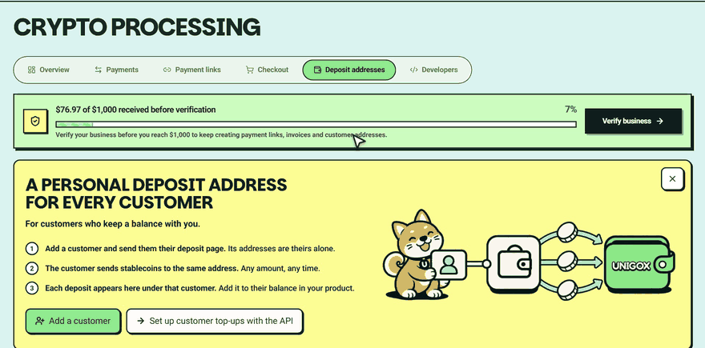
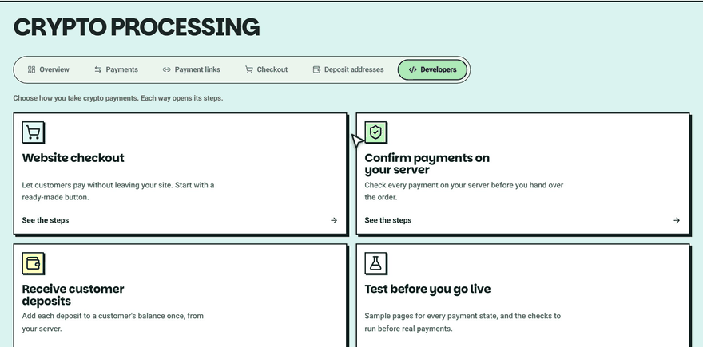

# Crypto processing: the whole guide

> **Not available yet.** This page describes crypto processing ahead of its release. Until this notice is gone, `https://www.unigox.com/checkout.js`, the help pages and the link check it names can answer 404. Once released, crypto processing is in early access, turned on per business.

Crypto processing lets your customers pay you in USDT, USDC, USDG and USDT0 on 13 networks. Unigox shows the payer the amount, the address and the progress of the transfer, so you do not build a payment page. Each payment arrives in your Unigox wallet (your balance at Unigox) in the coin the customer sent: Unigox does not convert it.

This page shows how to open crypto processing for your business, the shortest way to take payments on your website, and how to create a payment link, an invoice and a customer's deposit addresses in the portal, which needs no code. The other pages give the developer of your website every detail. The guide uses each of its terms in one meaning: [Words this guide uses](https://developers.unigox.com/tutorials/crypto-checkout-reference#words-this-guide-uses).

## Pick your task

| What you want to do | Code | Where |
| --- | --- | --- |
| Send a customer a link to pay an order | None | [Your first payment link](#your-first-payment-link) |
| Send an invoice with a PDF | None | [Send an invoice](#send-an-invoice) |
| Give a customer permanent addresses to top up a balance | None | [Give a customer deposit addresses](#give-a-customer-deposit-addresses) |
| Take payments on your website: a **Pay with crypto** button, the checkout inside your page, or a payment page | A few lines on your page and one request on your server, with your API key | [Your website in four steps](#your-website-in-four-steps), then [Website checkout](https://developers.unigox.com/tutorials/crypto-checkout-embed) |
| Mark orders paid on your server | One request with your API key | [Confirm payments](https://developers.unigox.com/tutorials/crypto-checkout-confirm) |
| Create deposit pages, or payment links that stay open longer than 7 days, from your server | Server code and your wallet's key | [Deposit pages and signed links](https://developers.unigox.com/tutorials/crypto-checkout-links) |
| Build your own payment page | Server and page code, and your wallet's key | [Your own payment page](https://developers.unigox.com/tutorials/crypto-payments) |
| Check your integration before real customers pay | None | [Test and go live](https://developers.unigox.com/tutorials/crypto-checkout-testing) |

## How a payment works

1. A payment starts as an order or as a payment link. On your website, your server creates a new order for each payment, with your API key. A payment link is one you create in the portal and send to one customer. Both open at `https://www.unigox.com/pay/{token}`.
2. The customer opens the checkout, on a Unigox page or on your site, and picks a coin and a network.
3. The customer sends the amount from any wallet or exchange. Each order and each link has its own addresses, so the customer adds no memo or tag.
4. Unigox adds the payment to your Unigox wallet, in the same coin and the same amount. The portal's **Payments** shows it as **Completed**.
5. You fulfil the order once your server reads it as paid, or once you see the payment in **Payments**.

Creating an order or a link and opening a checkout move no money. A message the checkout sends to your web page is not proof of payment: anyone can produce one in their own browser. Proof is the payment in **Payments**, or your server's check ([Confirm payments](https://developers.unigox.com/tutorials/crypto-checkout-confirm)).

## Open crypto processing

1. On `https://www.unigox.com/crypto-processing`, press **Start business onboarding**. Sign in or create an account if you have none.
2. Answer **Your business** and **Your volume**, and under **Your products** pick **Crypto processing**.
3. Answer the questions under **Before you start accepting crypto**. You upload no documents at this step. By finishing, you confirm that you take no payments from sanctioned countries and regions, as the Terms of Service require. The questions are:
   - who you accept payments for: yourself, or a company (then its name);
   - your website and your industry;
   - how you plan to accept payments;
   - whose goods or services your customers pay for;
   - where your customers are: pick countries, or **Worldwide**;
   - the largest single payment you expect.
4. Press **Finish and open my portal**. **Crypto processing** opens in your business portal, and you can create your first payment link at once.

<figure><figcaption><p>The crypto processing questions in business onboarding (sample answers).</p></figcaption></figure>

Until your business is verified, you can receive up to 1,000 USD in total. A band at the top of every **Crypto processing** page shows how much of it you have received, with the **Verify business** button. Once you reach 1,000 USD, you cannot create orders, payment links, invoices or deposit addresses until your business is verified. Payments to the ones you already created still arrive.

## What you need

To take payments from the portal you need only **Crypto processing in your business portal** ([Open crypto processing](#open-crypto-processing)). A developer who connects your website also needs:

- **Your partner API key.** Your server sends it in the `X-API-Key` header to create and read orders, at `https://api.unigox.com`. Step 1 of [Your website in four steps](#your-website-in-four-steps) shows where to get it. Keep it on your server, never in a web page or a repository.
- **The portal open now and then.** Each order takes payment addresses that the portal reserves while you are signed in with **Crypto processing** open, as the account whose wallet receives the payments ([Limits](https://developers.unigox.com/tutorials/crypto-checkout-reference#limits)).

Deposit pages, links your server signs and your payment history need two more things:

- **The API address**, which **Developers → Environment** shows as **API address**. It can change, so keep it in your configuration, not in your code. The examples call it `UNIGOX_PAYMENTS_API`.
- **Your wallet's private key**, to sign those requests. Unigox gives you the key on request (**Developers → Confirm payments on your server → Ask for the key**). This key can move your whole balance. Keep it in a secrets store on the server that signs, never in browser code or a repository. Keep the wallet's balance low: move the money you collect out regularly. **Developers → Environment** shows your wallet's address as **Your Unigox wallet**.

Unigox does not send payment notifications (webhooks) to your server yet. Your server reads each order itself: when the customer returns to your site, and from a job that runs every few minutes.

## The portal

Everything for crypto processing is under **Crypto processing** in your business portal:

| Tab | What it is for |
| --- | --- |
| **Overview** | Money received, recent payments and shortcuts to the three ways to get paid |
| **Payments** | Every payment, its status and its transactions; **Export CSV** |
| **Payment links** | Create links and invoices, follow them, close them; **Export CSV** |
| **Checkout** | Set up the checkout on your website and copy its code |
| **Deposit addresses** | Customers with permanent addresses and deposit pages |
| **Developers** | Code for your website and server, test pages, the API address and your wallet |

<figure><figcaption><p>The Overview before your business is verified (test account).</p></figcaption></figure>

**Settings** is where you set what payers see. It has no tab: open `https://www.unigox.com/portal/crypto/settings`, or follow the **Settings** link that the link form shows when your business name is missing.

- **Shown to the payer as**: your business name on payment pages.
- **Return to your site (optional)**: an `https://` page the payer can go back to.
- **Support email for payers (optional)**: shown when a payer has to contact you.

These settings are stored in your browser, not in your account. They go into every link you create or copy in this browser from then on. A link you already sent keeps what it had, and a link made in another browser does not have them. Orders do not use them: your server sends the name and the return page with each order (`merchantName`, `returnUrl`).

## Your website in four steps

You add this once. Every payment is then a new order that your server creates.

**1. Get your API key.** Open **Crypto processing → Checkout** and pick **Payment button**. Under **3. Create the order on your server**, press **Get your API key**. On the page that opens, press **Generate** next to **API key** and copy the key: it is shown only once. Keep it on your server as `UNIGOX_API_KEY`. Leave **Crypto processing** open for a few minutes the first time, signed in as the account whose wallet receives the payments: the portal reserves the addresses your orders will take.

**2. Put the checkout on your page.** The button asks your server for an order on its first press and opens the checkout over your page:

```html
<script src="https://www.unigox.com/checkout.js"></script>
<button type="button" id="pay-with-crypto">Pay with crypto</button>
<script>
  // Your server's route of step 3: it creates the order and answers { token, payUrl }.
  const newOrder = () => fetch("/your-server/crypto-order", { method: "POST" })
    .then((r) => (r.ok ? r.json() : Promise.reject(new Error(`HTTP ${r.status}`))));
  let checkout;
  document.getElementById("pay-with-crypto").addEventListener("click", () => {
    // checkout.js did not load (an ad blocker, the network, your CSP): the order's payment page takes the payment.
    if (!window.UnigoxCheckout) return newOrder().then((o) => location.assign(o.payUrl));
    checkout ??= UnigoxCheckout.create({
      token: () => newOrder().then((o) => o.token), // called on the first open: your server creates the order
      mode: "modal",
      onComplete(payload) { /* update your page; only your server confirms the payment */ },
    });
    checkout.open();
  });
</script>
```

**3. Create the order on your server.** One request with your order number and total:

```bash
curl -X POST https://api.unigox.com/api/v1/partner/crypto/orders \
  -H "X-API-Key: $UNIGOX_API_KEY" \
  -H "Content-Type: application/json" \
  -d '{"merchantName": "Northwind", "reference": "A-1001", "amount": "25.00"}'
```

The answer is `{"status": "order_created", "code": 201, "data": {"id": "ord_…", "token": "o_…", "payUrl": "https://www.unigox.com/pay/o_…", …}}`. The same request as the route your page calls, in Node.js:

```js
// Node 18+ with express (npm install express). UNIGOX_API_KEY stays on your server, never in the page.
import express from "express";

const app = express();

app.post("/your-server/crypto-order", async (req, res) => {
  const cart = await yourCart(req); // your own order, e.g. { id: "A-1001", total: "25.00" }
  const response = await fetch("https://api.unigox.com/api/v1/partner/crypto/orders", {
    method: "POST",
    headers: { "Content-Type": "application/json", "X-API-Key": process.env.UNIGOX_API_KEY },
    body: JSON.stringify({ merchantName: "Northwind", reference: cart.id, amount: cart.total }),
  });
  const body = await response.json().catch(() => null);
  if (!response.ok) return res.status(502).end();
  await saveUnigoxOrderId(cart.id, body.data.id); // step 4 reads the order by this id
  res.json({ token: body.data.token, payUrl: body.data.payUrl });
});

app.listen(3000);
```

`yourCart()` and `saveUnigoxOrderId()` stand for your own code. The same `reference` sent again returns the same order, so a second press never makes a second order.

**4. Read the order to confirm.** Ship when the order reads `paid` or `overpaid`. Read it when the payer returns to your site, and from a job every few minutes:

```js
const unigoxOrderId = await yourUnigoxOrderId(cartId); // the id you saved in step 3, never one from the browser
const response = await fetch(`https://api.unigox.com/api/v1/partner/crypto/orders/${encodeURIComponent(unigoxOrderId)}`, {
  headers: { "X-API-Key": process.env.UNIGOX_API_KEY },
});
if (!response.ok) throw new Error(`Unigox: HTTP ${response.status}`); // try again on the next pass
const { data: order } = await response.json();
if (order.status === "paid" || order.status === "overpaid") { /* mark your order paid, once, and ship */ }
```

[Website checkout](https://developers.unigox.com/tutorials/crypto-checkout-embed) has the other ways to show the checkout, and [Confirm payments](https://developers.unigox.com/tutorials/crypto-checkout-confirm) every status and the job.

## Your first payment link

1. Open **Crypto processing → Payment links**. On the **Payment link** tile, press **Create payment link**.
2. Enter **Amount (USD)**, at least 1.00. Add an **Order ID** to find the payment later, or leave it empty and the portal makes one.
3. Under **Accepted payments**, leave every coin and network ticked, or untick the ones you do not take.
4. Press **Create link**.
5. Press **Copy link** and send it to your customer, or **Open checkout** to see what they see.

<figure><figcaption><p>Creating a payment link (sample data).</p></figcaption></figure>

Creating the link takes up to a minute, while its networks get ready. If a network is still getting ready after that, the link says which one, and payers can already use the others.

When the customer pays, the link shows **Payment detected**, then **Paid**, and the payment appears in **Payments**. A payment that is short by at most 0.5 % of the amount, and by no more than 1.00 USD, still counts as paid. This covers an exchange that takes its withdrawal fee out of the amount it sends. An invoice must be paid in full.

## Send an invoice

An invoice is a payment link with an invoice document. Your customer gets the link and a PDF, and pays the total in full.

1. Open **Crypto processing → Payment links** and press **Create invoice**.
2. Under **Customer**, choose a customer or add one.
3. Under **Items**, enter what you charge for: **Description**, **Qty** and **Unit price (USD)**. **Add item** and **Add tax** add lines.
4. Check **Number and dates** and **Your business**, and add **Terms and notes** if you need them. **Invoice preview** shows the document as your customer gets it.
5. Press **Review invoice**, check the coins and networks under **Accepted payments**, then press **Create invoice & payment link**.
6. Under **Invoice created**, press **Copy link** to send the link, or **Download invoice PDF** to attach the invoice to an email.

<figure><figcaption><p>Creating an invoice (test account, nothing is created).</p></figcaption></figure>

## Give a customer deposit addresses

Use this for a customer who keeps a balance with you. The customer gets permanent addresses of their own and can send any amount at any time. Each deposit appears in **Payments** under that customer.

1. Open **Crypto processing → Deposit addresses** and press **Add a customer**.
2. Enter the **Customer or company name**: the customer sees it on their deposit page. **Tax ID**, **Email** and **Billing address** are optional.
3. Under **Networks**, keep every network or choose the ones you accept, then press **Create addresses**.
4. Under **Deposit addresses ready**, press **Copy link** and send the customer the link to their deposit page. You can also show the addresses in your own product.

<figure><figcaption><p>Adding a customer with deposit addresses (test account, nothing is created).</p></figcaption></figure>

The customer opens the deposit page, picks a coin and a network and copies their address. Their deposits are listed on the same page.

<figure><figcaption><p>The deposit page as your customer sees it (sample page).</p></figcaption></figure>

Unigox does not keep your customers' balances. Add each deposit to the customer's balance in your own system, once: by hand from **Payments**, or from your server ([Deposit pages and signed links](https://developers.unigox.com/tutorials/crypto-checkout-links#create-a-deposit-page-for-a-customer)).

Next: put the checkout on your website ([Website checkout](https://developers.unigox.com/tutorials/crypto-checkout-embed)), or mark orders paid on your server ([Confirm payments](https://developers.unigox.com/tutorials/crypto-checkout-confirm)).

<!-- checkout-embed.md -->

**Add checkout to your website**

Take payments on your website. You add the code once. For every payment, your server creates a new order with your API key, and the checkout shows that order: in a window over your page, inside your page, or on a Unigox payment page. The checkout shows the amount, lets the payer choose a coin and a network, shows the address and follows the transfer. It tells your page about each step through callbacks.

## Choose how customers pay

| Way | What the payer sees | What you add |
| --- | --- | --- |
| **Payment button** | The checkout opens in a window over your page | `checkout.js`, a button and one request on your server |
| **Embedded checkout** | The checkout inside your page | `checkout.js`, an empty element and one request on your server |
| **Payment page** | A Unigox page with the payment, in the same tab | A form that posts to your server, which sends the payer to the order's page |
| **Your own frame** | The checkout in an iframe you control | An iframe, a message listener and one request on your server |

Use the payment button or the embedded checkout if you can: `checkout.js` takes care of sizing, phones, loading problems and messages. Use the payment page on any page where you cannot add a script. Use your own frame only when your site cannot load a script from Unigox.

All four open an order. A payment link you make in the portal is for one payment you send to one customer, by email or in a chat ([Get started](https://developers.unigox.com/tutorials/crypto-checkout#your-first-payment-link)).

## 1. Create the order on your server

When the payer chooses to pay with crypto, your page asks your own server for an order. Your server creates it at Unigox with one request and answers the page with the order's `token` and `payUrl`.

**Before you start:**

- **Your partner API key.** In the portal, **Crypto processing → Checkout**, step **3. Create the order on your server**, has **Get your API key**. It opens your partner page, where **Generate** creates the key under **API key** and shows it once; **Reissue** replaces it and stops the old one. Keep the key on your server, never in a web page or a repository.
- **Addresses for your orders.** Each order takes one payment address of each address type from the addresses the portal keeps ready for orders. The portal adds them while you are signed in with **Crypto processing** open, as the account whose wallet receives the payments. Open it once before your first order, and open it again regularly: see [Limits](https://developers.unigox.com/tutorials/crypto-checkout-reference#limits).

The request, with your order number and total:

```bash
curl -X POST https://api.unigox.com/api/v1/partner/crypto/orders \
  -H "X-API-Key: $UNIGOX_API_KEY" \
  -H "Content-Type: application/json" \
  -d '{"merchantName": "Northwind", "reference": "A-1001", "amount": "25.00", "customer": {"id": "cus-77"}}'
```

The answer, `201` (shortened):

```json
{
  "status": "order_created",
  "code": 201,
  "data": {
    "id": "ord_4f9c2a7e1b3d5c8a0e6f2b4d",
    "token": "o_4f9c2a7e1b3d5c8a0e6f2b4d",
    "payUrl": "https://www.unigox.com/pay/o_4f9c2a7e1b3d5c8a0e6f2b4d",
    "reference": "A-1001",
    "amount": "25.00",
    "currency": "USD",
    "status": "open",
    "received": "0.00",
    "expiresAt": "2026-11-26T11:00:00.000000Z"
  }
}
```

The same request as the route your page calls, in Node.js:

```js
// Node 18+ with express (npm install express). UNIGOX_API_KEY stays on your server, never in the page.
import express from "express";

const app = express();
const UNIGOX_API = "https://api.unigox.com"; // https://api-staging.unigox.com on a test account

app.post("/your-server/crypto-order", async (req, res) => {
  const cart = await yourCart(req); // your own order, e.g. { id: "A-1001", total: "25.00", customerId: "cus-77" }
  const response = await fetch(`${UNIGOX_API}/api/v1/partner/crypto/orders`, {
    method: "POST",
    headers: { "Content-Type": "application/json", "X-API-Key": process.env.UNIGOX_API_KEY },
    body: JSON.stringify({
      merchantName: "Northwind",         // the name the payer sees
      reference: cart.id,                // your order number, at most 64 characters
      amount: cart.total,                // USD as a string, such as "25.00"
      customer: { id: cart.customerId }, // optional
    }),
    signal: AbortSignal.timeout(10_000),
  });
  const body = await response.json().catch(() => null);
  if (!response.ok) {
    console.error("Unigox order not created:", response.status, body?.details, body?.field);
    return res.status(502).end();
  }
  await saveUnigoxOrderId(cart.id, body.data.id); // you read the order by this id to confirm the payment
  res.json({ token: body.data.token, payUrl: body.data.payUrl });
});

app.listen(3000);
```

`yourCart()` and `saveUnigoxOrderId()` stand for your own code.

- **Create the order when the payer chooses to pay, not when the page loads.** An order holds one address of each type until it ends, and each address then rests 24 hours before another order can take it. Orders that nobody pays use up addresses.
- **Send the same `reference` for the same cart.** While that order is open or paid, a request with the same `reference` and `amount` returns the same order (`200`), so a double click or a retry never makes a second order. If the cart's total changed, use a new `reference`, or close the old order first: the same `reference` with another amount answers `409 order_reference_conflict`.
- **Keep `data.id` with your order.** Your server reads the order with it to know when it is paid ([Confirm payments](https://developers.unigox.com/tutorials/crypto-checkout-confirm)). Never read an order by an id that the browser sends you.
- **Send `merchantName`.** It is the name the payer sees, and every answer about the order returns it. Without it the payer sees your partner account's name. The name under **Settings → Shown to the payer as** is kept in your browser and does not reach orders.
- **The order takes payments for 60 minutes.** Send `expiresInMinutes` for another time, from 5 to 10,080 (7 days).
- **When Unigox refuses the order**, show the payer another way to pay. `409 no_free_addresses`: no address is free; open **Crypto processing** in the portal. `403 merchant_unverified_limit`: your business is not verified and has received 1,000 USD. Every field and error is in the [Reference](https://developers.unigox.com/tutorials/crypto-checkout-reference#orders-api).

## 2. Show the checkout

### Get the code from the portal

1. Open **Crypto processing → Checkout** and pick **Payment button**, **Embedded checkout** or **Payment page**.
2. Under **1. Choose how customers pay**, keep the way you picked or change it. **Your own frame** is in this list only. The preview beside the steps shows what your customer sees.
3. Under **2. Add checkout to your site**, press **Copy code** and paste the code into your page.
4. Under **3. Create the order on your server**, choose **cURL** or **Node.js** and add the request to your server. **Get your API key** leads to your key.
5. Read **4. Check the payment**: ship once your server reads the order as `paid` ([Confirm payments](https://developers.unigox.com/tutorials/crypto-checkout-confirm)).

<figure><figcaption><p>Setting up the payment button in the portal (sample data).</p></figcaption></figure>

The code you copy calls `/your-server/crypto-order` on your site: the route of step 1. Under the steps, **Add to your Content-Security-Policy** gives the one line a strict policy needs, and **Callbacks** and **Error codes** list what your page can react to.

### Payment button

Load `checkout.js` once on the page, from `https://www.unigox.com`, and open the checkout from your button:

```html
<script src="https://www.unigox.com/checkout.js"></script>
<button type="button" id="pay-with-crypto">Pay with crypto</button>
<script>
  // Your server's route from step 1: it creates the order and answers { token, payUrl }.
  const newOrder = () => fetch("/your-server/crypto-order", { method: "POST" })
    .then((r) => (r.ok ? r.json() : Promise.reject(new Error(`HTTP ${r.status}`))));
  let checkout;
  document.getElementById("pay-with-crypto").addEventListener("click", () => {
    // checkout.js did not load (an ad blocker, the network, your CSP): the order's payment page takes the payment.
    if (!window.UnigoxCheckout) return newOrder().then((o) => location.assign(o.payUrl));
    checkout ??= UnigoxCheckout.create({
      token: () => newOrder().then((o) => o.token), // called on the first open: your server creates the order
      mode: "modal",
      onComplete(payload) { /* update your page; only your server confirms the payment */ },
    });
    checkout.open();
  });
</script>
```

`checkout.js` calls the `token` function once, on the first `open()`. A failed request reaches `onError` as `TOKEN_MISSING`, and the next `open()` calls the function again. Once it has a token, every `open()` shows the same order. Closing the window does not cancel the payment. If the payer comes back after the order's time ran out, the checkout shows the order as ended: call `checkout.destroy()` and create a new checkout, which creates a new order.

On a phone the window fills the screen. The window closes when the browser goes Back or leaves the page. In a single-page app, call `checkout.close()` when your route changes.

### Embedded checkout

```html
<script src="https://www.unigox.com/checkout.js"></script>
<button type="button" id="pay-with-crypto">Pay with crypto</button>
<div id="checkout"></div>
<script>
  const newOrder = () => fetch("/your-server/crypto-order", { method: "POST" })
    .then((r) => (r.ok ? r.json() : Promise.reject(new Error(`HTTP ${r.status}`))));
  const button = document.getElementById("pay-with-crypto");
  let checkout;
  // The order is created when the payer chooses crypto: the press mounts the checkout, which asks for the token.
  button.addEventListener("click", () => {
    // checkout.js did not load (an ad blocker, the network, your CSP): the order's payment page takes the payment.
    if (!window.UnigoxCheckout) return newOrder().then((o) => location.assign(o.payUrl));
    button.hidden = true;
    checkout ??= UnigoxCheckout.create({
      token: () => newOrder().then((o) => o.token), // called on the first mount: your server creates the order
      mode: "inline",
      onError: ({ code }) => { if (code === "TOKEN_MISSING" || code === "TOKEN_TIMEOUT") button.hidden = false; },
    });
    checkout.mount("#checkout");
  });
</script>
```

The checkout takes the element's full width and the height it needs, so your page never shows a second scrollbar. Keep the element visible: a hidden or zero-height element hides the checkout.

### Payment page

Your button posts a form to your server. Your server creates the order and sends the payer to the order's payment page:

```html
<form method="post" action="/your-server/crypto-order">
  <button type="submit">Pay with crypto</button>
</form>
```

In the route of step 1, answer the form with `res.redirect(303, body.data.payUrl)` instead of `res.json(…)`. `payUrl` is `https://www.unigox.com/pay/o_…`. For a language, put `/es`, `/fr` or `/pt` before `/pay` (`https://www.unigox.com/es/pay/o_…`). Without one, the page follows the payer's browser.

You can also send `payUrl` by email or in a chat. It takes payments until the order's `expiresAt`.

### Links you already have

Mark links to a payment page with `data-unigox-checkout`, and the checkout opens in a window over your page instead of on a new page. A link can be an order's `payUrl` that your server put in the page, or a payment link from the portal. With `data-unigox-checkout="inline"` and `data-target`, it shows inside the element you name:

```html
<a data-unigox-checkout href="https://www.unigox.com/pay/{token}">Pay with crypto</a>
<a data-unigox-checkout="inline" data-target="#checkout" href="https://www.unigox.com/pay/{token}">Pay here</a>
<div id="checkout"></div>
<script>window.UnigoxCheckout && UnigoxCheckout.bind();</script>
```

`{token}` is the part of the link after `/pay/`. These links give your page no callbacks. Confirm an order's payment by reading the order on your server, and a payment link's in **Payments** or from your payment history. On a page where users can post links (reviews, comments), bind only the container that holds your own links: `UnigoxCheckout.bind(document.querySelector("#checkout-links"))`.

### Invoices

An invoice made in **Payment links → Create invoice** is a payment link with the invoice document after `#invoice=` in the link. Pass the full link as `url`, not just the token, so the payer can open the invoice:

```js
// invoicePaymentUrl is the complete link copied from the portal, including #invoice=…
let checkout;
document.querySelector("#pay").addEventListener("click", () => {
  if (!window.UnigoxCheckout) return window.location.assign(invoicePaymentUrl);
  checkout ??= UnigoxCheckout.create({ url: invoicePaymentUrl, mode: "modal" });
  checkout.open();
});
```

The invoice document is stored only in the link and in the browser that made it. Anyone who has the full link can read the invoice: keep the link out of analytics and logs.

### Your own frame

Use this only if you cannot load `checkout.js`. Serve your page over HTTPS (or `http://localhost` while you build), keep the referrer policy that the example sets, and give each frame its own 16-character hexadecimal `instance`:

```html
<div id="checkout"></div>
<a id="checkout-fallback" target="_blank" rel="noopener noreferrer" hidden></a>
<script>
  // locale: "en", "es", "fr" or "pt". Leave it out to follow the payer's browser, as checkout.js does.
  function mountCheckoutFrame(container, token, fallback, locale) {
    const checkoutOrigin = "https://www.unigox.com";
    const languages = ["en", "es", "fr", "pt"];
    const lang = languages.includes(locale) ? locale
      : (navigator.languages || [navigator.language]).map((l) => String(l).slice(0, 2).toLowerCase()).find((l) => languages.includes(l)) || "en";
    // The frame's name and the fallback link's text, in the checkout's language.
    const words = {
      en: ["Pay with crypto", "Continue to secure checkout"],
      es: ["Pagar con cripto", "Continuar al checkout seguro"],
      fr: ["Payer en crypto", "Continuer vers le checkout sécurisé"],
      pt: ["Pagar com cripto", "Continuar para o checkout seguro"],
    }[lang];
    const hostedUrl = new URL((lang === "en" ? "" : "/" + lang) + "/pay/" + encodeURIComponent(token), checkoutOrigin);
    const instance = Array.from(crypto.getRandomValues(new Uint8Array(8)), b => b.toString(16).padStart(2, "0")).join("");
    const frameUrl = new URL(hostedUrl);
    frameUrl.search = new URLSearchParams({ embed: "1", mode: "inline", v: "1", instance, origin: location.origin });
    const frame = document.createElement("iframe");
    frame.title = words[0];
    frame.setAttribute("sandbox", "allow-scripts allow-same-origin allow-forms allow-popups allow-popups-to-escape-sandbox allow-top-navigation-to-custom-protocols");
    frame.allow = "clipboard-write";
    frame.referrerPolicy = "strict-origin-when-cross-origin";
    frame.style.cssText = "width:100%;max-width:480px;height:560px;border:0;color-scheme:normal";
    let visible = true;
    // The link to the hosted page shows only while the frame cannot: 10 seconds without READY, or a frame that fails.
    if (fallback) {
      fallback.href = hostedUrl.href;
      fallback.textContent = words[1];
    }
    const showFallback = (show) => { if (fallback) fallback.hidden = !show; };
    const fallbackTimer = setTimeout(() => showFallback(true), 10000);
    const send = (type, fields = {}) => frame.contentWindow?.postMessage({
      source: "unigox-checkout-host", v: 1, instance, type, ...fields,
    }, checkoutOrigin);
    function onMessage(event) {
      if (event.origin !== checkoutOrigin || event.source !== frame.contentWindow) return;
      const msg = event.data;
      if (!msg || msg.source !== "unigox-checkout" || msg.v !== 1 || msg.instance !== instance) return;
      if (msg.type === "UNIGOX_CHECKOUT_READY") {
        clearTimeout(fallbackTimer);
        showFallback(false);
        // Repeat after READY: a visibility message sent before load may have been missed.
        send("UNIGOX_CHECKOUT_VISIBILITY", { visible });
      } else if (msg.type === "UNIGOX_CHECKOUT_RESIZE") {
        const height = msg.payload?.height;
        // The heights checkout.js takes too: more than 0, at most 10000 px. A long checkout on a phone is taller than
        // 2000 px; a lower cap would give it a scrollbar inside the frame.
        if (typeof height === "number" && height > 0 && height <= 10000) {
          frame.style.height = Math.max(160, height) + "px";
        }
      }
      // Payment events may update your screen. Only your server can fulfil the order.
    }
    window.addEventListener("message", onMessage);
    frame.addEventListener("load", () => send("UNIGOX_CHECKOUT_PING"));
    frame.addEventListener("error", () => showFallback(true));
    frame.src = frameUrl.href;
    container.append(frame);
    return {
      hostedUrl: hostedUrl.href,
      setVisible(value) {
        visible = Boolean(value);
        frame.hidden = !visible;
        send("UNIGOX_CHECKOUT_VISIBILITY", { visible });
      },
      destroy() {
        clearTimeout(fallbackTimer);
        window.removeEventListener("message", onMessage);
        frame.remove();
      },
    };
  }
  let frameCheckout;
  // Your server creates the order (step 1); its token opens the frame.
  fetch("/your-server/crypto-order", { method: "POST" })
    .then((r) => (r.ok ? r.json() : Promise.reject(new Error(`HTTP ${r.status}`))))
    .then((o) => {
      frameCheckout = mountCheckoutFrame(document.getElementById("checkout"), o.token, document.getElementById("checkout-fallback"));
    });
  // In Spanish, for example: mountCheckoutFrame(container, token, fallback, "es").
  // Call frameCheckout.destroy() when this view unmounts.
</script>
```

The ordinary payment page cannot be shown in a frame. Only the URL with `embed=1` can.

### React, Next.js, Vue and PHP

Each example calls the route of step 1, `/your-server/crypto-order`, which answers `{ token, payUrl }`.

React:

```jsx
import { useEffect, useRef, useState } from "react";

const newOrder = () => fetch("/your-server/crypto-order", { method: "POST" })
  .then((r) => (r.ok ? r.json() : Promise.reject(new Error(`HTTP ${r.status}`))));

// A button that creates the order on its first press and opens the checkout over the page.
export function PayWithCrypto({ cartId }) {
  const checkout = useRef(null);
  const [failed, setFailed] = useState(false);
  useEffect(() => {
    setFailed(false);
    return () => { checkout.current?.destroy(); checkout.current = null; };
  }, [cartId]);
  const pay = () => {
    // checkout.js did not load, or the checkout failed: the order's payment page takes the payment.
    if (!window.UnigoxCheckout || failed) return newOrder().then((o) => window.location.assign(o.payUrl));
    checkout.current ??= window.UnigoxCheckout.create({
      token: () => newOrder().then((o) => o.token),
      onError: () => setFailed(true), // the next press uses the payment page, never a dead button
      onComplete: () => window.location.assign(`/orders/${cartId}`),
    });
    checkout.current.open();
  };
  return <button type="button" onClick={pay}>Pay with crypto</button>;
}

// The checkout inside the page, for an order your server has created: pass its token and payUrl.
export function InlineCheckout({ token, payUrl }) {
  const box = useRef(null);
  const [ready, setReady] = useState(false);
  useEffect(() => {
    setReady(false);
    if (!window.UnigoxCheckout) return;
    const checkout = window.UnigoxCheckout.create({ token, mode: "inline", onReady: () => setReady(true), onError: () => setReady(false) });
    checkout.mount(box.current);
    return () => checkout.destroy();
  }, [token]);
  return <><div ref={box} />{!ready && <a href={payUrl}>Open checkout</a>}</>;
}
```

Next.js (App Router), the route and the button:

```js
// app/your-server/crypto-order/route.js: runs on your server, so UNIGOX_API_KEY never reaches the browser.
export async function POST(request) {
  const cart = await yourCart(request); // your own order, e.g. { id: "A-1001", total: "25.00" }
  const response = await fetch("https://api.unigox.com/api/v1/partner/crypto/orders", {
    method: "POST",
    headers: { "Content-Type": "application/json", "X-API-Key": process.env.UNIGOX_API_KEY },
    body: JSON.stringify({ merchantName: "Northwind", reference: cart.id, amount: cart.total }),
  });
  const body = await response.json().catch(() => null);
  if (!response.ok) return new Response(null, { status: 502 });
  await saveUnigoxOrderId(cart.id, body.data.id);
  return Response.json({ token: body.data.token, payUrl: body.data.payUrl });
}
```

```jsx
// app/checkout/pay-button.jsx
"use client";
import Script from "next/script";
import { useEffect, useRef, useState } from "react";

const newOrder = () => fetch("/your-server/crypto-order", { method: "POST" })
  .then((r) => (r.ok ? r.json() : Promise.reject(new Error(`HTTP ${r.status}`))));

export default function PayButton() {
  const [loaded, setLoaded] = useState(false);
  const checkout = useRef(null);
  useEffect(() => () => { checkout.current?.destroy(); checkout.current = null; }, []);
  return (
    <>
      <Script src="https://www.unigox.com/checkout.js" strategy="afterInteractive" onReady={() => setLoaded(true)} onError={() => setLoaded(false)} />
      <button type="button" onClick={() => {
        if (!loaded || !window.UnigoxCheckout) return newOrder().then((o) => window.location.assign(o.payUrl));
        (checkout.current ??= window.UnigoxCheckout.create({ token: () => newOrder().then((o) => o.token), onError: () => setLoaded(false) })).open();
      }}>Pay with crypto</button>
    </>
  );
}
```

Vue, the checkout inside the page for an order your server has created:

```vue
<template><div ref="box" /><a v-if="!ready" :href="props.payUrl">Open checkout</a></template>
<script setup>
import { onBeforeUnmount, onMounted, ref, watch } from "vue";
const props = defineProps({ token: String, payUrl: String });
const box = ref(null);
const ready = ref(false);
let checkout;
function mountCheckout() {
  if (!box.value) return;
  checkout?.destroy();
  ready.value = false;
  if (!window.UnigoxCheckout) return;
  checkout = window.UnigoxCheckout.create({ token: props.token, mode: "inline", onReady: () => { ready.value = true; }, onError: () => { ready.value = false; } });
  checkout.mount(box.value);
}
onMounted(mountCheckout);
watch(() => props.token, mountCheckout, { flush: "post" });
onBeforeUnmount(() => checkout?.destroy());
</script>
```

PHP, the payment page way (WordPress included). Point the `action` of the form in [Payment page](#payment-page) at this file.

```php
<?php
// your-server/crypto-order.php: creates the order and sends the payer to its payment page.
// UNIGOX_API_KEY comes from your server's environment, never from the page.
$cart = your_cart(); // your own order, e.g. ['id' => 'A-1001', 'total' => '25.00']
$ch = curl_init('https://api.unigox.com/api/v1/partner/crypto/orders');
curl_setopt_array($ch, [
  CURLOPT_POST => true,
  CURLOPT_RETURNTRANSFER => true,
  CURLOPT_TIMEOUT => 10,
  CURLOPT_HTTPHEADER => ['Content-Type: application/json', 'X-API-Key: ' . getenv('UNIGOX_API_KEY')],
  CURLOPT_POSTFIELDS => json_encode(['merchantName' => 'Northwind', 'reference' => $cart['id'], 'amount' => $cart['total']]),
]);
$body = json_decode((string) curl_exec($ch), true);
$status = curl_getinfo($ch, CURLINFO_RESPONSE_CODE);
if ($status !== 200 && $status !== 201) {
  http_response_code(502);
  exit('Crypto payment is not available right now.');
}
save_unigox_order_id($cart['id'], $body['data']['id']); // you read the order by this id to confirm the payment
header('Location: ' . $body['data']['payUrl'], true, 303);
```

## 3. React to the checkout

### Options

| Option | Default | What it does |
| --- | --- | --- |
| `token` | none | The order's token, or a payment link's, or a function that returns it or a promise of it. The function is called on the first `open()` or `mount()`, and again after it failed or timed out. |
| `url` | none | A whole payment page address instead of `token`: an order's `payUrl` or a payment link. Keeps an invoice attached after `#invoice=`. |
| `mode` | `"modal"` | `"modal"`: a window over your page. `"inline"`: inside your page. `"hosted"`: `open()` sends the payer to the payment page, in the same tab. A browser without `<dialog>` gets `"hosted"`. |
| `container` | none | Embedded: the element or a selector, used when `mount()` gets none. |
| `theme` | light | `"light"` or `"dark"`. |
| `locale` | `"auto"` | `"en"`, `"es"`, `"fr"` or `"pt"`. `"auto"` follows the payer's browser. |
| `readyTimeoutMs` | `10000` | How long to wait for your token function and for the checkout to load, 3,000 to 120,000 ms. |
| `keepAlive` | `true` | Window: keep the checkout while it is closed. `false` removes it on close. |
| `zIndex` | `2147483000` | Stacking order of the window. |

### Methods

| Method | What it does |
| --- | --- |
| `UnigoxCheckout.create(options)` | Returns a checkout. Nothing is added to the page until you open or mount it. |
| `checkout.open()` | Shows the window, or mounts the embedded checkout. Returns a promise that settles when the checkout is ready, falls back or fails. |
| `checkout.close()` | Hides the window. The payment is kept and its checks pause until it opens again. |
| `checkout.mount(container)` | Embedded: shows the checkout in the element. |
| `checkout.unmount()` | Embedded: removes it. |
| `checkout.destroy()` | Removes everything for good. |
| `checkout.state` | `idle`, `loading`, `ready`, `open`, `closed`, `fallback` or `destroyed` |
| `checkout.status` | The last payment status, for example `awaiting_payment` or `paid` |
| `checkout.hostedUrl` | The payment page of this payment |
| `UnigoxCheckout.hostedUrl(token, { locale })` | The payment page of a token |
| `UnigoxCheckout.bind(root = document)` | Handles `data-unigox-checkout` links inside `root` |

The types are at `https://www.unigox.com/checkout.d.ts`.

### Callbacks

Use callbacks to update your page. A callback is not proof of payment, because anyone can call it in their own browser. Proof is your server's check ([Confirm payments](https://developers.unigox.com/tutorials/crypto-checkout-confirm)).

| Callback | When |
| --- | --- |
| `onReady(payload)` | The checkout has loaded. `payload` has `livemode`, `mode` and `environment`. |
| `onStatusChange(status, payload)` | At every status below |
| `onPaymentDetected(payload)` | A transfer was seen on its network |
| `onComplete(payload)` | Once, on `paid`, `overpaid` or `paid_late` |
| `onDeposit(payload)` | Deposit page: a deposit was credited. Sent again for each credited deposit every time the page opens: count each `quoteId` once. |
| `onReturn(payload)` | The payer pressed **Back to {merchant}**. If you pass no `onReturn`, the window closes. |
| `onClose({reason})` | The window closed: `button`, `escape`, `backdrop`, `api`, `return`, `replaced` or `navigation` |
| `onError({code})` | See below |
| `onResize({height})` | The checkout changed height (already applied) |

For an order, your server reads the order to confirm the payment; the callbacks only tell it when to read. For a payment link, post `payload.payments` from `onStatusChange` and `onComplete` to your server, which checks those transfers with Unigox.

| Error code | What it means and what to do |
| --- | --- |
| `TOKEN_MISSING` | No token: none given, or your token function failed. Call `open()` again once you have one. |
| `TOKEN_TIMEOUT` | Your token function took longer than `readyTimeoutMs`. Let the payer retry. Create the order with the same `reference`, so a retry returns the same order instead of a second one. |
| `TOKEN_INVALID` | The token is not one Unigox can open: a link cut off, edited or no longer reserved for this payment, or an order token that names no order. The payer is told not to pay. Create a new order, or copy the link again. |
| `CHECKOUT_UNAVAILABLE` | Unigox cannot be reached right now. Temporary, not a failed payment: do not close the order. |
| `FRAME_TIMEOUT` | The checkout did not load in time, or your Content Security Policy blocked it. The payer sees **Continue to secure checkout**. Temporary: if `onReady` follows, the checkout loaded late. |
| `FRAME_ERROR` | Anything else went wrong while setting up the checkout; the browser console says what after `[UnigoxCheckout]`. Try again, or send the payer to `checkout.hostedUrl`. |
| `CONTAINER_NOT_FOUND` | Embedded: no element was found to mount into. |
| `CONTAINER_OCCUPIED` | Embedded: another checkout already uses this element. |

None of these codes means that a payment failed or that the payer must pay again.

### Payment statuses

| Status | What it means | What your page does |
| --- | --- | --- |
| `choosing` | The payer is choosing a coin and network | Nothing |
| `awaiting_payment` | The address and amount are shown | Nothing |
| `detected`, `confirming` | A transfer is on its network, not credited yet | Show "payment received, confirming" |
| `paid` | Credited in full, or short by at most 0.5 % and never more than 1.00 USD | Ask your server to confirm |
| `overpaid` | Credited, more than the amount | Ask your server to confirm |
| `paid_late` | Credited, but a transfer after the pay-by date was needed | Ask your server; your policy decides |
| `underpaid` | Credited, short by more than the allowance; the rest can still come | Wait, or ask for the rest |
| `underpaid_closed` | Short, and the pay-by date passed or the link closed | Your server decides |
| `on_hold` | Received, being reviewed by Unigox; not in your wallet yet | Wait |
| `failed` | Not credited, or being sent back | Do not fulfil |
| `expired` | The pay-by date passed and nothing came | Create a new order (or link) if the sale stands |
| `cancelled`, `closed` | The payer cancelled, or the order or link was closed | Nothing; money sent later still reaches your wallet |
| `unreferenced` | Money reached the address after the payment was closed, so it is not recorded under it | Find it in **Payments** and match it to the order yourself |
| `unavailable` | The checkout cannot reach Unigox right now | Nothing; it keeps trying |
| `credited` | Deposit page only: a deposit was credited | Ask your server to add it to the customer's balance |

### The payload

Each callback gets the same fields, each only when it applies. Money is a decimal string.

| Field | Value |
| --- | --- |
| `status` | One of the statuses above |
| `mode` | `modal`, `inline`, `topup` on a deposit page, or `null` |
| `livemode` | `true` for a real payment, `false` on a sample page |
| `environment` | `production` or `staging` |
| `reference` | Your order reference |
| `invoiceId` | The full reference text, for example `NW-20418 · 250.00 USD` |
| `amountDue`, `currency` | The amount due, in `USD` |
| `coin`, `chainId` | The coin and network the payer chose |
| `address` | The address shown (`awaiting_payment` only) |
| `txHash`, `logIndex`, `quoteId` | The latest transfer: its transaction hash, which transfer of that transaction, and its Unigox ID |
| `token`, `tokenAddress` | The coin the payment came in, and its contract address. `null` while the coin is not known, or when the amount came in two coins. |
| `amount` | What was sent, credited or on its way |
| `amountReceived` | What is credited so far |
| `amountRemaining` | `underpaid` only: what is still due |
| `amountExtra` | `overpaid` only: what came on top |
| `payments` | Every transfer the checkout follows: `chainId`, `txHash`, `logIndex`, `quoteId`, `amount`, `coin`, `tokenAddress` and `stage` (`checking`, `seen`, `detected`, `confirming`, `on_hold`, `credited`, `failed` or `refunded`) |
| `incomplete` | `true` when the checkout could not follow every transfer (over 200): the amounts are then a minimum |

The same status can arrive more than once. A transfer that is still being checked can appear in `payments` with the amount 0.

### Messages to your own frame

Your own frame posts the same statuses as messages to your page. Each message is `{source: "unigox-checkout", v: 1, instance, type, payload}`, where `type` is one of:

`UNIGOX_CHECKOUT_READY`, `UNIGOX_CHECKOUT_RESIZE` (`payload.height`), `UNIGOX_CHECKOUT_CHOOSING`, `UNIGOX_CHECKOUT_AWAITING_PAYMENT`, `UNIGOX_CHECKOUT_PAYMENT_DETECTED`, `UNIGOX_CHECKOUT_ON_HOLD`, `UNIGOX_CHECKOUT_UNDERPAID`, `UNIGOX_CHECKOUT_PAID`, `UNIGOX_CHECKOUT_OVERPAID`, `UNIGOX_CHECKOUT_PAID_LATE`, `UNIGOX_CHECKOUT_EXPIRED`, `UNIGOX_CHECKOUT_CANCELLED`, `UNIGOX_CHECKOUT_FAILED`, `UNIGOX_CHECKOUT_RECEIVED_WITHOUT_REFERENCE`, `UNIGOX_CHECKOUT_DEPOSIT_CREDITED`, `UNIGOX_CHECKOUT_RETURN`, `UNIGOX_CHECKOUT_CLOSE_REQUESTED`, `UNIGOX_CHECKOUT_INVALID_LINK` and `UNIGOX_CHECKOUT_UNAVAILABLE`.

Accept a message only when `event.origin` is `https://www.unigox.com`, `event.source` is your frame, `source` is `"unigox-checkout"`, `v` is `1` and `instance` is your frame's. Your page can send two messages to the frame, with `source: "unigox-checkout-host"`, `v: 1` and the `instance`: `UNIGOX_CHECKOUT_PING` (send `READY` again) and `UNIGOX_CHECKOUT_VISIBILITY` with `visible: true` or `false` (pause checking while hidden). Nothing your page sends changes the payment.

### When the checkout cannot load

If the checkout does not load within `readyTimeoutMs`, or your Content Security Policy blocks it, the window or element shows **Continue to secure checkout**, and `checkout.state` is `fallback`. The button opens the payment page of the same payment in a new tab, with the transfers already seen, and `onError` gets `FRAME_TIMEOUT`. If the checkout loads late, it replaces the card and `onReady` follows.

If `checkout.js` itself does not load (an ad blocker, the network, your policy), `window.UnigoxCheckout` does not exist. Check for it and send the payer to the payment page, as the button example does. `data-unigox-checkout` links open the payment page by themselves.

### Content Security Policy

For a strict policy, add:

```
script-src https://www.unigox.com; frame-src https://www.unigox.com
```

`checkout.js` needs no `style-src` change. Your own frame needs only `frame-src https://www.unigox.com`.

The checkout only reads payment data: it cannot move money. It runs in a sandboxed frame that cannot navigate your page, and it posts payment details only to the page that framed it.

## 4. Return to your site

- **Payment button and embedded checkout:** `onReturn` is called; the checkout never navigates your page.
- **Payment page:** with `returnUrl` on the order, the page shows **Back to {merchant}**, with the name the payer sees. For a payment link, the page does this with **Return to your site** from **Settings**, or `u` in a token your server makes. It never redirects by itself.

On the page the payer returns to, have your server read the order and show its status. Do not treat the return itself as payment.

## What your customer sees

<figure><figcaption><p>The checkout as your customer sees it (sample page, no real payment).</p></figcaption></figure>

1. **Choose a coin**, then **Choose the network**. Coins and networks you did not accept are not offered. Each network shows how long a payment takes.
2. **Awaiting payment.** The exact amount and the address, each with a copy button, a QR code (on a phone, behind **Show QR**), and the time to pay by: every order has one, a link when you set one.
3. **Payment detected.** The transfer was seen and is confirming on its network. The payer does nothing more.
4. **Payment completed.** The payment is in your Unigox wallet. On the payment page the payer can **Print receipt**.

A payer who already sent the money can press **Already sent? Find my payment** and enter the transaction hash.

<!-- checkout-confirm.md -->

**Confirm payments on your server**

Fulfil an order only after your server has checked with Unigox that the payment reached your wallet. A message from the checkout, the customer's return to your site and a screenshot from the customer are not proof: each can be faked.

## Choose how to check

| Way | For | You need | It finds |
| --- | --- | --- | --- |
| [Read the order](#read-the-order) | Orders your server creates for your website | Your API key and the order's `id` | Every payment that counts for the order, and its status |
| [Check the transfers your page reports](#check-the-transfers-your-page-reports) | Payment links | Three values kept with the link: its reference, its address IDs and your wallet address. Nothing secret. | The transfers the checkout told your page about |
| [Read your payment history](#read-your-payment-history) | Payment links and deposit pages | Your wallet's private key | Every payment to the link's addresses, also the ones made while no page was open |
| Look in the portal | Everything | Nothing | Every payment, in **Payments**: for checking by hand |

Unigox does not send payment notifications (webhooks) to your server yet. Run your check in two places: when the customer returns to your site, and in a job that goes over every open order every few minutes.

## Read the order

`GET /api/v1/partner/crypto/orders/{id}` with your API key answers with the order's `status`, what it has `received` and its `payments`. Read it with the `id` your server saved when it created the order (`data.id`), never with an id the browser sends.

```bash
curl https://api.unigox.com/api/v1/partner/crypto/orders/ord_4f9c2a7e1b3d5c8a0e6f2b4d \
  -H "X-API-Key: $UNIGOX_API_KEY"
```

```json
{
  "status": "order_retrieved",
  "code": 200,
  "data": {
    "id": "ord_4f9c2a7e1b3d5c8a0e6f2b4d",
    "reference": "A-1001",
    "amount": "25.00",
    "currency": "USD",
    "status": "paid",
    "received": "25.00",
    "expiresAt": "2026-11-26T11:00:00.000000Z",
    "closedAt": "2026-11-26T10:07:41.512000Z",
    "payments": [
      {
        "txHash": "0x5f2c8e1d4b7a9c3e6f0d2b5a8c1e4f7d9b3a6c0e2f5d8b1a4c7e9f3d6b0a2c5e",
        "chainId": 42161,
        "coin": "USDC",
        "amount": "25.00",
        "status": "credited",
        "at": "2026-11-26T10:06:58.000000Z"
      }
    ]
  }
}
```

The answer is shortened: every field is in the [Reference](https://developers.unigox.com/tutorials/crypto-checkout-reference#the-order).

`confirmOrder()` reads the order and marks your own order paid once:

```js
// Node 18+. UNIGOX_API_KEY stays on your server.
const UNIGOX_API = "https://api.unigox.com"; // https://api-staging.unigox.com on a test account

export async function readOrder(unigoxOrderId) {
  const response = await fetch(`${UNIGOX_API}/api/v1/partner/crypto/orders/${encodeURIComponent(unigoxOrderId)}`, {
    headers: { "X-API-Key": process.env.UNIGOX_API_KEY },
    signal: AbortSignal.timeout(10_000),
  });
  const body = await response.json().catch(() => null);
  if (!response.ok || !body?.data) throw new Error(`Unigox order ${unigoxOrderId}: HTTP ${response.status} ${body?.details ?? ""}`);
  return body.data;
}

// order: your own record, with the Unigox order id your server saved when it created the order.
export async function confirmOrder(order) {
  const unigox = await readOrder(order.unigoxOrderId); // throws when Unigox cannot be read: the next pass retries
  await db.saveReceived(order.id, unigox.status, unigox.received, unigox.closedAt, unigox.payments); // for your records and the job
  if (unigox.status !== "paid" && unigox.status !== "overpaid") return unigox.status;
  // One conditional update, UPDATE orders SET status = 'paid' WHERE id = $1 AND status = 'open', that returns whether
  // it changed the row: of two passes at the same moment, only one queues the shipment.
  if (await db.markPaid(order.id)) await db.queueShipment(order.id);
  return unigox.status;
}

// The job, every few minutes. db.ordersToCheck() returns your orders whose Unigox order is not final: it has not
// ended (no closedAt), or ended less than 15 minutes ago, or has a payment that is still pending or on_hold.
setInterval(async () => {
  for (const order of await db.ordersToCheck()) {
    try { await confirmOrder(order); } catch (error) { console.error(error.message); }
  }
}, 3 * 60_000);
```

`db` stands for your own database code. Call `confirmOrder()` also when the payer returns to your site and when your page gets `onComplete`: the callback only tells your server when to read.

### What each status means for shipping

| `status` | What happened | What your server does |
| --- | --- | --- |
| `open` | Nothing credited yet. In the 15 minutes after `expiresAt`, `open` means a transfer sent in time is still on its way. | Wait |
| `partly_paid` | Part of the amount credited. Before `expiresAt` the payer can send the rest, on any network the order offers. | Wait |
| `paid` | The amount credited, or short of it by at most 0.5 % and never more than 1.00 USD. It never goes back; it can still become `overpaid`. | Ship, once |
| `overpaid` | More than the amount credited | Ship, once. The extra is in your wallet: settle it with your customer. |
| `expired` | The time ran out before the order was paid. 15 minutes after `expiresAt`, every order that is not paid ends as `expired`, whatever came. | Do not ship, unless it turns `paid` (below). If `received` is above `"0.00"`, that part is in your wallet: settle it with your customer. |
| `closed` | You closed the order before it was paid | Do not ship, unless it turns `paid` (below). Settle any `received` with your customer. |

### What counts for an order

- **`received`** is the USD credited to the order: the sum of its payments with status `credited`. One USDT, USDC, USDG or USDT0 counts as 1 USD. A payment that is `pending`, `on_hold`, `failed` or `refunded` is not in it.
- **`payments`** lists every transfer to the order's addresses that counts for the order, oldest first, with its network (`chainId`), coin, USD `amount`, `status` and time (`at`). A payment whose `amount` is `""` is one Unigox cannot value; it is not counted.
- **The allowance.** An order is `paid` when it is short by at most 0.5 % of the amount and by no more than 1.00 USD. This covers an exchange that takes its withdrawal fee out of the amount it sends.
- **The window.** A transfer counts for the order when it was sent between one minute before the order was created and 15 minutes after the order ended. The order ends at `expiresAt`, when you close it, or when it is paid, whichever comes first. A transfer sent inside the window counts when it is credited, also if that is later. So `expired` and `closed` turn `paid` or `overpaid` when such a transfer brings the order to its amount, and `paid` can turn `overpaid`.
- **When a status is final.** Once the window has passed and none of the order's `payments` is `pending` or `on_hold`, nothing changes the order any more. Keep reading an order until then.
- **A transfer after that time** is not the order's. It still reaches your Unigox wallet, and it appears in the portal's **Payments** under **Needs attention**, with no order. Reading the order does not show it. Match it to your customer by hand.

### Repeated requests and closing

- **One order per `reference`.** While an order reads `open`, `partly_paid`, `paid` or `overpaid`, creating it again with the same `reference` and `amount` answers `200` with that order, so retries never make a second one. Another amount answers `409 order_reference_conflict`. Once the order reads `closed` or `expired`, the same `reference` creates a new order: read the new one by its new `id`, and keep reading the old one until it is final. If the old order turns `paid` after all, it holds the `reference` again, unless the new order has taken it; ship once, for whichever order is paid.
- **Close an order** that will not be paid, for example when the customer empties the cart: `POST /api/v1/partner/crypto/orders/{id}/close`, with no body. The payment page stops showing its addresses. A transfer sent up to 15 minutes after the close still counts, and if it brings the order to its amount, the order reads `paid`. A `paid` or `overpaid` order cannot be closed (`409 order_already_paid`), also when the payment is credited at the moment you close it: read the order and ship. A `closed` or `expired` one comes back as it is.

There is no refund request in the API. To return money, agree an address and a network with your customer and send it from your Unigox wallet.

## Check the transfers your page reports

This way and the next are for payment links: links made in the portal and links your server signs. For a link, this page says "reference" for the text that names your order, "address ID" for the number of the payment address reserved for it, and "fingerprint" for the hash of the reference. In the API and in the code they are `memo`, `memoLockId` (or `lockId`) and `memoHash` ([Words this guide uses](https://developers.unigox.com/tutorials/crypto-checkout-reference#words-this-guide-uses)).

Anyone can read the status of a transfer with `GET /transaction/{chainId}/{txHash}`: it needs no key and no signature. The status says which payment address the transfer went to (the address ID), which reference it was recorded under (the fingerprint), and whether it was credited to your wallet. Your server reads the status of each transfer your page reports, and counts a transfer only when all three match the order.

1. **Keep three values with the order:** its reference, its address IDs and your wallet address. A link your server made has them already. For a link made in the portal, **Payment links → Export CSV** with **For developers** gives its address IDs (`address_ids`): [read your payment history](#read-your-payment-history) by them, or check the payment in **Payments**.
2. **Post the transfers from your page.** Send `payload.payments` from `onStatusChange` and `onComplete` (or from your own frame's messages) to your server. Each entry has `chainId`, `txHash`, `logIndex` and `quoteId`.
3. **Check them on your server** with `verifyTransfers()` below. It reads each reported transfer from Unigox and keeps only the transfers that were credited to your wallet under this order's reference and addresses.
4. **Mark the order paid once.** In one database transaction: record each transfer's `quoteId` so that it counts once, add its amount to the order, and mark the order paid when `isPaid()` returns true.

The status of one transfer looks like this (shortened). `verifyTransfers()` reads these fields:

- `memoLockId`: the address ID;
- `memoHash`: the fingerprint;
- `recipientAddress`: your wallet;
- `toChain`: `660279` marks a credit to a Unigox wallet;
- `status`, `subStatus` and `refund`: whether the transfer was credited;
- `actualToAmount`: the amount credited, in the coin's smallest units.

```json
{
  "status": "found",
  "code": 200,
  "data": {
    "quoteId": "<transfer ID>",
    "fromChain": "42161",
    "fromTx": "0x5f2c…9a41",
    "fromToken": "0xaf88d065e77c8cc2239327c5edb3a432268e5831",
    "fromAmount": "250000000",
    "toChain": "660279",
    "toToken": "<the coin's address on UNIGOX_BALANCE_CHAIN_ID, from GET /config>",
    "toAmount": "250000000",
    "actualToAmount": "250000000",
    "recipientAddress": "<your wallet address>",
    "toTx": "0x81d0…c3e7",
    "status": "DONE",
    "subStatus": "COMPLETED",
    "refund": null,
    "memo": null,
    "memoLockId": "27",
    "memoHash": "<keccak256 of the link's reference text>",
    "depositAddress": "<the link's payment address>"
  }
}
```

```js
// Node 18+ with viem (for keccak256). No key and no signature: every read is the public GET /transaction.
import { keccak256, toBytes } from "viem";

const UNIGOX_PAYMENTS_API = process.env.UNIGOX_PAYMENTS_API; // the API address on the Developers page
const UNIGOX_BALANCE_CHAIN_ID = 660279;                    // fixed: marks a payment credited to your Unigox wallet; copy as is

// One read of the Unigox payments API, at most 10 seconds: its JSON when the answer is ok and its status is `want`, else an error.
async function unigoxGet(path, want) {
  const response = await fetch(`${UNIGOX_PAYMENTS_API}${path}`, { cache: "no-store", signal: AbortSignal.timeout(10_000) });
  const body = await response.json().catch(() => null);
  if (!response.ok || body?.status !== want) throw new Error(`Unigox ${path}: HTTP ${response.status}, ${body?.status ?? "no JSON"}`);
  return body;
}

// Credited, the way the checkout reads it: DONE and completed, nothing refunded.
const settled = (tx) => tx.status === "DONE" && (tx.subStatus === "COMPLETED" || (!tx.subStatus && tx.toTx)) && !tx.refund;

// order: your own record of the link, e.g. { wallet: "0x…", memo: "NW-20418 · 250.00 USD · v2", lockIds: ["27", "28"],
//   amount: "250.00", tolerance: "default" }. reported: the `payments` your page received; never trusted, each one is
//   read again here. Returns [{ id, micros, fromTxMinedAt }]; the timestamp comes from Unigox, never the browser.
export async function verifyTransfers(order, reported) {
  // One transaction can hold several transfers. quoteId or logIndex names one of them exactly. A hash alone reads the
  // first transfer of that transaction: it is counted only when it is this link's credit, and can miss the others.
  const hints = (Array.isArray(reported) ? reported : []).slice(0, 200);
  const memoHash = keccak256(toBytes(order.memo));
  const config = await unigoxGet("/config", "fetched");
  const settlement = config.data.find((c) => Number(c.chainId) === UNIGOX_BALANCE_CHAIN_ID)?.tokens.filter((t) => !t.native && /^USD/.test(t.symbol)) ?? [];
  const credits = new Map();
  for (const p of hints) {
    if (!Number.isSafeInteger(p?.chainId) || typeof p.txHash !== "string" || !/^[\w-]{8,128}$/.test(p.txHash)) continue;
    const pick = typeof p.quoteId === "string" && p.quoteId.length > 0 ? `?quoteId=${encodeURIComponent(p.quoteId)}`
      : /^\d+$/.test(typeof p.logIndex === "number" ? String(p.logIndex) : typeof p.logIndex === "string" ? p.logIndex : "") ? `?logIndex=${p.logIndex}` : "";
    let tx;
    try {
      tx = (await unigoxGet(`/transaction/${p.chainId}/${encodeURIComponent(p.txHash)}${pick}`, "found")).data;
    } catch {
      continue;                                            // not indexed yet, or Unigox cannot be read: ask again later
    }
    if (!order.lockIds.includes(String(tx.memoLockId))) continue;                    // one of this link's address IDs
    if (tx.memoHash?.toLowerCase() !== memoHash) continue;                            // under this link's memo
    if (tx.recipientAddress?.toLowerCase() !== order.wallet.toLowerCase()) continue;  // credited to your wallet
    if (Number(tx.toChain) !== UNIGOX_BALANCE_CHAIN_ID || !settled(tx)) continue;
    const token = settlement.find((t) => t.address.toLowerCase() === tx.toToken?.toLowerCase());
    if (!token) continue;
    // Amounts are integer strings in base units: to micro-USD with the token's decimals, in BigInt.
    const units = BigInt(tx.actualToAmount ?? tx.toAmount);
    const decimals = Number(token.decimals);
    const micros = decimals >= 6 ? units / 10n ** BigInt(decimals - 6) : units * 10n ** BigInt(6 - decimals);
    credits.set(tx.quoteId, { id: tx.quoteId, micros, fromTxMinedAt: tx.fromTxMinedAt ?? null });  // the same transfer reported twice counts once
  }
  return [...credits.values()];
}

// Paid as the checkout grades it: short by at most 0.5 % of the amount and never more than 1.00 USD, or nothing short
// for an invoice or a link made with tol: "none" (tolerance "none").
export function isPaid(order, creditedMicros) {
  if (typeof order.amount !== "string" || !/^\d{1,12}(\.\d{1,2})?$/.test(order.amount) || !/[1-9]/.test(order.amount)) throw new Error("amount: a positive decimal string, at most two decimals");
  const [whole, fraction = ""] = order.amount.split(".");
  const due = BigInt(whole + fraction.padEnd(6, "0"));
  const allowed = order.tolerance === "none" ? 0n : due / 200n < 1_000_000n ? due / 200n : 1_000_000n;
  return creditedMicros >= due - allowed;
}
```

**Send `quoteId` or `logIndex` with each hash.** Either one picks a single transfer. With the hash alone, Unigox returns only the first transfer of the transaction, so your server can miss the others: an exchange often pays many withdrawals in one transaction. The hash alone cannot make your server count a transfer twice or for the wrong order.

**A transfer that is not credited yet is not counted.** `verifyTransfers()` skips a transfer that is `PENDING`, `PROCESSING` or on hold. Check it again at the next event from the page, and in your job.

**What this way misses:** a payment your page was never told about. That is a payment made from another device, after the customer closed the page, or through a link you sent by email. Find such a payment in **Payments**, or ask the customer for the transaction hash and pass `{ chainId, txHash }` to `verifyTransfers()`, or read your payment history (below).

### Several transfers in one Solana transaction

A Solana transaction can hold several transfers to one address, and `GET /transaction` returns one of them. To list them all, send this request with the address ID, the transaction signature, your wallet and the fingerprint:

`GET {link check address}/crypto-checkout/memo-locks/{addressId}/solana-transfers/{signature}?wallet={wallet}&memoHash={memoHash}`

**Developers → Environment → Technical details → Link check** shows an address that ends in `/crypto-checkout/memo-locks/{addressId}`. The link check address is the part before that ending. The answer lists up to 200 transfers, each with `logIndex`, `token` and `amount`, and has `limited: true` when there are more. The list is not proof of payment: read each transfer with `GET /transaction/{chainId}/{signature}?logIndex=…` and check it before you count it.

## Read your payment history

`POST /transactions/history`, signed with your wallet's key, lists every payment to your wallet. Filter it by a link's address ID (`memoLockId`) to see everything that order received. Run it in a job: it finds the payments that no page reported, and the payments that arrive after an order is already paid.

`fulfilInvoice()` reads the history of one order's address IDs and marks the order paid once the credited payments cover the amount:

```js
// Node 20+. Your server holds your wallet's key: signHistory() returns { chainId, authorization, signature }, the History
// type signed with your wallet and reused until it expires. The API reference has the signing code; its domain name is a
// fixed signature label ("Unigox Bridge History"): type it exactly.
// UNIGOX_PAYMENTS_API: the API address on the Developers page, as in verifyTransfers() above.
const ENVIRONMENT = "production";                         // one ledger per environment
const WALLET = "0x…";                                      // your wallet

// One read of the Unigox payments API, at most 10 seconds: its JSON when the answer is ok and its status is `want`, else an error.
export async function unigoxCall(path, want, init = {}) {
  const response = await fetch(`${UNIGOX_PAYMENTS_API}${path}`, { cache: "no-store", ...init, signal: AbortSignal.timeout(10_000) });
  const body = await response.json().catch(() => null);
  if (!response.ok || body?.status !== want) throw new Error(`Unigox ${path}: HTTP ${response.status}, ${body?.status ?? "no JSON"}`);
  return body;
}

async function readHistory(query) {
  const { data } = await unigoxCall("/transactions/history", "history_retrieved", {
    method: "POST", headers: { "Content-Type": "application/json" }, body: JSON.stringify({ ...(await signHistory()), query }),
  });
  if (!Array.isArray(data?.transactions)) throw new Error("Unigox /transactions/history: no transactions");
  return data;
}

const UNIGOX_BALANCE_CHAIN_ID = 660279;                    // fixed: marks a payment credited to your Unigox wallet; copy as is

// Credited, the way the checkout reads it: DONE and completed, nothing refunded.
const settled = (tx) => tx.status === "DONE" && (tx.subStatus === "COMPLETED" || (!tx.subStatus && tx.toTx)) && !tx.refund;

export async function fulfilInvoice(memoLockId) {
  const order = await db.orderByLockId(memoLockId);        // your own record: amount, tolerance, addresses, address IDs, status
  if (!order) return;
  const config = await unigoxCall("/config", "fetched");   // throws when Unigox cannot be read: the next pass retries
  if (!Array.isArray(config.data)) throw new Error("Unigox /config: no chains");
  const settlement = config.data.find((c) => Number(c.chainId) === UNIGOX_BALANCE_CHAIN_ID)?.tokens.filter((t) => !t.native && /^USD/.test(t.symbol)) ?? [];

  // An order paid on several networks has one address ID per address type: read each.
  const payments = [];
  for (const lockId of order.lockIds) {
    let before;
    do {
      const { transactions, nextBefore } = await readHistory({ memoLockId: lockId, limit: 100, ...(before ? { before } : {}) });
      for (const tx of transactions) {
        const token = settlement.find((t) => t.address.toLowerCase() === tx.toToken?.toLowerCase());
        if (!settled(tx) || !token || Number(tx.toChain) !== UNIGOX_BALANCE_CHAIN_ID) continue;
        if (tx.recipientAddress?.toLowerCase() !== WALLET.toLowerCase()) continue;
        // One of this order's payment addresses (EVM in any letter case, the others exactly).
        if (!order.addresses.some((a) => a === tx.depositAddress || (a.startsWith("0x") && a.toLowerCase() === tx.depositAddress?.toLowerCase()))) continue;
        // Amounts are integer strings in base units: keep them in BigInt.
        const units = BigInt(tx.actualToAmount ?? tx.toAmount);
        const micros = token.decimals >= 6 ? units / 10n ** BigInt(token.decimals - 6) : units * 10n ** BigInt(6 - token.decimals);
        payments.push({ intentId: tx.intentId, micros });
      }
      before = nextBefore;
    } while (before);
  }

  // One database transaction: each (environment, intentId) counts once, and the order changes with it.
  await db.transaction(async (q) => {
    const current = await q.orderForUpdate(order.id); // SELECT ... FOR UPDATE; cancellation uses the same row lock
    if (!current) return;
    for (const p of payments) if (await q.claimIntentOnce(ENVIRONMENT, p.intentId, order.id)) await q.addCredited(order.id, p.micros);
    // Keep money received for cancelled, expired or already paid orders in the ledger, without shipping again.
    if (current.status !== "open") return; // "open" is your order state that still allows fulfilment
    // The checkout's tolerance: short by at most 0.5 % of the amount, never more than 1.00 USD (1_000_000 micro-USD),
    // or nothing short for an invoice or a link made with tol: "none" (tolerance "none", kept in your order record).
    const due = BigInt(order.amountMicroUsd);
    if (due <= 0n) throw new Error("Order amount must be positive");
    const allowed = order.tolerance === "none" ? 0n : (due / 200n < 1_000_000n ? due / 200n : 1_000_000n);
    // markPaid is one conditional update, UPDATE orders SET status = 'paid' WHERE id = $1 AND status = 'open', and
    // returns whether it changed the row: of passes running at the same moment, only one queues the shipment.
    if (BigInt(await q.creditedTotal(order.id)) >= due - allowed && await q.markPaid(order.id)) await q.queueShipment(order.id);
  });
}
```

- **Count each payment once.** One transaction can hold several payments, each with its own `intentId`. Record each `(environment, intentId)` once, in the same database transaction that updates the order. If you also use `verifyTransfers()`, record the payments of both ways by `quoteId` (a history record has it too), so that the two ways never count one payment twice.
- **Mark the order paid with one conditional update**, and ship only when that update changed the row. Otherwise two runs that start at the same moment both see the order as open, and both ship it.
- **Keep reading orders that are paid or closed.** A second transfer can arrive after you fulfilled the order: record it, and do not ship again.
- **Compare the total with the amount in your own order record**, not with the amount in the link or anything the browser sent.

## When is a payment paid

An order tells its own status ([What each status means for shipping](#what-each-status-means-for-shipping)). For a payment link, your server reads each transfer's status:

| Unigox status | Meaning |
| --- | --- |
| `DONE` with `subStatus` `COMPLETED`, no `refund` | Credited to your wallet. Only this counts. |
| `PENDING`, `PROCESSING`, `DEFERRED`, `COMPLIANCE_HOLD`, `COMPLIANCE_FROZEN` | Not credited yet; can still become a credit |
| `DONE` with `PARTIAL` or `REFUNDED`, or `FAILED` | Not a credit |

An older record can be `DONE` with no `subStatus`. It is a credit when it has a `toTx`: the examples read it that way.

A payment link is paid when its credited payments add up to the amount, or fall short of it by at most 0.5 % and by no more than 1.00 USD. An invoice, and a link your server makes with `tol: "none"`, must be paid in full. Keep the link's allowance with your order: `isPaid()` reads it.

**Late payments.** A link's pay-by date only tells the payer when to pay: Unigox credits a later payment like any other. Whether you still fulfil the order is your decision. Compare the transfer's `fromTxMinedAt` (the time of the transfer on its network) with your own deadline, then fulfil, cancel or refund.

**Too much or too little.** Extra money stays in your wallet. A payment that is short by more than the allowance leaves the link open: the customer can send the rest to the same address.

## Payments in the portal and exports

**Payments** lists every payment with its status, its transactions and the order, the link or the customer it belongs to. A payment to an order shows the order's reference and its customer. **Needs attention** collects the payments to open links that came short of the amount or over it, and the transfers to an order's address that came outside the order's time: you decide what to do with each. Open a payment to see its details, the payer's address and the receiving address, the transactions (to look up on the network), and a timeline of what happened.

<figure><figcaption><p>Checking payments in the portal (sample data).</p></figcaption></figure>

**Export CSV** writes the list for a period:

- Choose **Readable** for a file people read, or **For developers** for a file a program reads: its column names and codes do not change. The developer file of payments has `reference`, `status`, `amount_due_usd`, `received`, `coin`, `source_network`, `source_tx`, `credit_tx`, `seen_at`, `credited_at`, `address_id`, `payment_key`, `source` and more.
- **Payment links → Export CSV** writes one row per link, with its status, amounts and address IDs.
- **Deposit addresses → Export CSV** writes one row per customer and network, with every address ID the customer had.

Times are in UTC unless you choose your time zone; each file has a `timezone` column.

<!-- checkout-links.md -->

**Deposit pages and signed links from your server**

Your server can reserve payment addresses itself, signing each request with your Unigox wallet's private key. Use this page for what an order does not do:

- **A deposit page** for a customer who keeps a balance with you: permanent addresses and no amount due ([Create a deposit page for a customer](#create-a-deposit-page-for-a-customer)).
- **A payment link that stays payable longer than an order.** An order takes payments for at most 7 days; a link you sign can have a later pay-by date, or none.
- **The addresses for a payment page you build yourself** ([Your own payment page](https://developers.unigox.com/tutorials/crypto-payments)).

To take payments on your website you do not need this page or your wallet's key: your server creates an order for each payment with your API key ([Website checkout](https://developers.unigox.com/tutorials/crypto-checkout-embed)). To send one customer a link, create it in the portal (**Payment links → Create payment link**).

The API has its own names for three things this guide talks about. The reference (the text that names your order) is `memo`. The reservation of a payment address for a reference is a `lock`, under `/memo-locks`. The address ID (the number of a reservation) is `lockId`. The rest is in [Words this guide uses](https://developers.unigox.com/tutorials/crypto-checkout-reference#words-this-guide-uses).

## Before you start

- **Your wallet's private key.** Your server signs every request on this page with the private key of your Unigox wallet. These requests take no API key. Ask for the key under **Developers → Confirm payments on your server → Ask for the key**. Once Unigox enables export for you, your account settings show **Export Private Key**. This key can move your whole balance. Keep it in a secrets store on the server that signs, never in browser code or a repository. Keep the wallet's balance low: move the money you collect out regularly.
- **The API address and the environment.** **Developers → Environment** shows the **API address** (`UNIGOX_PAYMENTS_API` below) and the environment. Sign `"production"` when you call the production address, and `"staging"` when you call a test account's.
- **Node.js 20 or later and [viem](https://viem.sh)**, for the examples. Any language that can sign EIP-712 typed data works.

<figure><figcaption><p>Developers in the portal (sample data).</p></figcaption></figure>

## Create a signed payment link

Your server makes a link in four steps:

1. **Reserve a payment address** for the order's reference (`POST /memo-locks/allocate`). While the reservation is active, Unigox records every transfer to that address under the order's reference: that is how you know which order a payment belongs to.
2. **Wait until the address is ready** on its networks (`POST /memo-locks/list`).
3. **Build the link** from the order and its addresses. This step runs on your server and sends nothing to Unigox.
4. **Show the link and confirm the payment.**

You need one address for each address type you accept: `evm` (Ethereum and the networks built like it), `tvm` (TRON), `ton` and `svm` (Solana). One `evm` address takes payments on every EVM network.

### 1. Reserve an address for the order

Write the order's reference as `<your order reference> · <amount> USD`, for example `NW-20418-k3f9q2 · 250.00 USD`. Between the parts put a space, a middle dot (`·`, U+00B7) and a space. Write the amount with at most two decimals. The whole reference is at most 256 bytes. The checkout and the portal read the amount from it.

Add a random part to the reference, and keep personal data out of it. The reference itself is private, but its fingerprint is public: a reference that can be guessed can be recognised by its fingerprint.

`reserveAddress()` asks Unigox for a new address and reserves it for the reference, in one signed request (`POST /memo-locks/allocate`). Call it once for each address type you accept:

```js
// Node 20+ with viem: walletClient and account are your wallet's (viem's signTypedData). Your server holds the key.
const UNIGOX_PAYMENTS_API = process.env.UNIGOX_PAYMENTS_API; // the API address on the Developers page
const WALLET = "0x…";                                         // your Unigox wallet address
const ENVIRONMENT = "production";                             // or "staging", as the Developers page shows
// Fixed signature label: type this name exactly. It identifies the signing scheme; nothing else in your integration uses it.
const domain = { name: "Unigox Bridge Memo Locks", version: "1", chainId: 42161 };
const types = {
  AllocateAndLock: [
    { name: "action", type: "string" }, { name: "wallet", type: "address" },
    { name: "environment", type: "string" }, { name: "chainType", type: "string" },
    { name: "memo", type: "string" }, { name: "expiresAt", type: "uint64" },
    { name: "callbackUrl", type: "string" }, { name: "nonce", type: "bytes32" },
    { name: "deadline", type: "uint64" },
  ],
  Lock: [ // reserves a memo on an address you already have: the same fields, plus the address after chainType
    { name: "action", type: "string" }, { name: "wallet", type: "address" },
    { name: "environment", type: "string" }, { name: "chainType", type: "string" },
    { name: "depositAddress", type: "string" }, { name: "memo", type: "string" },
    { name: "expiresAt", type: "uint64" }, { name: "callbackUrl", type: "string" },
    { name: "nonce", type: "bytes32" }, { name: "deadline", type: "uint64" },
  ],
};
const nonce = () => "0x" + Array.from(crypto.getRandomValues(new Uint8Array(32)), (b) => b.toString(16).padStart(2, "0")).join("");

// The signed request for a new payment address of one address type ("evm", "tvm", "ton" or "svm"), reserved for this
// memo. Keep it with the order before reserveAddress() sends it: after a lost answer the same request is sent again,
// and no second request is ever signed for an order that may already have its address.
export async function allocationRequest(chainType, memo) {
  const { memoLimits } = await (await fetch(`${UNIGOX_PAYMENTS_API}/config`, { cache: "no-store", signal: AbortSignal.timeout(10_000) })).json();
  const message = {
    action: "allocate_and_lock", wallet: WALLET, environment: ENVIRONMENT, chainType, memo,
    expiresAt: "0",  // no end: the memo stays on the address until you end the reservation
    callbackUrl: "", // payment notifications are off: confirm the payment as step 4 says
    nonce: nonce(),  // fresh here and only here: the kept request carries it through every resend
    // 30 s inside the limit: a server whose clock runs a second ahead would refuse a deadline right at the edge.
    deadline: String(Number(memoLimits.serverTimeSeconds) + Number(memoLimits.maxWriteDeadlineSeconds) - 30),
  };
  const signature = await walletClient.signTypedData({ account, domain, types, primaryType: "AllocateAndLock", message });
  return { chainId: domain.chainId, message, signature };    // the request body, exactly as it is sent
}

// A new payment address, reserved for the memo. `signed` is the request you kept: sent again as it is, also after its
// deadline, Unigox answers with the address and reservation it made the first time. Without `signed` it signs a new
// request itself, so a lost answer cannot be sent again and a second call makes a second address: pass the request
// you kept whenever your server keeps the order's state.
export async function reserveAddress(chainType, memo, signed = null) {
  signed ??= await allocationRequest(chainType, memo);
  const response = await fetch(`${UNIGOX_PAYMENTS_API}/memo-locks/allocate`, {
    method: "POST", headers: { "Content-Type": "application/json" }, body: JSON.stringify(signed), signal: AbortSignal.timeout(10_000),
  });
  const result = await response.json();
  const made = result.data?.allocated?.[0];
  if (!response.ok || made?.lock?.status !== "ACTIVE") {
    // The error carries the answer: `code` is Unigox's reason, `allocated` the address the request made when the answer
    // names one. After 401 memo_lock_signature_expired the kept request is spent: with `allocated`, the deadline passed
    // before the memo was reserved, so reserve it with reserveMemo(); without, the request never took effect, so sign
    // a new one (its nonce was never used: no second address).
    const code = result.details ?? result.status ?? `HTTP ${response.status}`;
    // Only these answers prove that the request changed nothing. After any other error, a 5xx or a lost answer, keep
    // the signed request and send it again: a request signed with a new nonce could make a second address.
    const unusedRequest = !made && response.status < 500 && (String(code).startsWith("validation_") ||
      ["memo_lock_signature_invalid", "memo_lock_signature_expired", "memo_not_supported_for_chain", "deposit_addresses_cap_exceeded"].includes(code));
    throw Object.assign(new Error(code), { code, httpStatus: response.status, unusedRequest, allocated: made ? { address: made.address, monitoring: made.monitoring } : null });
  }
  // Keep these with the order: step 3 builds the link from them, step 4 confirms the payment with them.
  return { address: made.address, addressId: made.lock.lockId, monitoring: made.monitoring };
}

// Reserves the memo on an address you already have (signed `Lock`, a fresh nonce each time): the address that a 401
// memo_lock_signature_expired answer named, or one you reuse (see "Reuse an address"). Returns what reserveAddress()
// returns. This request cannot be sent again after a lost answer (409 memo_lock_nonce_used). Read the address's
// newest reservation first (newestReservation() in step 2): if it shows your memo, the lost request worked.
export async function reserveMemo(chainType, address, memo) {
  const { memoLimits } = await (await fetch(`${UNIGOX_PAYMENTS_API}/config`, { cache: "no-store", signal: AbortSignal.timeout(10_000) })).json();
  const message = {
    action: "lock", wallet: WALLET, environment: ENVIRONMENT, chainType, depositAddress: address, memo,
    expiresAt: "0", callbackUrl: "", nonce: nonce(),
    deadline: String(Number(memoLimits.serverTimeSeconds) + Number(memoLimits.maxWriteDeadlineSeconds) - 30),
  };
  const signature = await walletClient.signTypedData({ account, domain, types, primaryType: "Lock", message });
  const response = await fetch(`${UNIGOX_PAYMENTS_API}/memo-locks/lock`, {
    method: "POST", headers: { "Content-Type": "application/json" }, body: JSON.stringify({ chainId: domain.chainId, message, signature }), signal: AbortSignal.timeout(10_000),
  });
  const result = await response.json();
  const lock = result.data?.lock;
  if (!response.ok || lock?.status !== "ACTIVE") throw new Error(result.details ?? result.status ?? `HTTP ${response.status}`);
  return { address, addressId: lock.lockId, monitoring: result.data.monitoring };
}

// A Lock cannot be sent a second time: the copy is refused (409). So read the address's reservation first, and after
// a lost answer read it again. This never replaces another payment's active reservation and never unlocks.
export async function ensureMemo(chainType, address, memo) {
  const accept = (lock) => {
    if (lock?.status !== "ACTIVE") return null;
    if (lock.wallet?.toLowerCase() !== WALLET.toLowerCase() || lock.memo !== memo) throw new Error("address reserved for another payment");
    return { address, addressId: lock.lockId, monitoring: lock.monitoring };
  };
  const existing = accept(await newestReservation(chainType, address));
  if (existing) return existing;
  try { return await reserveMemo(chainType, address, memo); }
  catch (error) {
    const recovered = accept(await newestReservation(chainType, address));
    if (recovered) return recovered;
    throw error;
  }
}

const memo = `${order.reference} · ${order.amount} USD`; // e.g. "NW-20418 · 250.00 USD"
const signed = await allocationRequest("evm", memo);
await db.keepAllocationRequest(order.id, "evm", signed);  // before it is sent: a lost answer is resumed from here
const evm = await reserveAddress("evm", memo, signed);
```

**Save the signed request with the order before you send it, then save the answer:** the address, its address ID (`lockId`) and its readiness (`monitoring`). If the answer is lost, send the saved request again: you get the same address. A newly signed request would make a second address.

**What you sign.** Each request has a fresh 32-byte nonce and a deadline at most 10 minutes ahead. Take the server's time and the limit from `GET /config`, not from your own clock.

**Sign `callbackUrl: ""`.** Payment notifications are not available yet, and any other value gets 400 `validation_callback_url_invalid`.

**The signing chain id** (`chainId: 42161` in the examples) only says which chain the signature is made for. It has nothing to do with the networks your customers pay on. An ordinary wallet can sign with any chain id. A contract wallet must sign on a chain where Unigox has enabled contract wallets.

### 2. Wait until the address is ready

A new address can take payments on a network only after Unigox has started watching the address there. That can take a few minutes. Until then, the answer to step 1 is 202 `addresses_preparing` instead of 200 `memo_locked`.

The link offers only the networks that were ready when you built it. So reserve the address when the order is placed, not when the payer presses Pay, and build the link once the address is ready.

`waitUntilReady()` reads the address's reservation every 10 seconds (`POST /memo-locks/list`) until every network is ready, or until `maxMs` has passed. It returns the readiness to put in the link:

```js
// A read signature (ListLocks, no nonce) is reused until it expires: one signature an hour, not one per read.
const readTypes = {
  ListLocks: [
    { name: "action", type: "string" }, { name: "wallet", type: "address" },
    { name: "environment", type: "string" }, { name: "issuedAt", type: "uint64" },
    { name: "expiresAt", type: "uint64" },
  ],
};
let readGrant = null;
async function readSignature() {
  const { memoLimits } = await (await fetch(`${UNIGOX_PAYMENTS_API}/config`, { cache: "no-store", signal: AbortSignal.timeout(10_000) })).json();
  const now = Number(memoLimits.serverTimeSeconds);
  if (readGrant && Number(readGrant.authorization.expiresAt) > now + 60) return readGrant;
  const authorization = { action: "list", wallet: WALLET, environment: ENVIRONMENT, issuedAt: String(now), expiresAt: String(now + 3600) };
  const signature = await walletClient.signTypedData({ account, domain, types: readTypes, primaryType: "ListLocks", message: authorization });
  return (readGrant = { authorization, signature });
}

// The address's newest reservation, from a signed POST /memo-locks/list: { lockId, wallet, memo, status, monitoring, … }
// as the API reference lists it, or null when the address never had one. It throws when Unigox cannot be read, so the
// caller cannot mistake "no answer" for "no reservation". "If a request fails" calls it after a Lock
// whose answer was lost: a reservation that is ACTIVE with your wallet and your memo is the one that Lock made.
export async function newestReservation(chainType, address) {
  const { authorization, signature } = await readSignature();
  const response = await fetch(`${UNIGOX_PAYMENTS_API}/memo-locks/list`, {
    method: "POST", headers: { "Content-Type": "application/json" },
    body: JSON.stringify({ chainId: domain.chainId, authorization, signature, query: { chainType, address, limit: "1" } }), signal: AbortSignal.timeout(10_000),
  });
  const body = await response.json().catch(() => null);
  if (!response.ok || !Array.isArray(body?.data?.locks)) throw new Error(body?.details ?? body?.status ?? `HTTP ${response.status}`);
  return body.data.locks[0] ?? null;
}

// Polls for up to maxMs; each API request also has a 10-second timeout. With maxMs 0, reads once.
// Returns monitoring for paymentToken(): ready networks at the deadline, or null when none is ready.
export async function waitUntilReady(chainType, address, maxMs = 300_000) {
  if (!Number.isFinite(maxMs) || maxMs < 0) throw new Error("maxMs must be finite and nonnegative");
  const until = Date.now() + maxMs;
  for (;;) {
    const { authorization, signature } = await readSignature();
    const response = await fetch(`${UNIGOX_PAYMENTS_API}/memo-locks/list`, {
      method: "POST", headers: { "Content-Type": "application/json" },
      body: JSON.stringify({ chainId: domain.chainId, authorization, signature, query: { chainType, address, limit: "1" } }), signal: AbortSignal.timeout(10_000),
    });
    const body = await response.json();
    if (!response.ok || body?.status !== "memo_locks_retrieved" || !Array.isArray(body.data?.locks)) throw new Error(`Cannot read address readiness: HTTP ${response.status}`);
    const lock = body.data.locks[0];
    if (!lock || lock.status !== "ACTIVE") throw new Error("Address reservation is not active; restore it before creating a link");
    const monitoring = lock.monitoring;
    if (!monitoring || typeof monitoring.watched !== "boolean" || !Array.isArray(monitoring.chains)) throw new Error("Address readiness is missing; try again later");
    if (monitoring?.watched) return monitoring;                         // every network is ready
    if (Date.now() >= until) return monitoring.chains.some((c) => c.confirmed) ? monitoring : null;
    await new Promise((resolve) => setTimeout(resolve, 10_000));
  }
}
```

### 3. Build the link

`paymentToken()` turns the order and its addresses into the link's token. It sends nothing to Unigox. It throws an error for a link the checkout would not open, so a bad order fails on your server and not in front of the payer. Its source is under [The link format](#the-link-format).

```js
const token = paymentToken({
  merchant: "Northwind",                 // the name your customer sees
  memo,                                  // the exact reference text you reserved
  amount: "250.00",                      // amount due in USD
  wallet: WALLET,                        // your wallet, owner of the addresses
  expiresAt: null,                       // or your payment deadline as ISO time with its zone ("2026-11-02T12:00:00Z", "…+02:00") or a Date, before the reservation's own end
  openedAt: Date.now(),                  // milliseconds; transfers are watched from here
  description: "Order NW-20418",         // optional, one line
  returnUrl: "https://shop.example/orders/20418", // optional, https only
  supportEmail: "billing@shop.example", // optional, shown when the payer must contact you
  addresses: {
    evm: { address: evm.address, lockId: evm.addressId, monitoring: evm.monitoring },
    tvm: { address: tron.address, lockId: tron.addressId, monitoring: tron.monitoring },
  },
});
const payUrl = `https://www.unigox.com/pay/${token}`;
```

Before the payment page shows an address, it checks with Unigox that the address is still reserved by the token's wallet for the token's reference. A link whose reservation cannot be found does not open. A link whose reservation has ended opens as closed. So keep the reservation active for as long as the order can be paid.

That check does not prove that the wallet is yours: someone who edits a link can point it at their own wallet and their own addresses. So give payers links only from your own site, emails and messages, never accept a token that a payer sends you, and fulfil orders from your own order record.

### 4. Show the link and confirm the payment

Show the link with the [Website checkout](https://developers.unigox.com/tutorials/crypto-checkout-embed) code, or send it. Mark the order paid only from your server ([Confirm payments](https://developers.unigox.com/tutorials/crypto-checkout-confirm)).

### If a request fails

| What happened | What to do |
| --- | --- |
| No answer (timeout, dropped connection, 5xx) | Send the **same** signed request again, with the same nonce, even after its deadline. The answer has the address the first request made. Do not sign a new request for the order until you know that the first one failed: a new request makes a second address. |
| 401 `memo_lock_signature_expired` with an address in `data.allocated` | The address was made but not reserved. Keep it with the order and reserve it with a new signed `Lock` (`reserveMemo()` above). |
| 401 `memo_lock_signature_expired` without an address | Nothing happened. Sign a new request. |
| 409 `memo_lock_nonce_used` on `Lock` or `Unlock` | The nonce was used: read the address's newest reservation (`newestReservation()` above). If it shows your reference (or is closed, for an unlock), the first request worked. Otherwise sign a new one. |
| 409 `deposit_address_already_locked` | The address is reserved already. Read it before you sign again. |
| 400 `validation_environment_mismatch` | Sign the environment the API address belongs to. |
| 429 `deposit_addresses_cap_exceeded` | You reached the address limit for this address type. Reuse addresses (below) or write to support@unigox.com. |

Every error code is in the [API reference](https://developers.unigox.com/api-reference/payment-addresses).

### Close a link

To close a link, end the reservation of each of its addresses: `POST /memo-locks/unlock`, signed `Unlock`. The link then opens as closed. Closing a link does not stop the address: money sent to it afterwards still reaches your wallet, but it is no longer recorded under the order's reference.

### Reuse an address

A new address for each order is the safe choice. Reuse an address only when both are true: its last order was paid in full and credited, and its reservation ended at least 7 days ago. A late second transfer from the same payer is then unlikely. Never reuse the address of an order that is open, partly paid or unpaid.

To reuse an address, end its old reservation (`POST /memo-locks/unlock`), then reserve the new reference on it (`POST /memo-locks/lock`, signed `Lock`, `expiresAt: "0"`). The address gets a new address ID, and the old link opens as closed.

If the second request fails, the address has no reference until a reservation succeeds, and a payment that arrives in between reaches your wallet without a reference. Send the reservation again, and match such a payment by its address in your history.

The portal does the same. It takes new addresses until an address type holds 80 % of its 1,000-address limit. Then it reuses the addresses of links that were paid in full and closed at least 7 days ago, the longest unused first.

## Create a deposit page for a customer

A deposit page gives one customer permanent addresses to top up their balance with you. It has no amount due. Each deposit is credited to your wallet, and your server adds it to the customer's balance, once. Unigox does not keep your customers' balances.

In the portal: **Deposit addresses → Add a customer**, then **Copy link** of the customer's deposit page. From your server:

1. **Reserve one address for each address type** with the customer's reference: `Top-up · <customer reference> · <tag>`. The tag is 10 random characters from `a-z` and `2-7`; make it once and keep it for the customer. For the customer reference use your customer ID, not personal data: the customer sees it on the page.
2. **Keep every address ID** with the customer, old and new.
3. **Build the page link** with `topUpToken()` ([The link format](#the-link-format)) and share `https://www.unigox.com/pay/{token}`, or show it on your site like any link. On your site, `onDeposit` reports each credited deposit.
4. **Credit each deposit** to the customer's balance once, as below.

`createDepositPage()` does steps 1 to 3 for one customer:

```js
// Node 20+. Your server holds your wallet's key (reserveAddress signs with it). db is your own database.
import { randomInt } from "node:crypto";

const TAG_LETTERS = "abcdefghijklmnopqrstuvwxyz234567";
const newTag = () => Array.from({ length: 10 }, () => TAG_LETTERS[randomInt(TAG_LETTERS.length)]).join("");

// db.withCustomerLock must let only one of your workers at a time work on this customer, the first creation included.
// Every saveCustomer must be committed before it returns, even if a later API call fails. withCustomerLock() below
// shows one way to do both.
export async function createDepositPage(customerId, types = ["evm", "tvm", "ton", "svm"]) {
  if (typeof customerId !== "string" || !customerId.trim() || customerId !== customerId.trim() || Array.from(customerId).length > 64 || /[\p{Cc}\p{Cf}\p{Cs}\u2028\u2029]/u.test(customerId)) throw new Error("customerId: 1 to 64 plain characters");
  if (!Array.isArray(types) || !types.length || types.some((f) => !["evm", "tvm", "ton", "svm"].includes(f))) throw new Error("Choose supported address types");
  return db.withCustomerLock(customerId, async (store) => {
    const saved = await store.customer(customerId);
    if (saved?.archived || saved?.status === "archived") throw new Error("Customer is archived; restore their reservations first");
    const memo = saved?.memo ?? `Top-up · ${customerId} · ${newTag()}`;
    if (Buffer.byteLength(memo, "utf8") > 256) throw new Error("customer reference is too long in UTF-8");
    const openedAt = saved?.openedAt ?? Date.now();
    const addresses = { ...saved?.addresses };
    const allocations = { ...saved?.allocations }; // per address type: the signed request you kept, or an address that still needs its memo
    const lockIds = new Set((saved?.lockIds ?? []).map(String));
    const save = () => {
      for (const a of Object.values(addresses)) lockIds.add(String(a.lockId));
      return store.saveCustomer({ ...saved, id: customerId, memo, openedAt, addresses, allocations, lockIds: [...lockIds] });
    };
    await save();
    const readyAddresses = {};
    const readyUntil = Date.now() + 300_000; // one five-minute budget for the whole page
    for (const type of new Set(types)) {
      if (!addresses[type]) {
        const attempt = allocations[type] ??= {};
        let made;
        if (!attempt.address) {
          if (!attempt.request) {
            attempt.request = await allocationRequest(type, memo);
            await save(); // saved before it is sent: after a timeout the same signed request is sent again
          }
          try { made = await reserveAddress(type, memo, attempt.request); }
          catch (error) {
            if (error.code !== "memo_lock_signature_expired") {
              if (error.unusedRequest) { delete allocations[type]; await save(); }
              // An address type that cannot be had is skipped, so the page still gets the others. Any other failure is tried again.
              if (error.unusedRequest && ["memo_not_supported_for_chain", "deposit_addresses_cap_exceeded"].includes(error.code)) continue;
              throw error;
            }
            attempt.address = error.allocated?.address ?? null;
            attempt.request = null;
            await save(); // keep an address that was made, even when its memo is not reserved yet
            if (!attempt.address) throw error; // the request took no effect: the next call signs a new one
          }
        }
        if (!made) made = await ensureMemo(type, attempt.address, memo);
        addresses[type] = { address: made.address, lockId: made.addressId, monitoring: made.monitoring };
        delete allocations[type];
        await save(); // keep the address and its ID before readiness is read
      }
      // An address you already have needs its readiness read again: on a retry, and for a link you build again.
      const monitoring = await waitUntilReady(type, addresses[type].address, Math.max(0, readyUntil - Date.now()));
      if (monitoring) {
        addresses[type].monitoring = monitoring;
        readyAddresses[type] = addresses[type];
        await save();
      } // On a timeout the address stays saved. An address type with no ready network is left out of the link.
    }
    if (!Object.keys(readyAddresses).length) throw new Error("No payment network is ready yet; retry with the same customer");
    const token = topUpToken({
      merchant: "Northwind",
      memo, wallet: WALLET, openedAt, addresses: readyAddresses,
      supportEmail: "billing@shop.example",
    });
    return `https://www.unigox.com/pay/${token}`;
  });
}
```

It runs one creation at a time per customer, with a lock in your database:

```js
export async function withCustomerLock(pool, customerId, storageFor, run) {
  const client = await pool.connect();
  const key = `unigox-topup:${customerId}`;
  let locked = false;
  let broken = false;
  const failed = () => { broken = true; };
  client.on("error", failed);
  try {
    try {
      await client.query("SELECT pg_advisory_lock(hashtextextended($1, 0))", [key]);
      locked = true;
    } catch (error) {
      broken = true; // the database may have taken the lock before its answer was lost
      throw error;
    }
    const store = storageFor(client); // your existing customer reader/writer, each save committed
    const guard = (fn) => async (...args) => {
      if (broken) throw new Error("customer lock connection lost");
      const result = await fn(...args);
      if (broken) throw new Error("customer lock connection lost");
      return result;
    };
    return await run({ customer: guard(store.customer.bind(store)), saveCustomer: guard(store.saveCustomer.bind(store)) });
  } finally {
    if (locked && !broken) {
      try { await client.query("SELECT pg_advisory_unlock(hashtextextended($1, 0))", [key]); }
      catch { broken = true; }
    }
    client.removeListener("error", failed);
    client.release(broken); // a broken connection is closed, so its lock never goes back into the pool
  }
}
// db.withCustomerLock = (id, run) => withCustomerLock(pool, id, storageFor, run);
```

Do not use a customer's addresses for anything else, even after the customer has left: the customer may still send money to them.

### Credit deposits

Count each credited transfer once, by its `quoteId`, so a repeated report adds nothing.

| Way | It finds | It misses |
| --- | --- | --- |
| Without the key | Deposits your page reports through `onDeposit`, and transaction hashes your customers give you | Deposits made while your page was not open: from the shared link, from another device |
| With the key | Every deposit, from your signed history, in a periodic job | Deposits not credited yet: read again later |

Customers mostly pay into a deposit page while your site is not open, so the way without the key misses most deposits. With many customers you need the key, or a person who credits deposits from **Payments**.

**Without the key**, check each reported deposit with `verifyTransfers()` ([Confirm payments](https://developers.unigox.com/tutorials/crypto-checkout-confirm#check-the-transfers-your-page-reports)) against the customer's reference and every address ID they ever had:

```js
// Node 18+, with verifyTransfers() from "Confirm payments on your server" in the same file. No key and no signature.
const ENVIRONMENT = "production"; // one ledger per environment

// customer: your record, e.g. { id: "CUST-7", wallet: "0x…", memo: "Top-up · CUST-7 · abcdefghij", lockIds: ["31", "32", "57"] },
//   with every address ID the customer ever had (a restore adds new ones). reported: [{ chainId: payload.chainId,
//   txHash: payload.txHash, quoteId: payload.quoteId }] from an onDeposit payload (one deposit per payload, no payments
//   list), or [{ chainId, txHash }] for a hash a customer gave you (add quoteId or logIndex when you have it). Returns how many new credits it added.
export async function creditDeposits(customer, reported) {
  const credits = await verifyTransfers(customer, reported); // each one proven by Unigox, never taken from the browser
  let added = 0;
  // One database transaction: each (environment, transfer id) counts once.
  await db.transaction(async (q) => {
    for (const c of credits) {
      if (await q.claimTransferOnce(ENVIRONMENT, c.id, customer.id)) {
        await q.addToBalance(customer.id, c.micros); // micro-USD, as a BigInt
        added += 1;
      }
    }
  });
  return added;
}
```

**With the key**, read your signed history for each of the customer's addresses, with `includeMemo: true`. Keep the rows that have the customer's reference and one of the customer's address IDs, and pass them through the same ledger:

```js
// Server only. customer.lockIds has every address ID the customer has or had.
// transactions is one page from your signed history with includeMemo: true.
export async function creditCustomerHistory(customer, transactions) {
  const hints = transactions.filter((tx) =>
    tx.memo === customer.memo && customer.lockIds.includes(String(tx.memoLockId)) &&
    tx.recipientAddress?.toLowerCase() === customer.wallet.toLowerCase() &&
    typeof tx.quoteId === "string" && tx.quoteId.length > 0
  ).map((tx) => ({ chainId: Number(tx.fromChain), txHash: tx.fromTx, quoteId: tx.quoteId }));
  let added = 0;
  // verifyTransfers() reads each transfer again from Unigox: its status, and the decimals of the credited coin.
  for (let i = 0; i < hints.length; i += 200) added += await creditDeposits(customer, hints.slice(i, i + 200));
  return added;
}
```

### Archive and restore a customer

- **Archive:** end the reservation of each of the customer's addresses (`POST /memo-locks/unlock`). The deposit page then opens as closed. Money sent to the addresses still reaches your wallet, but it is no longer recorded under the customer's reference.
- **Restore:** first check with `POST /memo-locks/list` that no other reference is on the addresses. Then reserve the same reference on the same addresses again (`POST /memo-locks/lock`, `expiresAt: "0"`). The addresses get new address IDs, so build a new page link and send it to the customer.

## The link format

You need this only to read or check a link yourself; `paymentToken()` and `topUpToken()` write it.

The token is base64url JSON with these keys:

| Key | Field | Value |
| --- | --- | --- |
| `v` | version | `1` |
| `m` | merchant | The name the payer sees, up to 64 characters |
| `r` | reference text | Exactly as reserved on the addresses, up to 256 bytes |
| `a` | amount | Amount due in USD, up to 12 digits and two decimals. Use at least 1.00, as the portal does: below that, a network fee can be more than the payment. |
| `c` | currency | `USD`. One USDT, USDC, USDG or USDT0 counts as 1 USD. |
| `w` | wallet | Your wallet, lowercase `0x` address |
| `x` | pay-by date | `null`, or ISO time with its zone. Only the page shows it; keep the reservation open past it. |
| `t` | opened at | Unix seconds; transfers are watched from then |
| `d` | description | Optional, one line, up to 140 characters |
| `u` | return page | Optional `https://` page of your site, up to 2,048 bytes. Shown as a link, never opened by itself. |
| `e` | support email | Optional, up to 254 characters |
| `l` | addresses | Per address type: `a` address, `k` address ID, `n` network ids ready (EVM, TRON), `s: 1` when watched (TON, Solana) |
| `tol` | allowance | Optional: `"none"` when the full amount is due. Without it, a shortfall of at most 0.5 % and never more than 1.00 USD counts as paid. |

A deposit page's token has `p: "topup"` and no `a`, `c`, `x` or `tol`.

Links made in the portal have a shorter token of their own. It is not JSON, and it names each address by its address ID: the payment page reads the addresses from Unigox. You do not build this form. A portal link also writes its terms into the reference, so a link that someone edits to other terms does not open:

```
<reference> · <amount> USD · v2 [· <tag>] [· by <UTC deadline>] [· no tolerance] [· coins <coins>] [· networks <network ids>] [· note <description>]
```

For example `NW-1042 · 250.00 USD · v2 · d6ppalq2 · by 2026-11-02T12:00Z · no tolerance · coins USDT,USDC · networks 42161,728126428`. The tag is 8 random characters from `a-z` and `2-7`. Your server can keep writing the short form, `<reference> · <amount> USD`. To confirm the payment of a portal link on your server, read your payment history by its address IDs: **Payment links → Export CSV** with **For developers** lists them (`address_ids`).

### The builders

Node.js 20 or later, no dependencies. Both end with the same helpers: keep one copy if you use both.

`paymentToken()`:

```js
function paymentToken(link) {
  // Checked here so a bad order fails on your server, not on the payer's screen.
  const unsafe = /[\u0000-\u001F\u007F-\u009F\u061C\u200B-\u200F\u2028-\u202E\u2066-\u2069\uFEFF]/;
  if (typeof link.merchant !== "string" || !link.merchant || link.merchant.length > 64 || unsafe.test(link.merchant)) throw new Error("merchant: 1 to 64 characters, no control or text-direction characters");
  if (typeof link.memo !== "string" || !link.memo || Buffer.byteLength(link.memo, "utf8") > 256 || unsafe.test(link.memo) || /\p{Cs}/u.test(link.memo)) throw new Error("memo: the exact memo you reserved in step 1, up to 256 bytes");
  // Amount due in USD: a decimal string with at most two decimals ("250.00"); a number is taken when it has no more than cents.
  const cents = typeof link.amount === "number" && Number.isFinite(link.amount) && Math.abs(link.amount * 100 - Math.round(link.amount * 100)) < 1e-6;
  const amount = cents ? link.amount.toFixed(2) : String(link.amount ?? "");
  if (!/^\d{1,12}(\.\d{1,2})?$/.test(amount)) throw new Error("amount: a decimal string with at most two decimals, e.g. 250.00");
  if (!/[1-9]/.test(amount)) throw new Error("amount: more than 0");
  const description = oneLine(link.description, unsafe);
  const returnUrl = returnPage(link.returnUrl);
  const supportEmail = supportMailbox(link.supportEmail, unsafe);
  // "none" when the full amount is due (as on an invoice); anything else is the default tolerance.
  const tolerance = link.tolerance === "none" ? "none" : "default";
  // The payment deadline: a Date, or ISO time with its zone ("2026-11-02T12:00:00Z", "…+02:00"). Text without a zone
  // would be read in each payer's own time zone, so the link would end at a different hour on every device.
  const zoned = /^\d{4}-\d{2}-\d{2}T\d{2}:\d{2}(:\d{2}(\.\d{1,9})?)?([Zz]|[+-]\d{2}:?\d{2})$/;
  const deadline = link.expiresAt == null ? null : new Date(typeof link.expiresAt === "string" && !zoned.test(link.expiresAt) ? NaN : link.expiresAt);
  if (deadline !== null && (Number.isNaN(deadline.getTime()) || !/^\d{4}-/.test(deadline.toISOString()))) throw new Error("expiresAt: null, or ISO time with its zone, e.g. 2026-11-02T12:00:00Z");
  // A v2 memo ("<reference> · <amount> USD · v2 …", what the portal writes) states the link's terms itself: the link must
  // state exactly the same ones, or the checkout does not open it ("This payment link can't be used").
  const terms = linkTerms(link.memo);
  const centsOf = (s) => { const [whole, fraction = ""] = s.split("."); return BigInt(whole + fraction.padEnd(2, "0")); };
  const legacyAmount = / · (\d{1,12}(?:\.\d{1,2})?) USD$/.exec(link.memo)?.[1];
  if (!terms && legacyAmount && centsOf(legacyAmount) !== centsOf(amount)) throw new Error(`amount: the memo says ${legacyAmount} USD`);
  if (terms) {
    if (centsOf(terms.amount) !== centsOf(amount)) throw new Error(`amount: the memo says ${terms.amount} USD`);
    // Whole seconds, as the payment page compares them: a sub-second time (Go writes nine digits) is the same deadline.
    const by = terms.expiresAt === null ? null : Math.floor(Date.parse(terms.expiresAt) / 1000);
    const given = link.expiresAt == null ? null : Math.floor(Date.parse(link.expiresAt) / 1000);
    if (by !== given) throw new Error(`expiresAt: the memo says ${terms.expiresAt ?? "no deadline"}`);
    if ((terms.description ?? "") !== description) throw new Error(`description: the memo says "${terms.description ?? ""}"`);
    if (terms.tolerance !== tolerance) throw new Error(`tolerance: the memo says "${terms.tolerance}"`);
  }
  // One entry per address type: a = address, k = address ID, then readiness from the reservation's monitoring:
  // n = network ids it confirmed (EVM, Tron), s = 1 when the address is watched (TON, Solana).
  const addresses = {};
  for (const [type, entry] of walletAndAddresses(link)) {
    const m = entry.monitoring;
    const n = ((m && m.chains) || []).filter((c) => c.confirmed).map((c) => c.chainId);
    addresses[type] = { a: entry.address, k: String(entry.lockId), ...(n.length ? { n } : {}), ...(m && m.watched ? { s: 1 } : {}) };
  }
  const wire = {
    v: 1,                                        // token version
    m: link.merchant,                            // merchant name the payer sees
    r: link.memo,                                // the exact memo text on the reserved addresses
    a: amount,                                   // amount due, e.g. "250.00"
    c: "USD",
    w: link.wallet.toLowerCase(),                // your wallet, owner of the addresses
    x: terms ? terms.expiresAt : deadline === null ? null : deadline.toISOString(), // null, or the payment deadline the payer sees, before the reservation ends (ISO time, UTC); only the payer's page reads it
    t: Math.floor((link.openedAt ?? Date.now()) / 1000), // creation time: transfers are watched from here
    ...(description ? { d: description } : {}), // optional: what is being paid for
    ...(returnUrl ? { u: returnUrl } : {}),      // optional: the page of your site the payer may go back to
    ...(supportEmail ? { e: supportEmail } : {}), // optional: where the payer can write to you about this payment
    ...(tolerance === "none" ? { tol: "none" } : {}), // optional: the full amount is due
    l: addresses,
  };
  return Buffer.from(JSON.stringify(wire), "utf8").toString("base64url");
}

// The terms of a v2 memo: <reference> · <amount> USD · v2 [· <tag>] [· by <UTC>] [· no tolerance] [· coins …]
// [· networks …] [· note <description>]; null for any other memo. The payment page reads the coins and networks itself.
function linkTerms(memo) {
  const at = memo.indexOf(" USD · v2");
  if (at < 0) return null;
  const terms = { amount: memo.slice(0, at).split(" · ").pop(), expiresAt: null, description: null, tolerance: "default" };
  let rest = memo.slice(at + " USD · v2".length).replace(/^ · [a-z2-7]{8}(?= · |$)/, "");
  while (rest.startsWith(" · ")) {
    rest = rest.slice(3);
    if (rest.startsWith("note ")) { terms.description = rest.slice(5); rest = ""; break; }
    const end = rest.indexOf(" · ");
    const part = end < 0 ? rest : rest.slice(0, end);
    rest = end < 0 ? "" : rest.slice(end);
    const by = /^by (\d{4}-\d{2}-\d{2}T\d{2}:\d{2})(:\d{2})?Z$/.exec(part);
    if (by) terms.expiresAt = `${by[1]}${by[2] ?? ":00"}Z`;
    else if (part === "no tolerance") terms.tolerance = "none";
    else if (!/^(coins|networks) [\w,]+$/.test(part)) throw new Error(`memo: "${part}" is not a term of a v2 memo`);
  }
  if (rest) throw new Error("memo: not a v2 memo");
  return terms;
}

// One line of plain text: control and direction characters become spaces, a broken character becomes U+FFFD
// (the UTF-8 round trip replaces it), cut at 140 characters without splitting one.
function oneLine(text, unsafe) {
  const clean = String(text ?? "").replace(new RegExp(unsafe.source, "g"), " ").trim();
  return Array.from(Buffer.from(clean, "utf8").toString("utf8")).slice(0, 140).join("");
}

// Optional return page: https only, no user name or password, at most 2048 bytes.
function returnPage(value) {
  if (value == null || String(value).trim() === "") return null;
  let url = null;
  try { url = new URL(String(value).trim()); } catch {}
  if (!url || url.protocol !== "https:" || url.username || url.password || !url.hostname || Buffer.byteLength(url.href, "utf8") > 2048) throw new Error("returnUrl: an https address up to 2048 bytes, without a user name or password");
  return url.href;
}

// Your wallet (the owner of the addresses) and at least one address entry, each a payment address and its numeric address ID.
function walletAndAddresses(link) {
  if (typeof link.wallet !== "string" || !/^0x[0-9a-fA-F]{40}$/.test(link.wallet)) throw new Error("wallet: your wallet address, 0x and 40 hexadecimal characters");
  const entries = Object.entries(link.addresses || {}).filter(([type]) => ["evm", "tvm", "ton", "svm"].includes(type));
  if (!entries.length) throw new Error("addresses: at least one of evm, tvm, ton, svm, each a payment address you reserved");
  for (const [type, entry] of entries) {
    if (!entry || typeof entry.address !== "string" || !entry.address.trim()) throw new Error(`addresses.${type}.address: the payment address you reserved`);
    if (!/^\d+$/.test(String(entry.lockId))) throw new Error(`addresses.${type}.lockId: the address ID of the address you reserved, digits only`);
  }
  return entries;
}

// Optional support email: a plain mailbox, at most 254 characters.
function supportMailbox(value, unsafe) {
  if (value == null || String(value).trim() === "") return null;
  const email = String(value).trim();
  if (email.length > 254 || unsafe.test(email) || !/^[^\s@<>()",;:\\[\]]{1,64}@[A-Za-z0-9-]+(\.[A-Za-z0-9-]+)+$/.test(email)) throw new Error("supportEmail: a plain email address up to 254 characters");
  return email;
}
```

`topUpToken()`:

```js
function topUpToken(link) {
  // Checked here so a bad customer fails on your server, not on the payer's screen.
  const unsafe = /[\u0000-\u001F\u007F-\u009F\u061C\u200B-\u200F\u2028-\u202E\u2066-\u2069\uFEFF]/;
  if (typeof link.merchant !== "string" || !link.merchant || link.merchant.length > 64 || unsafe.test(link.merchant)) throw new Error("merchant: 1 to 64 characters, no control or text-direction characters");
  // The customer's memo: "Top-up · <customer reference> · <tag>", the tag 10 characters of a-z and 2-7 kept for the customer's lifetime.
  const shape = /^Top-up · (.+) · ([a-z2-7]{10})$/u;
  const m = typeof link.memo === "string" ? shape.exec(link.memo) : null;
  if (!m || m[1] !== m[1].trim() || Array.from(m[1]).length > 64 || Buffer.byteLength(link.memo, "utf8") > 256 || unsafe.test(link.memo) || /\p{Cs}/u.test(link.memo)) throw new Error("memo: Top-up · <customer reference> · <tag>, up to 256 bytes");
  if (!Number.isFinite(link.openedAt) || link.openedAt < 1000) throw new Error("openedAt: when the customer's first address was reserved, in milliseconds");
  const description = oneLine(link.description, unsafe);
  const returnUrl = returnPage(link.returnUrl);
  const supportEmail = supportMailbox(link.supportEmail, unsafe);
  const addresses = {};
  for (const [type, entry] of walletAndAddresses(link)) {
    const mon = entry.monitoring;
    const n = ((mon && mon.chains) || []).filter((c) => c.confirmed).map((c) => c.chainId);
    addresses[type] = { a: entry.address, k: String(entry.lockId), ...(n.length ? { n } : {}), ...(mon && mon.watched ? { s: 1 } : {}) };
  }
  const wire = {
    v: 1,
    p: "topup",                                  // a customer's deposit page: no amount, currency or pay-by date
    m: link.merchant,
    r: link.memo,
    w: link.wallet.toLowerCase(),
    t: Math.floor(link.openedAt / 1000),         // transfers are watched from here
    ...(description ? { d: description } : {}),
    ...(returnUrl ? { u: returnUrl } : {}),
    ...(supportEmail ? { e: supportEmail } : {}),
    l: addresses,
  };
  return Buffer.from(JSON.stringify(wire), "utf8").toString("base64url");
}

// One line of plain text: control and direction characters become spaces, a broken character becomes U+FFFD
// (the UTF-8 round trip replaces it), cut at 140 characters without splitting one.
function oneLine(text, unsafe) {
  const clean = String(text ?? "").replace(new RegExp(unsafe.source, "g"), " ").trim();
  return Array.from(Buffer.from(clean, "utf8").toString("utf8")).slice(0, 140).join("");
}

// Optional return page: https only, no user name or password, at most 2048 bytes.
function returnPage(value) {
  if (value == null || String(value).trim() === "") return null;
  let url = null;
  try { url = new URL(String(value).trim()); } catch {}
  if (!url || url.protocol !== "https:" || url.username || url.password || !url.hostname || Buffer.byteLength(url.href, "utf8") > 2048) throw new Error("returnUrl: an https address up to 2048 bytes, without a user name or password");
  return url.href;
}

// Your wallet (the owner of the addresses) and at least one address entry, each a payment address and its numeric address ID.
function walletAndAddresses(link) {
  if (typeof link.wallet !== "string" || !/^0x[0-9a-fA-F]{40}$/.test(link.wallet)) throw new Error("wallet: your wallet address, 0x and 40 hexadecimal characters");
  const entries = Object.entries(link.addresses || {}).filter(([type]) => ["evm", "tvm", "ton", "svm"].includes(type));
  if (!entries.length) throw new Error("addresses: at least one of evm, tvm, ton, svm, each a payment address you reserved");
  for (const [type, entry] of entries) {
    if (!entry || typeof entry.address !== "string" || !entry.address.trim()) throw new Error(`addresses.${type}.address: the payment address you reserved`);
    if (!/^\d+$/.test(String(entry.lockId))) throw new Error(`addresses.${type}.lockId: the address ID of the address you reserved, digits only`);
  }
  return entries;
}

// Optional support email: a plain mailbox, at most 254 characters.
function supportMailbox(value, unsafe) {
  if (value == null || String(value).trim() === "") return null;
  const email = String(value).trim();
  if (email.length > 254 || unsafe.test(email) || !/^[^\s@<>()",;:\\[\]]{1,64}@[A-Za-z0-9-]+(\.[A-Za-z0-9-]+)+$/.test(email)) throw new Error("supportEmail: a plain email address up to 254 characters");
  return email;
}
```

<!-- checkout-testing.md -->

**Test and go live**

There is no test mode: a real order or link takes real money. Build your page against the samples, test your server on a test account, then make one small real payment.

## Test your page without money

Each sample is a real checkout page of a made-up merchant, fixed in one state. No sample has an address that can be paid. Open `https://www.unigox.com/pay/<id>`, or pass the id as the token: `UnigoxCheckout.create({ token: "demo-awaiting" })`. Every event a sample sends has `livemode: false`. In production, ignore every event whose `livemode` is not `true`.

On a sample that waits for a payment, **Send the payment (sample)** plays the payment through to the end. On an underpaid sample, **Send the rest (sample)** does the same. This way your page receives every event of a paid checkout.

| Id | Shows | Events your page receives |
| --- | --- | --- |
| `demo` | Start: the payer picks a coin and a network | `READY`, `CHOOSING` |
| `demo-link` | A payment link: no order number | `READY`, `CHOOSING` |
| `demo-awaiting` | The address and the amount to send (a sample address that nobody can pay) | `READY`, `AWAITING_PAYMENT`; after **Send the payment (sample)**: `PAYMENT_DETECTED`, then `PAID` (`onComplete`) |
| `demo-detected` | A transfer seen on the network | `READY`, `PAYMENT_DETECTED` |
| `demo-paid` | Payment completed | `READY`, `PAID` (`onComplete`) |
| `demo-underpaid` | Less than the amount: what came and what remains | `READY`, `UNDERPAID`; after **Send the rest (sample)**: `PAYMENT_DETECTED`, then `PAID` (`onComplete`) |
| `demo-overpaid` | More than the amount | `READY`, `OVERPAID` (`onComplete`) |
| `demo-expired` | The pay-by time passed with nothing received | `READY`, `EXPIRED` |
| `demo-late` | Paid after the pay-by time | `READY`, `PAID_LATE` (`onComplete`) |
| `demo-hold` | Received, under review by Unigox | `READY`, `ON_HOLD` |
| `demo-confirming` | A transfer confirming on the network | `READY`, `PAYMENT_DETECTED` with `status: "confirming"` |
| `demo-tolerance` | Paid within the tolerance: 249.10 of 250.00 USD | `READY`, `PAID` (`onComplete`) |
| `demo-parts` | Paid in two transfers | `READY`, `PAID` (`onComplete`) |
| `demo-incomplete` | Less than the amount, and the pay-by time has passed | `READY`, `UNDERPAID` with `status: "underpaid_closed"` |
| `demo-failed` | A transfer that was not completed | `READY`, `FAILED` |
| `demo-too-small` | A transfer below the network's minimum: not credited | `READY`, `FAILED` |
| `demo-refunding` | A transfer that Unigox support is sending back | `READY`, `FAILED` |
| `demo-refunded` | A transfer that was sent back | `READY`, `FAILED` |
| `demo-frozen` | Received and on hold after a review: not in the balance | `READY`, `ON_HOLD` |
| `demo-unreferenced` | Money that reached the address after the link closed | `READY`, `RECEIVED_WITHOUT_REFERENCE` |
| `demo-closed` | A link that was closed: a newer payment uses the address | `READY`, `CANCELLED` with `status: "closed"` |
| `demo-cancelled` | The payer cancelled on the page | `READY`, `CANCELLED` with `status: "cancelled"` |
| `demo-unavailable` | The checkout cannot reach Unigox right now: the address stays on screen and the status does not change | `READY`, `AWAITING_PAYMENT`, `UNAVAILABLE` (`onError` `CHECKOUT_UNAVAILABLE`); after **Send the payment (sample)**: `PAYMENT_DETECTED`, then `PAID` (`onComplete`) |
| `demo-preset` | A link that offers one coin on one network: the address straight away | `READY`, `AWAITING_PAYMENT`; after **Send the payment (sample)**: `PAYMENT_DETECTED`, then `PAID` (`onComplete`) |
| `demo-preset-coin` | A link that offers one coin: the payer picks only the network | `READY`, `CHOOSING` |
| `demo-detected-expired` | A transfer seen before the pay-by time, which has passed since | `READY`, `PAYMENT_DETECTED` |
| `demo-underpaid-60` | 60.00 of a 100.00 USD payment received | `READY`, `UNDERPAID`; after **Send the rest (sample)**: `PAYMENT_DETECTED`, then `PAID` (`onComplete`) |
| `demo-repeat` | Paid, then sent again: both transfers and the extra | `READY`, `OVERPAID` (`onComplete`) |
| `demo-topup` | A customer's deposit page | `READY`, `CHOOSING`, both with `mode: "topup"`; once a network is chosen, after **Send a deposit (sample)**: `PAYMENT_DETECTED`, then `DEPOSIT_CREDITED` (`onDeposit`), with `mode: "topup"` and `livemode: false` |
| `embed-demo` | A shop's order page with a **Pay with crypto** button, its code and the events it receives | |
<!-- samples:end -->

Any other id is treated as a link that cannot be read (`INVALID_LINK`, `onError` `TOKEN_INVALID`).

### A complete test run on the sample shop

**Developers → Test before you go live → Open the sample host page** opens `https://www.unigox.com/pay/embed-demo`. It is a shop's order page with a **Pay with crypto** button, the code behind the button and the events the page receives. Use it to see a whole integration before you write any code:

1. Press **Pay with crypto**. The checkout opens over the page.
2. Choose a coin and a network. The address and the amount appear.
3. Press **Send the payment (sample)**. The page shows **Payment detected**, then **Payment completed**.
4. Close the window. Under **Checkout events** the shop lists what its code received, in order: `ready`, each status (`choosing`, `awaiting_payment`, `detected`, `paid`), `complete` and `close`. **This page's code** next to it is the code that produced them: copy it as a starting point.

<figure><figcaption><p>A test run on the sample shop: no real payment.</p></figcaption></figure>

Then do the same on your own page with a sample id as the token, and check that your page reacts to each callback. While you build, your token function can answer a sample id instead of asking your server for an order: `token: async () => "demo-awaiting"`.

## Test your server on a test account

Ask for a test account under **Developers → Test before you go live → Ask for a test account**. A test account has its own portal, API address and checkout site. Unigox sends you all three with the account. In every example, use that checkout site in place of `https://www.unigox.com`. Your server creates the test account's orders at `https://api-staging.unigox.com`, with the API key of the test account's partner page, and signs `environment: "staging"` in requests signed with the wallet's key. Before you send anything, ask Unigox which networks and coins the test account accepts, and open **Crypto processing** in the test portal so it reserves addresses for orders.

First check your server's requests, which move no money:

1. **The same order twice:** create an order, then send the same `reference` and `amount` again. The second answer is `200` with the same `id`.
2. **Another amount:** the same `reference` with another `amount` answers `409 order_reference_conflict`.
3. **An order that runs out:** create one with `"expiresInMinutes": 5` and pay nothing. After 5 minutes it reads `expired`; the same `reference` then creates a new order with a new `id`.
4. **Close an order:** it reads `closed`, and its payment page no longer shows an address.
5. **A currency other than USD:** `"currency": "EUR"` answers `400` with `field` `currency`.

Then make small payments and check each result in three places: on the checkout page, in **Payments** and in your own order records:

6. **Exactly the amount:** the page shows **Payment completed**; the order reads `paid`, and your job marks your order paid once.
7. **Less, then the rest from another network:** the order reads `partly_paid`, then `paid`.
8. **More than the amount:** the order reads `overpaid`.
9. **Two transfers** that together make the amount.
10. **After the order's time:** a transfer sent more than 15 minutes after the order ended does not change the order, and **Payments** shows it under **Needs attention**.
11. **Close the window mid-payment**, pay, open it again: the same state.
12. **Close your page before the payment is credited**: your periodic job still finds the payment.
13. **Block the checkout** with `frame-src 'none'` in your policy: **Continue to secure checkout** opens the same payment.
14. **Unigox unreachable** (point your server's Unigox address at one that fails): your job logs the error, keeps running, and marks the order paid once Unigox answers.
15. **The same order checked twice at once:** it is marked paid and shipped once.

With payment links, also pay one after its pay-by date: the page shows **Payment arrived after the deadline**.

With deposit pages:

16. Send two small deposits on two networks: **Payments** shows both, and your ledger adds two credits.
17. Open the deposit page again: `onDeposit` reports both again, and your ledger adds nothing.
18. Archive the customer, then deposit: the money reaches your wallet without the customer's reference and is not added to their balance.

## Go live

- Your server creates orders at `https://api.unigox.com` with your production API key, and the key is only on your server.
- Every order your server creates carries `merchantName`, the name your customers know.
- You open **Crypto processing** in the portal often enough that orders find free addresses: see [Limits](https://developers.unigox.com/tutorials/crypto-checkout-reference#limits).
- If your server signs requests with your wallet's key: **Developers → Environment** shows **Production**, and your server signs `environment: "production"` against the production API address, with `callbackUrl: ""`.
- Your business is verified, or you know how much is left of the 1,000 USD you can receive before verification (the band at the top of every **Crypto processing** page).
- Every network you offer is ready for your addresses.
- Your job reads every order until it is final (15 minutes after its `closedAt`, and none of its payments `pending` or `on_hold`), so a payment that is credited after the order ended is still recorded. It passed tests 14 and 15.
- With deposit pages: your deposit job, or the person who credits deposits from **Payments**, runs as often as customers expect.
- If you hold your wallet's key, it is only in your secrets store.
- Your page ignores events whose `livemode` is not `true`.
- Your payment links carry your support email (**Settings → Support email for payers**, or `e` in a token your server makes).
- A production order's `payUrl` opens on `https://www.unigox.com/pay/…` and shows its addresses, and your `checkout.js` and Content-Security-Policy name `https://www.unigox.com`.
- One small real payment passed tests 6 and 12.

<!-- checkout-reference.md -->

**Reference**

## Words this guide uses

Each word has one meaning on every page. The last column is its name in the API, where the two differ.

| Word | What it means | In the API |
| --- | --- | --- |
| Order | One payment your server asks Unigox to take: an amount in USD, your order number and, if you like, your customer. Your server creates it with your API key. Every payment on your website is a new order. | `POST /api/v1/partner/crypto/orders`; its `id` is `ord_…` |
| Order token | What opens an order's checkout: `o_` and the 24 characters of the order's `id`. It names the order and holds nothing else. | `token`; the payment page is `payUrl` |
| API key | Your partner key. Your server sends it in the `X-API-Key` header to create and read orders. Never put it in a web page. | `X-API-Key` |
| Payment link | A link for one payment that you make in the portal or that your server signs: `https://www.unigox.com/pay/{token}`. Its token holds the amount, the reference and the payment addresses. | The token: [The link format](https://developers.unigox.com/tutorials/crypto-checkout-links#the-link-format) |
| Checkout | What the payer sees when an order or a payment link opens: on a Unigox page (the payment page), in a window over your page, or inside your page. | `checkout.js` |
| Reference | For an order, your order number. For a payment link, the text that names your order, for example `NW-20418 · 250.00 USD`; only your wallet can read it back. | `reference` on an order; `memo` on a link |
| Payment address | An address the payer sends coins to. An order or a link has one for each address type it accepts. | `address`, `depositAddress` |
| Address type | Networks that share one address format: `evm` (Ethereum and the networks built like it), `tvm` (TRON), `ton` and `svm` (Solana). | `family` on an order; `chainType` on a link |
| Rest | The 24 hours an order's address waits after the order ends before another order can take it. A late transfer from the last payer then cannot land in the next order. | none |
| Reservation | A payment address held for one reference of a link. While the reservation is active, every transfer to the address is recorded under that reference. Ending it closes the link. | `memo-locks`, `lock` |
| Address ID | The number of a reservation. An address gets a new one each time it is reserved again. | `lockId`; on a payment, `memoLockId` |
| Fingerprint | The keccak-256 hash of a link's reference. It is public; the reference is not. | `memoHash` |
| Transfer | One movement of coins on a network. One transaction can hold several transfers. | `quoteId` names one transfer |
| Credited | The money is in your Unigox wallet. Only a credited payment counts as paid. | `credited` on an order's payment; `status: "DONE"` with `subStatus: "COMPLETED"` and no `refund` on a transfer |
| Unigox wallet | Your balance at Unigox, and its `0x` address. It receives every payment and owns your payment addresses. | `wallet`, `recipientAddress` |
| Allowance | How far short a payment may be and still count as paid: 0.5 % of the amount, and never more than 1.00 USD. | `tol` in a link's token; `tolerance` in the examples |
| Pay-by date | The time the payer is asked to pay by. An order stops taking payments at it; a link's page only shows it. | `expiresAt` on an order; `x` in a link's token |
| Deposit page | A page with one customer's permanent payment addresses. It has no amount due. | `p: "topup"` in the token |
| Link check | The request the payment page makes before it shows an address: is this address still reserved for this link? | [Link check](https://developers.unigox.com/api-reference/payment-addresses#link-check) |

## Orders API

Your server calls these with your partner API key in the `X-API-Key` header, at `https://api.unigox.com` (`https://api-staging.unigox.com` on a test account). The API reference lists them under **Crypto Processing**.

| Request | What it does |
| --- | --- |
| `POST /api/v1/partner/crypto/orders` | Creates an order. `201` with the order, or `200` with the existing order for a repeated `reference` |
| `GET /api/v1/partner/crypto/orders/{id}` | The order with what it received and its payments |
| `POST /api/v1/partner/crypto/orders/{id}/close` | Closes an order that is not paid. No body |
| `PUT /api/v1/partner/crypto/customers/{external_id}` | Creates or updates your customer under your own id |
| `GET /api/v1/partner/crypto/customers/{external_id}` | The customer with their latest 20 orders, newest first |

`{id}` is the order's `id` (`ord_…`) or its `token` (`o_…`). `{external_id}` is your own id for the customer, URL-encoded.

Every answer is `{"status": "…", "code": <HTTP status>, "data": {…}}`. The order is in `data`, so its token is `data.token`. An error is `{"status": "bad_request" or "order_failed", "code": <HTTP status>, "details": "<error code>"}`, with `field` on a `400`. A missing or unknown API key answers `401` with `{"success": false, "error": …}`.

### Create an order

| Field | Required | Value |
| --- | --- | --- |
| `reference` | Yes | Your order number, 1 to 64 characters. The payer sees it. |
| `amount` | Yes | USD as a string with up to 12 digits and up to two decimals, at least `"1.00"`. A JSON number is accepted too. |
| `merchantName` | No | The name the payer sees, up to 64 characters. Without it the payer sees your partner account's name, written as the portal writes it (`acme-shop-12` becomes `Acme shop`). The name under **Settings → Shown to the payer as** is kept in your browser, so orders never use it: send `merchantName` with every order. |
| `currency` | No | `"USD"`. Orders are in USD; any other value answers `400` with `field` `currency`. |
| `description` | No | Text about the order for the payer, up to 140 characters. |
| `customer` | No | `{"id": "…", "name": "…", "email": "…"}`. `id` is your own id for the customer, 1 to 64 characters; `name` is up to 120 characters; `email` up to 254 and must look like an email address. The customer is created, or their name and email updated; a field you leave out keeps its stored value. |
| `expiresInMinutes` | No | How long the order takes payments: 5 to 10,080 minutes (7 days). Default 60. |
| `returnUrl` | No | An `https://` page of your site, up to 2,048 characters, without a user name or password. The payment page offers it as a link back to you and never opens it by itself. |

Texts the payer reads (`merchantName`, `reference`, `description` and the customer's fields) refuse control characters, line breaks among them, and the characters that change the direction of text (U+202A to U+202E, U+2066 to U+2069). Spaces at either end are removed. Fields the API does not know are ignored.

### The order

| Field | Value |
| --- | --- |
| `id` | `ord_` and 24 letters and digits. Keep it with your order to read the order later. |
| `token` | `o_` and the same 24 characters. Give it to `checkout.js`. |
| `payUrl` | The order's payment page, `https://www.unigox.com/pay/o_…`. Use it as it is. |
| `merchantName` | The name the payer sees: the one you sent, or your partner account's name |
| `reference`, `description`, `returnUrl` | As you sent them. `description` is `""` and `returnUrl` is `null` when you sent none. |
| `amount`, `currency` | The amount due with two decimals, such as `"25.00"`, and `"USD"` |
| `status` | See [Order statuses](#order-statuses) |
| `received` | USD credited to the order so far, with two to six decimals (`"0.00"`, `"24.995"`). The sum of its `credited` payments. |
| `createdAt`, `expiresAt` | When the order was created, and when it stops taking payments. UTC, such as `"2026-11-26T10:00:00.000000Z"`. |
| `closedAt` | When the order ended: paid, closed, or its time ran out (then it equals `expiresAt`). `null` until then. An order whose time ran out can keep `null` until 15 minutes after `expiresAt`. |
| `addresses` | `[{"family": "evm", "address": "0x…"}, …]`: one payment address for each address type that had a free address when the order was created |
| `customer` | `{"id", "name", "email"}`, or `null`. A name or email that was never sent is `""`. |
| `payments` | When you read or close the order: every transfer that counts for it, oldest first (below) |

Each payment:

| Field | Value |
| --- | --- |
| `txHash` | The transaction on the network the payer sent from |
| `chainId` | That network, a number: see [Networks and coins](#networks-and-coins) |
| `coin` | The coin sent, such as `"USDT"`; `""` when Unigox has no symbol for it |
| `amount` | What the transfer is worth in USD: the amount credited to your wallet, one for one. `""` when Unigox cannot read the coin's decimals; such a payment is not counted. |
| `status` | `credited` (in your wallet, counted in `received`), `pending` (on its way; it counts once credited, also after the order ended), `on_hold` (stopped for a compliance review; it counts if credited), `failed` (not credited) or `refunded` (sent back, or marked to be) |
| `at` | When the transfer was mined on its network; before that, when Unigox first saw it |

A transfer counts for the order when it was sent between one minute before the order was created and 15 minutes after the order ended. The order ends at `expiresAt`, or earlier when you close it or when it is paid. A transfer to the same address outside that time is not the order's: it still reaches your wallet, and it appears in the portal's **Payments** under **Needs attention**, with no order.

### Order statuses

| `status` | What it means | Ship? |
| --- | --- | --- |
| `open` | Nothing credited yet. Before `expiresAt` the order takes payments. In the 15 minutes after `expiresAt`, `open` means a transfer sent in time is still on its way. | No. Wait. |
| `partly_paid` | Some money credited, short of the amount by more than the allowance. Before `expiresAt` the payer can send the rest, on any network the order offers. | No. Wait. |
| `paid` | The amount credited, or short of it by at most 0.5 % and never more than 1.00 USD. It never goes back to another status; a later credit inside the window can make it `overpaid`. | Yes |
| `overpaid` | More than the amount credited. The extra is in your wallet. | Yes. Settle the extra with your customer. |
| `expired` | The time ran out before the order was paid; `received` says what came. In the 15 minutes after `expiresAt`, an order with nothing credited and nothing on its way already reads `expired`. 15 minutes after `expiresAt`, every order that is not paid ends as `expired`, whatever came and whatever is still on its way. | No. If `received` is above `"0.00"`, settle that part with your customer. |
| `closed` | You closed the order before it was paid. `received` says what came. | No |

**When a status is final.** A transfer counts for an order when it was sent inside the order's window: from one minute before the order was created until 15 minutes after it ended. A transfer sent inside the window that is credited later still counts, also after the order has ended. So `expired` and `closed` turn `paid` or `overpaid` when such a transfer brings the order to its amount, and `paid` can turn `overpaid`. A status is final once the window has passed and none of the order's `payments` is `pending` or `on_hold`.

An order that is not paid gives up its addresses 15 minutes after `expiresAt` at the latest; they then rest 24 hours.

### Customers

`PUT /api/v1/partner/crypto/customers/{external_id}` takes `{"name": "…", "email": "…"}`, both optional, with the same limits as an order's `customer`. Send `{}` to create a customer with only an id. The answer (`customer_saved`) is `{"id", "name", "email", "createdAt", "updatedAt"}`. `GET` on the same path answers `customer_retrieved` with the same fields and `orders`: the customer's latest 20 orders, newest first, each without `customer` and `payments`.

### Errors

| HTTP | `details` | What to do |
| --- | --- | --- |
| 400 | `validation_order_request_invalid` | `field` names the value: `body` (not a JSON object, a field of the wrong type, or over 64 KB), `merchantName`, `currency`, `reference`, `amount`, `description`, `customer.id`, `customer.name`, `customer.email`, `expiresInMinutes` or `returnUrl`. Fix it and send again. |
| 401 | none | No `X-API-Key` header, or a key Unigox does not know. The body is `{"success": false, "error": …}`. |
| 403 | `merchant_unverified_limit` | Your business is not verified and has received 1,000 USD in total. Verify your business in the portal. Orders created before keep taking payments. |
| 404 | `order_not_found` | You have no order with this id. |
| 404 | `customer_not_found` | You have no customer with this id. |
| 409 | `order_reference_conflict` | The order with this `reference` reads `open`, `partly_paid`, `paid` or `overpaid` and has another amount. Use a new `reference`, or close that order first. |
| 409 | `no_free_addresses` | No address type has a free address: see [Limits](#limits). Show the payer another way to pay, and open **Crypto processing** in the portal. |
| 409 | `merchant_wallet_missing` | The account behind this API key has no Unigox wallet to receive payments. Write to support@unigox.com. |
| 409 | `order_already_paid` | A `paid` or `overpaid` order cannot be closed, also one paid at the moment you close it. Ship it. |
| 500 | `internal_error` | Send the request again later. A repeated create with the same `reference` and `amount` never makes a second order. |
| 503 | `merchant_limit_unavailable` | Unigox could not check how much you may still receive before verification, so no order was created. Send the request again later. |

## Networks and coins

`GET /config` always has the current list. When Unigox turns a network or a coin off, the checkout stops offering it at once. "Credited in about" is an estimate: the network's confirmations and block time, plus Unigox's processing time.

<!-- networks:start -->
| Network | Chain id | Coins | Credited in about |
| --- | --- | --- | --- |
| Ethereum | `1` | USDT, USDC, USDG | 4 min |
| Base | `8453` | USDC | 1 min |
| Arbitrum | `42161` | USDT, USDC, USDG | 1 min |
| Polygon | `137` | USDT, USDC | 6 min |
| Optimism | `10` | USDT, USDC, USDT0 | 1 min |
| BNB Smart Chain | `56` | USDT, USDC | 1 min |
| Avalanche | `43114` | USDC | 1 min |
| Unichain | `130` | USDT, USDC | 1 min |
| HyperEVM | `999` | USDT, USDC | 1 min |
| Robinhood Chain | `4663` | USDG | 1 min |
| TRON | `728126428` | USDT | 1 min |
| TON | `69696969420` | USDT | 1 min |
| Solana | `1151111081099710` | USDT, USDC, USDG | 1 min |
<!-- networks:end -->

- **You receive the coin that was sent.** A USDG payment arrives in your Unigox wallet as USDG, in the same amount. Unigox does not convert it. Amounts are in USD: one USDT, USDC, USDG or USDT0 counts as 1 USD.
- **Native coins are not accepted:** ETH, TRX, TON, SOL and the like.
- **A coin or a network the page did not offer.** Such a transfer is not credited to the payment, and Unigox does not return it automatically. The payer contacts you; you write to support@unigox.com with the network, the transaction hash, the coin, the amount and the receiving address. Recovery is not guaranteed.
- **Minimums.** An order or a payment link is for at least 1.00 USD. Each coin and network also has a minimum transfer, which the page shows. A transfer below it is neither credited nor returned.
- **Count a payment only once it is credited.** A transfer that the checkout shows as seen or confirming is not a payment yet.

## Limits

| What | Limit |
| --- | --- |
| Received before your business is verified | 1,000 USD in total. Once you reach it, new orders are refused (`403 merchant_unverified_limit`), and you cannot create links, invoices or deposit addresses, until your business is verified. Payments to the ones you already created still arrive. If Unigox cannot check the total, no order is created (`503 merchant_limit_unavailable`). |
| Order amount | 1.00 USD to 999,999,999,999.99 USD, up to two decimals |
| Order time | 5 to 10,080 minutes (7 days); 60 minutes when you send none |
| Addresses an order holds | One per address type, from its creation until it ends. Each then rests 24 hours before another order can take it. |
| Addresses kept ready for orders | The portal adds addresses while you are signed in with **Crypto processing** open, as the account whose wallet receives your orders' payments; a team member signed in with another account adds none. It keeps 10 free addresses of each type, up to 200 of each type in all. Addresses that have rested become free again on their own; new ones are added only while the portal is open. |
| Orders a day | Each address serves one order, then rests 24 hours. 200 addresses of a type serve about 190 orders of 60 minutes a day, and fewer when orders take longer. Write to support@unigox.com if you need more. |
| A late transfer | Counts for the order up to 15 minutes after the order ends |
| Customer's orders returned with the customer | The latest 20 |
| Payment link amount | At least 1.00 USD in the portal, up to two decimals. Use the same minimum for links from your server. |
| Allowed shortfall | 0.5 % of the amount, never more than 1.00 USD. Invoices, and links made with `tol: "none"`, allow none. |
| Addresses per address type | 1,000 for orders, links and deposit pages together; the portal stops adding addresses for orders at 80 % of it. Write to support@unigox.com to raise it. |
| Reference text of a link | 256 bytes |
| Transfers followed per payment | 200 |
| Signed request deadline | 10 minutes ahead at most |

## Troubleshooting

| What you see | What to do |
| --- | --- |
| `409 no_free_addresses` when you create an order | Every address of every type is held by an order or resting. Open **Crypto processing** in the portal, signed in as the account whose wallet receives the payments, and leave it open for a few minutes: it adds addresses. Meanwhile offer the payer another way to pay. |
| An order offers fewer networks than you expected | The order was created while some address types had no free address. Keep the portal open more often, so each type keeps free addresses. |
| `403 merchant_unverified_limit` | Verify your business: **Verify business** in the band at the top of every **Crypto processing** page. |
| `409 order_reference_conflict` | You sent a `reference` that an order still holds, with another amount. A changed cart needs a new `reference`, or close the old order first. |
| The payer sees an order as closed or expired | Create a new order for the payment and open the checkout with its token. |
| The payer sees "This payment link can't be used" (`TOKEN_INVALID`) | The link was edited, or its addresses are not reserved for it any more. Copy it again from **Payment links**, or build it again from your server's answers. For an order, check that your page passes the `token` of an order your server created. |
| The payer sees "This payment link doesn't work" | The link was cut off. Send the whole link again. |
| The payer sees "We couldn't check this payment link" (`CHECKOUT_UNAVAILABLE`) | Unigox did not answer, or too many checks came from the payer's network. Nothing is wrong with the link: the payer presses **Try again**. |
| The payer sees "This payment request is closed" | The link was closed, or a newer payment uses its address. Create a new link. |
| The payer sent money but the checkout shows nothing | The checkout counts only the coins and networks it offered, sent to the address it showed. Look the payment up in **Payments**, or ask the payer for the transaction hash. |
| The payer sees "Payment arrived after this link was closed" | The transfer reached the address after the link was closed, so it carries no order reference. It is in your wallet: match it to the order yourself in **Payments**. |
| The window always shows **Continue to secure checkout** | Your Content Security Policy blocks the checkout. Add `https://www.unigox.com` to `frame-src`. |
| `UnigoxCheckout is not defined` | `checkout.js` did not load (an ad blocker, the network, your `script-src`). Send the payer to the payment page when `window.UnigoxCheckout` is missing. |
| A deposit is missing from the customer's page | The page lists deposits from the time the customer's first address was made, on the coins and networks it offers. The customer can find a deposit by its hash with **Deposit missing? Find it by its hash**. Otherwise look the address up in **Payments**. |
| A deposit was credited twice in your system | Count each deposit once by its `quoteId`, in the same database transaction that adds it to the balance, never by the transaction hash alone. |
| An API error | Orders: [Errors](#errors). Payment addresses signed with your wallet's key: the [API reference](https://developers.unigox.com/api-reference/payment-addresses#errors). |

## Questions

**Do I need a developer?** Not for payment links, invoices or deposit pages made in the portal. You need one to take payments on your website (your server creates an order for each payment) and to confirm payments on your server.

**Is there an API key?** Yes, for orders. Your server creates and reads orders with your partner API key. Showing the checkout needs nothing secret. Deposit pages and links your server signs itself, and your payment history, use your wallet's private key instead ([Deposit pages and signed links](https://developers.unigox.com/tutorials/crypto-checkout-links)).

**Does my server need the key of my whole wallet?** Not for your website: orders need only your API key. Your wallet's private key is needed only to create deposit pages or links from your server, or to read your payment history. Unigox has no narrower key for those. Keep the wallet's balance low and the key in a secrets store.

**Can my customer pay from an exchange?** Yes, if the exchange can withdraw the chosen coin on the chosen network. The customer covers the withdrawal fee. If the exchange takes the fee out of the amount, a shortfall within the allowance still counts as paid.

**What if the customer pays too little, too much or late?** On an order: too little is `partly_paid`, and the customer can send the rest before `expiresAt`; 15 minutes after it the order ends as `expired`, with `received` showing what came. Too much is `overpaid`. A transfer sent more than 15 minutes after the order ended is not the order's: find it in **Payments** under **Needs attention**. On a payment link: too little shows as `underpaid`, too much as `overpaid`, and a payment completed after the pay-by date as `paid_late`. In each case your server decides what happens to the order.

**Can I refund a payment?** Agree an address and a network with the payer, then send the money from your Unigox wallet. Unigox has no refund request in the API and does not do this for you. It is a different thing from Unigox sending back a transfer it could not credit.

**Can an order be in another currency?** No. Orders are in USD.

**Which languages does the checkout have?** English, Spanish, French and Portuguese. It follows the payer's browser, or the `locale` you pass.

**What does it cost?** Write to support@unigox.com.

## Types

`https://www.unigox.com/checkout.d.ts` declares `window.UnigoxCheckout` for TypeScript: every option, method, callback, status, payload field and error code. Copy it into your project.

## Versions

`https://www.unigox.com/checkout.js` is version 1. Unigox updates the file in place, and every update keeps the options, methods, callbacks and events of [Website checkout](https://developers.unigox.com/tutorials/crypto-checkout-embed) working. A change that would break your page ships as a new file (`checkout.v2.js`), and version 1 keeps working for at least 90 days after that.

Within version 1, Unigox can add events, statuses, payload fields, options and error codes: write your page so that it ignores the ones it does not know. Within version 1, Unigox does not remove or rename any of them, does not change a field's type, and does not change what `livemode`, `paid` or `onComplete` mean.

The API address and the link check address can change: keep both in your configuration, not in your code.

## Changes

- **2026-11-26, orders:** every payment on your website is a new order that your server creates with your API key (`POST /api/v1/partner/crypto/orders`) and reads to confirm. The checkout is no longer tied to one payment link, and the website no longer needs your wallet's key. Payment links, invoices and deposit pages stay as they were. Money: an order is paid by the same rule as a link, short by at most 0.5 % and never more than 1.00 USD.
- **2026-11-26:** the guide is rewritten in plainer words, with [Words this guide uses](#words-this-guide-uses). The onboarding no longer asks whether you can link payments to customers. The limit before verification shows on every page. Money: no change.
- **2026-11-25:** the guide is rewritten around tasks. Crypto processing opens before verification, up to 1,000 USD received. Money: no change to how payments are credited.
- **2026-11-15:** portal setup starts in **Checkout**; invoice links keep their document in the checkout; several transfers in one Solana transaction can be listed. Money: listing a transfer never counts it as a credit.
- **2026-11-02:** `checkout.d.ts` lists the `onClose` reason `return`. Money: no change.
- **2026-10-30, 1.1.0:** the checkout follows the payer's browser language (`locale: "auto"`); TypeScript types at `/checkout.d.ts`. Money: no change.
- **2026-10-29, 1.0.1:** a closed window stops checking until it opens again. Money: no change.
- **2026-10-27, 1.0.0:** first version: window, embedded and payment page, `bind()`, the events and the fallback.

None of these is in production yet: the first public release is early access.

## Payment notifications

Unigox does not send payment notifications (webhooks) to your server yet, for orders or for links, so there is nothing to build for them. Your server reads each order itself ([Confirm payments](https://developers.unigox.com/tutorials/crypto-checkout-confirm)): when the payer returns to your site, and from a job that reads your open orders every few minutes. When Unigox turns notifications on, this page will describe them.
