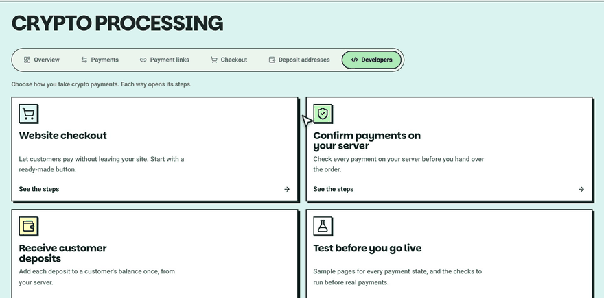

# Crypto processing: deposit pages and signed links from your server

> **Not available yet.** Crypto processing is not released: `https://www.unigox.com/checkout.js` and the other addresses on this page can answer 404 until it is. Once released, crypto processing is in early access, turned on per business.

> **Crypto processing guide:** [Get started](https://developers.unigox.com/tutorials/crypto-checkout) · [Website checkout](https://developers.unigox.com/tutorials/crypto-checkout-embed) · [Confirm payments](https://developers.unigox.com/tutorials/crypto-checkout-confirm) · **Deposit pages and signed links** · [Test and go live](https://developers.unigox.com/tutorials/crypto-checkout-testing) · [Reference](https://developers.unigox.com/tutorials/crypto-checkout-reference)

Your server can reserve payment addresses itself, signing each request with your Unigox wallet's private key. Use this page for what an order does not do:

- **A deposit page** for a customer who keeps a balance with you: permanent addresses and no amount due ([Create a deposit page for a customer](#create-a-deposit-page-for-a-customer)).
- **A payment link that stays payable longer than an order.** An order takes payments for at most 7 days; a link you sign can have a later pay-by date, or none.
- **The addresses for a payment page you build yourself** ([Your own payment page](https://developers.unigox.com/tutorials/crypto-payments)).

To take payments on your website you do not need this page or your wallet's key: your server creates an order for each payment with your API key ([Website checkout](https://developers.unigox.com/tutorials/crypto-checkout-embed)). To send one customer a link, create it in the portal (**Payment links → Create payment link**).

The API has its own names for three things this guide talks about. The reference (the text that names your order) is `memo`. The reservation of a payment address for a reference is a `lock`, under `/memo-locks`. The address ID (the number of a reservation) is `lockId`. The rest is in [Words this guide uses](https://developers.unigox.com/tutorials/crypto-checkout-reference#words-this-guide-uses).

## Before you start

- **Your wallet's private key.** Your server signs every request on this page with the private key of your Unigox wallet. These requests take no API key. Ask for the key under **Developers → Confirm payments on your server → Ask for the key**. Once Unigox enables export for you, your account settings show **Export Private Key**. This key can move your whole balance. Keep it in a secrets store on the server that signs, never in browser code or a repository. Keep the wallet's balance low: move the money you collect out regularly.
- **The API address and the environment.** **Developers → Environment** shows the **API address** (`UNIGOX_PAYMENTS_API` below) and the environment. Sign `"production"` when you call the production address, and `"staging"` when you call a test account's.
- **Node.js 20 or later and [viem](https://viem.sh)**, for the examples. Any language that can sign EIP-712 typed data works.

<figure><figcaption><p>Developers in the portal (sample data).</p></figcaption></figure>

## Create a signed payment link

Your server makes a link in four steps:

1. **Reserve a payment address** for the order's reference (`POST /memo-locks/allocate`). While the reservation is active, Unigox records every transfer to that address under the order's reference: that is how you know which order a payment belongs to.
2. **Wait until the address is ready** on its networks (`POST /memo-locks/list`).
3. **Build the link** from the order and its addresses. This step runs on your server and sends nothing to Unigox.
4. **Show the link and confirm the payment.**

You need one address for each address type you accept: `evm` (Ethereum and the networks built like it), `tvm` (TRON), `ton` and `svm` (Solana). One `evm` address takes payments on every EVM network.

### 1. Reserve an address for the order

Write the order's reference as `<your order reference> · <amount> USD`, for example `NW-20418-k3f9q2 · 250.00 USD`. Between the parts put a space, a middle dot (`·`, U+00B7) and a space. Write the amount with at most two decimals. The whole reference is at most 256 bytes. The checkout and the portal read the amount from it.

Add a random part to the reference, and keep personal data out of it. The reference itself is private, but its fingerprint is public: a reference that can be guessed can be recognised by its fingerprint.

`reserveAddress()` asks Unigox for a new address and reserves it for the reference, in one signed request (`POST /memo-locks/allocate`). Call it once for each address type you accept:

```js
// Node 20+ with viem: walletClient and account are your wallet's (viem's signTypedData). Your server holds the key.
const UNIGOX_PAYMENTS_API = process.env.UNIGOX_PAYMENTS_API; // the API address on the Developers page
const WALLET = "0x…";                                         // your Unigox wallet address
const ENVIRONMENT = "production";                             // or "staging", as the Developers page shows
// Fixed signature label: type this name exactly. It identifies the signing scheme; nothing else in your integration uses it.
const domain = { name: "Unigox Bridge Memo Locks", version: "1", chainId: 42161 };
const types = {
  AllocateAndLock: [
    { name: "action", type: "string" }, { name: "wallet", type: "address" },
    { name: "environment", type: "string" }, { name: "chainType", type: "string" },
    { name: "memo", type: "string" }, { name: "expiresAt", type: "uint64" },
    { name: "callbackUrl", type: "string" }, { name: "nonce", type: "bytes32" },
    { name: "deadline", type: "uint64" },
  ],
  Lock: [ // reserves a memo on an address you already have: the same fields, plus the address after chainType
    { name: "action", type: "string" }, { name: "wallet", type: "address" },
    { name: "environment", type: "string" }, { name: "chainType", type: "string" },
    { name: "depositAddress", type: "string" }, { name: "memo", type: "string" },
    { name: "expiresAt", type: "uint64" }, { name: "callbackUrl", type: "string" },
    { name: "nonce", type: "bytes32" }, { name: "deadline", type: "uint64" },
  ],
};
const nonce = () => "0x" + Array.from(crypto.getRandomValues(new Uint8Array(32)), (b) => b.toString(16).padStart(2, "0")).join("");

// The signed request for a new payment address of one address type ("evm", "tvm", "ton" or "svm"), reserved for this
// memo. Keep it with the order before reserveAddress() sends it: after a lost answer the same request is sent again,
// and no second request is ever signed for an order that may already have its address.
export async function allocationRequest(chainType, memo) {
  const { memoLimits } = await (await fetch(`${UNIGOX_PAYMENTS_API}/config`, { cache: "no-store", signal: AbortSignal.timeout(10_000) })).json();
  const message = {
    action: "allocate_and_lock", wallet: WALLET, environment: ENVIRONMENT, chainType, memo,
    expiresAt: "0",  // no end: the memo stays on the address until you end the reservation
    callbackUrl: "", // payment notifications are off: confirm the payment as step 4 says
    nonce: nonce(),  // fresh here and only here: the kept request carries it through every resend
    // 30 s inside the limit: a server whose clock runs a second ahead would refuse a deadline right at the edge.
    deadline: String(Number(memoLimits.serverTimeSeconds) + Number(memoLimits.maxWriteDeadlineSeconds) - 30),
  };
  const signature = await walletClient.signTypedData({ account, domain, types, primaryType: "AllocateAndLock", message });
  return { chainId: domain.chainId, message, signature };    // the request body, exactly as it is sent
}

// A new payment address, reserved for the memo. `signed` is the request you kept: sent again as it is, also after its
// deadline, Unigox answers with the address and reservation it made the first time. Without `signed` it signs a new
// request itself, so a lost answer cannot be sent again and a second call makes a second address: pass the request
// you kept whenever your server keeps the order's state.
export async function reserveAddress(chainType, memo, signed = null) {
  signed ??= await allocationRequest(chainType, memo);
  const response = await fetch(`${UNIGOX_PAYMENTS_API}/memo-locks/allocate`, {
    method: "POST", headers: { "Content-Type": "application/json" }, body: JSON.stringify(signed), signal: AbortSignal.timeout(10_000),
  });
  const result = await response.json();
  const made = result.data?.allocated?.[0];
  if (!response.ok || made?.lock?.status !== "ACTIVE") {
    // The error carries the answer: `code` is Unigox's reason, `allocated` the address the request made when the answer
    // names one. After 401 memo_lock_signature_expired the kept request is spent: with `allocated`, the deadline passed
    // before the memo was reserved, so reserve it with reserveMemo(); without, the request never took effect, so sign
    // a new one (its nonce was never used: no second address).
    const code = result.details ?? result.status ?? `HTTP ${response.status}`;
    // Only these answers prove that the request changed nothing. After any other error, a 5xx or a lost answer, keep
    // the signed request and send it again: a request signed with a new nonce could make a second address.
    const unusedRequest = !made && response.status < 500 && (String(code).startsWith("validation_") ||
      ["memo_lock_signature_invalid", "memo_lock_signature_expired", "memo_not_supported_for_chain", "deposit_addresses_cap_exceeded"].includes(code));
    throw Object.assign(new Error(code), { code, httpStatus: response.status, unusedRequest, allocated: made ? { address: made.address, monitoring: made.monitoring } : null });
  }
  // Keep these with the order: step 3 builds the link from them, step 4 confirms the payment with them.
  return { address: made.address, addressId: made.lock.lockId, monitoring: made.monitoring };
}

// Reserves the memo on an address you already have (signed `Lock`, a fresh nonce each time): the address that a 401
// memo_lock_signature_expired answer named, or one you reuse (see "Reuse an address"). Returns what reserveAddress()
// returns. This request cannot be sent again after a lost answer (409 memo_lock_nonce_used). Read the address's
// newest reservation first (newestReservation() in step 2): if it shows your memo, the lost request worked.
export async function reserveMemo(chainType, address, memo) {
  const { memoLimits } = await (await fetch(`${UNIGOX_PAYMENTS_API}/config`, { cache: "no-store", signal: AbortSignal.timeout(10_000) })).json();
  const message = {
    action: "lock", wallet: WALLET, environment: ENVIRONMENT, chainType, depositAddress: address, memo,
    expiresAt: "0", callbackUrl: "", nonce: nonce(),
    deadline: String(Number(memoLimits.serverTimeSeconds) + Number(memoLimits.maxWriteDeadlineSeconds) - 30),
  };
  const signature = await walletClient.signTypedData({ account, domain, types, primaryType: "Lock", message });
  const response = await fetch(`${UNIGOX_PAYMENTS_API}/memo-locks/lock`, {
    method: "POST", headers: { "Content-Type": "application/json" }, body: JSON.stringify({ chainId: domain.chainId, message, signature }), signal: AbortSignal.timeout(10_000),
  });
  const result = await response.json();
  const lock = result.data?.lock;
  if (!response.ok || lock?.status !== "ACTIVE") throw new Error(result.details ?? result.status ?? `HTTP ${response.status}`);
  return { address, addressId: lock.lockId, monitoring: result.data.monitoring };
}

// A Lock cannot be sent a second time: the copy is refused (409). So read the address's reservation first, and after
// a lost answer read it again. This never replaces another payment's active reservation and never unlocks.
export async function ensureMemo(chainType, address, memo) {
  const accept = (lock) => {
    if (lock?.status !== "ACTIVE") return null;
    if (lock.wallet?.toLowerCase() !== WALLET.toLowerCase() || lock.memo !== memo) throw new Error("address reserved for another payment");
    return { address, addressId: lock.lockId, monitoring: lock.monitoring };
  };
  const existing = accept(await newestReservation(chainType, address));
  if (existing) return existing;
  try { return await reserveMemo(chainType, address, memo); }
  catch (error) {
    const recovered = accept(await newestReservation(chainType, address));
    if (recovered) return recovered;
    throw error;
  }
}

const memo = `${order.reference} · ${order.amount} USD`; // e.g. "NW-20418 · 250.00 USD"
const signed = await allocationRequest("evm", memo);
await db.keepAllocationRequest(order.id, "evm", signed);  // before it is sent: a lost answer is resumed from here
const evm = await reserveAddress("evm", memo, signed);
```

**Save the signed request with the order before you send it, then save the answer:** the address, its address ID (`lockId`) and its readiness (`monitoring`). If the answer is lost, send the saved request again: you get the same address. A newly signed request would make a second address.

**What you sign.** Each request has a fresh 32-byte nonce and a deadline at most 10 minutes ahead. Take the server's time and the limit from `GET /config`, not from your own clock.

**Sign `callbackUrl: ""`.** Payment notifications are not available yet, and any other value gets 400 `validation_callback_url_invalid`.

**The signing chain id** (`chainId: 42161` in the examples) only says which chain the signature is made for. It has nothing to do with the networks your customers pay on. An ordinary wallet can sign with any chain id. A contract wallet must sign on a chain where Unigox has enabled contract wallets.

### 2. Wait until the address is ready

A new address can take payments on a network only after Unigox has started watching the address there. That can take a few minutes. Until then, the answer to step 1 is 202 `addresses_preparing` instead of 200 `memo_locked`.

The link offers only the networks that were ready when you built it. So reserve the address when the order is placed, not when the payer presses Pay, and build the link once the address is ready.

`waitUntilReady()` reads the address's reservation every 10 seconds (`POST /memo-locks/list`) until every network is ready, or until `maxMs` has passed. It returns the readiness to put in the link:

```js
// A read signature (ListLocks, no nonce) is reused until it expires: one signature an hour, not one per read.
const readTypes = {
  ListLocks: [
    { name: "action", type: "string" }, { name: "wallet", type: "address" },
    { name: "environment", type: "string" }, { name: "issuedAt", type: "uint64" },
    { name: "expiresAt", type: "uint64" },
  ],
};
let readGrant = null;
async function readSignature() {
  const { memoLimits } = await (await fetch(`${UNIGOX_PAYMENTS_API}/config`, { cache: "no-store", signal: AbortSignal.timeout(10_000) })).json();
  const now = Number(memoLimits.serverTimeSeconds);
  if (readGrant && Number(readGrant.authorization.expiresAt) > now + 60) return readGrant;
  const authorization = { action: "list", wallet: WALLET, environment: ENVIRONMENT, issuedAt: String(now), expiresAt: String(now + 3600) };
  const signature = await walletClient.signTypedData({ account, domain, types: readTypes, primaryType: "ListLocks", message: authorization });
  return (readGrant = { authorization, signature });
}

// The address's newest reservation, from a signed POST /memo-locks/list: { lockId, wallet, memo, status, monitoring, … }
// as the API reference lists it, or null when the address never had one. It throws when Unigox cannot be read, so the
// caller cannot mistake "no answer" for "no reservation". "If a request fails" calls it after a Lock
// whose answer was lost: a reservation that is ACTIVE with your wallet and your memo is the one that Lock made.
export async function newestReservation(chainType, address) {
  const { authorization, signature } = await readSignature();
  const response = await fetch(`${UNIGOX_PAYMENTS_API}/memo-locks/list`, {
    method: "POST", headers: { "Content-Type": "application/json" },
    body: JSON.stringify({ chainId: domain.chainId, authorization, signature, query: { chainType, address, limit: "1" } }), signal: AbortSignal.timeout(10_000),
  });
  const body = await response.json().catch(() => null);
  if (!response.ok || !Array.isArray(body?.data?.locks)) throw new Error(body?.details ?? body?.status ?? `HTTP ${response.status}`);
  return body.data.locks[0] ?? null;
}

// Polls for up to maxMs; each API request also has a 10-second timeout. With maxMs 0, reads once.
// Returns monitoring for paymentToken(): ready networks at the deadline, or null when none is ready.
export async function waitUntilReady(chainType, address, maxMs = 300_000) {
  if (!Number.isFinite(maxMs) || maxMs < 0) throw new Error("maxMs must be finite and nonnegative");
  const until = Date.now() + maxMs;
  for (;;) {
    const { authorization, signature } = await readSignature();
    const response = await fetch(`${UNIGOX_PAYMENTS_API}/memo-locks/list`, {
      method: "POST", headers: { "Content-Type": "application/json" },
      body: JSON.stringify({ chainId: domain.chainId, authorization, signature, query: { chainType, address, limit: "1" } }), signal: AbortSignal.timeout(10_000),
    });
    const body = await response.json();
    if (!response.ok || body?.status !== "memo_locks_retrieved" || !Array.isArray(body.data?.locks)) throw new Error(`Cannot read address readiness: HTTP ${response.status}`);
    const lock = body.data.locks[0];
    if (!lock || lock.status !== "ACTIVE") throw new Error("Address reservation is not active; restore it before creating a link");
    const monitoring = lock.monitoring;
    if (!monitoring || typeof monitoring.watched !== "boolean" || !Array.isArray(monitoring.chains)) throw new Error("Address readiness is missing; try again later");
    if (monitoring?.watched) return monitoring;                         // every network is ready
    if (Date.now() >= until) return monitoring.chains.some((c) => c.confirmed) ? monitoring : null;
    await new Promise((resolve) => setTimeout(resolve, 10_000));
  }
}
```

### 3. Build the link

`paymentToken()` turns the order and its addresses into the link's token. It sends nothing to Unigox. It throws an error for a link the checkout would not open, so a bad order fails on your server and not in front of the payer. Its source is under [The link format](#the-link-format).

```js
const token = paymentToken({
  merchant: "Northwind",                 // the name your customer sees
  memo,                                  // the exact reference text you reserved
  amount: "250.00",                      // amount due in USD
  wallet: WALLET,                        // your wallet, owner of the addresses
  expiresAt: null,                       // or your payment deadline as ISO time with its zone ("2026-11-02T12:00:00Z", "…+02:00") or a Date, before the reservation's own end
  openedAt: Date.now(),                  // milliseconds; transfers are watched from here
  description: "Order NW-20418",         // optional, one line
  returnUrl: "https://shop.example/orders/20418", // optional, https only
  supportEmail: "billing@shop.example", // optional, shown when the payer must contact you
  addresses: {
    evm: { address: evm.address, lockId: evm.addressId, monitoring: evm.monitoring },
    tvm: { address: tron.address, lockId: tron.addressId, monitoring: tron.monitoring },
  },
});
const payUrl = `https://www.unigox.com/pay/${token}`;
```

Before the payment page shows an address, it checks with Unigox that the address is still reserved by the token's wallet for the token's reference. A link whose reservation cannot be found does not open. A link whose reservation has ended opens as closed. So keep the reservation active for as long as the order can be paid.

That check does not prove that the wallet is yours: someone who edits a link can point it at their own wallet and their own addresses. So give payers links only from your own site, emails and messages, never accept a token that a payer sends you, and fulfil orders from your own order record.

### 4. Show the link and confirm the payment

Show the link with the [Website checkout](https://developers.unigox.com/tutorials/crypto-checkout-embed) code, or send it. Mark the order paid only from your server ([Confirm payments](https://developers.unigox.com/tutorials/crypto-checkout-confirm)).

### If a request fails

| What happened | What to do |
| --- | --- |
| No answer (timeout, dropped connection, 5xx) | Send the **same** signed request again, with the same nonce, even after its deadline. The answer has the address the first request made. Do not sign a new request for the order until you know that the first one failed: a new request makes a second address. |
| 401 `memo_lock_signature_expired` with an address in `data.allocated` | The address was made but not reserved. Keep it with the order and reserve it with a new signed `Lock` (`reserveMemo()` above). |
| 401 `memo_lock_signature_expired` without an address | Nothing happened. Sign a new request. |
| 409 `memo_lock_nonce_used` on `Lock` or `Unlock` | The nonce was used: read the address's newest reservation (`newestReservation()` above). If it shows your reference (or is closed, for an unlock), the first request worked. Otherwise sign a new one. |
| 409 `deposit_address_already_locked` | The address is reserved already. Read it before you sign again. |
| 400 `validation_environment_mismatch` | Sign the environment the API address belongs to. |
| 429 `deposit_addresses_cap_exceeded` | You reached the address limit for this address type. Reuse addresses (below) or write to support@unigox.com. |

Every error code is in the [API reference](https://developers.unigox.com/api-reference/payment-addresses).

### Close a link

To close a link, end the reservation of each of its addresses: `POST /memo-locks/unlock`, signed `Unlock`. The link then opens as closed. Closing a link does not stop the address: money sent to it afterwards still reaches your wallet, but it is no longer recorded under the order's reference.

`endReservation()` ends one address's reservation. It uses `domain`, `WALLET`, `ENVIRONMENT`, `nonce()` and `walletClient` from step 1:

```js
const unlockTypes = {
  Unlock: [
    { name: "action", type: "string" }, { name: "wallet", type: "address" },
    { name: "environment", type: "string" }, { name: "chainType", type: "string" },
    { name: "depositAddress", type: "string" }, { name: "lockId", type: "uint256" },
    { name: "nonce", type: "bytes32" }, { name: "deadline", type: "uint64" },
  ],
};

// Ends the reservation `lockId` of one address. Returns the ended reservation (status "UNLOCKED"). After a lost answer
// the same request is refused (409 memo_lock_nonce_used): read newestReservation() instead; UNLOCKED means it worked.
export async function endReservation(chainType, address, lockId) {
  const { memoLimits } = await (await fetch(`${UNIGOX_PAYMENTS_API}/config`, { cache: "no-store", signal: AbortSignal.timeout(10_000) })).json();
  const message = {
    action: "unlock", wallet: WALLET, environment: ENVIRONMENT, chainType, depositAddress: address, lockId: String(lockId),
    nonce: nonce(), deadline: String(Number(memoLimits.serverTimeSeconds) + Number(memoLimits.maxWriteDeadlineSeconds) - 30),
  };
  const signature = await walletClient.signTypedData({ account, domain, types: unlockTypes, primaryType: "Unlock", message });
  const response = await fetch(`${UNIGOX_PAYMENTS_API}/memo-locks/unlock`, {
    method: "POST", headers: { "Content-Type": "application/json" }, body: JSON.stringify({ chainId: domain.chainId, message, signature }), signal: AbortSignal.timeout(10_000),
  });
  const result = await response.json().catch(() => null);
  if (!response.ok || result?.status !== "memo_unlocked") throw new Error(result?.details ?? result?.status ?? `HTTP ${response.status}`);
  return result.data.lock;
}
```

Ending a reservation that is no longer active answers `409 memo_lock_not_active`.

### Reuse an address

A new address for each order is the safe choice. Reuse an address only when both are true: its last order was paid in full and credited, and its reservation ended at least 7 days ago. A late second transfer from the same payer is then unlikely. Never reuse the address of an order that is open, partly paid or unpaid.

To reuse an address, end its old reservation (`POST /memo-locks/unlock`), then reserve the new reference on it (`POST /memo-locks/lock`, signed `Lock`, `expiresAt: "0"`). The address gets a new address ID, and the old link opens as closed.

If the second request fails, the address has no reference until a reservation succeeds, and a payment that arrives in between reaches your wallet without a reference. Send the reservation again, and match such a payment by its address in your history.

The portal does the same. It takes new addresses until an address type holds 80 % of its 1,000-address limit. Then it reuses the addresses of links that were paid in full and closed at least 7 days ago, the longest unused first.

## Create a deposit page for a customer

A deposit page gives one customer permanent addresses to top up their balance with you. It has no amount due. Each deposit is credited to your wallet, and your server adds it to the customer's balance, once. Unigox does not keep your customers' balances.

In the portal: **Deposit addresses → Add a customer**, then **Copy link** of the customer's deposit page. From your server:

1. **Reserve one address for each address type** with the customer's reference: `Top-up · <customer reference> · <tag>`. The tag is 10 random characters from `a-z` and `2-7`; make it once and keep it for the customer. For the customer reference use your customer ID, not personal data: the customer sees it on the page.
2. **Keep every address ID** with the customer, old and new.
3. **Build the page link** with `topUpToken()` ([The link format](#the-link-format)) and share `https://www.unigox.com/pay/{token}`, or show it on your site like any link. On your site, `onDeposit` reports each credited deposit.
4. **Credit each deposit** to the customer's balance once, as below.

`createDepositPage()` does steps 1 to 3 for one customer:

```js
// Node 20+. Your server holds your wallet's key (reserveAddress signs with it). db is your own database.
import { randomInt } from "node:crypto";

const TAG_LETTERS = "abcdefghijklmnopqrstuvwxyz234567";
const newTag = () => Array.from({ length: 10 }, () => TAG_LETTERS[randomInt(TAG_LETTERS.length)]).join("");

// db.withCustomerLock must let only one of your workers at a time work on this customer, the first creation included.
// Every saveCustomer must be committed before it returns, even if a later API call fails. withCustomerLock() below
// shows one way to do both.
export async function createDepositPage(customerId, types = ["evm", "tvm", "ton", "svm"]) {
  if (typeof customerId !== "string" || !customerId.trim() || customerId !== customerId.trim() || Array.from(customerId).length > 64 || /[\p{Cc}\p{Cf}\p{Cs}\u2028\u2029]/u.test(customerId)) throw new Error("customerId: 1 to 64 plain characters");
  if (!Array.isArray(types) || !types.length || types.some((f) => !["evm", "tvm", "ton", "svm"].includes(f))) throw new Error("Choose supported address types");
  return db.withCustomerLock(customerId, async (store) => {
    const saved = await store.customer(customerId);
    if (saved?.archived || saved?.status === "archived") throw new Error("Customer is archived; restore their reservations first");
    const memo = saved?.memo ?? `Top-up · ${customerId} · ${newTag()}`;
    if (Buffer.byteLength(memo, "utf8") > 256) throw new Error("customer reference is too long in UTF-8");
    const openedAt = saved?.openedAt ?? Date.now();
    const addresses = { ...saved?.addresses };
    const allocations = { ...saved?.allocations }; // per address type: the signed request you kept, or an address that still needs its memo
    const lockIds = new Set((saved?.lockIds ?? []).map(String));
    const save = () => {
      for (const a of Object.values(addresses)) lockIds.add(String(a.lockId));
      return store.saveCustomer({ ...saved, id: customerId, memo, openedAt, addresses, allocations, lockIds: [...lockIds] });
    };
    await save();
    const readyAddresses = {};
    const readyUntil = Date.now() + 300_000; // one five-minute budget for the whole page
    for (const type of new Set(types)) {
      if (!addresses[type]) {
        const attempt = allocations[type] ??= {};
        let made;
        if (!attempt.address) {
          if (!attempt.request) {
            attempt.request = await allocationRequest(type, memo);
            await save(); // saved before it is sent: after a timeout the same signed request is sent again
          }
          try { made = await reserveAddress(type, memo, attempt.request); }
          catch (error) {
            if (error.code !== "memo_lock_signature_expired") {
              if (error.unusedRequest) { delete allocations[type]; await save(); }
              // An address type that cannot be had is skipped, so the page still gets the others. Any other failure is tried again.
              if (error.unusedRequest && ["memo_not_supported_for_chain", "deposit_addresses_cap_exceeded"].includes(error.code)) continue;
              throw error;
            }
            attempt.address = error.allocated?.address ?? null;
            attempt.request = null;
            await save(); // keep an address that was made, even when its memo is not reserved yet
            if (!attempt.address) throw error; // the request took no effect: the next call signs a new one
          }
        }
        if (!made) made = await ensureMemo(type, attempt.address, memo);
        addresses[type] = { address: made.address, lockId: made.addressId, monitoring: made.monitoring };
        delete allocations[type];
        await save(); // keep the address and its ID before readiness is read
      }
      // An address you already have needs its readiness read again: on a retry, and for a link you build again.
      const monitoring = await waitUntilReady(type, addresses[type].address, Math.max(0, readyUntil - Date.now()));
      if (monitoring) {
        addresses[type].monitoring = monitoring;
        readyAddresses[type] = addresses[type];
        await save();
      } // On a timeout the address stays saved. An address type with no ready network is left out of the link.
    }
    if (!Object.keys(readyAddresses).length) throw new Error("No payment network is ready yet; retry with the same customer");
    const token = topUpToken({
      merchant: "Northwind",
      memo, wallet: WALLET, openedAt, addresses: readyAddresses,
      supportEmail: "billing@shop.example",
    });
    return `https://www.unigox.com/pay/${token}`;
  });
}
```

It runs one creation at a time per customer, with a lock in your database:

```js
export async function withCustomerLock(pool, customerId, storageFor, run) {
  const client = await pool.connect();
  const key = `unigox-topup:${customerId}`;
  let locked = false;
  let broken = false;
  const failed = () => { broken = true; };
  client.on("error", failed);
  try {
    try {
      await client.query("SELECT pg_advisory_lock(hashtextextended($1, 0))", [key]);
      locked = true;
    } catch (error) {
      broken = true; // the database may have taken the lock before its answer was lost
      throw error;
    }
    const store = storageFor(client); // your existing customer reader/writer, each save committed
    const guard = (fn) => async (...args) => {
      if (broken) throw new Error("customer lock connection lost");
      const result = await fn(...args);
      if (broken) throw new Error("customer lock connection lost");
      return result;
    };
    return await run({ customer: guard(store.customer.bind(store)), saveCustomer: guard(store.saveCustomer.bind(store)) });
  } finally {
    if (locked && !broken) {
      try { await client.query("SELECT pg_advisory_unlock(hashtextextended($1, 0))", [key]); }
      catch { broken = true; }
    }
    client.removeListener("error", failed);
    client.release(broken); // a broken connection is closed, so its lock never goes back into the pool
  }
}
// db.withCustomerLock = (id, run) => withCustomerLock(pool, id, storageFor, run);
```

Do not use a customer's addresses for anything else, even after the customer has left: the customer may still send money to them.

### Credit deposits

Count each credited transfer once, by its `quoteId`, so a repeated report adds nothing.

| Way | It finds | It misses |
| --- | --- | --- |
| Without the key | Deposits your page reports through `onDeposit`, and transaction hashes your customers give you | Deposits made while your page was not open: from the shared link, from another device |
| With the key | Every deposit, from your signed history, in a periodic job | Deposits not credited yet: read again later |

Customers mostly pay into a deposit page while your site is not open, so the way without the key misses most deposits. With many customers you need the key, or a person who credits deposits from **Payments**.

**Without the key**, check each reported deposit with `verifyTransfers()` ([Confirm payments](https://developers.unigox.com/tutorials/crypto-checkout-confirm#check-the-transfers-your-page-reports)) against the customer's reference and every address ID they ever had:

```js
// Node 18+, with verifyTransfers() from "Confirm payments on your server" in the same file. No key and no signature.
const ENVIRONMENT = "production"; // one ledger per environment

// customer: your record, e.g. { id: "CUST-7", wallet: "0x…", memo: "Top-up · CUST-7 · abcdefghij", lockIds: ["31", "32", "57"] },
//   with every address ID the customer ever had (a restore adds new ones). reported: [{ chainId: payload.chainId,
//   txHash: payload.txHash, quoteId: payload.quoteId }] from an onDeposit payload (one deposit per payload, no payments
//   list), or [{ chainId, txHash }] for a hash a customer gave you (add quoteId or logIndex when you have it). Returns how many new deposits it recorded.
export async function creditDeposits(customer, reported) {
  const credits = await verifyTransfers(customer, reported); // each one proven by Unigox, never taken from the browser
  let added = 0;
  // One database transaction: each (environment, transfer id) counts once.
  await db.transaction(async (q) => {
    for (const c of credits) {
      if (await q.claimTransferOnce(ENVIRONMENT, c.id, customer.id)) {
        await q.addToBalance(customer.id, c.micros); // micro-USD, as a BigInt
        added += 1;
      }
    }
  });
  return added;
}
```

**With the key**, read your signed history for each of the customer's addresses, with `includeMemo: true`. Keep the rows that have the customer's reference and one of the customer's address IDs, and pass them through the same ledger:

```js
// Server only. customer.lockIds has every address ID the customer has or had.
// transactions is one page from your signed history with includeMemo: true.
export async function creditCustomerHistory(customer, transactions) {
  const hints = transactions.filter((tx) =>
    tx.memo === customer.memo && customer.lockIds.includes(String(tx.memoLockId)) &&
    tx.recipientAddress?.toLowerCase() === customer.wallet.toLowerCase() &&
    typeof tx.quoteId === "string" && tx.quoteId.length > 0
  ).map((tx) => ({ chainId: Number(tx.fromChain), txHash: tx.fromTx, quoteId: tx.quoteId }));
  let added = 0;
  // verifyTransfers() reads each transfer again from Unigox: its status, and the decimals of the credited coin.
  for (let i = 0; i < hints.length; i += 200) added += await creditDeposits(customer, hints.slice(i, i + 200));
  return added;
}
```

### Archive and restore a customer

- **Archive:** end the reservation of each of the customer's addresses (`POST /memo-locks/unlock`). The deposit page then opens as closed. Money sent to the addresses still reaches your wallet, but it is no longer recorded under the customer's reference.
- **Restore:** first check with `POST /memo-locks/list` that no other reference is on the addresses. Then reserve the same reference on the same addresses again (`POST /memo-locks/lock`, `expiresAt: "0"`). The addresses get new address IDs, so build a new page link and send it to the customer.

## The link format

You need this only to read or check a link yourself; `paymentToken()` and `topUpToken()` write it.

The token is base64url JSON with these keys:

| Key | Field | Value |
| --- | --- | --- |
| `v` | version | `1` |
| `m` | merchant | The name the payer sees, up to 64 characters |
| `r` | reference text | Exactly as reserved on the addresses, up to 256 bytes |
| `a` | amount | Amount due in USD, up to 12 digits and two decimals. Use at least 1.00, as the portal does: below that, a network fee can be more than the payment. |
| `c` | currency | `USD`. One USDT, USDC, USDG or USDT0 counts as 1 USD. |
| `w` | wallet | Your wallet, lowercase `0x` address |
| `x` | pay-by date | `null`, or ISO time with its zone. Only the page shows it; keep the reservation open past it. |
| `t` | opened at | Unix seconds; transfers are watched from then |
| `d` | description | Optional, one line, up to 140 characters |
| `u` | return page | Optional `https://` page of your site, up to 2,048 bytes. Shown as a link, never opened by itself. |
| `e` | support email | Optional, up to 254 characters |
| `l` | addresses | Per address type: `a` address, `k` address ID, `n` network ids ready (EVM, TRON), `s: 1` when watched (TON, Solana) |
| `tol` | allowance | Optional: `"none"` when the full amount is due. Without it, a shortfall of at most 0.5 % and never more than 1.00 USD counts as paid. |

A deposit page's token has `p: "topup"` and no `a`, `c`, `x` or `tol`.

Links made in the portal have a shorter token of their own. It is not JSON, and it names each address by its address ID: the payment page reads the addresses from Unigox. You do not build this form. A portal link also writes its terms into the reference, so a link that someone edits to other terms does not open:

```
<reference> · <amount> USD · v2 [· <tag>] [· by <UTC deadline>] [· no tolerance] [· coins <coins>] [· networks <network ids>] [· note <description>]
```

For example `NW-1042 · 250.00 USD · v2 · d6ppalq2 · by 2026-11-02T12:00Z · no tolerance · coins USDT,USDC · networks 42161,728126428`. The tag is 8 random characters from `a-z` and `2-7`. Your server can keep writing the short form, `<reference> · <amount> USD`. To confirm the payment of a portal link on your server, read your payment history by its address IDs: **Payment links → Export CSV** with **For developers** lists them (`address_ids`).

### The builders

Node.js 20 or later, no dependencies. Both end with the same helpers: keep one copy if you use both.

`paymentToken()`:

```js
function paymentToken(link) {
  // Checked here so a bad order fails on your server, not on the payer's screen.
  const unsafe = /[\u0000-\u001F\u007F-\u009F\u061C\u200B-\u200F\u2028-\u202E\u2066-\u2069\uFEFF]/;
  if (typeof link.merchant !== "string" || !link.merchant || link.merchant.length > 64 || unsafe.test(link.merchant)) throw new Error("merchant: 1 to 64 characters, no control or text-direction characters");
  if (typeof link.memo !== "string" || !link.memo || Buffer.byteLength(link.memo, "utf8") > 256 || unsafe.test(link.memo) || /\p{Cs}/u.test(link.memo)) throw new Error("memo: the exact memo you reserved in step 1, up to 256 bytes");
  // Amount due in USD: a decimal string with at most two decimals ("250.00"); a number is taken when it has no more than cents.
  const cents = typeof link.amount === "number" && Number.isFinite(link.amount) && Math.abs(link.amount * 100 - Math.round(link.amount * 100)) < 1e-6;
  const amount = cents ? link.amount.toFixed(2) : String(link.amount ?? "");
  if (!/^\d{1,12}(\.\d{1,2})?$/.test(amount)) throw new Error("amount: a decimal string with at most two decimals, e.g. 250.00");
  if (!/[1-9]/.test(amount)) throw new Error("amount: more than 0");
  const description = oneLine(link.description, unsafe);
  const returnUrl = returnPage(link.returnUrl);
  const supportEmail = supportMailbox(link.supportEmail, unsafe);
  // "none" when the full amount is due (as on an invoice); anything else is the default tolerance.
  const tolerance = link.tolerance === "none" ? "none" : "default";
  // The payment deadline: a Date, or ISO time with its zone ("2026-11-02T12:00:00Z", "…+02:00"). Text without a zone
  // would be read in each payer's own time zone, so the link would end at a different hour on every device.
  const zoned = /^\d{4}-\d{2}-\d{2}T\d{2}:\d{2}(:\d{2}(\.\d{1,9})?)?([Zz]|[+-]\d{2}:?\d{2})$/;
  const deadline = link.expiresAt == null ? null : new Date(typeof link.expiresAt === "string" && !zoned.test(link.expiresAt) ? NaN : link.expiresAt);
  if (deadline !== null && (Number.isNaN(deadline.getTime()) || !/^\d{4}-/.test(deadline.toISOString()))) throw new Error("expiresAt: null, or ISO time with its zone, e.g. 2026-11-02T12:00:00Z");
  // A v2 memo ("<reference> · <amount> USD · v2 …", what the portal writes) states the link's terms itself: the link must
  // state exactly the same ones, or the checkout does not open it ("This payment link can't be used").
  const terms = linkTerms(link.memo);
  const centsOf = (s) => { const [whole, fraction = ""] = s.split("."); return BigInt(whole + fraction.padEnd(2, "0")); };
  const legacyAmount = / · (\d{1,12}(?:\.\d{1,2})?) USD$/.exec(link.memo)?.[1];
  if (!terms && legacyAmount && centsOf(legacyAmount) !== centsOf(amount)) throw new Error(`amount: the memo says ${legacyAmount} USD`);
  if (terms) {
    if (centsOf(terms.amount) !== centsOf(amount)) throw new Error(`amount: the memo says ${terms.amount} USD`);
    // Whole seconds, as the payment page compares them: a sub-second time (Go writes nine digits) is the same deadline.
    const by = terms.expiresAt === null ? null : Math.floor(Date.parse(terms.expiresAt) / 1000);
    const given = link.expiresAt == null ? null : Math.floor(Date.parse(link.expiresAt) / 1000);
    if (by !== given) throw new Error(`expiresAt: the memo says ${terms.expiresAt ?? "no deadline"}`);
    if ((terms.description ?? "") !== description) throw new Error(`description: the memo says "${terms.description ?? ""}"`);
    if (terms.tolerance !== tolerance) throw new Error(`tolerance: the memo says "${terms.tolerance}"`);
  }
  // One entry per address type: a = address, k = address ID, then readiness from the reservation's monitoring:
  // n = network ids it confirmed (EVM, Tron), s = 1 when the address is watched (TON, Solana).
  const addresses = {};
  for (const [type, entry] of walletAndAddresses(link)) {
    const m = entry.monitoring;
    const n = ((m && m.chains) || []).filter((c) => c.confirmed).map((c) => c.chainId);
    addresses[type] = { a: entry.address, k: String(entry.lockId), ...(n.length ? { n } : {}), ...(m && m.watched ? { s: 1 } : {}) };
  }
  const wire = {
    v: 1,                                        // token version
    m: link.merchant,                            // merchant name the payer sees
    r: link.memo,                                // the exact memo text on the reserved addresses
    a: amount,                                   // amount due, e.g. "250.00"
    c: "USD",
    w: link.wallet.toLowerCase(),                // your wallet, owner of the addresses
    x: terms ? terms.expiresAt : deadline === null ? null : deadline.toISOString(), // null, or the payment deadline the payer sees, before the reservation ends (ISO time, UTC); only the payer's page reads it
    t: Math.floor((link.openedAt ?? Date.now()) / 1000), // creation time: transfers are watched from here
    ...(description ? { d: description } : {}), // optional: what is being paid for
    ...(returnUrl ? { u: returnUrl } : {}),      // optional: the page of your site the payer may go back to
    ...(supportEmail ? { e: supportEmail } : {}), // optional: where the payer can write to you about this payment
    ...(tolerance === "none" ? { tol: "none" } : {}), // optional: the full amount is due
    l: addresses,
  };
  return Buffer.from(JSON.stringify(wire), "utf8").toString("base64url");
}

// The terms of a v2 memo: <reference> · <amount> USD · v2 [· <tag>] [· by <UTC>] [· no tolerance] [· coins …]
// [· networks …] [· note <description>]; null for any other memo. The payment page reads the coins and networks itself.
function linkTerms(memo) {
  const at = memo.indexOf(" USD · v2");
  if (at < 0) return null;
  const terms = { amount: memo.slice(0, at).split(" · ").pop(), expiresAt: null, description: null, tolerance: "default" };
  let rest = memo.slice(at + " USD · v2".length).replace(/^ · [a-z2-7]{8}(?= · |$)/, "");
  while (rest.startsWith(" · ")) {
    rest = rest.slice(3);
    if (rest.startsWith("note ")) { terms.description = rest.slice(5); rest = ""; break; }
    const end = rest.indexOf(" · ");
    const part = end < 0 ? rest : rest.slice(0, end);
    rest = end < 0 ? "" : rest.slice(end);
    const by = /^by (\d{4}-\d{2}-\d{2}T\d{2}:\d{2})(:\d{2})?Z$/.exec(part);
    if (by) terms.expiresAt = `${by[1]}${by[2] ?? ":00"}Z`;
    else if (part === "no tolerance") terms.tolerance = "none";
    else if (!/^(coins|networks) [\w,]+$/.test(part)) throw new Error(`memo: "${part}" is not a term of a v2 memo`);
  }
  if (rest) throw new Error("memo: not a v2 memo");
  return terms;
}

// One line of plain text: control and direction characters become spaces, a broken character becomes U+FFFD
// (the UTF-8 round trip replaces it), cut at 140 characters without splitting one.
function oneLine(text, unsafe) {
  const clean = String(text ?? "").replace(new RegExp(unsafe.source, "g"), " ").trim();
  return Array.from(Buffer.from(clean, "utf8").toString("utf8")).slice(0, 140).join("");
}

// Optional return page: https only, no user name or password, at most 2048 bytes.
function returnPage(value) {
  if (value == null || String(value).trim() === "") return null;
  let url = null;
  try { url = new URL(String(value).trim()); } catch {}
  if (!url || url.protocol !== "https:" || url.username || url.password || !url.hostname || Buffer.byteLength(url.href, "utf8") > 2048) throw new Error("returnUrl: an https address up to 2048 bytes, without a user name or password");
  return url.href;
}

// Your wallet (the owner of the addresses) and at least one address entry, each a payment address and its numeric address ID.
function walletAndAddresses(link) {
  if (typeof link.wallet !== "string" || !/^0x[0-9a-fA-F]{40}$/.test(link.wallet)) throw new Error("wallet: your wallet address, 0x and 40 hexadecimal characters");
  const entries = Object.entries(link.addresses || {}).filter(([type]) => ["evm", "tvm", "ton", "svm"].includes(type));
  if (!entries.length) throw new Error("addresses: at least one of evm, tvm, ton, svm, each a payment address you reserved");
  for (const [type, entry] of entries) {
    if (!entry || typeof entry.address !== "string" || !entry.address.trim()) throw new Error(`addresses.${type}.address: the payment address you reserved`);
    if (!/^\d+$/.test(String(entry.lockId))) throw new Error(`addresses.${type}.lockId: the address ID of the address you reserved, digits only`);
  }
  return entries;
}

// Optional support email: a plain mailbox, at most 254 characters.
function supportMailbox(value, unsafe) {
  if (value == null || String(value).trim() === "") return null;
  const email = String(value).trim();
  if (email.length > 254 || unsafe.test(email) || !/^[^\s@<>()",;:\\[\]]{1,64}@[A-Za-z0-9-]+(\.[A-Za-z0-9-]+)+$/.test(email)) throw new Error("supportEmail: a plain email address up to 254 characters");
  return email;
}
```

`topUpToken()`:

```js
function topUpToken(link) {
  // Checked here so a bad customer fails on your server, not on the payer's screen.
  const unsafe = /[\u0000-\u001F\u007F-\u009F\u061C\u200B-\u200F\u2028-\u202E\u2066-\u2069\uFEFF]/;
  if (typeof link.merchant !== "string" || !link.merchant || link.merchant.length > 64 || unsafe.test(link.merchant)) throw new Error("merchant: 1 to 64 characters, no control or text-direction characters");
  // The customer's memo: "Top-up · <customer reference> · <tag>", the tag 10 characters of a-z and 2-7 kept for the customer's lifetime.
  const shape = /^Top-up · (.+) · ([a-z2-7]{10})$/u;
  const m = typeof link.memo === "string" ? shape.exec(link.memo) : null;
  if (!m || m[1] !== m[1].trim() || Array.from(m[1]).length > 64 || Buffer.byteLength(link.memo, "utf8") > 256 || unsafe.test(link.memo) || /\p{Cs}/u.test(link.memo)) throw new Error("memo: Top-up · <customer reference> · <tag>, up to 256 bytes");
  if (!Number.isFinite(link.openedAt) || link.openedAt < 1000) throw new Error("openedAt: when the customer's first address was reserved, in milliseconds");
  const description = oneLine(link.description, unsafe);
  const returnUrl = returnPage(link.returnUrl);
  const supportEmail = supportMailbox(link.supportEmail, unsafe);
  const addresses = {};
  for (const [type, entry] of walletAndAddresses(link)) {
    const mon = entry.monitoring;
    const n = ((mon && mon.chains) || []).filter((c) => c.confirmed).map((c) => c.chainId);
    addresses[type] = { a: entry.address, k: String(entry.lockId), ...(n.length ? { n } : {}), ...(mon && mon.watched ? { s: 1 } : {}) };
  }
  const wire = {
    v: 1,
    p: "topup",                                  // a customer's deposit page: no amount, currency or pay-by date
    m: link.merchant,
    r: link.memo,
    w: link.wallet.toLowerCase(),
    t: Math.floor(link.openedAt / 1000),         // transfers are watched from here
    ...(description ? { d: description } : {}),
    ...(returnUrl ? { u: returnUrl } : {}),
    ...(supportEmail ? { e: supportEmail } : {}),
    l: addresses,
  };
  return Buffer.from(JSON.stringify(wire), "utf8").toString("base64url");
}

// One line of plain text: control and direction characters become spaces, a broken character becomes U+FFFD
// (the UTF-8 round trip replaces it), cut at 140 characters without splitting one.
function oneLine(text, unsafe) {
  const clean = String(text ?? "").replace(new RegExp(unsafe.source, "g"), " ").trim();
  return Array.from(Buffer.from(clean, "utf8").toString("utf8")).slice(0, 140).join("");
}

// Optional return page: https only, no user name or password, at most 2048 bytes.
function returnPage(value) {
  if (value == null || String(value).trim() === "") return null;
  let url = null;
  try { url = new URL(String(value).trim()); } catch {}
  if (!url || url.protocol !== "https:" || url.username || url.password || !url.hostname || Buffer.byteLength(url.href, "utf8") > 2048) throw new Error("returnUrl: an https address up to 2048 bytes, without a user name or password");
  return url.href;
}

// Your wallet (the owner of the addresses) and at least one address entry, each a payment address and its numeric address ID.
function walletAndAddresses(link) {
  if (typeof link.wallet !== "string" || !/^0x[0-9a-fA-F]{40}$/.test(link.wallet)) throw new Error("wallet: your wallet address, 0x and 40 hexadecimal characters");
  const entries = Object.entries(link.addresses || {}).filter(([type]) => ["evm", "tvm", "ton", "svm"].includes(type));
  if (!entries.length) throw new Error("addresses: at least one of evm, tvm, ton, svm, each a payment address you reserved");
  for (const [type, entry] of entries) {
    if (!entry || typeof entry.address !== "string" || !entry.address.trim()) throw new Error(`addresses.${type}.address: the payment address you reserved`);
    if (!/^\d+$/.test(String(entry.lockId))) throw new Error(`addresses.${type}.lockId: the address ID of the address you reserved, digits only`);
  }
  return entries;
}

// Optional support email: a plain mailbox, at most 254 characters.
function supportMailbox(value, unsafe) {
  if (value == null || String(value).trim() === "") return null;
  const email = String(value).trim();
  if (email.length > 254 || unsafe.test(email) || !/^[^\s@<>()",;:\\[\]]{1,64}@[A-Za-z0-9-]+(\.[A-Za-z0-9-]+)+$/.test(email)) throw new Error("supportEmail: a plain email address up to 254 characters");
  return email;
}
```
