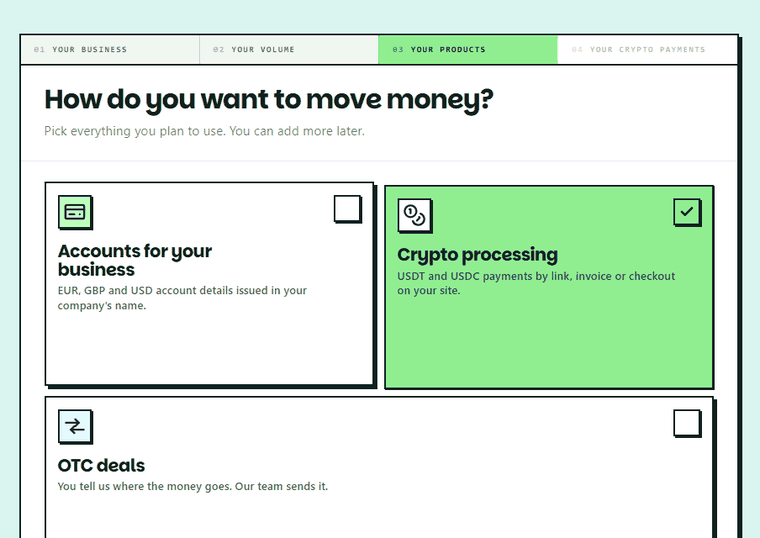
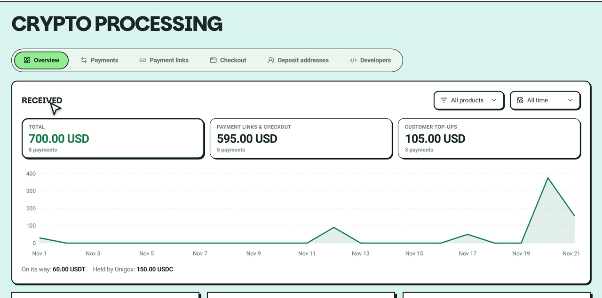
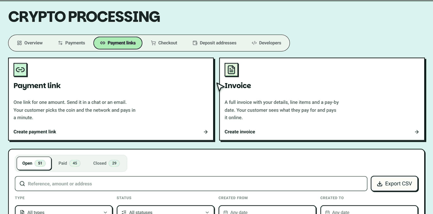
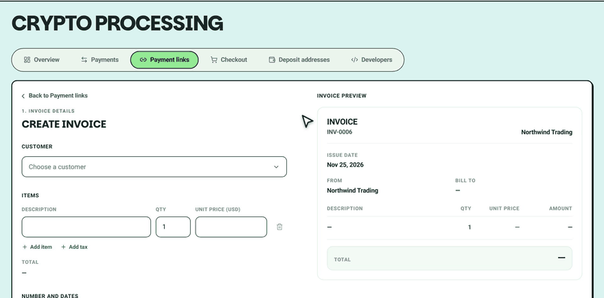
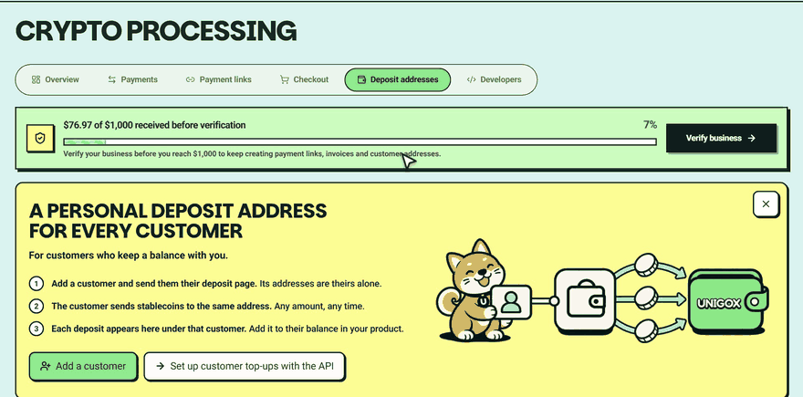
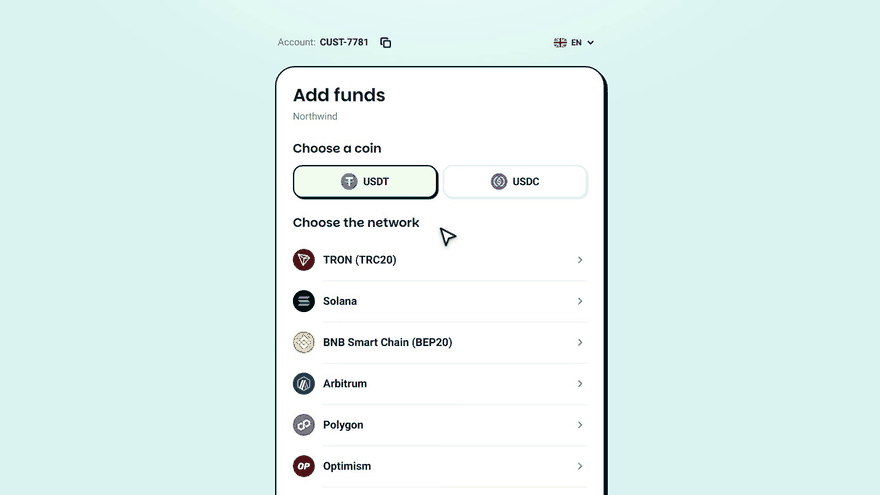

# Crypto processing: get started

> **Not available yet.** This page describes crypto processing ahead of its release. Until this notice is gone, `https://www.unigox.com/checkout.js`, the help pages and the link check it names can answer 404. Once released, crypto processing is in early access, turned on per business.

> **Crypto processing guide:** **Get started** · [Website checkout](https://developers.unigox.com/tutorials/crypto-checkout-embed) · [Confirm payments](https://developers.unigox.com/tutorials/crypto-checkout-confirm) · [Links from your server](https://developers.unigox.com/tutorials/crypto-checkout-links) · [Test and go live](https://developers.unigox.com/tutorials/crypto-checkout-testing) · [Reference](https://developers.unigox.com/tutorials/crypto-checkout-reference)

Crypto processing lets your customers pay you in USDT, USDC, USDG and USDT0 on 13 networks. Unigox shows the payer the amount, the address and the progress of the transfer, so you do not build a payment page. Each payment arrives in your Unigox wallet (your balance at Unigox) in the coin the customer sent: Unigox does not convert it.

This page needs no code. It opens crypto processing for your business and takes you through a payment link, an invoice and a customer's deposit addresses in the portal. The other pages are for the developer who adds the checkout to your website or connects your server. The guide uses each of its terms in one meaning: [Words this guide uses](https://developers.unigox.com/tutorials/crypto-checkout-reference#words-this-guide-uses).

## Pick your task

| What you want to do | Code | Where |
| --- | --- | --- |
| Send a customer a link to pay an order | None | [Your first payment link](#your-first-payment-link) |
| Send an invoice with a PDF | None | [Send an invoice](#send-an-invoice) |
| Give a customer permanent addresses to top up a balance | None | [Give a customer deposit addresses](#give-a-customer-deposit-addresses) |
| Add a **Pay with crypto** button to your website | A few lines of HTML | [Website checkout](https://developers.unigox.com/tutorials/crypto-checkout-embed) |
| Mark orders paid on your server | Server code, nothing secret | [Confirm payments](https://developers.unigox.com/tutorials/crypto-checkout-confirm) |
| Create a link for every order automatically | Server code and your wallet's key | [Links from your server](https://developers.unigox.com/tutorials/crypto-checkout-links) |
| Build your own payment page | Server and page code, and your wallet's key | [Your own payment page](https://developers.unigox.com/tutorials/crypto-payments) |
| Check your integration before real customers pay | None | [Test and go live](https://developers.unigox.com/tutorials/crypto-checkout-testing) |

## How a payment works

1. You create a payment link for an order: in the portal, or from your server. The link is `https://www.unigox.com/pay/{token}`. The token holds the amount, your order reference and the addresses that take the payment.
2. The customer opens the link, on a Unigox page or in a checkout on your site, and picks a coin and a network.
3. The customer sends the amount from any wallet or exchange. Each order has its own address, so the customer adds no memo or tag.
4. Unigox adds the payment to your Unigox wallet, in the same coin and the same amount. The portal's **Payments** shows it as **Completed**.
5. You fulfil the order once you see the payment in **Payments**, or once your server has checked it with Unigox.

Creating a link and opening a checkout move no money. A message the checkout sends to your web page is not proof of payment: anyone can produce one in their own browser. Proof is the payment in **Payments**, or your server's check ([Confirm payments](https://developers.unigox.com/tutorials/crypto-checkout-confirm)).

## Open crypto processing

1. On `https://www.unigox.com/crypto-processing`, press **Start business onboarding**. Sign in or create an account if you have none.
2. Answer **Your business** and **Your volume**, and under **Your products** pick **Crypto processing**.
3. Answer the questions under **Before you start accepting crypto**. You upload no documents at this step. By finishing, you confirm that you take no payments from sanctioned countries and regions, as the Terms of Service require. The questions are:
   - who you accept payments for: yourself, or a company (then its name);
   - your website and your industry;
   - how you plan to accept payments;
   - whose goods or services your customers pay for;
   - where your customers are: pick countries, or **Worldwide**;
   - the largest single payment you expect.
4. Press **Finish and open my portal**. **Crypto processing** opens in your business portal, and you can create your first payment link at once.

<figure><figcaption>
The crypto processing questions in business onboarding (sample answers).
</figcaption></figure>

Until your business is verified, you can receive up to 1,000 USD in total. A band at the top of every **Crypto processing** page shows how much of it you have received, with the **Verify business** button. Once you reach 1,000 USD, you cannot create payment links, invoices or deposit addresses until your business is verified. Payments to the ones you already created still arrive.

## What you need

To take payments from the portal you need only **Crypto processing in your business portal** ([Open crypto processing](#open-crypto-processing)). A developer who connects your website or server also needs:

- **Your Unigox wallet address.** It receives every payment. **Developers → Environment** shows it as **Your Unigox wallet**.
- **The API address**, for server code. **Developers → Environment** shows it as **API address**. It can change, so keep it in your configuration, not in your code. The examples call it `UNIGOX_PAYMENTS_API`.
- **Your wallet's private key**, only when your server creates links or reads your payment history. There is no separate API key: your server signs those requests with the wallet's key. Unigox gives you the key on request (**Developers → Confirm payments on your server → Ask for the key**). This key can move your whole balance. Keep it in a secrets store on the server that signs, never in browser code or a repository. Keep the wallet's balance low: move the money you collect out regularly.

Unigox does not send payment notifications (webhooks) to your server yet. Your server asks Unigox for each payment's status: when the customer returns to your site, and from a job that runs every few minutes.

## The portal

Everything for crypto processing is under **Crypto processing** in your business portal:

| Tab | What it is for |
| --- | --- |
| **Overview** | Money received, recent payments and shortcuts to the three ways to get paid |
| **Payments** | Every payment, its status and its transactions; **Export CSV** |
| **Payment links** | Create links and invoices, follow them, close them; **Export CSV** |
| **Checkout** | Set up the checkout on your website and copy its code |
| **Deposit addresses** | Customers with permanent addresses and deposit pages |
| **Developers** | Code for your website and server, test pages, the API address and your wallet |

<figure><figcaption>
The Overview before your business is verified (test account).
</figcaption></figure>

**Settings** is where you set what payers see. It has no tab: open `https://www.unigox.com/portal/crypto/settings`, or follow the **Settings** link that the link form shows when your business name is missing.

- **Shown to the payer as**: your business name on payment pages.
- **Return to your site (optional)**: an `https://` page the payer can go back to.
- **Support email for payers (optional)**: shown when a payer has to contact you.

These settings are stored in your browser, not in your account. They go into every link you create or copy in this browser from then on. A link you already sent keeps what it had, and a link made in another browser does not have them.

## Your first payment link

1. Open **Crypto processing → Payment links**. On the **Payment link** tile, press **Create payment link**.
2. Enter **Amount (USD)**, at least 1.00. Add an **Order ID** to find the payment later, or leave it empty and the portal makes one.
3. Under **Accepted payments**, leave every coin and network ticked, or untick the ones you do not take.
4. Press **Create link**.
5. Press **Copy link** and send it to your customer, or **Open checkout** to see what they see.

<figure><figcaption>
Creating a payment link (sample data).
</figcaption></figure>

The link is ready when its networks are ready, usually within a minute. Until then **Copy link** waits and says which networks are still getting ready.

When the customer pays, the link shows **Payment detected**, then **Paid**, and the payment appears in **Payments**. A payment that is short by at most 0.5 % of the amount, and by no more than 1.00 USD, still counts as paid. This covers an exchange that takes its withdrawal fee out of the amount it sends. An invoice must be paid in full.

## Send an invoice

An invoice is a payment link with an invoice document. Your customer gets the link and a PDF, and pays the total in full.

1. Open **Crypto processing → Payment links** and press **Create invoice**.
2. Under **Customer**, choose a customer or add one.
3. Under **Items**, enter what you charge for: **Description**, **Qty** and **Unit price (USD)**. **Add item** and **Add tax** add lines.
4. Check **Number and dates** and **Your business**, and add **Terms and notes** if you need them. **Invoice preview** shows the document as your customer gets it.
5. Press **Review invoice**, check the coins and networks under **Accepted payments**, then press **Create invoice & payment link**.
6. Under **Invoice created**, press **Copy link** to send the link, or **Download invoice PDF** to attach the invoice to an email.

<figure><figcaption>
Creating an invoice (test account, nothing is created).
</figcaption></figure>

## Give a customer deposit addresses

Use this for a customer who keeps a balance with you. The customer gets permanent addresses of their own and can send any amount at any time. Each deposit appears in **Payments** under that customer.

1. Open **Crypto processing → Deposit addresses** and press **Add a customer**.
2. Enter the **Customer or company name**: the customer sees it on their deposit page. **Tax ID**, **Email** and **Billing address** are optional.
3. Under **Networks**, keep every network or choose the ones you accept, then press **Create addresses**.
4. Under **Deposit addresses ready**, press **Copy link** and send the customer the link to their deposit page. You can also show the addresses in your own product.

<figure><figcaption>
Adding a customer with deposit addresses (test account, nothing is created).
</figcaption></figure>

The customer opens the deposit page, picks a coin and a network and copies their address. Their deposits are listed on the same page.

<figure><figcaption>
The deposit page as your customer sees it (sample page).
</figcaption></figure>

Unigox does not keep your customers' balances. Add each deposit to the customer's balance in your own system, once: by hand from **Payments**, or from your server ([Links from your server](https://developers.unigox.com/tutorials/crypto-checkout-links#create-a-deposit-page-for-a-customer)).

Next: put the checkout on your website ([Website checkout](https://developers.unigox.com/tutorials/crypto-checkout-embed)), or mark orders paid on your server ([Confirm payments](https://developers.unigox.com/tutorials/crypto-checkout-confirm)).
