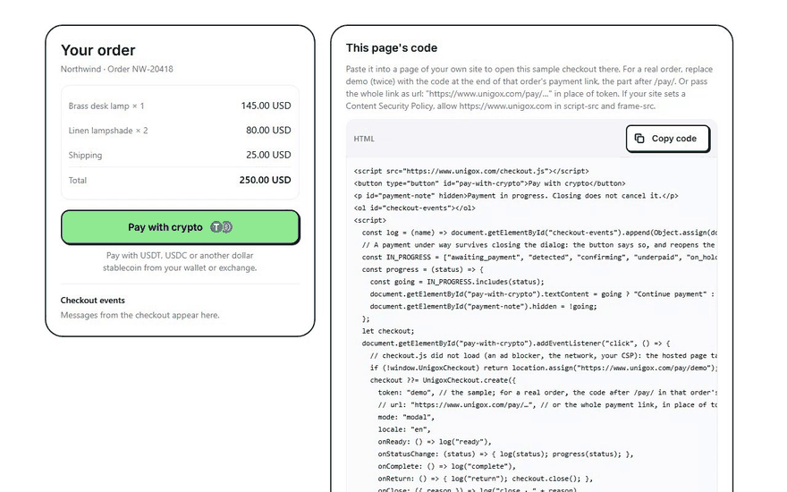

# Crypto processing: test and go live

> **Not available yet.** This page describes crypto processing ahead of its release. Until this notice is gone, `https://www.unigox.com/checkout.js`, the help pages and the link check it names can answer 404. Once released, crypto processing is in early access, turned on per business.

> **Crypto processing guide:** [Get started](https://developers.unigox.com/tutorials/crypto-checkout) · [Website checkout](https://developers.unigox.com/tutorials/crypto-checkout-embed) · [Confirm payments](https://developers.unigox.com/tutorials/crypto-checkout-confirm) · [Deposit pages and signed links](https://developers.unigox.com/tutorials/crypto-checkout-links) · **Test and go live** · [Reference](https://developers.unigox.com/tutorials/crypto-checkout-reference)

There is no test mode: a real order or link takes real money. Build your page against the samples, test your server on a test account, then make one small real payment.

## Test your page without money

Each sample is a real checkout page of a made-up merchant, fixed in one state. No sample has an address that can be paid. Open `https://www.unigox.com/pay/<id>`, or pass the id as the token: `UnigoxCheckout.create({ token: "demo-awaiting" })`. Every event a sample sends has `livemode: false`. In production, ignore every event whose `livemode` is not `true`.

On a sample that waits for a payment, **Send the payment (sample)** plays the payment through to the end. On an underpaid sample, **Send the rest (sample)** does the same. This way your page receives every event of a paid checkout.

| Id | Shows | Events your page receives |
| --- | --- | --- |
| `demo` | Start: the payer picks a coin and a network | `READY`, `CHOOSING` |
| `demo-link` | A payment link: no order number | `READY`, `CHOOSING` |
| `demo-awaiting` | The address and the amount to send (a sample address that nobody can pay) | `READY`, `AWAITING_PAYMENT`; after **Send the payment (sample)**: `PAYMENT_DETECTED`, then `PAID` (`onComplete`) |
| `demo-detected` | A transfer seen on the network | `READY`, `PAYMENT_DETECTED` |
| `demo-paid` | Payment completed | `READY`, `PAID` (`onComplete`) |
| `demo-underpaid` | Less than the amount: what came and what remains | `READY`, `UNDERPAID`; after **Send the rest (sample)**: `PAYMENT_DETECTED`, then `PAID` (`onComplete`) |
| `demo-overpaid` | More than the amount | `READY`, `OVERPAID` (`onComplete`) |
| `demo-expired` | The pay-by time passed with nothing received | `READY`, `EXPIRED` |
| `demo-late` | Paid after the pay-by time | `READY`, `PAID_LATE` (`onComplete`) |
| `demo-hold` | Received, under review by Unigox | `READY`, `ON_HOLD` |
| `demo-confirming` | A transfer confirming on the network | `READY`, `PAYMENT_DETECTED` with `status: "confirming"` |
| `demo-tolerance` | Paid within the tolerance: 249.10 of 250.00 USD | `READY`, `PAID` (`onComplete`) |
| `demo-parts` | Paid in two transfers | `READY`, `PAID` (`onComplete`) |
| `demo-incomplete` | Less than the amount, and the pay-by time has passed | `READY`, `UNDERPAID` with `status: "underpaid_closed"` |
| `demo-failed` | A transfer that was not completed | `READY`, `FAILED` |
| `demo-too-small` | A transfer below the network's minimum: not credited | `READY`, `FAILED` |
| `demo-refunding` | A transfer that Unigox support is sending back | `READY`, `FAILED` |
| `demo-refunded` | A transfer that was sent back | `READY`, `FAILED` |
| `demo-frozen` | Received and on hold after a review: not in the balance | `READY`, `ON_HOLD` |
| `demo-unreferenced` | Money that reached the address after the link closed | `READY`, `RECEIVED_WITHOUT_REFERENCE` |
| `demo-closed` | A link that was closed: a newer payment uses the address | `READY`, `CANCELLED` with `status: "closed"` |
| `demo-cancelled` | The payer cancelled on the page | `READY`, `CANCELLED` with `status: "cancelled"` |
| `demo-unavailable` | The checkout cannot reach Unigox right now: the address stays on screen and the status does not change | `READY`, `AWAITING_PAYMENT`, `UNAVAILABLE` (`onError` `CHECKOUT_UNAVAILABLE`); after **Send the payment (sample)**: `PAYMENT_DETECTED`, then `PAID` (`onComplete`) |
| `demo-preset` | A link that offers one coin on one network: the address straight away | `READY`, `AWAITING_PAYMENT`; after **Send the payment (sample)**: `PAYMENT_DETECTED`, then `PAID` (`onComplete`) |
| `demo-preset-coin` | A link that offers one coin: the payer picks only the network | `READY`, `CHOOSING` |
| `demo-detected-expired` | A transfer seen before the pay-by time, which has passed since | `READY`, `PAYMENT_DETECTED` |
| `demo-underpaid-60` | 60.00 of a 100.00 USD payment received | `READY`, `UNDERPAID`; after **Send the rest (sample)**: `PAYMENT_DETECTED`, then `PAID` (`onComplete`) |
| `demo-repeat` | Paid, then sent again: both transfers and the extra | `READY`, `OVERPAID` (`onComplete`) |
| `demo-topup` | A customer's deposit page | `READY`, `CHOOSING`, both with `mode: "topup"`; once a network is chosen, after **Send a deposit (sample)**: `PAYMENT_DETECTED`, then `DEPOSIT_CREDITED` (`onDeposit`), with `mode: "topup"` and `livemode: false` |
| `embed-demo` | A shop's order page with a **Pay with crypto** button, its code and the events it receives | |
<!-- samples:end -->

Any other id is treated as a link that cannot be read (`INVALID_LINK`, `onError` `TOKEN_INVALID`).

### A complete test run on the sample shop

**Developers → Test before you go live → Open the sample host page** opens `https://www.unigox.com/pay/embed-demo`. It is a shop's order page with a **Pay with crypto** button, the code behind the button and the events the page receives. Use it to see a whole integration before you write any code:

1. Press **Pay with crypto**. The checkout opens over the page.
2. Choose a coin and a network. The address and the amount appear.
3. Press **Send the payment (sample)**. The page shows **Payment detected**, then **Payment completed**.
4. Close the window. Under **Checkout events** the shop lists what its code received, in order: `ready`, each status (`choosing`, `awaiting_payment`, `detected`, `paid`), `complete` and `close`. **This page's code** next to it is the code that produced them: copy it as a starting point.

<figure><figcaption>
A test run on the sample shop: no real payment.
</figcaption></figure>

Then do the same on your own page with a sample id as the token, and check that your page reacts to each callback. While you build, your token function can answer a sample id instead of asking your server for an order: `token: async () => "demo-awaiting"`.

## Test your server on a test account

Ask for a test account under **Developers → Test before you go live → Ask for a test account**. A test account has its own portal, API address and checkout site. Unigox sends you all three with the account. In every example, use that checkout site in place of `https://www.unigox.com`. Your server creates the test account's orders at `https://api-staging.unigox.com`, with the API key of the test account's partner page, and signs `environment: "staging"` in requests signed with the wallet's key. Before you send anything, ask Unigox which networks and coins the test account accepts, and open **Crypto processing** in the test portal so it reserves addresses for orders.

First check your server's requests, which move no money:

1. **The same order twice:** create an order, then send the same `reference` and `amount` again. The second answer is `200` with the same `id`.
2. **Another amount:** the same `reference` with another `amount` answers `409 order_reference_conflict`.
3. **An order that runs out:** create one with `"expiresInMinutes": 5` and pay nothing. After 5 minutes it reads `expired`; the same `reference` then creates a new order with a new `id`.
4. **Close an order:** it reads `closed`, and its payment page no longer shows an address.
5. **A currency other than USD:** `"currency": "EUR"` answers `400` with `field` `currency`.

Then make small payments and check each result in three places: on the checkout page, in **Payments** and in your own order records:

6. **Exactly the amount:** the page shows **Payment completed**; the order reads `paid`, and your job marks your order paid once.
7. **Less, then the rest from another network:** the order reads `partly_paid`, then `paid`.
8. **More than the amount:** the order reads `overpaid`.
9. **Two transfers** that together make the amount.
10. **After the order's time:** a transfer sent more than 15 minutes after the order ended does not change the order, and **Payments** shows it under **Needs attention**.
11. **Close the window mid-payment**, pay, open it again: the same state.
12. **Close your page before the payment is credited**: your periodic job still finds the payment.
13. **Block the checkout** with `frame-src 'none'` in your policy: **Continue to secure checkout** opens the same payment.
14. **Unigox unreachable** (point your server's Unigox address at one that fails): your job logs the error, keeps running, and marks the order paid once Unigox answers.
15. **The same order checked twice at once:** it is marked paid and shipped once.

With payment links, also pay one after its pay-by date: the page shows **Payment arrived after the deadline**.

With deposit pages:

16. Send two small deposits on two networks: **Payments** shows both, and your ledger adds two credits.
17. Open the deposit page again: `onDeposit` reports both again, and your ledger adds nothing.
18. Archive the customer, then deposit: the money reaches your wallet without the customer's reference and is not added to their balance.

## Go live

- Your server creates orders at `https://api.unigox.com` with your production API key, and the key is only on your server.
- Every order your server creates carries `merchantName`, the name your customers know.
- You open **Crypto processing** in the portal often enough that orders find free addresses: see [Limits](https://developers.unigox.com/tutorials/crypto-checkout-reference#limits).
- If your server signs requests with your wallet's key: **Developers → Environment** shows **Production**, and your server signs `environment: "production"` against the production API address, with `callbackUrl: ""`.
- Your business is verified, or you know how much is left of the 1,000 USD you can receive before verification (the band at the top of every **Crypto processing** page).
- Every network you offer is ready for your addresses.
- Your job reads every order until it is final (15 minutes after its `closedAt`, and none of its payments `pending` or `on_hold`), so a payment that is credited after the order ended is still recorded. It passed tests 14 and 15.
- With deposit pages: your deposit job, or the person who credits deposits from **Payments**, runs as often as customers expect.
- If you hold your wallet's key, it is only in your secrets store.
- Your page ignores events whose `livemode` is not `true`.
- Your payment links carry your support email (**Settings → Support email for payers**, or `e` in a token your server makes).
- A production order's `payUrl` opens on `https://www.unigox.com/pay/…` and shows its addresses, and your `checkout.js` and Content-Security-Policy name `https://www.unigox.com`.
- One small real payment passed tests 6 and 12.
